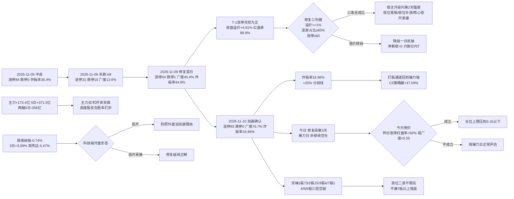

# 2026-11-11 · **风格研判**

> **数据源新鲜度**: partial（主源 tushare 全量 ok，外盘与跨资产缺一线）
> **降级状态**: true —— 缺口在跨资产（商品 skipped、汇率单点）与两融滞后，A 股风格/涨停/广度主源无一缺失
> **置信度**: 0.472（0.70 × 0.75 × 0.90）

## 一句话结论

**连板情绪型 + 情绪浓度 71.9（贪婪档）+ 三主线以上（代理 6 条），仓位上限 70%**。今日是**修复段第 3 个交易日（修复首日 2026-11-09，T-1 加速确认）＝修复确认后的接力日**：T-1 涨停 93 / 跌停 0 / 炸板率 16.96% / 昨日涨停收盘溢价 +4.91% / 涨家占比 76.7% / 再涨停 19 只，赚钱效应三条判据全部成立，**不是二次验证、也不是继续空仓**——但溢价已抬到 +4.91%、成本抬高，只做低位首板、低位补涨与主线核心的低开承接，**不追连续加速的高位二波、不接 7 板以上独苗**。

---

## 一、情绪周期位置：修复段第 3 个交易日（接力日）

先回答「第几天」，再谈风格——阶段标签本身不驱动决策，**第几天 + 对应打法**才能。

| 项 | 读数 | 含义 |
|---|---|---|
| `cycle_position.cycle_day` | **0**（as of 2026-11-10 收盘） | 已**不在杀跌序列内**（连跌 0 天 / `neutral`） |
| `consecutive_down_days` | **0** | 上一杀跌段 2026-11-06（连跌 1 天：跌停 15、广度 0.136）已于 2026-11-09 修复 |
| `recent_run` | 杀跌段 11-06 → 修复日 **11-09**（涨停 54、广度 0.4023、中位 −0.31%）→ **11-10 加速确认**（涨停 93、跌停 0、广度 0.7667、中位 +1.31%、炸板率 16.96%） | 今日 = `repair_session_no_today = 3`，**修复段第 3 个交易日** |
| `emotion_cycle.phase` | `main_up`（主升 · confidence 0.85） | 溢价 +4.11% ≥ +3% 且连板高度 7 ≥ 5 且炸板率 17.0% < 25% → 赚钱效应 + 高度共振无分歧 |
| `main_down` 的读法 | **修复窗口，不是继续空仓** | 上一轮（11-06）`main_down` 语义 = 等承接；本轮已进入修复段第 3 天，`cycle_day=0` 表示不在杀跌序列，**阶段只定温度，不预设固定打法** |

**修复段第 3 天的打法（四条，逐条可执行）**：

1. **接力日：只做低位首板、低位补涨与主线核心的低开承接**。修复首日（11-09）涨停 54 → T-1（11-10）涨停 93（+72%），昨日 54 家涨停股收盘溢价 +4.91%、红盘率 88.9%、再涨停 19 只——**赚钱效应三条判据（溢价 >+1% ✓、涨家占比 ≥60% ✓、涨停 ≥60 ✓）全部成立**，今日按主升段内第 2 天的强度处理。
2. **不追连续加速的高位二波、不接 7 板以上独苗**：最高 7 板独苗，下方 4/5/6 板**三层空缺**，高度无法自然递推，反包只按一次性脉冲处理、不做第二波假设。
3. **竞价是唯一硬闸门**：若今日昨日涨停集合竞价红盘率跌破 50% 或广度跌回 0.55 以下，即降级为一日反抽、当日只做日内 T，净新增归零。
4. **两融仍在退潮**：两融 5 日 −356 亿（−1.55%），杠杆资金没有同步进场——高度股反包胜率下降，低位方向优先。

**口径保留**：`cycle_position.samples` 两条历史实例（2026-10-27、2026-10-30）都是**连跌 2 天**后的修复，而本轮只连跌 1 天——**样本不同口径，不能直接当概率用**。它们的价值只有一个：说明「连跌后 1–2 日内出现过广度 >0.74 的修复」，不构成今日必然延续的证据。

| 交易日 | 涨停 | 跌停 | 炸板率 | 广度 | 中位 | 定性 |
|---|---:|---:|---:|---:|---:|---|
| 2026-11-04 | 118 | 9 | 21.85% | 83.8% | +1.88% | 二次修复确认 |
| 2026-11-05 | 84 | **0** | 36.36% | 87.4% | +2.02% | 冲高（涨停缩量、炸板率抬升） |
| 2026-11-06 | **32** | **15** | 30.43% | **13.6%** | −1.85% | **杀跌（kill）** |
| 2026-11-09 | 54 | 1 | **44.90%** | 40.4% | −0.35% | **修复首日（未完全确认）** |
| 2026-11-10 | **93** | **0** | **16.96%** | **76.7%** | **+1.37%** | **加速确认（修复成立）** |
| 2026-11-11 | ？ | ？ | ？ | ？ | ？ | **修复段第 3 天 · 接力日** |

---

## 二、详细分析

### 2.1 结构读数：炸板率 44.9% → 16.96%，修复被 T-1 完整确认

2026-11-10 全市场涨停 **93** 家（前日 54，**+72%**）、跌停 **0** 家、炸板 **19** 家，炸板率从 44.90% 大幅回落到 **16.96%**；涨 **4003** / 跌 **1073** / 平 142，广度 **76.7%**，中位 **+1.37%**，成交额 **15046 亿（+1.49%）**。

连板天梯：**1 板 73 家 / 2 板 15 家 / 3 板 4 家 / 7 板 1 家**，最高 **7 板**、**4/5/6 板三层空缺**，首板占比 **78.5%**。

- **修复被确认的证据是「炸板率 + 跌停家数 + 广度」三件一起转**：炸板率 44.9% → 16.96%（<25% 分歧线）、跌停 15 → 0、广度 13.6% → 76.7%。这是 11-06 杀跌以来第一次三项同时进入健康区。
- **但梯队仍有缺口**：7 板独苗下方 4/5/6 板**三层空心**——高度是「跳级」上来的，任何高位股的反包都缺接力盘支撑，所以高位二波一律不假设。
- **指数层面权重滞涨**：上证 **+0.08%** / 沪深300 **+0.07%** 几乎走平，而创业板 **+1.46%** / 中证500 **+0.91%** / 深成 **+0.86%** 明显更强——**赚钱效应在题材与中盘，不在权重**，这符合「连板情绪型」而非「主线扩散型」。

**崩溃三判据核验（三项须同时成立）**：炸板率 >50% → **否（16.96%）**；跌停 ≥30 家或涨家占比 <25% → 跌停 0 家、涨家占比 76.7%，**否**；指数 ≤−1% → **否**。**三项全部不成立 → 崩溃退潮型被排除**，且风格表与情绪周期阶段一致，无需覆盖。

### 2.2 溢价拆解：昨日涨停兑现强，接力层活着

T-1（2026-11-09）的 54 家涨停股在 2026-11-10 的表现：

| 口径 | 均值 | 中位 | 含义 |
|---|---:|---:|---|
| 开盘溢价 | +4.11% | +3.61% | 竞价直接给正溢价 |
| 收盘溢价 | **+4.91%** | **+4.43%** | 全天维持正兑现且**比开盘更高** |
| 红盘率 | **88.9%** | — | 近九成红盘 |
| 再涨停 | **19 只 / 54** | — | 35.2% 的接力成功率 |

**均值与中位同步为正且收盘 > 开盘**（+4.91% / +4.43%），说明 11-10 的兑现是**普涨性 + 盘中继续走强**——打板通道在 11-09（溢价 +4.17%）之后连续第二天为正，**修复三判据（溢价 >+1%、涨家占比 ≥60%、涨停 ≥60）全部成立**，这是本轮给 70% 而非 40% 的结构依据。

**但成本已经抬高**：+4.91% 的收盘溢价意味着今日接力要在「昨日涨停 +5%」的基线上再赚，**追高位的期望被抬高了**——所以打法限定在低位首板 / 低位补涨 / 主线核心低开承接。

### 2.3 30 日 6 簇：高 beta 巨簇继续收缩，策略腿回到 +47%

窗口 **2026-09-30 → 2026-11-10**（30 个收益日，42 个样本 = 22 风格板块 + 20 ETF），1−Pearson 距离 + Ward linkage，k=6：

| 簇 | n | 30日 | 5日 | 末日 | 回撤 | 簇内相关 | 与宽基相关 | 构成 |
|---|---:|---:|---:|---:|---:|---:|---:|---:|---|
| C5 | 4 | **+47.09%** | +7.81% | +0.63% | −9.4% | 0.344 | 0.086 | 极端接力策略指数（打二板以上 / 非ST三板以上）+ 证券 ETF + 消费 ETF |
| C6 | 3 | **+9.84%** | +1.66% | +1.28% | −8.4% | 0.202 | −0.138 | 非ST二板策略 + 银行 ETF + 煤炭 ETF |
| C3 | 6 | −7.27% | **+6.85%** | **+3.60%** | −16.7% | 0.793 | 0.660 | 百日新高、同花顺热股、昨日高振幅、高贝塔值、昨日打板、昨日打首板 |
| C2 | 8 | −9.23% | +3.33% | +0.36% | −14.2% | 0.714 | 0.772 | 行业龙头、沪深300、上证50、恒生科技、光伏ETF、新能源、有色ETF、房地产 |
| C4 | 3 | −13.43% | +2.33% | +2.86% | −19.5% | 0.405 | 0.479 | 创历史新高、昨日资金前十、医药ETF |
| C1 | **18** | **−22.26%** | +6.68% | +1.52% | **−27.6%** | **0.871** | **0.918** | 近端次新、百元股、成交前十、沪深股通前十、增发/增持/减持/回购/扭亏、中证500/1000、科创50、通信/芯片/半导体/军工 ETF |

42 个样本 30 日中位 **−11.64%**、正收益 **9/42（21.4%）**；**5 日中位转正 +4.96%**（39/42 上涨）；末日（11-10）**35 涨 / 7 跌**、中位 **+1.27%**。

**这组数字的读法**：

- **C1 从 n=20 缩到 n=18、30 日 −22.26%**，仍是簇内相关 0.871、与宽基相关 0.918 的高 beta 巨簇——它代表「同一批筹码的重仓方向」，不是分散的多个风格。**但 C1 内部 5 日 +6.68%、末日 +1.52% 连续两日为红**：修复的微观信号在累积。
- **C5 策略腿回到 +47.09%**（极端接力策略 + 证券/消费 ETF）：30 日窗内最赚钱通道依然是「打二板以上 / 非ST三板以上」，且 T-1 炸板率降到 16.96%——**该通道从兑现端回到接力端**，这是与 11-09（44.90% 炸板率时判「通道不进」）最大的不同。
- **C3 是「打板行为 + 高弹性」腿**：百日新高、同花顺热股、高贝塔值、昨日打板/打首板聚在一簇，末日 +3.60% 领涨——修复日资金回补弹性端，但簇内相关 0.793 说明这是**同一类行为资金**，不是分散验证。
- **防御端（银行/煤炭/消费 ETF）落 C6/C5 正收益侧**：30 日尺度上「避险 + 极端博弈」两端格局未变，但防御端 5 日只有 +1.66%——**已经不是领先腿了**。

### 2.4 30 日 vs 5 日 vs 末日：策略腿 + 弹性腿同向，高 beta 巨簇仍负

| 维度 | 强的一端 | 读数 | 解释 |
|---|---|---|---|
| **30 日（09-30 → 11-10）** | 防御 / 策略 | C5 +47.09%、C6 +9.84%；42 样本中位 −11.64% | 两个月里资金在 **避险 + 极端博弈** 两端 |
| **5 日（11-04 → 11-10）** | 高 beta 回补 | C1 内部 5 日 +6.68%、C3 +6.85%、全样本中位 **+4.96%** | 一周里资金在**超跌回补端** |
| **末日（11-10）** | 打板行为端 | C3 末日 +3.60%、C4 +2.86%；全样本 35 涨 / 7 跌、中位 **+1.27%** | 修复确认日**资金全面回补弹性与打板端** |

与 11-09 不同，今天**5 日与末日深度同向**（都是回补），策略腿 C5 也从兑现端回到接力端。**但 30 日中位仍 −11.64%、正收益仅 9/42**——结构性下跌未完全结束，正收益样本数要到 1/3（14/42）以上才算趋势反转；在此之前，**修复的延续性仍按日验证**。

### 2.5 外盘：隔夜微跌回吐，但纳指 3 日 +3.09% 已转正

| 资产 | 2026-11-10 | 5 日 | 20 日 | 读法 |
|---|---:|---:|---:|---|
| 纳指 | **−0.74%** | +0.35% | **−7.31%** | 隔夜小幅回吐，但 **3 日累计 +3.09%**（11-06 +1.09% → 11-09 +2.74% → 11-10 −0.74%）——外盘科技已从 3 日净跌转为净涨 |
| 标普500 | −0.38% | +0.11% | −3.30% | 同步小幅回吐 |
| 道指 | −0.30% | — | — | 滞涨 |
| 费城半导体 | −0.35% | — | — | 半导体回吐但幅度极小 |
| 纳斯达克100 | −0.60% | — | — | — |
| 恒生指数 | +0.44% | **+4.38%** | **+1.18%** | 亚太里唯一 20 日为正 |
| 韩国综合 | +4.39% | −7.25% | −13.19% | 单日强反抽，20 日仍深跌 |
| 日经225 | — | −4.16% | −12.42% | 弱 |

个股（2026-11-10 收盘）：**英伟达 −5.47%**（隔夜最大回吐）、微软 −2.2%、美光 −1.1%、康宁 −3.29%；但**博通 +3.91%、台积电 +2.02%、AMD +1.3%、高通 +1.2%、亚马逊 +1.48%**——半导体内部分化，不是一致下跌。

**读法**：隔夜美股微跌是 11-09 强反抽（费半 +6.85%）后的正常回吐，**纳指 3 日 +3.09% 已转正**，外盘对 A 股科技端的压制解除；但**英伟达 −5.47%** 说明美股 AI 权重股仍在高位震荡，映射到 A 股是「科技方向有支撑、但不是单边做多」。对今日的意义：**高开可接受、但别把外盘当继续加速的理由**。

### 2.6 资金：主力转正第二日 +173.4 亿，两融仍在退潮

| 口径（2026-11-10，东财 DC，与 R7 同源） | 数值 | 读法 |
|---|---:|---|
| 主力净额 | **+173.4 亿**（净流入率 +1.14%） | 主力连续第二日净流入（11-09 +128.8 亿 → 11-10 +173.4 亿），**派发结束的概率上升** |
| 主力 5 日累计 | **+371.5 亿** | 5 日已转正——11-06 派发（−528.5 亿）被两日回补基本覆盖 |
| 两融余额（2026-11-09，T+1） | 22670 亿 · 5 日 **−356.2 亿（−1.55%）** | **杠杆仍在退**——主力在买、杠杆在卖，高度股反包缺杠杆接力 |

**结构读法**：11-10 是主力买（+173.4 亿）、两融卖（5 日 −356 亿）——**主动资金回补与杠杆退潮并存**。修复段的资金指纹成立（主力连续为正），但杠杆端缺席意味着**修复靠存量资金、不是增量杠杆**，高度股的反包胜率仍要打折。今日第一条观察量：**主力是否连续第三日为正、两融是否止跌**。

### 2.7 风格归因：五分法代价表

| 风格 | 代价 | 判据落点 |
|---|---:|---|
| **连板情绪型** | **0.00** ✅ | 涨停 93 ≥ 50（✓）、最高 7 板 ≥ 6（✓）、炸板率 16.96% < 20%（✓）——**三项全满足** |
| 主线扩散型 | 1.26 | 涨停 93 > 50 上界，且概念 ≥20 家 6 条（有梯队但涨停总数超阈值） |
| 崩溃退潮型 | 2.7409 | 三判据全部不成立（见 2.1） |
| 震荡分化型 | 3.0847 | 涨停 93 远超 20–40 区间、且炸板率已回落 |
| 防御观望型 | 3.8374 | 涨停 93 ≥ 20、成交额 +1.49% 未缩量，指数未走平 |

**取「连板情绪型」的理由必须写死**：三项判据（涨停 ≥50、高度 ≥6、炸板率 <20%）**全部命中且无任何反例**——这与 11-09 不同（当时炸板率 44.90% 判连板情绪型会被打脸，所以取震荡分化型）；今天把市场写成连板情绪型，等于告诉 D1「打板通道的期望已回到正值」，且 T-1 溢价 +4.91%、再涨停 19 只**实证了这条通道**。

**与情绪周期的联动**：`emotion_cycle=main_up` 与「连板情绪型」**一致**，无需阶段覆盖；按「阶段优先」原则，仓位在风格基准 0.70 之上**微调**，见第五节。

### 2.8 推理深度三问（top 对象：今日的「修复段第 3 天 · 接力日」结构）

- **大资金意图**: 主力连续第二日净流入（+173.4 亿，5 日 +371.5 亿）回补**超跌弹性端**（C3 打板行为端末日 +3.60%、C1 高 beta 巨簇末日 +1.52% 连续两日微红）；对手盘是退潮中的杠杆盘（两融 5 日 −356 亿）与兑现中的获利盘。**意图是「修复已确认后的低位补量」——买低位、不追高位**。
- **为什么走强**: 位置（C1 高 beta 巨簇 30 日 −22.26% 超跌）给了弹性，修复首日（11-09）的兑现（溢价 +4.17%）给了信心，T-1（11-10）炸板率 44.9% → 16.96%、广度 13.6% → 76.7% 把「承接断裂」修成了「承接健康」——**三个独立信号（涨停 +72%、跌停归零、炸板率腰斩）同日共振**。
- **逻辑够不够硬**: **够 1 天、不够一周**。独立源三条：①炸板率 16.96% + 跌停 0 + 广度 76.7% 全面健康（✓）②昨日涨停收盘溢价 +4.91%、再涨停 19 只（✓ 实证接力通道）③主力 5 日 +371.5 亿但两融 5 日 −356 亿（△ 主力与杠杆背离）。证伪路径很明确：**今日竞价昨日涨停红盘率 <50%、或广度跌回 0.55 以下、或炸板率再上 45%，则「修复段第 3 天 · 接力日」被证伪，净新增归零、只留存量 T**；反之若收盘广度维持 0.60 以上且昨日涨停红盘率过半，修复延续成立。

---

## 三、结构传导图

---

## 四、今日执行框架（思维链四段）

R1 不出个股与买卖点，此处的「对象」是**今日唯一可执行的观察位**：低位首板 / 低位补涨 / 主线核心低开承接（修复段第 3 天 · 接力日）。

- **买入理由**：① 周期锚 —— 修复段第 3 天（`repair_session_no_today=3`）语义是「接力日」而非「重新验证」，T-1 三项判据（涨停 93、广度 76.7%、炸板率 16.96%）全部成立；② 通道锚 —— 昨日涨停收盘溢价 +4.91%、再涨停 19 只，打板通道连续第二天正兑现，C5 策略腿 30 日 +47.09% 是唯一持续正收益通道；③ 位置锚 —— C1 高 beta 巨簇 30 日 −22.26%、5 日 +6.68%，修复日资金回补弹性端动作已出现。
- **风险点**：① 短期 —— 收盘溢价已抬到 +4.91%，**追高位的成本抬高**，任何「开盘追连续加速」在当日都是负期望；② 中期 —— 两融 5 日 −356 亿（−1.55%），杠杆缺席的修复靠存量资金，高度股反包胜率打折；30 日样本正收益仅 9/42，结构性下跌未完全结束。
- **止损条件**：以 **竞价与盘初承接** 为条件式止损 —— 若昨日涨停集合竞价红盘率跌破 50% 或 10:00 前广度 <0.55，则**当日净新增归零**（等于区间止损）；已成交的低位试错位，破当日分时均价且 15 分钟内不收复即出，**不留过夜幻想**；7 板以上独苗若分歧放量，当日不做任何触碰。
- **可验证假设**（24–72h 内可证真/证伪）：**H1** 今日收盘广度 ≥0.60 且昨日涨停红盘率 ≥60% → 「修复延续」成立；**H2** 炸板率全天 ≤35%（不触发减半线）→ 打板通道保持接力端；**H3** 主力净额连续第三日为正 → 派发彻底结束。三条中 **≥2 条成立**才把明日的额度从「70%」维持到「常规进攻」；若 H1 证伪则回到 40% 以下。

---

## 五、仓位上限推导：70%

| 步骤 | 调整 | 数值 | 依据 |
|---|---|---:|---|
| 风格基准 | — | 0.70 | 连板情绪型（涨停 ≥50 + 高度 ≥6 + 炸板率 <20% 全命中） |
| 情绪档 | **+0.05** | 0.75 | 情绪 71.9 落**贪婪**档（60–80） |
| 周期阶段 | **+0.05** | 0.80 | `main_up` 主升，风险预算可放宽 |
| 30 日宽度 | **−0.05** | 0.75 | 中位 −11.64%、正收益仅 9/42 |
| 修复段折扣 | **−0.05** | **0.70** | 修复段第 3 个交易日（T-1 加速确认、修复已成立，但接力日成本已抬高 −0.05） |
| **合计** | | **0.70** | 未触发主跌/退潮下限，无需下限托底 |

**70% 不是「可以买七成」**，而是**净新增风险预算的上限**：其中实际可用额度还需过「竞价闸门」（昨日涨停红盘率 ≥50%、广度 ≥0.55），未成立时**净新增 = 0**，70% 只覆盖存量调仓与日内 T。

---

## 六、关键证据

- 🟢 涨停 **93** / 跌停 **0** / 炸板 **19** → 炸板率 **16.96%**（`tushare.limit_list_d` 2026-11-10）
- 🟢 天梯 1板73 / 2板15 / 3板4 / 7板1，最高 **7 板**、**4/5/6 板三层空缺**、首板占 **78.5%**
- 🟢 T-1 54 家涨停股：开盘溢价均值 +4.11%（中位 +3.61%）、收盘 **+4.91%**（中位 **+4.43%**）、红盘率 **88.9%**、再涨停 **19** 只
- 🟢 广度 涨 **4003** / 跌 **1073** / 平 142，中位 **+1.37%**，成交额 **15046 亿（+1.49%）**
- 🟢 指数 上证 +0.08% / 深成 +0.86% / 创业板 **+1.46%** / 科创50 +0.64% / 沪深300 +0.07% / 中证500 +0.91% / 北证50 +0.75%
- 🟢 主力净额 **+173.4 亿**（净流入率 +1.14%）、5 日 **+371.5 亿**（连续第二日为正）
- 🟡 两融 22670 亿（2026-11-09，T+1）、5 日 **−356.2 亿（−1.55%）**
- 🟢 30 日窗（09-30 → 11-10）：42 样本中位 **−11.64%**、正收益 **9/42**、末日 35 涨 / 7 跌、末日中位 **+1.27%**
- 🟢 6 簇：C1（n=18）30 日 −22.26%、簇内相关 0.871、与宽基 0.918；C5 策略腿 **+47.09%**；C3 打板行为端末日 **+3.60%**
- 🟢 隔夜美股（2026-11-10）：纳指 −0.74% / 费半 −0.35% / 道指 −0.30%，**纳指 3 日 +3.09%**；英伟达 **−5.47%**、博通 +3.91%、台积电 +2.02%
- 🟢 情绪周期：`cycle_day=0`、连跌 0 天、`neutral`、**修复段第 3 个交易日**、阶段 `main_up`（0.85）
- 🟢 概念代理（非 R2 判定）：行业 ≥8 家涨停 **1 条**；概念 ≥8 家 **20 个**、≥20 家 **6 个**；第一概念 34 家（前日 16，+18）、5 日龄、当日 +2.71%
- 🟡 文本侧：群聊 0 条、公众号 84 篇未做方向性摘要——**文本维度本轮不参与证据链**，未对置信度加分

---

## 七、数据源审计

| 源 | 日期 | 状态 | 备注 |
|---|---|:--:|---|
| tushare/ths_daily + ths_member | 2026-11-10 | 🟢 | 22 条风格板块 · 41 个交易日 K 线 |
| tushare/fund_daily | 2026-11-10 | 🟢 | 20 条 ETF · 41 个交易日 K 线 |
| r1_style_cluster.py | 2026-11-11 | 🟢 | 42 样本 · 30 日窗 · 6 簇 · 缺失样本 0 |
| tushare/limit_list_d + limit_step | 2026-11-10 | 🟢 | 涨停 93 / 跌停 0 / 炸板 19 逐票 |
| tushare/index_daily | 2026-11-10 | 🟢 | 7 个指数 |
| tushare/limit_cpt_list | 2026-11-10 | 🟢 | 概念代理 20 条 |
| tushare/daily（全市场广度） | 2026-11-10 | 🟢 | 5218 只 |
| R7_capital_flow（东财 DC 主力/两融） | 2026-11-10 | 🟢 | 主力净额 +173.4 亿 · 两融 22670 亿 · 20 日序列 |
| sina gb_ + eastmoney push2his（外盘补齐） | 2026-11-10 | 🟢 | 5 个指数 + 15 只半导体/科技股 |
| tushare/index_global + us_daily | 2026-11-09 | 🟡 | 美股最新只到 11-09，隔夜 11-10 由 sina/东财补齐 |
| tushare/fx_daily | 2026-11-09 | 🔴 | DXY 空返回，仅保留单点 USDCNH 6.6680 |
| 商品（原油/铜/金） | — | 🔴 | `commodities=skipped`，跨资产三档坐标无法建立 |
| wechat_official_rss（18 源） | 2026-11-11 | 🟢 | 84 篇 · 未做方向性摘要 |
| wechat_cli_groups（焦点群，匿名） | 2026-11-11 | 🔴 | 0 字节 · 抓取窗口内无消息 |
| cycle_position.py / emotion_cycle.py | 2026-11-10 | 🟢 | 12 个交易日序列 · 修复段第 3 日 · 同口径样本 2 条 |

---

## 八、不确定性 / 反证

1. **「接力日」可能过度乐观**：昨日涨停收盘溢价 +4.91% 是强兑现，但**成本已抬**——若今日竞价即高开 2% 以上，则接力盘没有低吸空间，高位开盘反而容易诱多；我在执行框架里把「竞价红盘率 ≥50%、广度 ≥0.55」写成硬闸门，不满足即降级。
2. **样本口径不严**：`cycle_position.samples` 两条历史都是「连跌 2 天 → 修复」，本轮只连跌 1 天。**不能把它当概率表**，我只用于说明「连跌后 1–2 天出现过广度 >0.74 的修复」，未据此上调仓位。
3. **两融与主力背离是最大中期隐患**：主力 5 日 +371.5 亿、两融 5 日 −356 亿——**杠杆缺席的修复靠存量资金**。若两融继续收缩，高度股反包与高位二波的胜率会快速下降，修复只靠低位补涨支撑，70% 上限要给到低位方向。
4. **C1 高 beta 巨簇仍是负收益主体**：30 日 −22.26%、正收益样本仅 9/42——**结构性下跌未完全结束**。若今日高 beta 端（C1 内部）再度放量下跌，则「修复延续」被证伪，应直接按一日反抽处理（炸板率再上 45% 即触发）。
5. **文本侧完全缺失**：群聊 0 条、公众号 84 篇未做方向性摘要——**游资情绪的真实温度这一维是缺的**，因此 agreement factor 只取 0.90（未加分），confidence 0.472 偏保守，不是偏乐观。

---

## 九、与其他 R/D/E 的关系

- **依赖**: `data/raw/20261111/style_snapshot.json`（22 板块 + 20 ETF）、`data/research/20261111/_r1_cluster.json`、`_r1_market.json`、`cycle_position.json`、`emotion_cycle.json`、`R7_capital_flow_20261111.json`、`_r1_overseas_fill.json`
- **被消费**:
  - **R2 主线**: `style=连板情绪型`、`main_lines_count=6`（三主线以上·代理）→ R2 按代理口径有 6 条候选主线（概念 ≥20 家），须在真实判定中确认或剔除；R2 仍须按已有证据筛选研究观察对象，无合格对象允许为空
  - **R3 情绪**: `sentiment_score=71.9` 作基准（可自算覆核；若 R3 与 R1 差 >15 分需在 R3 侧说明）
  - **R6 反证**: 对 R2 主线数量与 R1「三主线以上（代理）」的一致性做反证；R1 的 71.9 分与 R3 若差 >15 分需在 R3 侧说明
  - **D1 预案**: `position_cap_suggestion=0.70` → exec_pool 总仓上限；`emotion_cycle_action` 提供「修复段第 3 天 · 接力日」唯一入口；炸板率 16.96% < 35% 不触发候选数减半，但 4/5/6 板空缺 → 高位二波不做假设
- **边界**: R1 不推板块、不推个股、不给买卖点；本文出现的簇构成与概念代理仅为**统计口径描述**，不构成任何板块或 ETF 的交易建议。

---

## Sub-Agent 元数据

- skill: `analyze_style_v1@1.0`
- artifact: `data/research/20261111/R1_style.json`
- 生成耗时: 管线产物 06:41–06:46 完成；本次会话复用已落盘结果做契约校验与人读交付
- model: deepseek-v4-flash
- 校验: pydantic `research_unit_v1` 通过；`style` 落 5 枚举之一（连板情绪型）；`sentiment_score` 5 维加权（权重归一 1.00）；`cycle_position` 嵌入（第 0 天 / neutral / 修复段第 3 个交易日）；`status=degraded` 因跨资产与两融缺口，置信度 0.472
