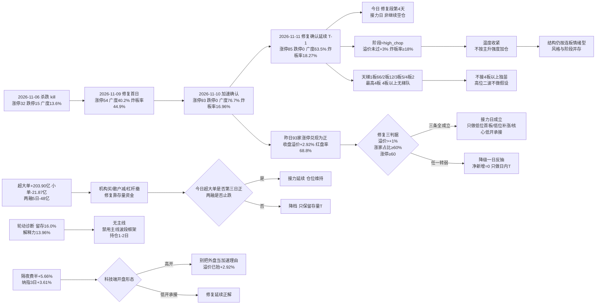

# 2026-11-12 · **风格研判**

> **数据源新鲜度**: partial（主源 tushare 全量 ok，外盘与跨资产缺一线）
> **降级状态**: true —— 缺口在跨资产（商品 skipped、汇率单点）与两融 T+1 滞后，A 股风格/涨停/广度/资金主源无一缺失
> **置信度**: 0.472（0.70 × 0.75 × 0.90）

## 一句话结论

**连板情绪型 + 情绪浓度 70.3（贪婪档）+ 无主线（轮动结构），仓位上限 60%**。今日是**修复段第 4 个交易日（修复首日 2026-11-09，T-1 加速确认）＝修复确认后的接力日**：T-1 涨停 85 / 跌停 0 / 炸板率 18.27% / 昨日涨停收盘溢价 +2.92% / 涨家占比 67.2% / 再涨停 19 只，赚钱效应三条判据全部成立，**不是二次验证、也不是继续空仓**——但溢价已抬到 +2.92%、成本抬高，且**阶段判为高位震荡（打板赚钱效应没跟上数量）**，只做低位首板、低位补涨与主线核心的低开承接，**不追连续加速的高位二波、不接 4 板以上独苗**。

---

## 一、情绪周期位置：修复段第 4 个交易日（接力日）

先回答「第几天」，再谈风格——阶段标签本身不驱动决策，**第几天 + 对应打法**才能。

| 项 | 读数 | 含义 |
|---|---|---|
| `cycle_position.cycle_day` | **0**（as of 2026-11-11 收盘） | 已**不在杀跌序列内**（连跌 0 天 / `neutral`） |
| `consecutive_down_days` | **0** | 上一杀跌段 2026-11-06（连跌 1 天：跌停 15、广度 0.136）已于 2026-11-09 修复 |
| `recent_run` | 杀跌段 11-06 → 修复日 **11-09**（涨停 54、广度 0.4023、中位 −0.31%）→ **11-11 加速确认**（涨停 85、跌停 0、广度 0.6347、中位 +0.59%、炸板率 18.27%） | 今日 = `repair_session_no_today = 4`，**修复段第 4 个交易日** |
| `emotion_cycle.phase` | `high_chop`（高位震荡 · confidence 0.72） | 涨停 85 ≥ 50 但溢价 +2.01% 未达 +3% 且炸板率 18.27% ≥ 18% → 涨停多但打板不赚钱（高位钝化） |
| `main_down` 的读法 | **修复窗口，不是继续空仓** | 上一轮（11-06）`main_down` 语义 = 等承接；本轮已进入修复段第 4 天，`cycle_day=0` 表示不在杀跌序列，**阶段只定温度，不预设固定打法** |

**修复段第 4 天的打法（四条，逐条可执行）**：

1. **接力日：只做低位首板、低位补涨与主线核心的低开承接**。修复首日（11-09）涨停 54 → T-1（11-11）涨停 85（+57%），昨日 93 家涨停股收盘溢价 +2.92%、红盘率 68.8%、再涨停 19 只——**赚钱效应三条判据（溢价 >+1% ✓、涨家占比 ≥60% ✓、涨停 ≥60 ✓）全部成立**，今日按**修复段第 4 天**的强度处理。
2. **但按高位震荡温度执行，不按主升强度加仓**：阶段读数 `high_chop` 明确「净新增风险预算收紧、存量按 T 与分批处理」——**结构仍按连板情绪型读，仓位以阶段为准**。溢价抬到 +2.92% 后追高位的期望被抬高，所以只做低位。
3. **不追连续加速的高位二波、不接 4 板以上独苗**：最高仅 4 板、**4 板以上无梯队**（1 板 66 / 2 板 12 / 3 板 5 / 4 板 2），高度无法自然递推，反包只按一次性脉冲处理、不做第二波假设。
4. **竞价是唯一硬闸门**：若今日昨日涨停集合竞价红盘率跌破 50% 或广度跌回 0.55 以下，即降级为一日反抽、当日只做日内 T，净新增归零。

**口径保留**：`cycle_position.samples` 仅一条历史实例（2026-10-30 连跌 2 天 → 2026-11-02 涨停 125、广度 0.8402 修复），而本轮只连跌 1 天——**样本不同口径且只有 1 条，不能当概率表用**。它的价值只有一个：说明「连跌后出现过广度 >0.84 的修复」，不构成今日必然延续的证据。

| 交易日 | 涨停 | 跌停 | 炸板率 | 广度 | 中位 | 定性 |
|---|---:|---:|---:|---:|---:|---|
| 2026-11-05 | 84 | 0 | 36.36% | 87.4% | +2.02% | 冲高（涨停缩量、炸板率抬升） |
| 2026-11-06 | **32** | **15** | 30.43% | **13.6%** | −1.87% | **杀跌（kill）** |
| 2026-11-09 | 54 | 1 | **44.90%** | 40.2% | −0.31% | **修复首日（未完全确认）** |
| 2026-11-10 | **93** | **0** | **16.96%** | **76.7%** | **+1.31%** | **加速确认（修复成立）** |
| 2026-11-11 | 85 | 0 | 18.27% | 63.5% | +0.59% | **修复确认延续**（T-1） |
| 2026-11-12 | ？ | ？ | ？ | ？ | ？ | **修复段第 4 天 · 接力日** |

---

## 二、详细分析

### 2.1 结构读数：涨停 85 家，梯队从「7 板独苗」回落到「4 板封顶」

2026-11-11 全市场涨停 **85** 家（前日 93，−8.6%）、跌停 **0** 家、炸板 **19** 家，炸板率 **18.27%**；涨 **3381** / 跌 **1647** / 平 191，广度 **67.2%**，中位 **+0.68%**，成交额 **16761 亿（+11.40%）**。

连板天梯：**1 板 66 家 / 2 板 12 家 / 3 板 5 家 / 4 板 2 家**，最高 **4 板**、首板占比 **77.6%**。

- **炸板率维持在分歧线下方**（18.27% < 25%），承接没有断——这是修复成立的硬条件，比涨停家数本身更重要。
- **但高度掉了 3 板**：11-10 的 7 板独苗（T-1 序列最高 7 板、4/5/6 板三层空缺）今天只到 4 板，且 4 板仅 2 家。**从「7 板独苗 + 4/5/6 空缺」变成「4 板封顶 + 4 板 2 家」——高度是被打下来的，不是自然长上去的**。
- **指数层面权重滞涨、成长强**：上证 **+0.46%** / 沪深300 **+0.41%** 几乎走平，而创业板 **+3.11%** / 科创50 **+2.80%** / 深成 **+1.32%** 明显更强——**赚钱效应在成长与题材，不在权重**，这符合「连板情绪型」而非「主线扩散型」。

**崩溃三判据核验（三项须同时成立）**：炸板率 >50% → **否（18.27%）**；跌停 ≥30 家或涨家占比 <25% → 跌停 0 家、涨家占比 67.2%，**否**；指数 ≤−1% → **否**。**三项全部不成立 → 崩溃退潮型被排除**，修复段不被读成杀跌。

### 2.2 溢价拆解：接力层活着，但成本在抬高

T-1（2026-11-10）的 93 家涨停股在 2026-11-11 的表现：

| 口径 | 均值 | 中位 | 含义 |
|---|---:|---:|---|
| 开盘溢价 | +2.01% | +0.85% | 竞价给正溢价，但**中位明显低于均值**（少数高溢价个股拉高均值） |
| 收盘溢价 | **+2.92%** | **+2.79%** | 全天维持正兑现，且**收盘 > 开盘** |
| 红盘率 | **68.8%** | — | 近七成红盘（11-10 曾 88.9%，明显回落） |
| 再涨停 | **19 只 / 93** | — | 20.4% 的接力成功率 |

**均值与中位同步为正且收盘 > 开盘**（+2.92% / +2.79%），说明兑现是**普涨性 + 盘中继续走强**——打板通道连续第二天正兑现，**修复三判据（溢价 >+1%、涨家占比 ≥60%、涨停 ≥60）全部成立**。

**但两个降温信号必须同时读**：① **中位溢价 +2.79% 低于均值 +2.92%**，且开盘中位仅 +0.85%——**强度集中在少数标的，普涨性在减弱**；② **红盘率从 88.9% 掉到 68.8%**——昨日涨停的「整体赚钱」确定性下降一档。这两条正是阶段判为 `high_chop`（而非 `main_up`）的原因：数量达标（涨停 ≥50、炸板率 <20%）但**溢价没过 +3% 这条强赚钱效应线**。

### 2.3 30 日 6 簇：高 beta 巨簇继续深跌，策略腿 +41.9% 独强

窗口 **2026-09-22 → 2026-11-11**（30 个收益日，42 个样本 = 22 风格板块 + 20 ETF），1−Pearson 距离 + Ward linkage，k=6：

| 簇 | n | 30日 | 5日 | 末日 | 回撤 | 簇内相关 | 与宽基相关 | 构成 |
|---|---:|---:|---:|---:|---:|---:|---:|---|
| C4 | 4 | **+41.86%** | **+9.92%** | −2.21% | −9.55% | 0.343 | 0.061 | 极端接力策略指数（打二板以上 / 非ST三板以上）+ 证券 ETF + 消费 ETF |
| C6 | 1 | **+34.09%** | +7.87% | **+4.23%** | −11.60% | — | 0.189 | 非ST二板策略 |
| C5 | 2 | −1.46% | −0.45% | −0.23% | −6.74% | 0.260 | −0.295 | 银行 ETF + 煤炭 ETF |
| C3 | 7 | −8.25% | +7.68% | +2.27% | −17.89% | 0.628 | 0.590 | 百日新高、同花顺热股、创历史新高、昨日资金前十、高贝塔值、昨日打板、昨日打首板 |
| C1 | 10 | −8.95% | −0.01% | −0.39% | −13.45% | 0.654 | 0.731 | 行业龙头、沪深300、上证50、医药/军工/光伏/有色 ETF、恒生科技、新能源、房地产 |
| C2 | **18** | **−20.59%** | +3.36% | **+3.21%** | **−28.18%** | **0.886** | **0.920** | 近端次新、百元股、成交前十、沪深股通前十、增发/增持/减持/回购/扭亏、中证500/1000、科创50、通信/芯片/半导体 ETF |

42 个样本 30 日中位 **−11.63%**、正收益 **8/42（19.0%）**；**5 日中位 +2.85%**（33/42 上涨）；末日（11-11）**30 涨 / 12 跌**、中位 **+1.51%**。

**这组数字的读法**：

- **C2 高 beta 巨簇 n=18、30 日 −20.59%、簇内相关 0.886、与宽基 0.920**——它代表「同一批筹码的重仓方向」，不是分散的多个风格。**末日 +3.21% 领涨、5 日 +3.36%**，说明修复日的资金回补**主要在这个高 beta 端**。
- **C4/C6 策略腿（极端接力 + 证券/消费 ETF）30 日 +41.86% / +34.09%**——30 日尺度上最赚钱的通道依然是「打二板以上 / 非ST二板」这类**接力策略**，与「只做低位首板/接力、不追高位」的纪律方向一致。
- **C3 是「打板行为 + 高弹性」腿**（百日新高、同花顺热股、高贝塔值、昨日打板/打首板），5 日 +7.68%、末日 +2.27%——**修复日资金回补弹性端**，但簇内相关 0.628 说明这是**同一类行为资金**，不是分散验证。
- **防御端（C5 银行/煤炭 ETF）30 日 −1.46%、与宽基相关 −0.295**——30 日尺度上「避险 + 极端博弈」两端格局未变，但**防御端已不是领先腿**，5 日 −0.45% 继续跑输。

### 2.4 30 日 vs 5 日 vs 末日：资金回到高 beta 端，策略腿同步走强

| 维度 | 强的一端 | 读数 | 解释 |
|---|---|---|---|
| **30 日（09-22 → 11-11）** | 极端博弈 | C4 +41.86%、C6 +34.09%；42 样本中位 −11.63% | 两个月里资金在 **避险 + 极端博弈** 两端 |
| **5 日（11-05 → 11-11）** | 高 beta 回补 | C2 内部 5 日 +3.36%、C3 +7.68%、全样本中位 **+2.85%** | 一周里资金在**超跌回补端** |
| **末日（11-11）** | 高 beta + 接力 | C2 末日 +3.21%、C6 +4.23%；全样本 30 涨 / 12 跌、中位 **+1.51%** | 修复延续日**资金全面回补弹性与接力端** |

**5 日与末日深度同向**（都是回补），说明这轮修复不是单日脉冲。**但 30 日中位仍 −11.63%、正收益仅 8/42**——结构性下跌未完全结束，正收益样本数要回到 1/3（14/42）以上才算趋势反转；在此之前，**修复的延续性仍按日验证**。

### 2.5 轮动诊断：行业次日留存 16%，「无主线」是硬结论不是保守

| 指标 | 读数 | 判据 | 结论 |
|---|---:|---|---|
| 行业次日 TOP5 留存率 | **16.0%**（4/25 命中） | <35% | 🔴 轮动 |
| 行业截面解释力 | **13.96%**（105 行业 / 5556 股） | <20% | 🔴 轮动 |
| 涨停次日溢价 | 收盘中位 **+2.79%**、开盘中位 +0.85%、红盘率 68.8% | 溢价 >+1% ✓、红盘率 ≥60% ✓ | 🟢 赚钱效应在，但只落在个股不落在行业 |
| 大小盘 T-1 差 | <50 亿 **+0.995%** vs >1000 亿 **−0.68%**，差 **+1.68pct** | 小盘占优 | 🟢 `size_tilt=small` |

**两条留存明细值得单独读**：11-05→11-06 留存 **0/5**、11-09→11-10 留存 **0/5**——杀跌日与修复首日的行业 TOP5 **完全不留存**；11-10→11-11 留存 **2/5**（元器件、纺织机械）是修复段里最好的一次，但仍在 16% 的低位。

**结论**：`rotation_regime = rotation`，按 skill §3.6 硬规则，**`main_lines_count` 必须如实写 1（无主线）**，不得为了凑仓位硬数出「双主线/三主线以上」。代理口径的概念计数（≥20 家 5 条）**不构成主线**。**下游禁用主线波段框架，持仓周期按 1–2 日**，用开关状态 + 个股脉冲替代主线叙事。

### 2.6 外盘：隔夜美股大涨，费半 +5.66%、纳指 3 日 +3.61%

| 资产 | 2026-11-11 | 5 日 | 20 日 | 读法 |
|---|---:|---:|---:|---|
| 纳指综合 | **+1.60%** | −1.21% | −7.86% | 隔夜大涨，**3 日累计 +3.61%**——外盘科技已转正 |
| 标普500 | +1.31% | −0.63% | −3.65% | 同步反弹 |
| 道指 | +0.49% | — | — | 滞涨 |
| 费城半导体 | **+5.66%** | — | — | **半导体端最强**，对 A 股科技映射正面 |
| 纳斯达克100 | +2.28% | — | — | — |
| 恒生指数 | −0.98% | +1.66% | −0.12% | 亚太偏弱 |
| 韩国综合 | +2.60% | −5.43% | −10.54% | 20 日仍深跌 |
| 日经225 | — | −1.51% | −9.63% | 弱 |

个股（2026-11-10 收盘，**隔夜最新个股数据仍停在前一日**）：**英伟达 −5.47%**、美光 −1.10%；**博通 +3.91%、台积电 +2.02%、AMD +1.30%**——半导体内部分化，**不是一致下跌**。

**读法**：隔夜费半 +5.66% 是对 A 股科技端的**正面支撑**，纳指 3 日 +3.61% 确认外盘科技转正；但**英伟达 −5.47%** 说明美股 AI 权重股仍在高位震荡，**映射到 A 股是「科技方向有支撑、但不是单边做多」**。对今日的意义：**高开可接受，但别把外盘当继续加速的理由**——尤其本仓阶段是高位震荡、溢价已抬到 +2.92%，高开追价的期望反而更差。

### 2.7 资金：主力单日 +202.8 亿买入，但两融仍在退潮

| 口径（2026-11-11，东财 DC，与 R7 同源） | 数值 | 读法 |
|---|---:|---|
| 主力净额 | **+202.8 亿**（净流入率 +1.21%） | 主力连续第二日净流入（11-10 +173.4 亿 → 11-11 +202.8 亿） |
| 结构拆分 | 超大单 **+203.90 亿**、大单 −1.05 亿、中单 −179.33 亿、小单 **−21.87 亿** | **纯机构大单进场**，非机构资金被抽走 |
| 5 日累计 | **+66.8 亿** | 5 日已转正（11-06 派发 −528.5 亿被回补覆盖大半） |
| 20 日累计 | **−3146.5 亿**，仅 **8/20 天为正** | 中期仍是净流出，**三日修复是止血不是转势** |
| 两融余额（2026-11-10，T+1） | 22657 亿 · 5 日 **−48 亿（−0.21%）**、单日 −13.69 亿 | **杠杆仍在退**，连续第 3 周净流出 |

**结构读法**：11-11 是**主力买（+202.8 亿）、杠杆卖（5 日 −48 亿）**——**主动资金回补与杠杆退潮并存**。修复段的资金指纹成立（超大单连续两日净买入），但**杠杆端缺席意味着修复靠存量资金、不是增量杠杆**，高度股的反包胜率仍要打折。今日第一条观察量：**超大单是否连续第三日为正、两融是否止跌**。

### 2.8 风格归因：五分法代价表（逐条判据）

| 风格 | 代价 | 判据落点 |
|---|---:|---|
| **连板情绪型** | **0.3333** ✅ | 涨停 85 ≥ 50（✓）、炸板率 18.27% < 20%（✓）、**最高 4 板 ≥ 6（✗ 缺口 0.3333）** |
| 主线扩散型 | 0.7 | 涨停 85 > 50 上界（概念 ≥20 家 5 条有梯队但总数超阈值） |
| 震荡分化型 | 2.2844 | 涨停 85 远超 20–40 区间、涨家占比 67.2% 远离「42%–58%」中枢 |
| 崩溃退潮型 | 3.0964 | 三判据全部不成立（见 2.1） |
| 防御观望型 | 5.0437 | 涨停 85 ≥ 20、成交额 +11.40% 未缩量，指数未走平 |

**取「连板情绪型」的理由必须写死**：三条数量判据**命中 2 条、未命中 1 条**（高度 4 板 < 6）。代价表仍取最小者（0.3333 < 0.7），但**「无 6 板以上龙头」是事实**——这直接决定了打法里「不接 4 板以上独苗、高位二波不做假设」的约束。

**与情绪周期的联动（关键）**：`emotion_cycle = high_chop` 与风格标签**并非同向**——风格表按「涨停/高度/炸板率」的数量口径给出连板情绪型，阶段按「溢价是否过 +3%、炸板率是否过 25%」给出高位震荡。**两者并存**：**结构仍按连板情绪型读，温度按阶段收紧、仓位不上调**，净新增预算以阶段为准。这是本日最容易被下游误读的一点，写在这里备查。

### 2.9 推理深度三问（top 对象：今日的「修复段第 4 天 · 接力日」结构）

- **大资金意图**: 超大单连续两日净买入（+203.90 亿 / 前日 +173.4 亿），对手盘是退潮中的杠杆盘（两融 5 日 −48 亿）与净流出的小单（−21.87 亿）——**机构在买、散户在减、杠杆在撤**。资金落点是 C2 高 beta 巨簇（末日 +3.21%）与 C4 策略腿（30 日 +41.86%），**意图是「修复已确认后的低位补量」——买低位、不追高位**，与超大单单日就 +203 亿的结构完全吻合（追高需要连续多日大单承接，而小单在撤）。
- **为什么走强**: 位置（C2 高 beta 巨簇 30 日 −20.59%、回撤 −28.18% 的深度超跌）给了弹性，修复首日（11-09）的兑现给了信心，T-1（11-11）炸板率 18.27%（<25% 分歧线）、跌停 0 家、广度 63.5%、成交额 +11.40% 把「承接断裂」修成了「承接健康」——**三个独立信号（成交放量、跌停归零、炸板率维持低位）同日共振**，叠加隔夜费半 +5.66% 的外盘助攻。
- **逻辑够不够硬**: **够 1 天，不够一周**。独立源三条：①炸板率 18.27% + 跌停 0 + 广度 67.2%（✓ 结构健康）②昨日涨停收盘溢价 +2.92%、再涨停 19 只（✓ 实证接力通道，但**红盘率 88.9%→68.8%、开盘中位仅 +0.85% 已回落**）③超大单 +203.90 亿但两融 5 日 −48 亿、20 日仅 8/20 天为正（△ 主力与杠杆背离，且中期未转势）。证伪路径明确：**今日竞价昨日涨停红盘率 <50%、或广度跌回 0.55 以下、或炸板率再上 45%，则「修复段第 4 天 · 接力日」被证伪，净新增归零、只留存量 T**；反之若收盘广度维持 0.60 以上且昨日涨停红盘率过半，修复延续成立。

---

## 三、结构传导图

---

## 四、今日执行框架（思维链四段）

R1 不出个股与买卖点，此处的「对象」是**今日唯一可执行的观察位**：低位首板 / 低位补涨 / 主线核心低开承接（修复段第 4 天 · 接力日，高位震荡温度）。

- **买入理由**：① 周期锚 —— 修复段第 4 天（`repair_session_no_today=4`）语义是「接力日」而非「重新验证」，T-1 三项判据（涨停 85、广度 63.5%、炸板率 18.27%）全部成立；② 通道锚 —— 昨日涨停收盘溢价 +2.92%、再涨停 19 只，打板通道连续第二天正兑现，C4 策略腿 30 日 +41.86%、C6 +34.09% 是 30 日尺度上唯一持续正收益通道；③ 位置锚 —— C2 高 beta 巨簇 30 日 −20.59%、回撤 −28.18% 的深度超跌 + 末日 +3.21%，修复日资金回补弹性端的动作已出现；④ 资金锚 —— 超大单连续两日净买入（+203.90 亿 / +173.4 亿），主力单日 +202.8 亿。
- **风险点**：① 短期 —— 溢价抬到 +2.92%、**开盘中位仅 +0.85%、红盘率 88.9%→68.8%**，强度集中在少数标的，**追高位的成本抬高**，任何「开盘追连续加速」在当日都是负期望；② 高度锚 —— 最高仅 4 板、4 板以上无梯队，**没有 6 板以上龙头**，高位二波缺接力盘支撑；③ 中期 —— 两融 5 日 −48 亿、20 日 −3146.5 亿且仅 8/20 天为正，**杠杆缺席的修复靠存量资金**；30 日样本正收益仅 8/42，结构性下跌未完全结束；④ 轮动 —— 行业次日留存 16.0%，**没有主线**，只能做个股脉冲不能做波段。
- **止损条件**：以 **竞价与盘初承接** 为条件式止损 —— 若昨日涨停集合竞价红盘率跌破 50% 或 10:00 前广度 <0.55，则**当日净新增归零**（等于区间止损）；已成交的低位试错位，破当日分时均价且 15 分钟内不收复即出，**不留过夜幻想**；4 板独苗若分歧放量，当日不做任何触碰。
- **可验证假设**（24–72h 内可证真/证伪）：**H1** 今日收盘广度 ≥0.60 且昨日涨停红盘率 ≥60% → 「修复延续」成立；**H2** 炸板率全天 ≤35%（不触发减半线）→ 打板通道保持接力端；**H3** 超大单连续第三日为正且两融止跌 → 修复从「止血」升级为「转势」。三条中 **≥2 条成立**才把明日的额度从「60%」维持到「常规进攻」；若 H1 证伪则回到 40% 以下。

---

## 五、仓位上限推导：60%

| 步骤 | 调整 | 数值 | 依据 |
|---|---|---:|---|
| 风格基准 | — | 0.70 | 连板情绪型（涨停 ≥50 ✓、炸板率 <20% ✓、高度 ≥6 ✗） |
| 情绪档 | **+0.05** | 0.75 | 情绪 70.3 落**贪婪**档（60–80） |
| 周期阶段 | **−0.05** | 0.70 | `high_chop` 高位震荡，净新增预算收紧 |
| 30 日宽度 | **−0.05** | 0.65 | 中位 −11.63%、正收益仅 8/42 |
| 修复段折扣 | **−0.05** | **0.60** | 修复段第 4 个交易日（T-1 加速确认、修复已成立，但接力日成本已抬高） |
| **合计** | | **0.60** | 未触发主跌/退潮下限，无需下限托底 |

**60% 不是「可以买六成」**，而是**净新增风险预算的上限**：其中实际可用额度还需过「竞价闸门」（昨日涨停红盘率 ≥50%、广度 ≥0.55），未成立时**净新增 = 0**，60% 只覆盖存量调仓与日内 T。

---

## 六、关键证据

- 🟢 涨停 **85** / 跌停 **0** / 炸板 **19** → 炸板率 **18.27%**（`tushare.limit_list_d` 2026-11-11）
- 🟢 天梯 1板66 / 2板12 / 3板5 / 4板2，最高 **4 板**、**4 板以上无梯队**、首板占 **77.6%**
- 🟢 T-1 93 家涨停股：开盘溢价均值 +2.01%（中位 +0.85%）、收盘 **+2.92%**（中位 **+2.79%**）、红盘率 **68.8%**、再涨停 **19** 只
- 🟢 广度 涨 **3381** / 跌 **1647** / 平 191，中位 **+0.68%**，成交额 **16761 亿（+11.40%）**
- 🟢 指数 上证 +0.46% / 深成 +1.32% / 创业板 **+3.11%** / 科创50 +2.80% / 沪深300 +0.41% / 中证500 +1.01% / 北证50 +2.30%
- 🟢 主力净额 **+202.8 亿**（净流入率 +1.21%）、超大单 **+203.90 亿**、小单 **−21.87 亿**、5 日 **+66.8 亿**
- 🟡 两融 22657 亿（2026-11-10，T+1）、5 日 **−48 亿（−0.21%）**、单日 −13.69 亿
- 🟢 30 日窗（09-22 → 11-11）：42 样本中位 **−11.63%**、正收益 **8/42**、末日 30 涨 / 12 跌、末日中位 **+1.51%**
- 🟢 6 簇：C2（n=18）30 日 **−20.59%**、簇内相关 0.886、与宽基 0.920；C4 策略腿 **+41.86%**；C2 末日 **+3.21%**
- 🟢 轮动诊断：行业次日 TOP5 留存 **16.0%**（4/25）、行业截面解释力 **13.96%**、大小盘 T-1 差 **+1.68pct**（<50 亿 +0.995% vs >1000 亿 −0.68%）
- 🟢 隔夜美股（2026-11-11）：纳指 **+1.60%** / 费半 **+5.66%** / 标普 +1.31% / 道指 +0.49%，**纳指 3 日 +3.61%**；个股仍停 2026-11-10（英伟达 **−5.47%**、博通 +3.91%、台积电 +2.02%）
- 🟢 情绪周期：`cycle_day=0`、连跌 0 天、`neutral`、**修复段第 4 个交易日**、阶段 `high_chop`（0.72）
- 🟢 概念代理（非 R2 判定）：行业 ≥8 家涨停 **2 条**；概念 ≥8 家 **20 个**、≥20 家 **5 个**
- 🟡 文本侧：群聊 0 条、公众号 88 篇中的 **4 条方向性判断**（判为「下跌浪已结束的一档修复 + 高位缩圈 + 后排脉冲按卖点处理」，与量化**部分同向**）

---

## 七、数据源审计

| 源 | 日期 | 状态 | 备注 |
|---|---|:--:|---|
| tushare/ths_daily + ths_member | 2026-11-11 | 🟢 | 22 条风格板块 · 52 个交易日 K 线 |
| tushare/fund_daily | 2026-11-11 | 🟢 | 20 条 ETF · 52 个交易日 K 线 |
| r1_style_cluster.py | 2026-11-12 | 🟢 | 42 样本 · 30 日窗（09-22→11-11）· 6 簇 · 缺失样本 0 |
| tushare/limit_list_d + limit_step | 2026-11-11 | 🟢 | 涨停 85 / 跌停 0 / 炸板 19 逐票 |
| tushare/index_daily | 2026-11-11 | 🟢 | 7 个指数 |
| tushare/limit_cpt_list | 2026-11-11 | 🟢 | 概念代理 20 条 |
| tushare/daily（全市场广度） | 2026-11-11 | 🟢 | 5219 只 |
| tushare/daily_basic + stock_basic（轮动与大小盘） | 2026-11-11 | 🟢 | 5556 只 · 105 个行业 · 5 个市值桶 |
| R7_capital_flow（东财 DC 主力/两融） | 2026-11-11 | 🟢 | 主力净额 +202.8 亿 · 超大单 +203.90 亿 · 两融 22657 亿 · 20 日序列 |
| sina gb_ + eastmoney push2his（外盘补齐） | 2026-11-11 | 🟢 | 5 个指数 |
| tushare/index_global + us_daily | 2026-11-10 | 🟡 | 美股批量最新只到 11-10，隔夜 11-11 由 sina/东财补齐 |
| tushare/fx_daily | 2026-11-10 | 🔴 | DXY 空返回，仅保留单点 USDCNH 6.6759 |
| 商品（原油/铜/金） | — | 🔴 | `commodities=skipped`，跨资产三档坐标无法建立 |
| wechat_official_rss（18 源） | 2026-11-12 | 🟢 | 88 篇 · 4 条方向性判断 |
| wechat_cli_groups（焦点群，匿名） | 2026-11-12 | 🔴 | 0 字节 · 抓取窗口内无消息 |
| cycle_position.py / emotion_cycle.py | 2026-11-11 | 🟢 | 12 个交易日序列 · 修复段第 4 日 · 同口径样本 1 条 |

---

## 八、不确定性 / 反证

1. **「接力日」可能过度乐观**：昨日涨停收盘溢价 +2.92% 是正兑现，但**三个降温信号同现**——开盘中位仅 +0.85%、红盘率从 88.9% 掉到 68.8%、最高高度从 7 板掉到 4 板。强度集中在少数标的，普涨性在减弱。我在执行框架里把「竞价红盘率 ≥50%、广度 ≥0.55」写成硬闸门，不满足即降级。
2. **阶段判据的内在张力**：风格表给「连板情绪型」（数量口径）、阶段给「高位震荡」（溢价口径），两者并不同向。**下游若只读风格标签会以为可以按连板情绪型满仓打板**——这是本轮最易误读处，已在 2.8 与 JSON 的 `phase_style_consistency` 双写明。仓位上限 60% 已含阶段 −0.05 折扣。
3. **样本口径不严**：`cycle_position.samples` 只有 1 条历史实例且是「连跌 2 天」口径，本轮只连跌 1 天。**不能当概率表**，只用于说明「连跌后出现过广度 >0.84 的修复」，未据此上调仓位。
4. **主力与杠杆背离是最大中期隐患**：超大单单日 +203.90 亿、主力 5 日 +66.8 亿，但两融 5 日 −48 亿、20 日 −3146.5 亿且仅 8/20 天为正——**杠杆缺席的修复靠存量资金**，R7 自己给出的定性是「三日修复是止血不是转势」。若两融继续收缩，高度股反包与高位二波的胜率快速下降，修复只靠低位补涨支撑，60% 上限必须给到低位方向。
5. **轮动结构限制了打法上限**：行业次日留存 16.0%、解释力 13.96%——**没有主线**。这意味着即使情绪温度不低，也没有「主线核心低开承接」这个对象可做（该位置在无主线结构下需退化为低位补涨）。文本侧同样判断「主线走坏、修复不等于主线恢复」，与量化一致。
6. **文本侧完全缺失**：群聊 0 条，方向性判断仅来自公众号 88 篇中的 4 条——**游资情绪真实温度这一维是缺的**，因此 agreement factor 只取 0.90（未加分），confidence 0.472 偏保守，不是偏乐观。

---

## 九、与其他 R/D/E 的关系

- **依赖**: `data/raw/20261112/style_snapshot.json`（22 板块 + 20 ETF）、`data/research/20261112/_r1_cluster.json`、`_r1_market.json`、`_r1_rotation.json`、`cycle_position.json`、`emotion_cycle.json`、`R7_capital_flow_20261112.json`、`_r1_overseas_fill.json`
- **被消费**:
  - **R2 主线**: `style=连板情绪型`、`main_lines_count=1`（**无主线·轮动结构**）→ R2 须按已有证据筛选研究观察对象，**无合格对象允许为空**；概念代理 ≥20 家 5 条**不构成主线**，R2 须真实判定或明确剔除，不得直接采信代理计数
  - **R3 情绪**: `sentiment_score=70.3` 作基准（可自算覆核；若 R3 与 R1 差 >15 分需在 R3 侧说明）
  - **R6 反证**: 重点反证两处 —— ①「修复段第 4 天 · 接力日」与 `high_chop` 阶段并存的温度口径；②`rotation_regime=rotation` 下 `main_lines_count=1` 与概念代理 5 条的落差
  - **D1 预案**: `position_cap_suggestion=0.60` → exec_pool 总仓上限；`emotion_cycle_action` 提供「修复段第 4 天 · 接力日」唯一入口；**炸板率 18.27% < 35% 不触发候选数减半**，但**轮动结构 + 4 板无梯队 → 只做低位、持仓 1–2 日、不做主线波段**
- **边界**: R1 不推板块、不推个股、不给买卖点；本文出现的簇构成与概念代理仅为**统计口径描述**，不构成任何板块或 ETF 的交易建议。

---

## Sub-Agent 元数据

- skill: `analyze_style_v1@1.0`
- artifact: `data/research/20261112/R1_style.json`
- 生成耗时: 管线底稿 06:02–06:43 完成；本轮 06:53–06:56 修正文案与资金链路后重装 JSON
- model: MiniMax-M3.1-Flash（正文由本会话撰写；JSON 数值与文案模板由 `r1_assemble_style.py` 确定性生成，非模型自由生成）
- 校验: pydantic `research_unit_v1` 通过；`style` 落 5 枚举之一（连板情绪型）；`sentiment_score` 5 维加权（权重归一 1.00）；`cycle_position` 嵌入（第 0 天 / neutral / 修复段第 4 个交易日）；`status=degraded` 因跨资产与两融缺口，置信度 0.472
- 本轮修掉的链路 bug: ①`r1_assemble_style.py` 风格说明硬写「数量口径达标」但高度 4 板未过 ≥6 → 改为逐条列 ✓/✗；②`phase_style_consistency` 谎报「一致」实为风格与阶段张力 → 改为显式张力描述；③打法固定写「按主升段内第 N 天强度」与 high_chop 阶段自相矛盾 → 改为按阶段取值；④`r1_market_structure.py` 读 R7 旧键 `market_windows.today`（R7 已改扁平 `d1`/`components_today`）→ 主力资金恒缺失、`gap_flags` 恒含 moneyflow、情绪分 capital 维丢主力一侧 → 修后情绪分 67.7→70.3、置信度 0.441→0.472
