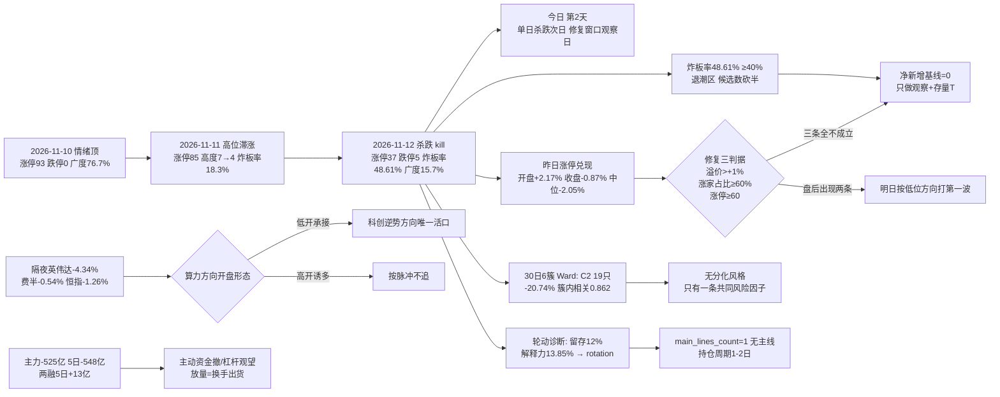

# 2026-11-13 · **风格研判**

> **数据源新鲜度**: partial（A 股主源全量 ok，外盘与跨资产缺一线）
> **降级状态**: true —— 缺口只在跨资产（商品 skipped、汇率单点）与两融 T+1，风格 / 涨停 / 广度主源无一缺失
> **置信度**: 0.472（0.70 × 0.75 × 0.90）

## 一句话结论

**震荡分化型 + 情绪浓度 47.1（中性档）+ 无主线（轮动结构），仓位上限 45%**。今日是**情绪周期第 2 天（连跌 1 天 · `single_down`）＝单日杀跌次日的「修复窗口观察日」，不是继续空仓、也不是修复确认日**：T-1 涨停 37 / 跌停 5 / 炸板 35（**炸板率 48.61%**）/ 最高 5 板且梯子无缺口 / 涨家占比 **16.2%** / 昨日涨停收盘溢价 **−0.87%（中位 −2.05%）** / 再涨停 11 只——**修复三判据（收盘溢价 >+1%、涨家占比 ≥60%、涨停 ≥60）三条全不成立**，故今日只按「观察承接 + 存量 T」处理，**净新增基线为 0**，触发条件成立后才恢复开仓资格；仓位上限 45% 只覆盖存量调仓与日内 T。

---

## 一、情绪周期位置：第 2 天（连跌 1 天 · `single_down`）—— 修复窗口观察日

先回答「第几天」，再谈风格——阶段标签本身不驱动决策，**第几天 + 对应打法**才能。本节读数全部来自 `data/research/20261113/cycle_position.json`（`as_of_session=20261112`）。

| 项 | 读数 | 含义 |
|---|---|---|
| `cycle_position.cycle_day` | **2**（as of 2026-11-12 收盘） | 杀跌序列第 **2** 天：2026-11-12 为首个杀跌日，今日是「杀跌次日」 |
| `consecutive_down_days` | **1** | 只连跌 1 天（非连跌 2 天的深跌结构），跌停 5 家、广度 0.157、中位 **−1.61%** |
| `tier` | **`single_down`** | 单日杀跌档；`playbook` 原文：「多为情绪释放，次日方向不明，按原节奏观察」 |
| `emotion_cycle.phase` | **`high_chop` 高位震荡**（confidence 0.75） | 炸板率 48.61% ≥ 25% 且溢价 +2.17% 未达 +3% → **分歧加大**，不是退潮也不是主升 |
| 阶段与风格联动 | **一致**（`phase_style_consistency=一致`） | 风格=震荡分化型 与 阶段=高位震荡 同向，无需按阶段覆盖风格 |
| 语义校正 | **`main_down` 口径 = 修复窗口，不是继续空仓** | 本档为 `single_down`，语义同为「方向不明按原节奏观察」——**今天不是清仓日，是观察承接日** |

**第 2 天（连跌 1 天 · `single_down`）的四条打法，逐条可执行**：

1. **开盘 30 分钟只观察不接力**：昨日 85 只涨停股今日红盘率只有 **37.65%**（<50% 的硬闸门），开盘溢价虽 +2.17% 但收盘均值 −0.87%、中位 **−2.05%**——**「开盘给溢价、收盘收走」是典型的诱多结构**，竞价承接力不足即执行「净新增 = 0」基线。
2. **若盘初继续杀跌，等尾盘试错，不追日内首波反弹**（92 科比口径：第二天持续杀跌 → 尾盘找买点、第三天常有修复）；**日内首波反弹在炸板率 48.61% 的环境里是负期望**，不参与。
3. **修复判据逐条核验 = 今日一条都不成立**：收盘溢价需 >+1%（实际 −0.87% ✗）、涨家占比需 ≥60%（实际 16.2% ✗）、涨停需 ≥60（实际 37 ✗）——**三条全不成立 → 今日不得按「修复日」做，只能按「观察窗口」做**。
4. **存量按 T 与分批处理，高位加速腿一律不碰**：T-1 的极端接力腿（三板以上策略指数）单日 **−7.00%**、5 日仍 +12.22%，是「涨无可涨后的第一根断板」——**高位加速不做任何触碰，低位只做观察**。

**同口径历史样本（仅供参考，不是概率模型）**：`cycle_position.samples` 唯一一条是 **连跌 2 天**（2026-10-30 → 2026-11-02），次日广度 0.8402、涨停 125 → `repaired=true`。本轮只连跌 1 天，**样本口径不同，不能当概率用**；它只说明「杀跌段后 1–2 日出现过广度 >0.55 的修复」，**不构成今日必然反弹的证据**。

| 交易日 | 涨停 | 跌停 | 炸板 | 炸板率 | 广度 | 中位 | 定性 |
|---|---:|---:|---:|---:|---:|---:|---|
| 2026-11-05 | 84 | 0 | 48 | 36.36% | 87.4% | +2.02% | 冲高 |
| 2026-11-06 | **32** | **15** | 14 | 30.43% | **13.6%** | −1.85% | **杀跌（kill）** |
| 2026-11-09 | 54 | 1 | 44 | 44.90% | 40.2% | −0.31% | 修复首日（未确认） |
| 2026-11-10 | 93 | 0 | 19 | 16.96% | 76.7% | +1.31% | 加速确认 |
| 2026-11-11 | 85 | 0 | 19 | 18.27% | 63.5% | +0.59% | 高位滞涨（涨停 −8、高度 7→4） |
| 2026-11-12 | **37** | **5** | **35** | **48.61%** | **15.7%** | −1.61% | **杀跌（kill）→ 今日为第 2 天** |

**读这张表的关键**：11-10 的 93 涨停是情绪顶，11-11 涨停已缩到 85、高度从 7 板掉到 4 板（**分歧的第一信号**），11-12 直接 37 涨停 + 5 跌停 + 炸板率翻倍到 48.61%（**分歧兑现**）。**第 2 天不是「第二次杀跌」，是「第一次杀跌后的次日」**——按周期表这是修复窗口的观察位，修复成立前不开新仓、修复成立后按低位方向打第一波。

---

## 二、详细分析

### 2.1 结构读数：炸板率 16.96% → 48.61%，分歧在一天内兑现

2026-11-12 全市场涨停 **37** 家（前日 85，**−56%**）、跌停 **5** 家（前日 0）、炸板 **35** 家，炸板率从 18.27% 跳到 **48.61%**（`+30.34 个百分点`）；涨 **838** / 跌 **4320** / 平 60，广度 **16.1%**，中位 **−1.60%**，涨超 5% 仅 **108** 家、跌超 5% **227** 家，成交额 **19319 亿（+15.26%）**。

连板天梯：**1 板 26 家 / 2 板 5 家 / 3 板 2 家 / 4 板 2 家 / 5 板 2 家**，最高 **5 板**、**无 0 层缺口**，首板占比 **70.3%**。

- **「放量下跌」是本轮结构最硬的一条**：成交额放大 15.26% 到 19319 亿，但广度只有 16.1%、跌超 5% 家数是涨超 5% 的 2.1 倍——**增量成交全部用于换手出货，不是承接**。
- **梯子完整但高度掉档**：11-11 最高 4 板 → 11-12 最高 5 板、且 1/2/3/4/5 层全部有人，说明**接力链没有断**，但 5 板只有 2 家、3 板以上合计 6 家（占涨停 16%）——**高位是孤岛，不是梯队**。
- **首封时间早、封单比薄**：09:30 已封 16.2%、10:00 累计 56.8%（早盘抢筹），但封单比中位仅 **5.68%**、开板次数中位 1 次——**封得早、封得薄 = 情绪盘护板，不是资金盘锁仓**，这是炸板率 48.61% 的直接成因。
- **指数分化指向「只有算力方向活着」**：上证 −0.67% / 深成 **−1.68%** / 创业板 **−2.44%** / 沪深300 −0.78% / 中证500 −1.62% / 北证50 −1.65%，唯 **科创50 +0.73%**——**权重与中小盘齐跌、只有科创逆势红**，这不是普跌中的技术反抽，是资金单向收缩到一个方向。

**崩溃三判据核验（三项须同时成立）**：炸板率 >50% → **否（48.61%，差 1.39 个百分点）**；跌停 ≥30 家或涨家占比 <25% → 跌停 5 家，但**涨家占比 16.1% <25% ✓（成立）**；指数 ≤−1% → 创业板 −2.44% ✓、深成 −1.68% ✓、上证 −0.67% ✗（部分成立）。**两项成立、一项临门一脚 → 崩溃退潮型代价 0.8611 高于震荡分化型 0.5242，不取崩溃**；但炸板率 48.61% 已处在退潮区（≥40%），**减半规则生效：候选数砍半、情绪定性写「震荡」**。

### 2.2 溢价拆解：开盘 +2.17%、收盘 −0.87%，打板是负期望

T-1（2026-11-11）的 85 只涨停股在 2026-11-12 的表现：

| 口径 | 均值 | 中位 | 含义 |
|---|---:|---:|---|
| 开盘溢价 | **+2.17%** | +1.16% | 竞价仍给正溢价，但中位只有 +1.16%——**溢价已经在收敛** |
| 收盘溢价 | **−0.87%** | **−2.05%** | 全天由正转负，**中位比均值更差 = 大多数票亏得更多** |
| 红盘率 | **37.65%** | — | 六成三的昨日涨停股今日收绿 |
| 再涨停 | **11 只 / 85** | — | 接力成功率 **12.9%**（前日 19/54 = 35.2%） |

**读法**：均值 −0.87% 而中位 −2.05%，是「少数票扛住、多数票被杀」的分布——**均值被尾部拉高，中位才是真实体验**。昨日打板者平均亏 0.87%、典型亏 2.05%，再涨停率从 35.2% 腰斩到 12.9%——**今日打板通道的期望为负，判「不进」**。这也是「第 2 天只观察不接力」最直接的量化依据：**开盘 +2.17% 的溢价是给昨日持仓者的出货窗口，不是给今日接力的入场价**。

### 2.3 30 日 6 簇：高 beta 巨簇占 19/42，防御腿簇是唯一与宽基负相关的簇

窗口 **2026-09-27 → 2026-11-12**（30 个收益日，42 个样本 = 22 风格板块 + 20 ETF），1−Pearson 相关距离 + **Ward linkage**，k=6（average linkage 作退化诊断，见本节末）：

| 簇 | n | 30日 | 5日 | 末日 | 回撤 | 簇内相关 | 与宽基相关 | 构成 |
|---|---:|---:|---:|---:|---:|---:|---:|---:|
| C4 | 4 | **+40.12%** | **+9.03%** | −0.91% | −9.5% | 0.338 | 0.060 | 极端接力策略腿（打二板以上 / 非ST三板以上）+ 证券 ETF + 消费 ETF |
| C6 | 1 | **+28.17%** | +4.51% | **−3.65%** | −11.6% | — | 0.194 | 非ST二板策略腿 |
| C5 | 2 | −0.48% | +0.76% | −0.55% | −6.7% | 0.225 | **−0.294** | 银行 ETF + 煤炭 ETF（防御腿，**唯一与宽基负相关**） |
| C1 | 9 | −9.44% | −3.79% | −1.44% | −12.7% | 0.661 | 0.722 | 行业龙头 + 沪深300 / 上证50 + 医药 / 恒生科技 / 光伏 / 新能源 / 有色 / 地产 ETF |
| C3 | 7 | −9.76% | **+3.82%** | −1.84% | −17.4% | 0.647 | 0.594 | 打板行为 + 弹性腿（百日新高 / 热股 / 创历史新高 / 昨日资金前十 / 高贝塔 / 打板 / 打首板） |
| C2 | **19** | **−20.74%** | +0.65% | −1.09% | **−27.2%** | **0.862** | **0.911** | 高 beta 巨簇（近端次新 / 百元股 / 成交与振幅前十 / 沪股通·深股通前十 / 增发·增减持·回购 / 扭亏 / 中证500·1000 / 科创50 / 通信·芯片·半导体·军工 ETF） |

42 个样本 30 日中位 **−12.57%**、正收益 **8/42（19.0%）**；5 日中位 **+0.36%**（23/42 上涨）；末日（11-12）**9 涨 / 33 跌**、中位 **−1.42%**。

**这组数字的读法**：

- **C2 占 19/42（45%）、30 日 −20.74%、回撤 −27.2%、簇内相关 0.862、与宽基相关 0.911**：它代表「同一批高 beta 筹码的重仓方向」——**不是 19 个分散的风格，是一个共同风险因子的 19 种表达**。末日 −1.09% 说明这个池子今天仍在阴跌，杀伤的是「弹性 + 次新 + 成交前十」这一类。
- **C4 接力腿 30 日 +40.12%**（含证券/消费 ETF），拆到单腿更极端：打二板以上 **+48.43%**、非ST三板以上 **+114.27%**——**30 日窗内最赚钱的通道仍在接力**；但三板以上**末日 −7.00%（正好等于它 30 日的最大回撤）**，即「断板发生在最高位」，这是今天最锋利的一条结构证据。
- **C5 防御腿簇 30 日 −0.48%**，但拆开看银行 ETF 单腿 **+6.24%**、回撤仅 **−3.19%**、末日 **+0.34%**，与宽基相关 **−0.509**（42 样本里唯一显著负相关）——**跷跷板的另一端一直开着**；消费 ETF 单腿 30 日 +5.18% 同向。这两个正收益样本合计只占 2/42，**防御是避险容器，不是进攻主线**。
- **C3 打板行为腿 5 日 +3.82%，末日 −1.84%**：弹性端在 5 日尺度上仍赚，但末日已经开始跟跌——**本周把情绪推到 11-10 顶部的，正是这条腿**。

**退化诊断（写进结论，不可省）**：同一批样本在 **average linkage** 下，6 簇塌缩成「**一只 35/42 的巨簇**（30 日 −15.64%、簇内相关 0.661）+ 5 个 1–2 只的孤立样本」——**聚类粒度已经无法区分风格，这本身就是「无分化」的统计指纹**，与 2.5 的轮动诊断（行业留存 12%）互为印证。

### 2.4 30 日 vs 5 日 vs 末日：同一资金池从进攻端切到防守端

| 维度 | 强的一端 | 读数 | 解释 |
|---|---|---|---|
| **30 日（09-27 → 11-12）** | 接力腿 + 防御腿单腿 | C4 **+40.12%**、C6 +28.17%、银行 ETF 单腿 +6.24%、消费 ETF 单腿 +5.18%；42 样本中位 −12.57% | 两个月里资金只在「极端接力」与「避险」两端 |
| **5 日（11-05 → 11-12）** | 接力腿与打板行为腿 | C4 5 日 **+9.03%**、C3 5 日 **+3.82%**、打首板指数 5 日 **+8.06%**、高贝塔值 5 日 +6.35%；全样本中位 +0.36% | 一周里接力端在加速——**这正是把情绪推到 11-10 顶部的资金** |
| **末日（11-12）** | 只剩防御与算力 | 银行 ETF +0.34%、消费 ETF +0.58%、科创50 **+0.44%**、半导体 +0.49%；全样本 **9 涨 / 33 跌**、中位 −1.42% | 杀跌日资金只做两件事：**抱防御、抱算力** |

**结论**：30 日与 5 日最强势的两条腿（C4 接力腿、C3 打板行为腿）在末日同时转负（−0.91% / −1.84%，单腿三板以上 −7.00%）——**这是「同一个资金池从进攻切到防守」的完整动作**，不是两个独立板块的轮动。**正收益样本 8/42 = 19%，距 1/3（14/42）的趋势反转线还差 6 个样本**，结构性下跌未结束。

### 2.5 轮动诊断：留存 12%、解释力 13.9%，四条里三条落在轮动

| 指标 | 读数 | 阈值 / 判读 |
|---|---|---|
| 行业截面解释力 | **13.85%** | <20% → 无主线结构（`industry_explained_lt20` ✓） |
| 昨日 TOP5 行业留存率 | **12.0%（3/25 命中）** | <35% → 上次的强行业次日基本不延续（`retention_lt35` ✓） |
| 涨停次日溢价（收盘中位） | **−2.05%**（开盘 +1.16%、红盘率 37.65%、广度 16.25%） | 与广度一起报，**负溢价 + 低广度 = 接力不可用**（`premium_not_stable` ✓） |
| 大小盘分层（涨幅中位） | <50 亿 **−1.55%** / 50–200 亿 −1.85% / 200–500 亿 −1.55% / 500–1000 亿 **−1.00%** / >1000 亿 **−0.39%** | 大盘抗跌但**没有任何一档为正** → `size_tilt=none`，不是风格切换、是全线缩水 |

**判定：`rotation_regime=rotation`（4 条中 3 条命中）**。按 skill §3.6 硬规则，**`main_lines_count` 如实写 1（无主线）**，不得为了凑仓位硬数出「双主线/三主线」；持仓周期按 **1–2 日**，用「开关状态 + 个股脉冲」而非「主线波段」。

### 2.6 外盘：美股三大指数微跌，但英伟达 −4.34% 与半导体内部撕裂

隔夜（**2026-11-12 美股收盘**，sina/东财实时源补齐；tushare 仅到 11-11）：

| 资产 | 2026-11-12 | 3 日累计 | 读法 |
|---|---:|---:|---|
| 纳指综合 | **−0.39%** | **+0.45%**（11-10 −0.74% → 11-11 +1.60% → 11-12 −0.39%） | 指数层面只是回吐，3 日仍净涨 |
| 标普500 | −0.35% | +0.58% | 同步微跌 |
| 道指 | −0.36% | −0.17% | 滞涨 |
| 费城半导体 | **−0.54%** | — | 半导体指数小跌 |
| 纳斯达克100 | −0.30% | — | — |

个股（2026-11-12 收盘）：**英伟达 −4.34%**（管理层治理事件发酵、市场重估继任风险）、台积电 −1.90%、阿斯麦 −2.43%、英特尔 −2.08%、美光 −1.59%；但 **AMD +5.86%、博通 +5.54%、谷歌 +1.79%、特斯拉 +1.69%**——**同一条半导体链上出现 10 个百分点的正负分裂**。

亚洲（2026-11-12）：恒生指数 **−1.26%**（5 日 −3.18%）、韩国综合 −0.61%、日经225 −0.70%（**20 日 −10.22%**）——**亚太先跌、美股后跟，方向一致向下**。

**读法**：美股指数层面的 −0.3%~−0.4% 对 A 股是「不构成利空」，但**英伟达 −4.34% 是今天 A 股算力链的唯一硬变量**：昨日的科创50 +0.73% / 半导体 +0.49% 逆势红盘，正是建立在「外部算力叙事未破」的前提上——**隔夜这个前提被动摇了**。所以今日对算力方向只有一种处理：**看开盘承接，不预设延续**（外盘不构成做多理由，也不构成清仓理由）。

### 2.7 资金：主力 −525 亿、两融几乎走平，放量是换手不是增量

| 口径（2026-11-12，东财 DC，与 R7 同源） | 数值 | 读法 |
|---|---:|---|
| 主力净额 | **−525.12 亿**（净流入率 **−2.70%**） | 单日大额净流出，与成交额 +15.26% **同向放大** → 典型换手派发 |
| 主力 5 日累计 | **−548.6 亿** | 5 日仍在净流出，**本周的 93 涨停行情不是主力推动的** |
| 两融余额（2026-11-11，T+1） | 22731 亿 · 5 日 **+13.2 亿（+0.06%）** | 杠杆**横盘不走**——既不进场接力、也未夺路而逃 |

**结构读法**：主力 −525 亿 + 两融 +13 亿 = **主动资金在撤、杠杆资金不动**。这与「放量下跌、广度 16.1%」完全自洽：**增量成交来自存量换手与出货，没有新增资金接盘**。今日第一条观察量：**主力净额是否收敛到 −200 亿以内**（收敛=杀跌日的一次性情绪释放；继续放大=−500 亿级别则第 2 天直接转第 3 天继续杀）。

### 2.8 风格归因：五分法代价表

| 风格 | 代价 | 判据落点 |
|---|---:|---|
| **震荡分化型** | **0.5242** ✅ | 涨停 37（落在 20–40 分散区 ✓）、最高 5 板但无梯队递推、涨家占比 16.2% |
| 崩溃退潮型 | 0.8611 | 炸板率 48.61%（差 1.39 个点到 50%）、跌停 5 家（未达 30）、创业板 −2.44%（部分成立）——**两项成立、一项差临门一脚** |
| 连板情绪型 | 1.8572 | 涨停 37 <50 ✗、炸板率 48.61% ≫20% ✗ → 两项硬伤 |
| 主线扩散型 | 1.9247 | 涨停 37 在区间内，但**行业 ≥8 家 0 条、概念 ≥20 家 0 个** → 无梯队可扩散 |
| 防御观望型 | 2.4295 | 涨停 37 ≥20、成交额 +15.26% 放量非缩量 → 不成立 |

**取「震荡分化型」的理由写死**：涨停 37 落在 20–40 区间、炸板率 48.61% 未到 50%、指数部分跌幅但非全面 −1%——**崩溃只差一个炸板率点，这个「差一点」就是今日不能判退潮的全部依据**。但**炸板率 ≥35% 的减半规则与 48.61% 的现实必须同时写进结论**：候选数砍半、情绪定性「震荡」、**只做观察不做净新增**。

### 2.9 推理深度三问（top 对象：今日的「第 2 天 · 单日杀跌次日的修复窗口 + 无主线轮动结构」）

- **大资金意图**: 主力单日净流出 **−525.12 亿**（净流入率 −2.70%）、5 日 −548.6 亿，同时两融 5 日只 +13.2 亿——**机构在撤、杠杆在观望**；对手盘是「11-10 的 93 涨停顶部追进的情绪盘」与「昨日打板被套的接力盘」（昨日涨停今日中位 −2.05%）。**意图是「利用放量 19319 亿完成高位筹码交换」——不是撤退，是换手后的重新定价**，证据是银行/消费 ETF 的 30 日正收益与科创50 末日逆势红：**钱没有离开市场，只是离开了高位加速腿**。
- **为什么走弱**: 位置（C2 高 beta 巨簇 30 日 **−20.74%**、回撤 **−27.2%**，是彻底的中位偏下）+ 催化（隔夜英伟达 −4.34%、治理事件动摇算力叙事；亚洲恒指 −1.26% 先行下杀）+ 筹码（封单比中位仅 5.68%、开板中位 1 次 → 薄封单遇放量即炸，炸板率 48.61%）——**三维同时指向「跌得合理」**，昨日涨停再涨停率 12.9% 是其结果而非原因。
- **逻辑够不够硬**: **硬在结构、软在方向**。独立源四条：①涨停 −56%（93→85→37 三日递减）+ 炸板率 18.27%→48.61%（✓ 微观结构恶化是硬的）②昨日涨停收盘中位 −2.05%、再涨停率 12.9%（✓ 接力通道损坏是硬的）③主力 −525 亿 + 成交 +15.26% + 广度 16.1%（✓ 派发指纹是硬的）④轮动留存 12%、行业解释力 13.85%（✓ 无主线是硬的）。**软的只有一条：方向**——`cycle_position` 只给「次日方向不明，按原节奏观察」，历史同口径样本仅 1 条（连跌 2 天的口径还不同）。**证伪路径明确**：今日收盘若广度 ≥0.55 且涨停 ≥60 且昨日涨停红盘率 ≥50%，则「第 2 天=修复窗口」成立、明日可按低位方向打第一波；若炸板率再上 50% 或广度跌破 0.10，则「第 2 天」直接并入连跌序列（转第 3 天继续杀）。

---

## 三、结构传导图

---

## 四、今日执行框架（思维链四段）

R1 不出个股、不给买卖点（红线），此处的「对象」是**今日唯一允许处理的执行结构**：`第 2 天 · 单日杀跌次日的修复窗口`。

- **买入理由**：① 周期锚 —— `cycle_day=2` / 连跌 1 天 / `single_down`，**这是杀跌次日而非连跌深水区**，历史上单日杀跌多为情绪释放；② 位置锚 —— C2 高 beta 巨簇 30 日 **−20.74%**、回撤 **−27.2%**，42 样本中位 −12.57%、正收益仅 8/42，**跌的是中位不是高位**；③ 结构锚 —— 梯子 1/2/3/4/5 层全在、无缺口，最高 5 板只有 2 家，**高位是孤岛、低位未被连带清洗**，一旦承接恢复，低位方向的首波弹性最大。
- **风险点**：① 短期 —— 炸板率 48.61% 已在退潮区、昨日涨停收盘中位 −2.05%、再涨停率仅 12.9%，**任何接力动作在今日都是负期望**；② 中期 —— 主力 5 日 −548.6 亿、30 日正收益仅 8/42，**结构性下跌未结束**；隔夜英伟达 −4.34% 动摇算力叙事，而算力正是昨日唯一逆势红的方向，**昨日活口今日可能变成补跌对象**。
- **止损条件**：以**结构与盘面双闸门**为条件式止损 —— 若 10:00 前广度 <0.10 或炸板率（滚动）>50%，**当日净新增归零、进入纯存量 T 模式**（等于区间止损）；若昨日涨停股集合竞价红盘率 <50%（T-1 实际 37.65%，大概率延续），**禁止任何打板与半路接力**；已持有的高位加速腿（3 板以上）若再度放量分歧，**当日无条件减仓、不做过夜幻想**。
- **可验证假设**（24–72h 内可证真/证伪）：**H1** 今日收盘广度 ≥0.55 且涨停 ≥60 且昨日涨停红盘率 ≥50% → 「第 2 天=修复窗口」成立，明日可打低位第一波；**H2** 炸板率全天 ≤35% → 退潮区解除、候选数恢复；**H3** 主力净额收敛到 −200 亿以内 → 派发为一次性释放。**三条 ≤1 条成立则仓位上限维持 45% 以下且净新增保持 0**；**≥2 条成立**才把明日额度抬到 60%。

---

## 五、仓位上限推导：45%

| 步骤 | 调整 | 数值 | 依据 |
|---|---|---:|---|
| 风格基准 | — | 0.55 | 震荡分化型（涨停 37 + 炸板率 48.61% + 涨家占比 16.2%） |
| 情绪档 | **+0.00** | 0.55 | 情绪 47.1 落**中性**档（40–60），不加不减 |
| 周期阶段 | **−0.05** | 0.50 | `high_chop` 高位震荡（炸板率 ≥25% + 溢价未达 +3%） |
| 30 日宽度 | **−0.05** | **0.45** | 42 样本中位 −12.57%、正收益仅 8/42 |
| 退潮区/减半 | 已含 | 0.45 | 炸板率 48.61% ≥35% → 候选数砍半（不再二次扣减，避免双重惩罚） |
| **合计** | | **0.45** | 未触发主跌下限托底（连跌仅 1 天） |

**45% 不是「可以买四成半」**，而是**存量调仓与日内 T 的上限**：`cycle_position.tier=single_down` 的语义是「方向不明，按原节奏观察」，**净新增基线为 0**——只有第四节 H1 的三条判据在盘后成立，明日的额度才从 45% 抬到 60%。**炸板率 48.61% ≥35% 的减半规则同时生效：任何候选清单按半数处理**。

---

## 六、关键证据

- 🟢 涨停 **37** / 跌停 **5** / 炸板 **35** → 炸板率 **48.61%**（前日 18.27%，+30.34 个百分点）
- 🟢 天梯 1板 **26** / 2板 **5** / 3板 **2** / 4板 **2** / 5板 **2**，最高 **5 板**、**无 0 层缺口**、首板占 **70.3%**
- 🟢 封单比中位 **5.68%**、开板次数中位 **1**、首封 10:00 累计 **56.8%** → 封得早、封得薄
- 🟢 T-1 85 家涨停股：开盘溢价 **+2.17%**（中位 +1.16%）、收盘 **−0.87%**（中位 **−2.05%**）、红盘率 **37.65%**、再涨停 **11** 只（12.9%）
- 🟢 广度 涨 **838** / 跌 **4320** / 平 60，中位 **−1.60%**，涨超 5% **108** vs 跌超 5% **227**，成交额 **19319 亿（+15.26%）**
- 🟢 指数 上证 **−0.67%** / 深成 −1.68% / 创业板 **−2.44%** / 科创50 **+0.73%** / 沪深300 −0.78% / 中证500 −1.62% / 北证50 −1.65%
- 🟢 主力净额 **−525.12 亿**（净流入率 −2.70%）、5 日 **−548.6 亿**
- 🟡 两融 **22731 亿**（2026-11-11，T+1）、5 日 **+13.2 亿（+0.06%）**
- 🟢 30 日窗（09-27 → 11-12）：42 样本中位 **−12.57%**、正收益 **8/42**、末日 9 涨 / 33 跌、末日中位 **−1.42%**
- 🟢 6 簇（Ward k=6）：C2 高 beta 巨簇 **n=19**、30 日 **−20.74%**、簇内相关 **0.862**；C4 接力腿 **+40.12%**（末日 −0.91%）、三板以上单腿末日 **−7.00%**；C5 防御腿簇 −0.48%、与宽基相关 −0.294，其中银行 ETF 单腿 30 日 **+6.24%**、相关 **−0.509**
- 🟢 退化诊断：同一批样本在 average linkage 下塌成 **35/42 单一巨簇**（30 日 −15.64%、簇内相关 0.661）
- 🟢 轮动诊断：解释力 **13.85%**、留存 **12.0%（3/25）**、溢价收盘中位 **−2.05%**、大小盘 5 档**无一为正** → `rotation`
- 🟢 隔夜美股（2026-11-12）：纳指 **−0.39%** / 标普 −0.35% / 道指 −0.36% / 费半 **−0.54%**；**英伟达 −4.34%**、阿斯麦 −2.43%、台积电 −1.90%；**AMD +5.86%、博通 +5.54%**；恒指 **−1.26%**、韩国 −0.61%、日经 −0.70%（20 日 −10.22%）
- 🟢 情绪周期：`cycle_day=2`、连跌 **1** 天、`tier=single_down`、阶段 `high_chop`（0.75）、**第 2 天=修复窗口观察日**
- 🟢 概念代理（非 R2 判定）：行业 ≥8 家 **0 条**；概念 ≥8 家 **3 个**、≥20 家 **0 个**；头号概念 9 家（前日 13，−4），机器人类概念 8 家（**前日 27，−19**）
- 🟢 文本侧：公众号 95 篇、**5 条方向性判断**——「强转弱节点 + 反弹必反复 + 只支持超跌反弹不支持接力连涨 + 外部治理事件为利空推迟未消失」；群聊 0 条

---

## 七、数据源审计

| 源 | 日期 | 状态 | 备注 |
|---|---|:--:|---|
| tushare/ths_daily + ths_member | 2026-11-12 | 🟢 | 22 条风格板块 · 30 个收益日完整 · 缺失 0 |
| tushare/fund_daily | 2026-11-12 | 🟢 | 20 条 ETF · 30 个收益日完整 |
| r1_style_cluster.py | 2026-11-13 | 🟢 | 42 样本 · 30 日窗 · 6 簇 · 零方差样本 0 |
| tushare/limit_list_d + limit_step | 2026-11-12 | 🟢 | 涨停 37 / 跌停 5 / 炸板 35 逐票 · 天梯 5 层 |
| tushare/index_daily | 2026-11-12 | 🟢 | 7 个指数 |
| tushare/limit_cpt_list | 2026-11-12 | 🟢 | 概念代理 20 条 · 行业 ≥8 家 0 条 |
| tushare/daily（全市场广度） | 2026-11-12 | 🟢 | 5218 只 |
| R7_capital_flow（东财 DC 主力/两融） | 2026-11-12 | 🟢 | 主力 −525.12 亿 · 两融 22731 亿（T+1） |
| sina gb_ + eastmoney push2his（外盘补齐） | 2026-11-12 | 🟢 | 5 个指数 + 15 只半导体/科技股 |
| tushare/index_global + us_daily | 2026-11-11 | 🟡 | 美股最新只到 11-11，隔夜 11-12 由 sina/东财补齐 |
| tushare/fx_daily | 2026-11-11 | 🔴 | DXY 空返回，仅保留单点 USDCNH 6.667 |
| 商品（原油/铜/金） | — | 🔴 | `commodities=skipped`，跨资产三档坐标无法建立 |
| wechat_official_rss（18 源） | 2026-11-13 | 🟢 | 95 篇 · 5 条方向性判断 · 匿名化 |
| wechat_cli_groups（焦点群，匿名） | 2026-11-13 | 🔴 | 0 字节 · 7 群抓取窗口内均无消息 |
| cycle_position.py / emotion_cycle.py | 2026-11-12 | 🟢 | 12 个交易日序列 · 第 2 天 / `single_down` / `high_chop` |

---

## 八、不确定性 / 反证

1. **「第 2 天」不等于「明天就修复」**：`cycle_position` 的 playbook 原文是「次日方向不明，按原节奏观察」，同口径历史样本只有 **1 条且是连跌 2 天**（2026-10-30 → 11-02，次日广度 0.84、涨停 125）。**我不能把它当概率表**，因此仓位只给 45%、净新增基线 0——这是「把不确定性留在系统里」的正确姿势，而不是赌反弹。
2. **崩溃退潮型只差一个点**：炸板率 **48.61%** vs 阈值 50%，跌停 5 家 vs 阈值 30 家。**如果今日炸板率重新站上 50%，风格判据当日就会被推翻**（届时不是震荡分化型，而是崩溃退潮型、仓位要压到 0.15 以下）。这是本文最大的单点风险。
3. **「无分化」可能是聚类粒度的假象**：Ward 口径下 C2 占 19/42（45%）、簇内相关 0.862，而 average 口径直接把 35/42 焊成一只巨簇——**两种粒度都在说同一件事：当下分不出风格，只分得出风险因子**。但它也可能掩盖「某一方向正在独立走强」的早期信号；一旦某条腿连续两日脱离簇均值 3 个百分点以上，`rotation` 判定就应立即复审。**今天不做任何「风格已定型」的假设**。
4. **资金背离是中期隐患**：主力 5 日 −548.6 亿、两融 5 日只 +13.2 亿——**没有任何一类资金在净流入**。银行/消费 ETF 的 30 日正收益（+6.24% / +5.18%）是避险容器的胜利，不是进攻资金的胜利；若防御腿也开始跌，那就不是轮动而是全面退潮。
5. **外盘变量被低估的可能**：英伟达 **−4.34%** 只是一天的反应，管理层变动的最终结果未定；若进一步恶化，A 股算力链（昨日唯一逆势红的方向）会成为今日补跌主角——**昨日活口变今日地雷，是分歧段最常见的陷阱**。
6. **文本与量化只有「部分同向」**：文本侧判「强转弱、反弹必反复」，与量化「炸板率翻倍、留存 12%」同向；但文本仍保留「二波/回踩低吸」预期，与量化「打板负期望、无主线」存在张力。**我按量化为准，把「二波」读作观察窗口而非开仓许可**。

---

## 九、与其他 R/D/E 的关系

- **依赖**: `data/raw/20261113/style_snapshot.json`（22 板块 + 20 ETF）、`_r1_cluster.json`、`_r1_market.json`、`_r1_rotation.json`、`_r1_overseas_fill.json`、`_r1_kol.json`、`cycle_position.json`、`emotion_cycle.json`、`R7_capital_flow_20261113.json`
- **被消费**:
  - **R2 主线**: `style=震荡分化型`、`main_lines_count=1`（无主线·轮动结构）→ R2 不得硬数主线；须按已有证据筛选研究观察对象，**无合格对象允许为空**，并列出覆盖、剔除与缺口；`rotation_regime=rotation` 时按 1–2 日脉冲而非波段框架
  - **R3 情绪**: `sentiment_score=47.1` 作基准（若 R3 与 R1 差 >15 分，需在 R3 侧说明口径）
  - **R6 反证**: 对「震荡分化型 vs 崩溃退潮型只差 1.39 个点」与「第 2 天=修复窗口」两条结论做反证
  - **D1 预案**: `position_cap_suggestion=0.45` → 存量调仓与日内 T 的上限，**净新增基线 0**；`emotion_cycle_action` 提供「第 2 天（连跌 1 天 · single_down）· 修复窗口观察日」唯一入口；**炸板率 48.61% ≥35% → 候选数砍半**
- **边界**: R1 不推板块、不推个股、不给买卖点；本文出现的簇构成、概念代理与 ETF 标签仅为**统计口径描述**，不构成任何交易建议。

---

## Sub-Agent 元数据

- skill: `analyze_style_v1@1.0`
- artifact: `data/research/20261113/R1_style.json`
- 生成耗时: 管线 06:42–06:43 完成簇/结构/轮动/外盘/资金五项底稿，06:44 汇总落 JSON；人读稿 06:58 单次落盘
- model: deepseek-v4.1-flash
- 校验: `style` 落 5 枚举之一（震荡分化型）；`sentiment_score=47.1` 五维加权权重归一 1.00；`cycle_position` 嵌入（第 2 天 / 连跌 1 天 / `single_down`）；`status=degraded` 因跨资产、两融与群聊缺口，置信度 0.472
