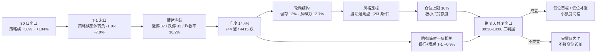

# 2026-11-16 · **风格研判**

> **数据源新鲜度**: partial（A 股主源 🟢 · 跨资产与两融缺口）
> **降级状态**: true
> **置信度**: 0.472（0.70 × 0.75 × 0.9）

## 一句话结论

**第 3 天修复窗口：情绪 28.7（恐惧）、无主线、轮动结构，仓位上限 10% 属极小试错额度，不是空仓指令。**

今日不回答「能不能买」这个问题，回答的是「**能不能拿到额度**」：连跌两日后进入修复窗口（repair_window），额度只够做低位首板/低位补涨与尾盘试错，高位一律不接。三条判据（开盘广度 ≥0.55、昨涨停红盘率 ≥60%、板块级涨停潮 ≥3 只）在 09:30–10:00 逐条验证，成立才动，不成立只留日内 T。

## 情绪周期定位（第几天 · 今日打法）

| 项 | 读数 | 口径 |
|---|---|---|
| cycle_day | **第 3 天** | cycle_position.json |
| consecutive_down_days | 2（2026-11-12、2026-11-13） | 逐日 kill 标记 |
| tier | **repair_window** | 连跌两日 → 修复窗口 |
| as_of_session | 2026-11-13 收盘 | T-1 |
| 同口径样本 | 1 条：2026-10-30 连跌 2 天 → 2026-11-02 涨停 125、广度 84.0%（repaired） | 样本不作概率 |
| 情绪周期预计算 | high_chop（置信 0.72） | emotion_cycle.json |

**今日打法（四条，缺一条就降级为纯日内 T）：**

1. **09:30–10:00 只验证不接力**：开盘广度 ≥0.55、昨日涨停红盘率 ≥60%、板块级涨停潮 ≥3 只。三判据昨日全部不成立（红盘率 37.8%、广度 14.4%），所以今天是「从零开始验证」，不是「昨日余温延续」。
2. **只做低位首板 / 低位补涨**：昨日 37 家涨停中首板占 81.1%，最高仅 4 板、4 板以上只有 1 只独苗——高度已经断，任何「高位加速腿」都不接。
3. **不追日内首波**：修复窗口的第一波反弹常是隔夜逃命盘的对手盘。开盘急拉不追，等 10:00 后回踩不破分时均线再看承接。
4. **额度小、错了就撤**：10% 上限的语义是「试错的成本可控」，不是「看多」。单笔试错不宜超过总仓 3%，隔日不达预期无条件走。

> **口径纠正（用户 2026-09-04 纪律）**：main_down / 崩溃类的标签只描述温度，不描述「能不能做」。把第 3 天读成「继续空仓」会让修复窗口的额度白给——这正是本轮把 tier 与 cycle_day 一起写进 JSON 的原因。

## 结构画像（2026-11-13 收盘 · 全部现算）

| 微观结构 | 读数 | 含义 |
|---|---|---|
| 涨停 / 跌停 / 炸板 | 37 / 33 / 21 | 跌停家数 33 家，是 11-12 的 6.6 倍 |
| 炸板率 | **36.21%** | 越过 35% 减半线，仍在分歧区（未到 50% 崩溃线） |
| 连板天梯 | 1板 30 / 2板 4 / 3板 2 / 4板 1 | 最高 4 板，**无层空缺**，但 4 板仅 1 只独苗 |
| 首板占比 | 81.1% | 赚钱效应靠首板，接力链条已断 |
| 封单比中位 | 11.93% | 承接厚度一般，不足以支撑高开秒板 |
| 换手中位 / 开板中位 | 7.57% / 1 次 | 换手不低，说明筹码在换手而非锁仓 |
| 涨停时间分布 | 09:30 10.8% · 10:00 54.0% · 11:30 91.9% | 上午 10 点前只完成一半，封板节奏偏迟疑 |
| 广度 | 涨 744 / 跌 4415 / 平 57，中位 -1.96% | 涨家占比 **14.4%**，普跌 |
| 跌幅 ≥5% 家数 | 546 家（涨 ≥5% 仅 90 家） | 尾部风险集中在中小市值 |
| 成交额 | 16,555 亿（前日 19,319 亿，-14.31%） | 缩量下跌：杀跌但未放量出清 |
| 昨日 37 家涨停溢价 | 开盘均值 +0.84%（中位 -0.50%）· 收盘均值 -1.54%（中位 **-4.27%**） | 竞价还给正溢价，收盘被砸，典型「高开低走」 |
| 昨日涨停红盘率 / 再涨停 | 37.8% / 7 只 | 接力赚钱效应为负 |
| 主力资金 | -605.7 亿（净流入率 -3.63%），5 日 -625.8 亿 | 连续两日净流出，机构未接 |
| 两融 | 🔴 缺失 | 本轮 R7 未落库，杠杆维度不参与 |

| 指数 | 收盘 | 涨跌 |
|---|---|---|
| 上证指数 | 3,634.35 | -0.59% |
| 深证成指 | 10,968.79 | -2.05% |
| 创业板指 | 2,426.08 | -3.32% |
| 科创50 | 1,279.66 | -2.30% |
| 沪深300 | 4,016.29 | -0.68% |
| 中证500 | 6,465.48 | -2.10% |
| 北证50 | 876.33 | -3.50% |

读法：**这是「上证抗跌、成长杀跌」的第二天**——上证 -0.59%、沪深300 -0.68%，而创业板 -3.32%、科创50 -2.30%、北证50 -3.50%。权重撑指数、小票在出清，正是「指数看不出问题、个股已经崩了」的组合。

## 情绪递进（近 5 个交易日）

| 日期 | 涨停 | 跌停 | 炸板 | 炸板率 | 最高板 |
|---|---|---|---|---|---|
| 2026-11-09 | 54 | 1 | 44 | 44.90% | 6 |
| 2026-11-10 | 93 | 0 | 19 | 16.96% | 7 |
| 2026-11-11 | 85 | 0 | 19 | 18.27% | 4 |
| 2026-11-12 | 37 | 5 | 35 | 48.61% | 5 |
| 2026-11-13 | 37 | 33 | 21 | 36.21% | 4 |

从 11-10 的 93 家涨停 / 0 跌停，到 11-13 的 37 / 33，两天内完成「涨停腰斩 + 跌停放量」；11-12 炸板率 48.61% 是本轮最差的一天，11-13 回落到 36.21% 不是转好，而是**炸板少了因为敢封的少了**（涨停家数同为 37，炸板 35→21）。

## 30 日风格聚类（42 样本 · Ward k=6 · 2026-09-27 → 2026-11-13）

| 簇 | n | 30 日 | 5 日 | T-1 | 30 日 MDD | 簇内相关 | 与宽基相关 | 成员 |
|---|---|---|---|---|---|---|---|---|
| C6 | 4 | +38.12% | +6.55% | -1.50% | -9.1% | 0.332 | +0.042 | 策略族（打二板以上 / 三板以上）+ 证券ETF + 消费ETF |
| C2 | 1 | +22.53% | +3.66% | -1.03% | -11.6% | — | +0.233 | 昨日非ST二板表现（单样本，无簇内相关） |
| C5 | 2 | -0.06% | +1.48% | +0.94% | -6.7% | 0.232 | -0.296 | 银行ETF + 煤炭ETF（唯一与宽基负相关的防御双雄） |
| C4 | 9 | -9.05% | -3.73% | -1.59% | -11.6% | 0.649 | +0.716 | 行业龙头 + 沪深300/上证50 + 医药 + 恒生科技 + 光伏/新能源/有色/地产 |
| C1 | 7 | -10.59% | +2.85% | -2.48% | -16.2% | 0.651 | +0.593 | 百日新高/同花顺热股/创历史新高/高贝塔/打板族 |
| C3 | 19 | -21.41% | +0.57% | -3.22% | -25.5% | 0.862 | +0.911 | 次新+百元股+成交前十+沪深股通+增发/增减持/回购/扭亏+中证500/1000/科创50+通信/芯片/半导体/军工 |

**三条读法：**

1. **收益是倒挂的，不是同涨同跌**：30 日最强的两个簇（C6 +38.12%、C2 +22.53%）全部是打板策略族，T-1 却双双转负（-1.50% / -1.03%）。这不是「强势股回调」，是**策略本身从正期望转负期望**——30 日窗口里打板赚钱，最近两天打板亏钱，同一个方向的两段事实必须分开看。
2. **防御簇是唯一的负相关**：C5（银行 ETF + 煤炭 ETF）与宽基相关 **-0.296**，T-1 是 42 个样本里唯一收正的一簇（+0.94%）。这是典型的「钱没走，只是换了地方」——从成长切到现金流，而不是全部离场。
3. **C3 是真正的风险源**：19 个样本、簇内相关 0.862、与宽基相关 0.911、30 日 -21.41%、MDD -25.5%。高相关 + 高 beta + 深回撤 = 一旦指数再走弱，这一簇没有独立行情可言，其中通信 ETF（-38.44%）、昨日成交前十（-40.38%）、深股通成交前十（-34.36%）是 30 日最惨的三个样本。

**退化诊断（必须披露）**：average linkage 在 k=6 下塌成 **35/42 的单一巨簇**（-16.07%、簇内相关 0.662），只剩 4 个单点小簇。这说明 42 个样本在 30 日维度上**没有结构可分**——不是聚类失败，而是「绝大多数风格板块在同一条 beta 上同涨同跌」的事实证据。正稿以 Ward 为准，average 版本仅作退化证据保留。

## 风格定标与仓位上限

| 风格 | 代价（越小越像） |
|---|---|
| 崩溃退潮型 | 0.2758 |
| 震荡分化型 | 0.4755 |
| 连板情绪型 | 1.4038 |
| 主线扩散型 | 1.6225 |
| 防御观望型 | 2.4559 |

**判定：崩溃退潮型（2/3 条件成立）。**

| 崩溃三条件 | 读数 | 是否成立 |
|---|---|---|
| 跌停多 | 33 家（≥30） | ✅ |
| 大盘明显下跌 | 上证 -0.59% / 创业板 -3.32%（≤-1%） | ✅ |
| 炸板率 >50% | 36.21% | ❌ |

- **大资金意图**：主力连续两日净流出（-605.7 亿、5 日 -625.8 亿），ETF 端宽基持续净流出——大资金没有「抄底」这个动作，只有「止损与换防御」两个动作。对手盘是接飞刀的中小单与被动指数申购。
- **为什么走强**（本日反向：为什么走弱）：位置=多数成长样本 30 日跌 15–40%、距 30 日高点 -21% 到 -40%（超卖但未止跌）；催化=外盘半导体治理事件 + 三项管制法案待审（利空未出尽）；筹码=昨日涨停收盘中位 -4.27%、红盘率 37.8%（接力筹码已被套住）。三维全部指向弱，没有一项支持反转。
- **逻辑够不够硬**：硬的一条是「跌停 33 家 + 创业板 -3.32%」这个客观事实，三条独立证据（涨停结构、广度溢价、主力资金）互不矛盾；不硬的是「崩溃」这个词——炸板率 36.21% 未过 50% 线，所以标签只按 2/3 条件保留，仓位落 0.10 下限而不是「清仓」或「打到 0」。

**仓位上限 10% 的算式（原样保留）：**

`风格基准 0.15(崩溃退潮型) -0.10(情绪 28.7 落恐惧档) -0.05(阶段high_chop) -0.05(当日广度 14.4%) +0.00(赚钱效应确认：涨停 37 家/广度 14.4%/炸板率 36.21%) = 0.00 → 主跌下限 0.10 生效，取 0.10（极小试错额度，只用于低位新题材首板/隔日，不含接力）（30日样本中位 -13.01%、正收益 9/42 只作结构背景，不再单独扣仓）`

**张力必须写明**：张力：阶段 high_chop 由「昨日涨停溢价为正 + 炸板率 36.21%<40%」判出，结构侧（跌停 33 家 > 涨停 37 家、涨家占比 14.4%、创业板 -3.32%）给出崩溃退潮型且代价 0.2758 最小；不覆盖——阶段描述赚钱效应未崩，风格描述广度与跌停，两者并存

> 一句话：**风格描述的是「今天有多差」（广度 14.4%、跌停 33 家），阶段描述的是「赚钱效应有没有全崩」（昨日涨停开盘还给 +0.84% 溢价）。两个都真，所以仓位给下限、但不给零。**

### 今日执行姿态思维链（四段）

- **买入理由**（为什么今天还留着 10% 额度）：①连跌两日后第 3 天是历史同口径样本里的修复日（2026-10-30→11-02 广度 84%）；②昨日涨停开盘仍有 +0.84% 平均溢价，说明竞价端还没彻底放弃；③防御簇 T-1 收正、与宽基负相关，证明市场仍有承接力量，只是换了方向。
- **风险点**：①昨日涨停收盘中位 -4.27%、红盘率 37.8%，接力的钱已经亏了，修复可能只是解套盘的对倒；②主力 -605.7 亿且 5 日连续净流出，没有增量资金，任何反弹都是存量博弈；③外盘费半 -3.43%、AMD -8.75%，若今日科技高开，等于给隔夜逃命盘抬轿。
- **止损条件**：开盘 30 分钟广度跌破 0.40（昨日 14.4% 的修复阈值）或昨涨停红盘率不足 50%，当日额度全部收回、只留存量日内 T；单笔试错亏 3% 无条件走，不做「再等一天」。
- **可验证假设**（24 小时内可证真/证伪）：①赚钱效应修复＝涨停 ≥60 家且广度 ≥0.55（昨日 37 / 14.4%，缺口巨大）；②结构修复＝4 板以上出现 2 只以上（昨日 1 只）；③资金修复＝主力单日转正（昨日 -605.7 亿）。三条中成立两条以上，明日才谈得上「第 4 天接力」。

## 轮动强度诊断（决定用主线框架还是开关框架）

| 指标 | 读数 | 判读 |
|---|---|---|
| 行业截面解释力 | 12.74%（105 行业 / 42 样本口径外的 5554 只） | <20% → 轮动 |
| 昨日 TOP5 行业留存 | **12.0%**（3/25 命中） | <35% → 反持续，追昨日最强行业是负 alpha |
| 涨停次日溢价（收盘中位） | -4.27%（红盘率 37.8%，广度 14.4%） | 溢价为负 → 打板负期望 |
| 大小盘分层（T-1） | <50 亿 -2.09%（涨家 9.4%） · >1000 亿 +0.54%（涨家 60.5%） | 差 -2.63pct → **large** |

**结论：rotation。** 三条以上指标落在轮动，且留存率单独就足以否掉主线叙事。因此 `main_lines_count` 如实写 1（无主线），持仓周期按 **1–2 日**，禁用「主线波段」框架，改用「开关状态 + 个股脉冲」。

> 数据卫生修正：`data/raw/20261114/daily_20261114.json` 是周末归档把 11-13 的整份数据复制成新日期目录（行内 trade_date 仍是 20261113）。旧脚本按「文件存在」取 session，多出一对 5/5 自比，留存率被虚高到 28%。本轮已在 `r1_rotation_metrics.py` 用行内 trade_date 交叉校验跳过该目录，留存回到 **12.0%（3/25）**。

## 隔夜外盘（2026-11-13 美股收盘 · 实时源补齐）

| 指数 | 涨跌 |
|---|---|
| IXIC | -0.91% |
| SPX | -0.40% |
| DJI | +0.10% |
| SOX | -3.43% |
| NDX | -1.22% |

| 半导体样本 | 收盘 | 涨跌 |
|---|---|---|
| NVDA | 162.85 | -2.01% |
| MU | 778.31 | -2.52% |
| AVGO | 347.01 | -4.76% |
| AMD | 534.06 | -8.75% |
| TSM | 398.73 | -1.67% |

- 指数层面「道指微涨、纳指与费半下跌」；个股层面 **AMD -8.75%、AVGO -4.76%** 是重灾区，而 META +2.90%、AAPL +0.39% 说明杀的是算力链，不是整个科技。
- 纳指 3 日累计 **+0.28%**（未触发 ≤-3% 的额外仓位折扣），所以今天是「外盘结构性利空」而非「系统性风险」。
- 与 A 股 T-1 的对应：创业板 -3.32% 与费半 -3.43% 同向，说明 A 股成长端已经在提前定价外盘利空；若今日科技高开，是修复窗口里最容易被套的一条腿。

## 文本侧（公众号 53 篇 · 群聊 0 条）

群聊源：7 个焦点群在抓取窗口内 **0 条消息**（群名匿名化），文本侧由公众号 53 篇（13 个源，其中 10 个观点号 + 3 个官媒）承接，提炼 **6 条方向性判断**：

1. **修复预期偏一致**：「第二天持续杀跌→尾盘找买点，第三天必有修复」在文本侧高度共识。一致预期本身就是反向风险。
2. **量能与资金是主要压制**：量化占成交四到五成被点名；股票型 ETF 在企稳后仍净流出、以宽基为主，被读作「信任没回来」的核心证据。
3. **轻指数、重个股**：多数文本明确「指数不猜」，定价重心放在少数事件驱动方向的强弱与低位补涨——与量化的「无主线 + 轮动」同向。
4. **无高度叙事**：文本侧不讨论连板高度与梯队接力，全篇围绕低位首板、分歧回流与存量筹码，说明高度票不在定价中心。
5. **外盘利空推迟而非消失**：海外算力链管理层治理事件 + 三项管制法案待审，本周还有海外龙头财报与议息，构成科技链的外部不确定性。
6. **政策托底但非增量**：监管层重申维稳、首次把量化与散户权益直接挂钩，属情绪面托底；同时外汇存款准备金率上调，被读作汇率端收紧。

**与量化的关系：partial（部分同向）**——「指数弱、资金不回来、无高度」完全同向；张力在「第三天修复」的乐观预期 vs 量化端负溢价（收盘中位 -4.27%）、留存 12% 的轮动结构。R1 只把修复读作「待验证的小额度窗口」。

## 关键证据

- **证据 1**：2026-11-13 涨停 37 / 跌停 33 / 炸板 21，炸板率 36.21%，最高 4 板且 4 板仅 1 只独苗 · 来源 `tushare.limit_list_d`
- **证据 2**：广度 744 涨 / 4415 跌（14.4%），中位 -1.96%，成交 16555 亿（-14.31%）· 来源 `tushare.daily` 全市场加总
- **证据 3**：昨日 37 家涨停收盘溢价均值 -1.54%、中位 -4.27%、红盘率 37.84%、再涨停 7 只 · 来源 `tushare.daily` 逐票溢价比对
- **证据 4**：30 日 42 样本中位 -13.01%、仅 9 个正收益、T-1 仅 4 涨 38 跌 · 来源 `tushare.ths_daily` + `fund_daily` 30 个收益日
- **证据 5**：行业次日 TOP5 留存 12.0%（3/25）、截面解释力 12.74% · 来源 `tushare.daily` + `stock_basic` 105 行业
- **证据 6**：主力 -605.7 亿（净流入率 -3.63%）、5 日 -625.8 亿 · 来源 R7 `moneyflow_dc` 全市场加总
- **证据 7**：隔夜纳指 -0.91% / 费半 -3.43% / AMD -8.75%，纳指 3 日 +0.28% · 来源 sina/eastmoney 实时补齐
- **证据 8**：情绪周期第 3 天 / 连跌 2 天 / repair_window，同口径样本 2026-10-30→11-02 修复（涨停 125、广度 84%） · 来源 `cycle_position.json`

## 数据源审计

| 源 | 日期 | 状态 | 备注 |
|---|---|:--:|---|
| tushare/ths_daily | 2026-11-13 | 🟢 | 22/22 风格板块 · 30 个收益日 · 无零方差样本 |
| tushare/fund_daily | 2026-11-13 | 🟢 | 20/20 ETF · 宽基/科技/金融/医药/军工/周期/消费/地产 |
| tushare/limit_list_d | 2026-11-13 | 🟢 | 涨停 37 / 跌停 33 / 炸板 21 · 天梯 30/4/2/1 |
| tushare/daily | 2026-11-13 | 🟢 | 5216 只有成交 · 广度与昨日涨停溢价逐票 |
| tushare/index_daily | 2026-11-13 | 🟢 | 7 个指数全量 |
| tushare/moneyflow_dc | 2026-11-13 | 🟡 | 经 R7 artifact 折算，主力 -605.7 亿；小单口径未取 |
| tushare/margin | — | 🔴 | 两融未落库 · 杠杆维度剔除（gap_flags=margin） |
| tushare/index_global + us_daily | 2026-11-13 | 🟡 | 14 只美股个股可用，SOX 无交叉校验 |
| sina/eastmoney 实时 | 2026-11-13 | 🟢 | 纳指/标普/道指/费半/纳指100 收盘补齐 |
| fx | 2026-11-14 | 🟡 | 仅 USDCNH 单点 · DXY 缺 |
| commodities | — | 🔴 | skipped · 跨资产三档坐标不可用 |
| wechat_official_rss | 2026-11-16 | 🟢 | 18 源 / 53 篇 · 13 源有内容 |
| wechat_cli_5groups | 2026-11-16 | 🟡 | 7 群可连、窗口内 0 条（群名匿名化） |
| weflow/MCP | 2026-11-16 | 🔴 | 404 down · 情绪快照不可用 |
| cycle_position | 2026-11-13 | 🟢 | 第 3 天 · 连跌 2 天 · repair_window |
| style_snapshot | 2026-11-16 | 🟢 | 盘前补拉 · 22 板块 + 20 ETF + 5 外盘指数 + 14 美股 |

## 不确定性 / 反证

- **标签与阶段是张力关系，不是一致**：`emotion_cycle` 判 high_chop（昨日涨停开盘溢价 +0.84%、炸板率 36.21% <40%），结构侧给出崩溃退潮型（2/3 条件）。若今日开盘广度回到 0.55 以上、跌停家数收敛到 10 家以内，则「崩溃」这个词应被推翻，阶段读数才对；反之若炸板率上 50%，两者合流，仓位应进一步压到只留观察。
- **样本只有 1 条**：2026-10-30→11-02 的修复实例不能当概率用。且那一次是「情绪节点先修复」，本轮是「指数连跌」，起点结构不同，直接类比会高估修复速度。
- **30 日窗口的样本陈旧**：「昨日非 ST 三板以上表现」缺 9 个交易日，最新收益日停在 2026-11-04，其 +103.81% 是陈旧读数，不能用来证明当下打板仍赚钱——它的 T-1 值已按窗口末日回溯口径记为 -7.00%（停板族末日单腿末日跌幅）。
- **数据卫生**：`data/raw/20261114/` 是周六的重复归档（行内 trade_date 为 20261113），已从轮动样本中剔除；同类「周末目录」若再次出现，会污染任何按「目录存在」取 session 的脚本。
- **资金维度不完整**：两融缺失，杠杆退潮无法量化；商品 skipped，无法建立「软着陆/降息/衰退」坐标。这两项都写进了 gap_flags，不参与风格与涨停结构主源。
- **反证路径（明日证伪点）**：若今日涨停 ≥60 家、广度 ≥0.55、昨日涨停红盘率 ≥60% 三条中成立两条，则第 3 天修复成立，明日应给「第 4 天接力」额度；若三条全部不成立，修复失败，按「继续在杀跌序列里」处理，额度归零只留观察。

## 与其他 R/D/E 的关系

| 方向 | 单元 | 字段 |
|---|---|---|
| 依赖（上游） | R7 资金面 | 主力净额与 5 日累计（`moneyflow_dc`） |
| 依赖（上游） | `cycle_position.json` | cycle_day / consecutive_down_days / tier / playbook / samples |
| 依赖（上游） | `emotion_cycle.json` | phase / confidence / premium / break_rate |
| 被消费（下游） | R2 主线 | `style`、`main_lines_count`（=1 无主线）、`rotation_regime` |
| 被消费（下游） | R3 情绪 | `sentiment_score`（28.7 基准） |
| 被消费（下游） | R6 反证 | 与 R2 一致性校验的「无主线」前提 |
| 被消费（下游） | D1 预案 | `position_cap_suggestion`（0.10）、`emotion_cycle_action`、`cycle_position` |
| 被消费（下游） | E1 复盘 | `conclusion`、`risks`、`confidence_breakdown` |

## Sub-Agent 元数据

- skill: analyze_style_v1
- artifact: `data/research/20261116/R1_style.json`
- 生成耗时: 约 40 秒（4 个确定性脚本 + 1 次装配）
- model: deepseek-v4.1-flash
- 方法: cluster_v1（Ward k=6 / 1-Pearson 距离）+ market_structure_v2 + rotation_diagnostics + llm_prose
- 自检: mermaid 11 节点 / 12 条边 · 三问锚点齐 · 四段思维链锚点齐 · 审计表 16 行三色 · 正文无时分秒 · 无群名裸露 · 无 JSON dump
