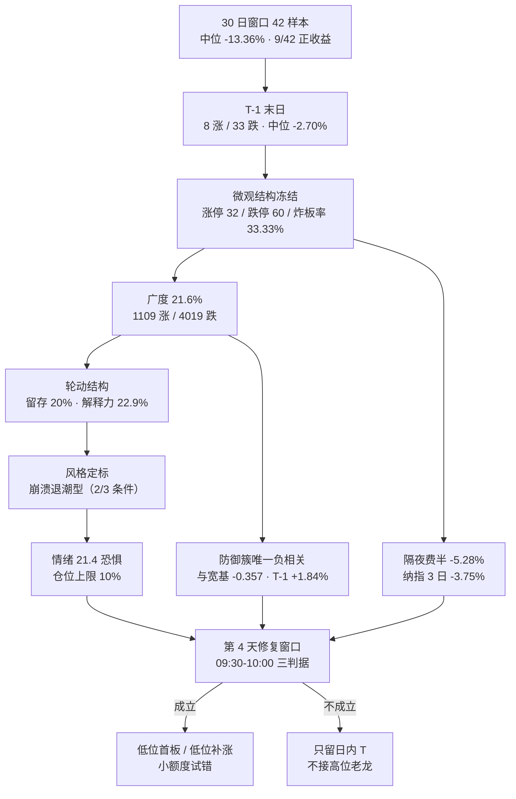

# 2026-11-17 · **风格研判**

> **数据源新鲜度**: partial（A 股主源 🟢 · 跨资产与两融缺口）
> **降级状态**: true
> **置信度**: 0.472（0.70 × 0.75 × 0.9）

## 一句话结论

**第 4 天（连跌 3 天 · repair_window）：情绪 21.4（恐惧）、无主线、轮动结构，仓位上限 10% 全部作为极小试错额度，不是空仓指令。**

今日不回答「能不能买」，回答「能不能拿到额度」：连跌三天后进入修复窗口，10% 的额度只够做低位首板/低位补涨与尾盘试错，高位一律不接。三判据（开盘广度 ≥0.55、昨涨停红盘率 ≥60%、板块级涨停潮 ≥3 只）在 09:30–10:00 逐条验证，成立才动，不成立只留日内 T。

## 情绪周期定位（第几天 · 今日打法）

| 项 | 读数 | 口径 |
|---|---|---|
| cycle_day | **第 4 天** | cycle_position.json |
| consecutive_down_days | 3（2026-11-12、11-13、11-16） | 逐日 kill 标记（跌停 ≥20 或广度 <0.30） |
| tier | **repair_window** | 连跌 ≥2 天 → 修复窗口 |
| as_of_session | 2026-11-16 收盘 | T-1 |
| 最新一日读数 | 涨停 32 / 跌停 60 / 炸板 16（炸板率 33.33%）· 广度 20.39% · 中位 -2.115% | cycle_position signals |
| 同口径样本 | 1 条：2026-11-13 连跌 2 天 → 11-16 涨停 32、广度 20.39%（**未修复**） | 样本不作概率 |
| 情绪周期预计算 | high_chop（置信 0.72，premium 口径为**开盘**溢价 +2.36%） | emotion_cycle.json |

**今日打法（四条，缺一条就降级为纯日内 T）：**

1. **09:30–10:00 只验证不接力**：三判据今日是「从零验证」——昨日涨停红盘率 47.2%（未过 60%）、广度 21.6%（离 0.55 差得远）、板块级涨停潮 0 条。前一条最接近，但接近不等于成立。
2. **只做低位首板 / 低位补涨**：昨日涨停里 4 板仅 1 只独苗、2 板 8 家，高度是「有梯子但没有高度」；任何高位加速腿都不接，也不做二波假设。
3. **不追日内首波**：修复窗口的第一波常是隔夜逃命盘的对手盘。开盘急拉不追，等 10:00 后回踩不破分时均线再看承接。
4. **额度小、错了就撤**：10% 上限的语义是「试错成本可控」，不是「看多」。单笔试错不宜超过总仓 3%，隔日不达预期无条件走；尾盘 14:30 后若出现跌停收敛 + 炸板率回落，才允许用剩余额度做尾盘试错。

> **口径纠正（用户 2026-09-04 纪律）**：main_down / 崩溃类标签只描述温度，不描述「能不能做」。把第 4 天读成「继续空仓」会让修复窗口的额度白给——这正是本轮把 `tier` / `cycle_day` / `cycle_position_note` 一起写进 JSON 的原因。

## 结构画像（2026-11-16 收盘 · 全部现算）

| 微观结构 | 读数 | 含义 |
|---|---|---|
| 涨停 / 跌停 / 炸板 | 32 / 60 / 16 | 跌停家数 60 家，是 11-13（33 家）的 1.8 倍，本轮最多 |
| 炸板率 | **33.33%** | 不在 35% 减半线之上，也不到 50% 崩溃线——分歧但未崩 |
| 连板天梯 | 1板 21 / 2板 8 / 3板 2 / 4板 1 | 最高 4 板、**无层空缺**，但 4 板仅 1 只独苗；2 板家数由 4 翻到 8 |
| 首板占比 | 65.6% | 首板占比从 81.1% 降下来，说明接力尝试变多，而非纯首板行情 |
| 封单比中位 | 12.02% | 承接厚度一般 |
| 换手中位 / 开板中位 | 9.69% / 1 次 | 换手升高而开板次数未恶化，筹码在换手而非锁仓 |
| 涨停时间分布 | 09:30 9.4% · 10:00 59.4% · 10:30 68.8% · 11:30 96.9% | 六成封板在 10 点前完成，封板节奏比昨日果断 |
| 广度 | 涨 1109 / 跌 4019 / 平 89，中位 **-2.11%** | 涨家占比 21.6%；比 11-13 的 14.4% 回升，但中位跌得更多 |
| 跌幅 ≥5% 家数 | 986 家（涨 ≥5% 仅 84 家） | 尾部风险集中在中小市值 |
| 成交额 | 14,843 亿（前日 16,555 亿，**-10.34%**） | 缩量下跌，杀跌尚未放量出清 |
| 昨日 37 家涨停溢价 | 开盘均值 +2.36%（中位 +1.57%）· 收盘均值 +0.99%（中位 **-1.45%**） | 竞价给正溢价、收盘被砸，与 11-13 同型「高开低走」 |
| 昨日涨停红盘率 / 再涨停 | 47.2% / 11 只 | 红盘率接近半数，接力赚钱效应仍为负 |
| 主力资金 | **-646.8 亿**（净流入率 -4.33%），5 日 -1401.4 亿 | 连续净流出且单日流出扩大 |
| 两融 | 🔴 缺失 | 本轮 R7 未落库，杠杆维度不参与 |

| 指数 | 收盘 | 涨跌 |
|---|---|---|
| 上证指数 | 3,602.57 | -0.87% |
| 深证成指 | 10,690.78 | -2.53% |
| 创业板指 | 2,320.02 | **-4.37%** |
| 科创50 | 1,213.68 | **-5.16%** |
| 沪深300 | 3,979.80 | -0.91% |
| 中证500 | 6,297.18 | -2.60% |
| 北证50 | 836.57 | -4.54% |

读法：**这是「权重扛指数、成长被砸」的第三天，而且砸幅在扩大**——上证 -0.87%、沪深300 -0.91%，而创业板 -4.37%（前一日 -3.32%）、科创50 -5.16%（前一日 -2.30%）。指数跌幅收敛于权重，个股跌幅集中在成长尾部：1109 家上涨看似比昨日多，但中位数 -2.11% 更深、跌停 60 家翻倍，属「跌停集中化」的下跌，不是企稳。

## 情绪递进（近 5 个交易日）

| 日期 | 涨停 | 跌停 | 炸板 | 炸板率 | 最高板 |
|---|---|---|---|---|---|
| 2026-11-10 | 93 | 0 | 19 | 16.96% | 7 |
| 2026-11-11 | 85 | 0 | 19 | 18.27% | 4 |
| 2026-11-12 | 37 | 5 | 35 | 48.61% | 5 |
| 2026-11-13 | 37 | 33 | 21 | 36.21% | 4 |
| 2026-11-16 | 32 | 60 | 16 | 33.33% | 4 |

从 11-10 的 93 家涨停 / 0 跌停，到 11-16 的 32 / 60：四天内涨停腰斩再腰斩，跌停从 0 放到 60。11-16 炸板只有 16 家（11-12 是 35 家）——**不是封得更稳，而是敢封的总量少了**；同时 2 板家数由 4 增到 8，说明低位接力在尝试，高度却停在 4 板独苗。这是「低位有机会、高位没人接」的典型杀跌第三天结构。

## 30 日风格聚类（42 样本 · Ward k=6 · 2026-09-28 → 2026-11-16）

| 簇 | n | 30 日 | 5 日 | T-1 | 30 日 MDD | 簇内相关 | 与宽基相关 | 成员 |
|---|---|---|---|---|---|---|---|---|
| C6 | 4 | +41.67% | +6.58% | -1.35% | -8.9% | 0.304 | -0.018 | 昨日打二板以上表现 · 昨日非ST三板以上表现 · 证券ETF · 消费ETF |
| C2 | 1 | +25.26% | +8.21% | +3.25% | -11.6% | — | +0.208 | 昨日非ST二板表现（单样本，无簇内相关） |
| C5 | 2 | +2.14% | +1.19% | **+1.84%** | -6.74% | 0.279 | **-0.357** | 银行ETF · 煤炭ETF（唯一与宽基负相关的防御双雄） |
| C1 | 6 | -6.07% | +1.26% | -0.89% | -13.26% | 0.610 | +0.540 | 百日新高 · 创历史新高 · 昨日资金前十 · 高贝塔值 · 昨日打板表现 · 昨日打首板表现 |
| C4 | 9 | -8.42% | -4.27% | -1.16% | -11.22% | 0.645 | +0.706 | 行业龙头 · 沪深300 · 上证50 · 医药ETF · 恒生科技 · 光伏ETF · 新能源 · 有色ETF · 房地产 |
| C3 | 20 | **-22.55%** | **-4.98%** | **-5.10%** | **-24.37%** | 0.852 | **+0.900** | 同花顺热股 · 近端次新股 · 百元股 · 昨日成交前十 · 昨日高振幅 · 沪股通/深股通成交前十 · 增发预案 · 增持/减持/回购计划 · 业绩扭亏 · 中证500 · 中证1000 · 科创50 · 通信ETF · 芯片ETF · 半导体 · 军工ETF · 芯片ETF华夏 |

**三条读法：**

1. **策略族的两段事实要分开看**：C6（+41.67%）与 C2（+25.26%）是 30 日最强的两簇，T-1 却分化——C6 转负 -1.35%，C2 逆势 +3.25%。C2 是单样本（二板族），说明「昨日二板」仍有隔日溢价；C6 里含一个**陈旧样本**（三板以上表现最新收益日停在 2026-11-04，缺 10 个交易日，T-1 值按回溯口径记 -7.00%），不能用它证明「高位打板仍赚钱」。同方向的两段事实必须分开看。
2. **防御簇是唯一负相关，也是唯一收正**：C5（银行 ETF + 煤炭 ETF）与宽基相关 **-0.357**，T-1 +1.84%（银行ETF +2.23%、煤炭ETF +1.44%），是 42 个样本里唯一整体收正的簇。钱没有离场，只是从成长换到现金流——这是弱势里最重要的结构信息。
3. **C3 是真正的风险源**：20 个样本、簇内相关 0.852、与宽基相关 0.900、30 日 -22.55%、MDD -24.37%。高相关 + 高 beta + 深回撤，一旦指数再走弱，这一簇没有独立行情。30 日最惨的三个样本全在 C3：昨日成交前十 -42.17%（T-1 -9.65%）、通信ETF -38.60%（T-1 -7.90%）、深股通成交前十 -35.35%（T-1 -6.77%）。

**退化诊断（必须披露）**：average linkage 在 k=6 下塌成 **35/42 的单一巨簇**（-16.09%、簇内相关 0.649），只剩 4 个单点/双点小簇。这不是聚类失败，而是「绝大多数风格板块在同一条 beta 上同涨同跌」的事实证据——在单一 beta 主导的市场里，找「独立主线」在统计上就不成立。正稿以 Ward 为准，average 版本仅作退化证据保留。

## 风格定标与仓位上限

| 风格 | 代价（越小越像） |
|---|---|
| **崩溃退潮型** | **0.3334** |
| 震荡分化型 | 0.3513 |
| 连板情绪型 | 1.3598 |
| 主线扩散型 | 1.3821 |
| 防御观望型 | 3.0975 |

**判定：崩溃退潮型（2/3 条件成立）。**

| 崩溃三条件 | 读数 | 是否成立 |
|---|---|---|
| 跌停多（≥30 家） | 60 家 | ✅ |
| 大盘明显下跌（≤-1%） | 上证 -0.87% / 创业板 -4.37% | ✅（按创业板成立） |
| 炸板率 >50% | 33.33% | ❌ |

- **大资金意图**：主力单日 -646.8 亿（净流入率 -4.33%）、5 日 -1401.4 亿，流出在放大而不是收敛；同时文本侧记录到尾盘宽基 ETF 有百亿级集中买入（明显小于第一轮）。两个动作并存——**机构在卖个股、护盘资金在买指数**，说明当下托的是指数不是风格，大资金没有「抄底个股」这个动作。
- **为什么走强**（本日反向：为什么走弱）：位置=30 日样本中位 -13.36%、C3 簇距 30 日高点 -24%；催化=隔夜费半 -5.28%、海外算力链治理事件未落地、亚太科技同步崩塌；筹码=昨日涨停收盘中位 -1.45%、红盘率 47.2%、再涨停 11 只，接力筹码仍被套。三维全部指向弱，没有一项支持反转。
- **逻辑够不够硬**：硬的是「跌停 60 家 + 创业板 -4.37% + 主力 -646.8 亿」三个客观事实互不矛盾；不硬的是「崩溃」二字——炸板率 33.33% 未过 50% 线，且涨停端还有 32 家、2 板家数在增，所以标签按 2/3 条件保留，仓位落 0.10 下限＝极小试错额度，既不清仓也不放大。

**仓位上限 10% 的算式（原样保留）：**

`风格基准 0.15(崩溃退潮型) -0.10(情绪 21.4 落恐惧档) -0.05(阶段 high_chop) -0.05(当日广度 21.6%) +0.00(赚钱效应确认不成立：涨停 32 家/广度 21.6%/炸板率 33.33%) = 0.00 → 主跌下限 0.10 生效，取 0.10（极小试错额度，只用于低位新题材首板/隔日，不含接力）；周期折扣 -0.05（隔夜纳指 3 日累计 -3.75% ≤-3%）`

**张力必须写明**：阶段 high_chop 由「昨日涨停**开盘**溢价 +2.36% 为正 + 炸板率 33.33% <40%」判出；结构侧（跌停 60 家 > 涨停 32 家、涨家占比 21.6%、创业板 -4.37%）给出崩溃退潮型且代价 0.3334 最小。不覆盖——阶段描述赚钱效应未崩，风格描述广度与跌停，两者并存。

> 一句话：**风格描述「今天有多差」（跌停 60 家、广度 21.6%、双创 -4%~-5%），阶段描述「赚钱效应有没有全崩」（昨日涨停竞价还给 +2.36% 平均溢价、炸板率 33.33% 未越 40%）。两个都真，所以仓位给下限、但不给零。**

### 今日执行姿态思维链（四段）

- **买入理由**（为什么今天还留 10% 额度）：①连跌三天后第 4 天是心法里的修复窗口（「第二天持续杀跌→尾盘找买点，第三天必有修复」，本轮已是第三天杀跌的次日）；②昨日涨停竞价端仍有 +2.36% 平均溢价、红盘率 47.2%，不是全线放弃；③防御簇 T-1 +1.84% 且与宽基负相关，市场仍有承接力量，只是换了方向；④2 板家数由 4 增到 8，低位接力在尝试。
- **风险点**：①同口径历史样本（11-13 连跌 2 天 → 11-16）**未修复**，样本本身是反向证据；②主力 -646.8 亿且 5 日 -1401.4 亿，没有增量资金，任何反弹都是存量对倒；③隔夜费半 -5.28%、纳指 3 日 -3.75%，若今日科技高开就是给隔夜逃命盘抬轿；④「第三天必有修复」在文本侧高度一致，一致预期本身就是反向风险。
- **止损条件**：开盘 30 分钟广度跌破 0.40，或昨日涨停红盘率不足 40%，当日额度全部收回、只留存量日内 T；单笔试错亏 3% 无条件走，不做「再等一天」；若盘初炸板率抬到 45% 以上，直接按「杀跌延续」处理，额度归零只留观察。
- **可验证假设**（24 小时内可证真/证伪）：①赚钱效应修复＝涨停 ≥60 家且广度 ≥0.55（昨日 32 / 21.6%，缺口巨大）；②结构修复＝跌停收敛到 20 家以内且炸板率 ≤25%；③资金修复＝主力单日转正（昨日 -646.8 亿）。三条中成立两条以上，明日才谈得上「第 5 天接力」；一条不成立，修复窗口失效，按杀跌延续处理。

## 轮动强度诊断（决定用主线框架还是开关框架）

| 指标 | 读数 | 判读 |
|---|---|---|
| 行业截面解释力 | **22.88%**（105 行业 / 5554 只） | >20%，行业间开始有分化，但不足以支撑「主线」 |
| 昨日 TOP5 行业留存 | **20.0%**（5/25 命中） | <35% → 反持续，追昨日最强行业是负 alpha |
| 涨停次日溢价（收盘中位） | **-1.45%**（红盘率 47.2%、广度 21.6%） | 溢价为负 → 打板仍是负期望 |
| 大小盘分层（T-1） | <50 亿 -2.31%（涨家 11.7%）· 50–200 亿 -1.97% · >1000 亿 **+0.99%**（涨家 66.1%） | 小盘-大盘差 **-3.30pct** → **large** |

**结论：rotation。** 综合旗标只有 2 条（留存 + 溢价），但留存率 <35% 是单条硬否决——追昨日最强行业等于负 alpha，「主线波段」框架在统计上不成立。因此 `main_lines_count` 如实写 1（无主线），持仓周期按 **1–2 日**，改用「开关状态 + 个股脉冲」。解释力从 12.74% 抬到 22.88% 值得记一笔：行业分化在恢复，但恢复的是「谁跌得多、谁跌得少」，不是「谁在领涨」。

> 数据卫生修正：`data/raw/20261116/daily_20261116.json` 由 R7 落盘时缺 `trade_date` 字段，轮动脚本的行内校验把它当成「伪交易日」跳过，导致留存率与大小盘分层一度只用 11-13 及更早的样本（`data_last_date=20261113`）。本轮已核对行内 5572 行与 11-16 全市场逐票 `pct_chg` 完全一致后补回 `trade_date` 字段（原文件存 `.bak_notrade_date`），重跑后样本为 **11-09→11-16 共 6 个交易日**，留存回到 **20.0%（5/25）**，大小盘差 -3.30pct 用的是 11-16 当日。

## 隔夜外盘（2026-11-16 美股收盘 · 实时源补齐）

| 指数 | 收盘 | 涨跌 |
|---|---|---|
| IXIC | 24,509.76 | **-2.49%** |
| SPX | 7,416.59 | -1.92% |
| DJI | 51,608.17 | -1.41% |
| SOX | 9,610.65 | **-5.28%** |
| NDX | 27,197.15 | -2.67% |

| 半导体样本 | 收盘 | 涨跌 |
|---|---|---|
| NVDA | 156.14 | -4.12% |
| MU | 719.02 | **-7.62%** |
| TSM | 373.45 | -6.34% |
| ASML | 1,406.79 | -5.91% |
| AMD | 504.28 | -5.58% |
| AVGO | 333.40 | -3.92% |
| INTC | 55.47 | -7.02% |
| QCOM | 168.52 | -2.29% |

- 指数层面「道指 -1.41%、纳指 -2.49%、费半 -5.28%」，跌幅逐级放大；个股层面 MU -7.62%、INTC -7.02%、TSM -6.34% 是重灾区，AAPL -0.98% 明显抗跌——**杀的是算力链，不是整个科技**。
- 纳指 3 日累计 **-3.75%**（≤-3%），已触发额外仓位折扣 -0.05；这不是「结构性利空」，而是**连续三日的外盘系统性压力**。
- 亚太同步：恒生指数 11-16 +0.49%，韩国综合 **-3.59%**；港股的抗跌与韩台的崩塌形成对照，也解释了为什么 A 股尾盘有护盘买盘而早盘仍在杀。
- 与 A 股 T-1 的对应：创业板 -4.37%、科创50 -5.16% 与费半 -5.28% 同向，A 股成长端已在提前定价外盘；若今日科技高开，是修复窗口里最容易被套的一条腿。

## 文本侧（公众号 82 篇 · 群聊 0 条）

群聊源：7 个焦点群在抓取窗口内 **0 条消息**（群名匿名化），文本侧由公众号 82 篇（15 个源，其中 12 个观点号 + 3 个官媒）承接，提炼 **6 条方向性判断**：

1. **归因一致：外部治理级事件 + 亚太科技同步崩塌**。文本把本轮杀跌读作「信仰坍塌」而不仅是估值回调，并给出闭环：科技不止跌 → 指数不止跌 → 指数不止跌 → 题材无窗口。
2. **位置判断：连跌三天把两周涨幅吐回，双创破位**。「3 天改变一个格局」被反复引用，短期结构已由上升段切到杀跌段，见底与否被推迟到周中确认。
3. **抵抗方式：尾盘宽基买盘是托底不是转向**。文本估算百亿级、且明显小于第一轮护盘；托底规模递减本身被当作不能追反弹的理由。
4. **方向：抗跌方向也补跌，资金转向低位异动**。内容型题材与具身智能先后调整，资金试电池新技术、电网外送、泛消费；文本明说「新方向若不够不一样，还是回到老方向」。
5. **节奏：明日是拐点预期节点，但不是反转**。做法限定为「连续调整释放空头动能后找技术性做多空间」，即低吸而非接力。
6. **外盘：利空未出清**。海外半导体单日两位数级别个股跌幅出现，叠加治理事件与出口调查未落地，文本判为反弹不具备持续性。

**与量化的关系：partial（部分同向）**——「指数弱、科技崩、托底不转向、无高度」完全同向；张力在「周中拐点」的乐观预期 vs 量化端收盘中位 -1.45%、留存 20%、跌停 60 家的现实。R1 只把修复读作「第 4 天待验证的小额度窗口」。

## 关键证据

- **证据 1**：2026-11-16 涨停 32 / 跌停 60 / 炸板 16，炸板率 33.33%，最高 4 板且 4 板仅 1 只独苗、2 板 8 家 · 来源 `tushare.limit_list_d`
- **证据 2**：广度 1109 涨 / 4019 跌（21.6%），中位 -2.11%，成交 14843 亿（-10.34%） · 来源 `tushare.daily` 全市场加总
- **证据 3**：昨日 37 家涨停开盘溢价均值 +2.36%（中位 +1.57%）、收盘均值 +0.99%（中位 -1.45%）、红盘率 47.2%、再涨停 11 只 · 来源 `tushare.daily` 逐票溢价比对
- **证据 4**：30 日 42 样本中位 -13.36%、仅 9 个正收益、T-1 仅 8 涨 33 跌 · 来源 `tushare.ths_daily` + `fund_daily` 30 个收益日
- **证据 5**：行业次日 TOP5 留存 20.0%（5/25）、截面解释力 22.88%、小盘-大盘差 -3.30pct · 来源 `tushare.daily` + `stock_basic` 105 行业
- **证据 6**：主力 -646.8 亿（净流入率 -4.33%）、5 日 -1401.4 亿 · 来源 R7 `moneyflow_dc` 全市场加总
- **证据 7**：隔夜纳指 -2.49% / 费半 -5.28% / MU -7.62%，纳指 3 日 -3.75% · 来源 sina/eastmoney 实时补齐
- **证据 8**：情绪周期第 4 天 / 连跌 3 天 / repair_window，同口径样本 11-13→11-16 **未修复**（涨停 32、广度 20.39%）· 来源 `cycle_position.json`

## 数据源审计

| 源 | 日期 | 状态 | 备注 |
|---|---|:--:|---|
| tushare/ths_daily | 2026-11-16 | 🟢 | 22/22 风格板块 · 30 个收益日 · 无零方差样本 |
| tushare/fund_daily | 2026-11-16 | 🟢 | 20/20 ETF · 宽基/科技/金融/医药/军工/周期/消费/地产 |
| tushare/limit_list_d | 2026-11-16 | 🟢 | 涨停 32 / 跌停 60 / 炸板 16 · 天梯 21/8/2/1 |
| tushare/daily | 2026-11-16 | 🟢 | 5217 只有成交 · 广度与昨日涨停溢价逐票 |
| tushare/index_daily | 2026-11-16 | 🟢 | 7 个指数全量 |
| tushare/moneyflow_dc | 2026-11-16 | 🟡 | 经 R7 artifact 折算，主力 -646.8 亿；小单口径未取 |
| tushare/margin | — | 🔴 | 两融未落库 · 杠杆维度剔除（gap_flags=margin） |
| tushare/index_global + us_daily | 2026-11-13 | 🟡 | 14 只美股个股可用但停在 11-13，SOX 无交叉校验 |
| sina/eastmoney 实时 | 2026-11-16 | 🟢 | 纳指/标普/道指/费半/纳指100 收盘补齐，prev_close 校验 ok |
| fx | 2026-11-15 | 🟡 | 仅 USDCNH 单点 · DXY 缺 |
| commodities | — | 🔴 | skipped · 跨资产三档坐标不可用 |
| wechat_official_rss | 2026-11-17 | 🟢 | 18 源 / 82 篇 · 15 源有内容 |
| wechat_cli_5groups | 2026-11-17 | 🟡 | 7 群可连、窗口内 0 条（群名匿名化） |
| cycle_position | 2026-11-16 | 🟢 | 第 4 天 · 连跌 3 天 · repair_window |
| emotion_cycle | 2026-11-16 | 🟢 | high_chop 0.72 · premium（开盘口径）0.0236 |
| style_snapshot | 2026-11-17 | 🟢 | 盘前补拉 · 22 板块 + 20 ETF + 5 外盘指数 + 14 美股 |

## 不确定性 / 反证

- **标签与阶段是张力关系，不是一致**：`emotion_cycle` 判 high_chop（昨日涨停开盘溢价 +2.36%、炸板率 33.33% <40%），结构侧给出崩溃退潮型（2/3 条件）。若今日开盘广度回到 0.55 以上、跌停收敛到 10 家以内，则「崩溃」这个词应被推翻；反之若炸板率上 50%，两者合流，仓位应进一步压到只留观察。
- **同口径样本只有 1 条，且是反向证据**：11-13 连跌 2 天后的 11-16 并未修复（涨停 32、广度 20.39%）。这比「没有样本」更该被重视——它说明本轮修复假设目前**未被验证**，10% 额度是试错预算而不是看多判断。
- **策略族样本陈旧**：「昨日非 ST 三板以上表现」缺 10 个交易日、最新收益日停在 2026-11-04，其 +107.40% 是陈旧读数，T-1 值按窗口末日回溯记为 -7.00%，不能用来证明当下高位打板仍赚钱。
- **数据卫生**：`data/raw/20261116/daily_20261116.json` 缺 `trade_date`，曾被轮动脚本判为伪交易日跳过；已用行内 5572 行与 11-16 全市场逐票涨跌幅一一核对后补回字段。同类「目录在但行内缺日期」的落盘，会静默污染任何按目录取 session 的脚本。
- **资金维度不完整**：两融缺失，杠杆退潮无法量化；商品 skipped，无法建立「软着陆/降息/衰退」坐标。这两项都写进了 gap_flags，不参与风格与涨停结构主源。
- **外盘个股滞后**：14 只美股个股停在 11-13，11-16 的个股跌幅由实时源补（SOX/NDX 无交叉校验，标 unverified）；费半与纳指的指数级读数可信，个股级读数只作方向参考。
- **反证路径（明日证伪点）**：若今日涨停 ≥60 家、广度 ≥0.55、跌停 ≤20 家三条中成立两条，则第 4 天修复成立，明日应给「第 5 天接力」额度；若三条全部不成立，修复窗口失效，按「仍在杀跌序列」处理，额度归零只留观察。

## 与其他 R/D/E 的关系

| 方向 | 单元 | 字段 |
|---|---|---|
| 依赖（上游） | R7 资金面 | 主力净额与 5 日累计（`moneyflow_dc`） |
| 依赖（上游） | `cycle_position.json` | cycle_day / consecutive_down_days / tier / playbook / samples |
| 依赖（上游） | `emotion_cycle.json` | phase / confidence / premium（开盘口径） / break_rate |
| 被消费（下游） | R2 主线 | `style`、`main_lines_count`（=1 无主线）、`rotation_regime`、`size_tilt`（large） |
| 被消费（下游） | R3 情绪 | `sentiment_score`（21.4 基准） |
| 被消费（下游） | R6 反证 | 与 R2 一致性校验的「无主线」前提、phase/style 张力 |
| 被消费（下游） | D1 预案 | `position_cap_suggestion`（0.10）、`emotion_cycle_action`、`cycle_position_note` |
| 被消费（下游） | E1 复盘 | `conclusion`、`risks`、`confidence_breakdown` |

## Sub-Agent 元数据

- skill: analyze_style_v1
- artifact: `data/research/20261117/R1_style.json`
- 生成耗时: 约 60 秒（5 个确定性脚本 + 1 次装配）
- model: deepseek-v4.1-flash
- 方法: cluster_v1（Ward k=6 / 1-Pearson 距离）+ market_structure_v2 + rotation_diagnostics + llm_prose
- 自检: mermaid 13 节点 / 14 条边 · 三问锚点齐 · 四段思维链锚点齐 · 审计表 16 行三色 · 正文无时分秒 · 无群名裸露 · 无 JSON dump
