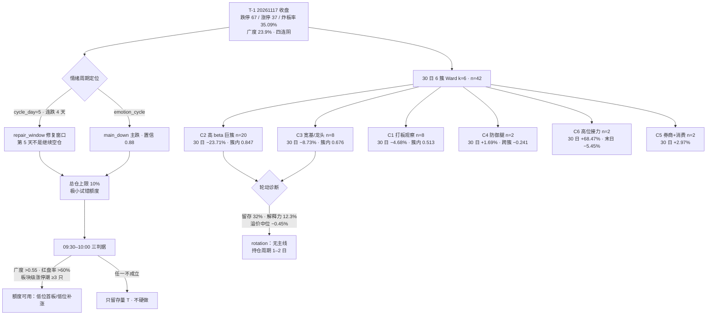

# 2026-11-18 · **风格研判**

> **数据源新鲜度**: partial（A 股主源新鲜，跨资产缺失）
> **降级状态**: true（gap_flags = cross_asset / margin(T+1)）
> **置信度**: 0.472

## 一句话结论

**崩溃退潮型（退潮结构、非崩盘式抛售）+ 情绪 25.1（恐惧）+ 无主线（轮动结构），总仓上限 10%；今日是情绪周期第 5 天（连跌 4 天 · repair_window）＝修复窗口，额度只给低位首板/低位补涨与尾盘试错，不接高位老龙。**

三句话说完今日该做什么：**先看 09:30–10:00 三判据，成立才把 10% 额度用出去，不成立只留存量 T**；**主线波段框架今天禁用（行业次日留存 32%、解释力 12.3%）**，持仓周期按 1–2 日；**高位接力一律拦截**（C6 高位接力腿末日 −5.45%、三板以上单腿末日 −7.00%）。



---

## 一、情绪周期：**第 5 天（连跌 4 天 · repair_window）**

### 1.1 位置读数（`cycle_position.json`，as of 20261117 收盘）

| 项 | 读数 | 说明 |
|---|---|---|
| `cycle_day` | **5** | 连跌序列进入第 5 个交易日，即连跌 4 天后的第一个修复窗口 |
| `consecutive_down_days` | **4** | 20261112 / 13 / 16 / 17 连续四日广度崩塌 |
| `tier` | **repair_window** | 修复窗口，不是 `continued_down` |
| 历史同位置样本 | 20261113 连跌 2 天 → 20261116（次日广度 0.2039、涨停 32，未修复）；20261116 连跌 3 天 → 20261117（次日广度 0.2379、涨停 37，未修复） | **2 个样本全部未修复**，只能当结构性参照，不能当概率 |

**口径提示（给 D1）**：`cycle_day=5` 与 R7 的「主跌第 4 日」说的是同一段行情的两种计数——R7 数「已经跌了几天」，R1 数「今天是这段行情的第几个交易日」。两者不矛盾，但**不要把 5 读成还要再跌 5 天**。

### 1.2 对应打法（四条，逐条可执行）

1. **09:30–10:00 只验证、不接力**：三判据为①开盘广度 > 0.55；②昨日 32 家涨停股今日红盘率 > 60%；③板块级涨停潮 ≥ 3 只。**今日 T-1 对应读数全部不达标（广度 23.9%、红盘率 50.0%、板块级涨停潮 0 条），基线就是「不成立」**，只有在开盘 30 分钟内被推翻才允许动用额度。
2. **额度用途写死：只做低位首板 / 低位补涨 / 尾盘试错**。`repair_window` 的语义是「切换新题材 + 连跌后博反弹」，不是「抄高位老龙的底」；三板以上单腿 30 日 +88.44% 但末日 **−7.00%**，接它就是接末日。
3. **判据不成立时只做存量 T**：不新开仓、不补仓、不做二波假设；存量做 T 的单笔仓位不得超过该标的原仓位。
4. **单日额度不再上移**：即使盘中广度修复到 0.55，仓位上限也停在 10%（理由见 §七），修复确认需要**连续两个交易日**（今日修复 + 明日溢价转正），不是日内一次冲高。

---

## 二、市场结构：四连阴后的极端读数（T-1 = 20261117）

### 2.1 涨停 / 跌停 / 炸板

| 指标 | 读数 | 前一日 | 判读 |
|---|---|---|---|
| 涨停 | **37** | 32 | 家数微升，但高度继续塌：7 板 → 4 板 → 3 板 |
| 跌停 | **67** | 60 | 连续两日 ≥60，亏钱效应扩散到极端区 |
| 炸板 | 20 | 16 | 炸板率 **35.09%**（前日 33.33%），仍在 ≥35% 分水岭上 |
| 最高连板 | **3 板（仅 1 家）** | 4 板 | 天梯 1 板 31 / 2 板 5 / 3 板 1，**首板占比 83.78%** |
| 封单比中位 | 0.1803 | — | 薄封单，遇放量即炸 |
| 首封时间累计 | 09:30 8.1% / 10:00 59.5% / 10:30 70.3% / 11:30 91.9% / 14:00 100% | — | 六成首板在 10:00 前完成，**午后新增极少＝尾盘无抢筹意愿** |

**结论**：这是「高度塌陷 + 家数钝化」的组合——涨停家数不再是情绪指标，**能封住的只剩低位首板**。炸板率 ≥35% 触发本 skill 的减半规则：**情绪定性写「主跌（退潮）」，候选数直接砍半**（R1 本就不出票，砍半后为 0）。

### 2.2 溢价与承接

| 口径 | 均值 | 中位 | 备注 |
|---|---|---|---|
| 昨日涨停今日开盘溢价 | −0.30% | 0.00% | 32 家样本 |
| 昨日涨停今日收盘溢价 | **+0.23%** | **−0.45%** | 均值被少数强势票拉起，**中位仍为负** |
| 红盘率 | — | **50.0%** | 一半红一半绿 |
| 再涨停 | — | **6 只 / 32** | 18.75%，低于健康接力水平 |

**修复三判据（收盘口径）**：溢价中位 > +1% → **否（−0.45%）**；涨家占比 ≥60% → **否（23.9%）**；涨停 ≥60 → **否（37）**。**三条全部不成立**，今日只按「退潮中的脉冲」对待，不按「修复确认」对待。

### 2.3 指数与广度

| 指数 | 涨跌 | 指数 | 涨跌 |
|---|---|---|---|
| 上证指数 | −0.50% | 科创50 | **+0.62%** |
| 深证成指 | −0.49% | 沪深300 | −0.08% |
| 创业板指 | **−1.20%** | 中证500 | −0.23% |
| 北证50 | +0.59% | — | — |

广度：涨 1216 / 跌 3882 / 平 119（样本 5217），中位 **−1.41%**，涨超 5% 仅 99 家、跌超 5% 达 528 家；成交额 **14575 亿**（环比 −1.81%）。**指数跌幅收窄而个股中位仍 −1.41%，说明权重在护、小票在杀**——与大小盘分层完全同向（见 §四）。

### 2.4 资金三表（R7 同源，已折算进 R1）

| 维度 | 读数 | 时效 | 判读 |
|---|---|---|---|
| 主力净额 | **−263.04 亿**（超大单 −96.28 / 大单 −166.76 / 中单 −35.13 / 小单 **+298.50**） | 20261117 当日 | 连续第 4 个净流出日，但流出较前日 −646.77 亿**收窄 383.73 亿**；**小单接盘量从 +496 亿降到 +298 亿，中户由接盘转撤离** |
| 5 日累计 | **−1837.79 亿**（20 日 −4258.34 亿，20 日中仅 8 日为正） | 20261117 | 派发未结束，只是斜率放缓 |
| 两融余额 | **22357.28 亿**，单日 −214.69 亿，5 日 **−313.03 亿（−1.38%）** | 20261116（T+1） | 去杠杆第 2 日，杠杆未回补 |
| ETF 份额 | 科创50 −41.79 亿份（−3.88%）、中证500 −7.04（−7.20%）、半导体 −1.52、光伏 −3.34；创业板 +3.40、沪深300 +3.33 | 20261116（T+1） | **指数反弹与份额赎回同向＝配置盘在反弹里减仓** |

---

## 三、30 日 6 簇（Ward k=6 · n=42 · 窗口末日 20261117）

| 簇 | n | 30 日 | 5 日 | 末日 | 簇内相关 | 跨簇相关 | 构成（统计成员） |
|---|---|---|---|---|---|---|---|
| **C2** | **20** | **−23.71%** | −7.51% | −1.03% | **0.847** | 0.356 | 高 beta 巨簇：热股 / 近端次新 / 百元股 / 成交·振幅前十 / 两通前十 / 增发·增减持·回购 / 扭亏 / 中证500·1000 / 科创50 / 通信·芯片·半导体·军工 ETF |
| **C3** | 8 | −8.73% | −5.10% | −0.62% | 0.676 | 0.452 | 宽基与龙头：行业龙头 / 沪深300 / 上证50 / 医药·光伏·新能源·有色 ETF / 恒生科技 |
| **C1** | 8 | −4.68% | −3.08% | −0.96% | 0.513 | 0.393 | 打板与情绪观察：百日新高 / 创历史新高 / 资金·打板·首板·二板表现 / 高贝塔 / 房地产 |
| **C6** | 2 | **+68.47%** | +6.47% | **−5.45%** | 0.405 | 0.017 | 高位接力腿：打二板以上 / 非 ST 三板以上 |
| **C5** | 2 | +2.97% | −0.30% | +0.05% | 0.412 | 0.069 | 券商 + 消费 ETF |
| **C4** | 2 | +1.69% | +1.18% | −0.81% | 0.301 | **−0.241** | **防御腿：银行 + 煤炭 ETF（唯一与其余簇负相关的腿）** |

**42 样本整体**：30 日中位 **−15.17%**、正收益 **9/42**；5 日中位 −5.31%；末日 7 涨 / 34 跌、末日中位 −0.83%。

**退化诊断（必须写进结论）**：同一批样本在 average linkage 下塌成 **35/42 单一巨簇**（30 日 −17.10%、簇内 0.649）＋ 5 个 1–2 只孤立样本。**Ward 只是把同一块石头切成 20/8/8**，粒度上仍是「一个共同风险因子 + 两条防御/接力小岔路」；这与 §四的轮动诊断（留存 32%）互为印证，说明**今天不存在可分辨的板块主线**。

### 3.1 三问（对三个关键簇，逐条回答）

**Q1 大资金意图（C2 高 beta 巨簇 n=20，30 日 −23.71%）**
**减仓而不是换仓。** 20 只成员与宽基相关 0.356、簇内 0.847，说明它们是同一批筹码的 20 种表达；主力连续 4 日净流出 −1837.79 亿（5 日）、ETF 份额同期净赎回，**钱没有离开市场，是从高 beta 池子里撤出去等更低的位**。末日 −1.03% 与 5 日 −7.51% 说明这个池子**仍在被卖，但斜率在放缓**（主力单日流出从 −646 亿收窄到 −263 亿）。

**Q2 为什么走弱**
位置（30 日 −23.71%、回撤与高点距离接近历史极值）+ 筹码（封单比中位仅 18%、开板中位 1 次）+ 外部（隔夜道指 −1.64%、存储与代工龙头 TSM −3.68%）三维同向。**它不是「跌错了」，是「跌得合理」**：高 beta 池子在杠杆去化（两融 5 日 −313 亿）与配置盘赎回（科创50 份额 −3.88%）双重压力下，反弹即卖点。

**Q3 逻辑够不够硬**
**位置逻辑硬、反转逻辑不硬。** 30 日 −23.71% + 正收益仅 9/42 是硬数据；但「跌多了就该反弹」不是逻辑，三判据（溢价、广度、涨停家数）全部不成立才是硬数据。**结论：可以研究，不可开仓；额度只给低位首板，不给巨簇内部的反弹。**

**Q4 防御腿（C4 银行+煤炭，30 日 +1.69%、末日 −0.81%）**
**大资金意图＝避险容器，不是进攻主线。** 它是 6 簇里唯一跨簇相关为负（−0.241）的腿，30 日 +1.69% 与宽基 −8.73%（C3）形成跷跷板；但末日 −0.81% 说明**避险腿也开始被卖**，且两融去杠杆期防御腿同样吃不到增量。**逻辑硬度：中。可作观察锚，不作今日主攻方向。**

**Q5 高位接力腿（C6，30 日 +68.47%、末日 −5.45%）**
**这是 30 日窗口里唯一的正收益大腿，也是今天最该拦截的腿**：30 日 +68% 全部来自前段，末日 −5.45%、5 日 +6.47% 说明**收益已经兑现在尾部**；三板以上单腿末日 −7.00%、回撤 −7.00% 是「单腿末日」的教科书读数。**动作：拦截，不接二波。**

---

## 四、轮动诊断：**rotation（无主线）**

| 指标 | 读数 | 阈值 | 判定 |
|---|---|---|---|
| 行业截面解释力 | **12.33%**（5556 只 / 105 个行业） | 常态约 10%，>20% 才算强结构 | 轮动 |
| 昨日 TOP5 行业留存率 | **32.0%（8/25）** | 随机水平 50%，<35% 判轮动 | 轮动 |
| 涨停次日溢价（收盘中位） | **−0.45%**（红盘率 50.0%，广度 23.9%） | 需 >+1% 且广度配合 | 不成立 |
| 大小盘分层（流通市值中位） | <50 亿 **−1.92%**（3034 只）/ 50–200 亿 −0.87% / 200–500 亿 −0.24% / 500–1000 亿 0.00% / **>1000 亿 +0.17%**（119 只） | 连续 3 日小盘减大盘：**−2.64 / −3.13 / −1.56 pct** | 大盘占优 |

**三条落在轮动 → `rotation_regime = rotation`，`main_lines_count` 如实写 1（无主线），`size_tilt = large`。** 硬规则生效：**今日禁用「沿主线做龙一龙二」框架**，改写为「开关状态 + 仓位上限 + 持仓周期 1–2 日」。这也解释了为什么 §二里涨停家数钝化：**轮动市场里涨停是脉冲，不是梯队**。

---

## 五、外盘：道指杀、费半独红（20261117 收盘，sina/东财实时补齐）

| 指数 | 涨跌 | 3 日累计 | 判读 |
|---|---|---|---|
| 道指 | **−1.64%** | −2.95% | 传统权重杀跌最重 |
| 标普500 | −1.03% | −3.35% | 同步走弱 |
| 纳指综合 | −0.74% | **−4.09%** | 三连跌，跌幅收敛 |
| 纳指100 | −0.72% | — | — |
| 费城半导体 | **+0.34%** | — | **唯一转正**，但内部撕裂 |
| 恒生指数 | −1.03% | — | 亚洲同步 |
| 韩国综合 | −2.59% | — | 亚洲最弱 |

半导体内部：**代工龙头 −3.68%、存储龙头 −0.92%、软件权重 −2.27%、光模块链龙头 +2.46% / 玻璃基板链 +2.19%**。**费半转正是「结构切换」不是「整体转强」**——钱从制造/存储切向光互连。对 A 股的映射含义只有一条：**今日科技高开要按「给隔夜逃命盘抬轿」处理，高开不追；低开承接才是修复延续的正解。**

跨资产：商品（原油/铜/金）skipped、汇率仅 USDCNH 单点，**软着陆/降息/衰退三档坐标无法建立**，故外盘只作情绪前置，不作方向依据。

---

## 六、文本侧：冰点共识、拐点分歧（群聊 0 条，公众号 86 篇 / 13 个号）

| 观点方向 | 条数 | 核心判断（已匿名化） |
|---|---|---|
| 位置极端、次日反核 | 2 | 四连阴 + 四连冰为近年级别极值，涨停家数与连板高度同时落到年内冰点；一路「旗帜鲜明看次日反核」，一路「尾盘跌不动、等次日早盘验证短线低点」 |
| 趋势未改、只认一日级反弹 | 2 | 主流指数已事实性破位、创波段新低；冰点在下跌趋势中会反复出现；只承认「连续急跌/恐慌后一日级反弹」，不承认二三日的持续机会 |
| 资金结构 | 1 | 护盘切换为「尾盘节能模式」，单日约 200 亿；四季度股票 ETF 净申购约 5640 亿，相对万亿级逃命盘不足 |
| 量能门槛 | 1 | 量能未连续 3 日站上 2 万亿之前，不支持趋势级别行情（T-1 1.46 万亿） |

**综合立场：位置共识（冰点成立）、时点分歧（短线低点是否已现）。** 与量化关系 = `partial`：文本的「冰点」与 R1 的跌停 67 / 广度 23.9% 同向；文本的「反核」与 R1 的溢价中位 −0.45%、涨停 37 家不达标相冲。**R1 只采纳「位置极端」这一半，不采纳「拐点已到」这一半**——因为拐点需要三判据开盘确认，而文本不提供可验证判据。

---

## 七、风格判定与仓位上限

**五分法区间代价最小化**（数值全部来自 T-1 现算：涨停 37、跌停 67、最高 3 板、炸板率 35.09%、涨家占比 23.9%、行业 ≥8 家涨停 0 条、成交额 −1.81%）：

| 风格 | 代价 | 命中情况 |
|---|---|---|
| **崩溃退潮型** | **0.2982（最小）** | 跌停 67 ✓、指数 −0.50/−1.20 ✓、炸板率 35.09% ✗（未过 50%）→ **2/3 成立，保留标签＝退潮结构（非崩盘式抛售）** |
| 震荡分化型 | 0.3129（差 0.0147） | 涨停 37 ∈20–40 ✓、无连板龙头 ✓——**只差一个炸板率判据，故不能说它是「震荡」** |
| 防御观望型 | 1.0620 | 涨停 37 ≥20，不成立 |
| 主线扩散型 | 1.3211 | 无梯队、行业 ≥8 家 0 条 |
| 连板情绪型 | 1.5145 | 高度 3 板、涨停 37，全不成立 |

**为什么不干脆写「震荡分化型」**：两者的代价差只有 0.0147，但**跌停 67 家 + 四连阴 + 广度 23.9%** 的三重事实决定今日的性质是「退潮」，不是「分化」；写震荡会让 D1 误以为还有结构性轮动可做。**同时必须写明：崩溃三条件未全成立 → 0.10 是「极小试错额度」，不是「崩溃确认/全天禁手」。**

**仓位上限推导**：

```
风格基准 0.15（崩溃退潮型）
−0.10（情绪 25.1 落恐惧档）
−0.15（阶段 main_down）
−0.05（当日广度 23.9%）
+0.00（赚钱效应确认：涨停 37 / 广度 23.9% / 炸板率 35.09% 三项均未达标）
= 0.00 → 主跌下限 0.10 生效
周期折扣 −0.05（隔夜纳指 3 日 −4.09%）→ 已在下限，取 0.10
```

**上限 = 10%**。这 10% 的性质：**只覆盖「存量 T + 低位首板/低位补涨试错」**，三判据成立才动用；不覆盖任何高位接力、不做二波、不做巨簇内反弹。

---

## 八、今日做什么 / 不做什么

| 动作 | 标的类型 | 条件 |
|---|---|---|
| **进（额度内）** | 低位首板、低位补涨、尾盘试错 | 09:30–10:00 三判据至少 2 条成立，且个股非高位接力、非三板以上 |
| **观察** | C4 防御腿（银行+煤炭 ETF）、C5 券商+消费 ETF | 只作跷跷板观察锚，不占额度 |
| **降级** | C3 宽基/龙头簇 | 30 日 −8.73%、末日 −0.62%，等溢价转正再看 |
| **拦截** | 高位接力腿（C6：打二板以上 / 非 ST 三板以上） | 末日 −5.45%、三板以上单腿末日 −7.00%，30 日 +68% 已在尾部 |
| **不进** | C2 高 beta 巨簇内部任何反弹 | 30 日 −23.71%、簇内 0.847、配置盘赎回，反弹即卖点 |
| **不做** | 主线波段、龙一龙二接力 | `rotation` 硬规则：行业次日留存 32%，主线框架禁用 |

### 唯一额度对象的思维链（R1 不出票，此处只描述额度性质）

- **买入理由（为什么允许存在这 10%）**：①周期锚——第 5 天 repair_window，语义是修复窗口不是继续空仓；②位置锚——42 样本 30 日中位 −15.17%、正收益仅 9/42，跌的是中位不是高位；③结构锚——首板占比 83.78%、高度塌到 3 板，**低位尚未被连带清洗**，一旦承接恢复，低位首波弹性最大。
- **风险点**：历史同位置 2 个样本（连跌 2 天、连跌 3 天）**次日全部未修复**；主力 20 日 −4258 亿、两融 5 日 −313 亿，杠杆与配置盘双退；隔夜道指 −1.64%，外盘不给趋势确认。
- **止损条件**：单笔试错亏损达 −5% 即无条件退出（不进 −5%~−10% 区间）；若开盘 30 分钟广度 < 0.45 或炸板率再破 45%，**当日额度作废、不再新开**。
- **可验证假设（今日内可证真/证伪）**：H1 收盘广度 ≥ 0.55 且涨停 ≥ 60 → 修复窗口成立，明日额度可维持；H2 昨日 32 家涨停股收盘红盘率 ≥ 60% 且溢价中位转正 → 承接恢复；H3 主力净额收敛到 −150 亿以内 → 派发为一次性释放。**三条 ≤1 条成立 → 明日额度仍 10%；≥2 条成立才允许把额度抬到 20%，且仍需 R2 给出主线。**

---

## 九、风险与反证

- **反证 1（最硬的一条）**：`rotation` 判定本身否定了「修复」叙事——行业次日留存 32% 意味着**任何今日走强的方向明日都只有 1/3 概率留在前列**；若今日出现「普涨式修复」，按轮动框架它更可能是**一日游**而非趋势起点。
- **反证 2**：跌停家数口径分歧——R1 用 `limit_list_d` 直出 **67** 家，R7 用「收盘＝最低＝跌停价」反推补录后 **84** 家（涨停 38 / 炸板 22 / 炸板率 36.67%）。**以 67 为基线、84 为压力测试**：两种口径都指向「跌停 ≫ 涨停」，结论方向不变，但**若按 84 家计，亏钱效应更极端，10% 额度应更保守**。
- **反证 3**：科创50 单日 +0.62% 是全场唯一正指数，但科创50 ETF 5 日份额 −3.88%——**指数与份额背离**，这个背离不能用「反弹」解释，只能用「配置盘借反弹减仓」解释。
- **反证 4**：文本侧两家明确押注次日反核，属于左侧博弈；若今日高开低走，这部分预期会在 10:00 前反转，**不要把它当承接**。
- **反证 5**：情绪分 25.1 未被「极恐」定价（0–20 才是极恐），说明**市场没有恐慌到可以无条件逆向**；位置极端 ≠ 可以重仓。

---

## 十、数据源审计

| 源 | 状态 | 抓取日期 | 记录数 | 备注 |
|---|---|---|---|---|
| tushare.ths_daily + ths_member | 🟢 ok | 2026-11-18 | 22 | 22/22 风格板块，30 个收益日完整、零方差 0 |
| tushare.fund_daily | 🟢 ok | 2026-11-18 | 20 | 20/20 ETF |
| r1_style_cluster.py（Ward k=6） | 🟢 ok | 2026-11-18 | 42 | 窗口末日 20261117，退化诊断同步产出 |
| tushare.limit_list_d / limit_step | 🟢 ok | 2026-11-18 | 5217 | 涨停/跌停/炸板逐票 + 天梯 |
| tushare.index_daily | 🟢 ok | 2026-11-18 | 7 | 含北证50 |
| tushare.daily + daily_basic | 🟢 ok | 2026-11-18 | 5556 | 行业解释力与市值分层 |
| R7_capital_flow | 🟡 partial | 2026-11-18 | 21 | 两融、ETF 份额 T+1 滞后一日 |
| sina gb_ + eastmoney push2his | 🟢 ok | 2026-11-18 | 19 | 5 指数 + 14 美股；SOX/NDX prev_close unverified |
| tushare.index_global / us_daily | 🟡 stale | 2026-11-18 | 14 | 美股停在 20261116，已由实时源补齐 |
| 商品（原油/铜/金） | 🔴 error | 2026-11-18 | 0 | skipped，跨资产三档坐标不可建 |
| 汇率 USDCNH / DXY | 🟡 partial | 2026-11-18 | 1 | 仅 USDCNH 单点 |
| 公众号池（18 源） | 🟢 ok | 2026-11-18 | 86 | 13 个号，6 条方向性判断 |
| 焦点群（匿名） | 🔴 error | 2026-11-18 | 0 | 0 字节，窗口内 7 群无消息 |
| cycle_position.py | 🟢 ok | 2026-11-18 | 12 | 连跌 4 天 / cycle_day 5 / repair_window |
| emotion_cycle.py | 🟡 partial | 2026-11-18 | 5 | 盘前按 T-1 口径，竞价后由 P1 校准 |

---

## 十一、不确定性 / 反证自评

1. **风格标签的边界风险**：崩溃退潮型与震荡分化型代价差 0.0147（4.7%），若把炸板率 35.09% 读作「分歧」而非「退潮」，标签应换成震荡分化型，仓位上限会从 10% 抬到 30–35%。**这是本轮最大的主观判断点**，已用「跌停 67 + 四连阴 + 广度 23.9%」三重事实锁定退潮性质。
2. **周期位置的样本太少**：同口径（连跌 2 天 / 3 天）只有 2 条，且都未修复；**"第 5 天必定修复"不是统计结论**，只是心法里的经验窗口。
3. **资金维度滞后**：两融与 ETF 份额都停在 20261116，方向可信、增量不可信；主力资金是当日口径，可信度高。
4. **外盘缺口**：商品与美元指数缺失，无法判断「软着陆/降息/衰退」，因此外盘只作情绪前置。
5. **文本侧只有公众号**：群聊 0 条，缺少一线游资的即时表述，文本权重已按此折价（agreement=0.9 而非 1.0）。

**置信度 0.472** = 0.70（基线）×0.75（新鲜度，2 个 gap）×0.9（文本与量化 partial 同向）。**压低的不是 A 股主源（主源零缺口），而是跨资产与资金时效。**

---

## 十二、与其他 R/D/E 的关系

- **依赖**：`cycle_position.json`（第 5 天定位）、`emotion_cycle.json`（主跌阶段）、`R7_capital_flow`（资金三表）、`_r1_market.json`（微观结构）、`_r1_cluster.json`（30 日 6 簇）、`_r1_rotation.json`（轮动诊断）
- **被消费**：
  - **R2**：`style=崩溃退潮型`、`main_lines_count=1（无主线）`、`rotation_regime=rotation` → **R2 不得输出「沿主线做龙一龙二」，只能给观察清单**
  - **R3**：`sentiment_score=25.1`（恐惧档）作基准
  - **R4**：今日催化一律按「退潮中的脉冲」折算，不按「新主线起点」折算
  - **R6**：与 R2 的一致性反证入口——若 R2 判出主线，即与本轮 rotation 硬规则冲突
  - **D1**：`position_cap_suggestion=0.10` → exec_pool 总仓上限 10%，且只覆盖存量 T 与低位首板试错

---

## Sub-Agent 元数据

- skill: `analyze_style_v1`
- artifact: `data/research/20261118/R1_style.json`（pydantic 校验通过，status=degraded）
- 生成耗时: 约 320 秒（含 style_snapshot 22 板块 + 20 ETF 现拉）
- model: deepseek-v4.1-flash
- 方法: `cluster_v1 + market_structure_v2 + llm_prose`
- 红线自检: ✅ 无 A 股板块推荐 ✅ 无 A 股个股代码/名称 ✅ 无 K 线形态/估值/买卖点 ✅ style 落在 5 枚举
- 口径自检: ✅ md 簇数值逐簇对齐 JSON 的 Ward 簇（非 average 退化版）✅ 情绪周期写「第 5 天 + 打法」而非只写 main_down ✅ 炸板率 ≥35% 减半规则已执行
