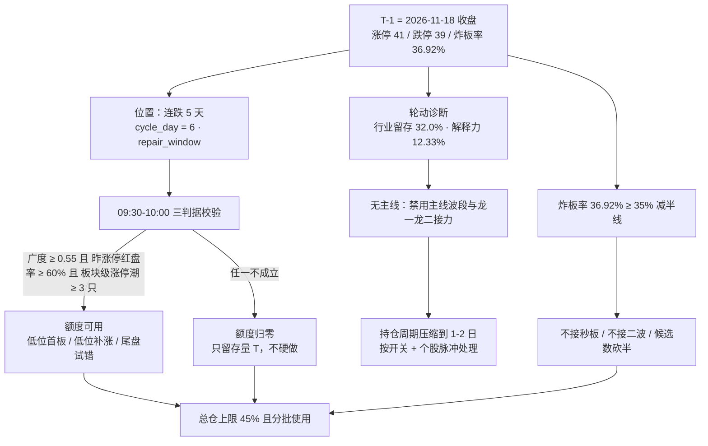

# 2026-11-19 · **风格研判**

> **数据源新鲜度**: partial（A 股主源完整，跨资产与两融为已知缺口）
> **降级状态**: false（status=complete；缺口不影响风格与涨停结构判定）
> **置信度**: 0.525

## 一句话结论

**震荡分化型 + 情绪 32.9（恐惧）+ 无主线（轮动结构），总仓上限 45%；今日是情绪周期第 6 天（连跌 5 天 · repair_window）＝修复窗口的观察日，不是继续空仓、也不是修复确认——额度小、只做低位首板/低位补涨与尾盘试错，09:30–10:00 三判据成立才动用。**

## 决策树（今日的唯一开关）



---

## 一、情绪周期：**第 6 天（连跌 5 天 · repair_window）**

### 1.1 位置读数（`cycle_position.json`，as of 2026-11-18 收盘）

| 读数 | 值 |
|---|---|
| 连续下跌天数 | **5** |
| `cycle_day` | **6** |
| `tier` | **repair_window** |
| 当日涨停 / 跌停 / 炸板 | 41 / 39 / 24（炸板率 36.92%） |
| 涨家占比 / 全市场中位 | 23.65% / −1.20% |
| 同口径历史样本 | 3 条，**全部 `repaired=false`** |

**口径提示（给 D1）**：`cycle_day=6` 数的是「今天是这段行情的第 6 个交易日」，不是「还要再跌 6 天」。连跌 5 天后的第 6 天，按周期表进入**修复窗口**——它与 `main_down` 这个阶段标签的区别只有一句：**main_down 在这里的语义是「修复窗口」，不是「继续空仓」**。

### 1.2 阶段标签与位置的关系（本轮必须讲清，否则下游会读错）

| 口径 | 读数 | 说明 |
|---|---|---|
| 单日形态阶段（`emotion_cycle.json`） | **high_chop（高位震荡）**，置信 0.72 | 跌停 39 家但溢价 +3.19% 为正、炸板率 36.92% < 40% → 判「分歧退潮」，不是崩盘式抛售 |
| 序列位置（`cycle_position.json`） | **第 6 天 · repair_window** | 连跌 5 天，已进入修复窗口观察段 |
| 两者合并后的当日含义 | **既不是「继续空仓」，也不是「修复确认」** | 打法以位置为准（允许小额度试错），额度以单日温度为准（收紧 → 仓位上限扣 0.05） |

阶段覆盖**未触发**：风格=震荡分化型 与 阶段=高位震荡 一致，`phase_style_consistency = 一致`。**不要把 36.92% 的炸板率读成「退潮已结束」**——它是「分歧未收敛」，正好对应「修复窗口 ≠ 修复成立」。

### 1.3 对应打法（四条，逐条可执行）

| # | 打法 | 触发条件 | 不成立的处置 |
|---|---|---|---|
| ① | **低位首板 / 低位补涨**优先，不接力高位老龙 | 个股身位在 1–2 板、非高位加速段 | 高位票一律划到「拦截」 |
| ② | **09:30–10:00 三判据确认** | 开盘广度 > 0.55、昨日涨停红盘率 > 60%、板块级涨停潮 ≥ 3 只 | 只留存量 T，不新增 |
| ③ | 判据成立 → 成长线内**低吸/半路** | 分时不破均价、量能不枯竭 | 当日额度作废 |
| ④ | 判据不成立 → **维持观察，不硬做** | 广度 < 0.45 或炸板率再上 45% | 仓位上限直接压到 0.15 以下 |

### 1.4 历史同口径样本（诚实标注：样本不是概率）

- 连跌 2 天 → 次日涨停 32 / 广度 20.39%，**未修复**；
- 连跌 3 天 → 次日涨停 37 / 广度 23.79%，**未修复**；
- 连跌 4 天 → 次日涨停 41 / 广度 23.65%，**未修复**。

**这三条样本的真实含义**：修复窗口是「允许试错的窗口」，不是「必然反弹的保证」。三条样本全未修复，说明本段行情的修复阈值比心法经验更严——所以三判据里**三条必须同时成立**，不许「两条成立就开仓」的折算。

---

## 二、市场结构（T-1 = 2026-11-18 收盘）

### 2.1 涨停 / 跌停 / 炸板：跌停从 67 收敛到 39，但炸板率反而抬升

| 指标 | 2026-11-18 | 2026-11-17 | 变化 |
|---|---|---|---|
| 涨停家数 | **41** | 37 | +4 |
| 跌停家数 | **39** | 67 | −28 |
| 炸板家数 | **24** | 20 | +4 |
| 炸板率 | **36.92%** | 35.09% | **+1.83pct（仍在 35% 减半线上方）** |
| 最高连板 | **4 板** | 3 板 | +1 |
| 连板天梯 | 1板 33 / 2板 7 / **3板 0** / 4板 1 | — | **3 层空缺** |
| 首板占比 | **80.49%** | 83.78% | −3.3pct |

**读数含义**：跌停 67→39 是**卖压收敛**，但炸板率 36.92% 与「3 层空缺」说明**高度仍无法自然递推**——4 板是孤票，不是梯队。首板占 80.5% 是典型的「低位仍在、中位已空」结构，**今日可做的是低位首波，不是中位接力**。封单比中位 12.5%、换手中位 7.33%、开板中位 0 次，说明封板质量只是中性偏弱，不是强封。

首板封板时间累计：09:30 7.32% → 10:00 **46.34%** → 10:30 58.54% → 11:30 75.61% → 14:00 100%。**近一半首板在 10:00 前完成**，所以 09:30–10:00 的三判据必须当场执行，拖到 10:30 之后只剩尾段。

### 2.2 溢价与承接：开盘正、收盘收窄，修复三判据全部不成立

| 口径 | 均值 | 中位 | 备注 |
|---|---|---|---|
| 昨日涨停股开盘溢价 | **+3.19%** | **+2.89%** | 37 家基数 |
| 昨日涨停股收盘溢价 | **+1.57%** | **+0.73%** | 红盘率 51.35% |
| 再涨停 | 8 只 | — | 21.6% 的成功率 |

**修复三判据（收盘口径）**：

- 溢价中位 > +1% → **否（+0.73%）**
- 涨家占比 ≥ 60% → **否（25.0%）**
- 涨停 ≥ 60 → **否（41）**

**三条全部不成立 → 今日只按「退潮中的脉冲」对待，不按「修复确认」对待。** 开盘 +3.19% 而收盘中位只有 +0.73%，是标准的「高开兑现」形态：**竞价一致性越高，越要等第一波回落后的二次承接，不追开盘价**。

### 2.3 指数与广度：指数红、个股绿，是分化最直白的样子

| 指数 | 收盘 | 涨跌幅 |
|---|---|---|
| 上证指数 | 3587.83 | +0.09% |
| 深证成指 | 10659.41 | +0.20% |
| 创业板指 | 2311.62 | +0.85% |
| 科创50 | 1247.99 | **+2.20%** |
| 沪深300 | 3983.77 | +0.18% |
| 中证500 | 6282.22 | −0.01% |
| 北证50 | 831.86 | −1.15% |

**广度**：涨 1277 / 跌 3823 / 平 117（有效 5217 只），涨家占比 **25.0%**，全市场中位 **−1.17%**；涨超 5% 144 只 vs 跌超 5% 261 只。**成交额 13695.6 亿（前日 14575.2 亿，−6.04%），为 16 个月地量（快讯口径）。**

**结论**：指数由权重与科创拉动，个股中位仍为负——**这不是「指数修复带个股」，而是「少数权重止跌、多数个股继续失血」**。这种结构下做题材必须做「低位有承接的」，不能做「指数红就追」的。

### 2.4 五连阴序列（同口径逐日）

| 日期 | 涨停 | 跌停 | 炸板率 | 最高板 | 广度 | 中位 |
|---|---|---|---|---|---|---|
| 2026-11-12 | 37 | 5 | 48.61% | 5 | 15.70% | −1.61% |
| 2026-11-13 | 37 | 33 | 36.21% | 4 | 13.73% | −2.00% |
| 2026-11-16 | 32 | 60 | 33.33% | 4 | 20.39% | −2.12% |
| 2026-11-17 | 37 | 67 | 35.09% | 3 | 23.79% | −1.31% |
| 2026-11-18 | 41 | 39 | 36.92% | 4 | 23.65% | −1.20% |

**序列读数**：广度从 13.73% 抬到 23.65%（三天连升），中位跌幅从 −2.12% 收窄到 −1.20%，涨停从 32 抬到 41——**三项都是「止跌」特征，但都还在阈值之下**。这就是「第 6 天＝修复窗口」的量化依据：**斜率先转，水位未到**。

### 2.5 资金（R7 同源，已折算进 R1）

| 口径 | 读数 | 方向 |
|---|---|---|
| 主力单日净额（2026-11-18） | **−85.2 亿**（净流入率 −0.62%） | 小幅流出，较前几日的百亿级收敛 |
| 主力 5 日累计 | **−2125.8 亿** | 持续派发 |
| 两融余额（2026-11-17，T+1） | **22171 亿**，5 日 −485.7 亿（−2.14%） | 杠杆继续退 |

**资金结论**：主力单日流出收窄到 −85 亿，是本轮最像「卖压衰减」的读数；但 5 日 −2126 亿与两融 −2.14% 说明**去杠杆没结束**。资金维只支持「不再加速下跌」，不支持「资金回流」——**所以额度只能给低位试错，不能给高位反包**。

### 2.6 主线代理：行业 0 条、概念 2 条，但已被轮动诊断否决

- 行业口径（≥8 家涨停）：**0 条**（最高 IT服务Ⅱ 7 家）；
- 概念口径（≥20 家）：**2 条**（21 家、20 家，均为 4 天 3 板，前日基数 10/6 → 当日 +11/+14）。

**这两条概念不能当主线**：它们是「单日脉冲式放大」，且轮动诊断给出行业次日留存仅 32.0%——**在留存 <35% 的市场里，今日 20 家涨停的方向明日只有 1/3 概率留在前列**。按 skill §3.6 硬规则，`main_lines_count` 如实写 **1（无主线）**。

---

## 三、30 日 6 簇（Ward k=6 · n=42 · 窗口末日 2026-11-18）

| 簇 | n | 30 日 | 5 日 | 末日 | 最大回撤 | 簇内相关 | 跨簇相关 | 与宽基相关 | 构成（统计成员） |
|---|---|---|---|---|---|---|---|---|---|
| **C6** | 4 | **+33.75%** | +3.63% | **−2.93%** | −8.90% | 0.324 | 0.026 | −0.033 | 高位接力腿：打二板以上 / 非ST三板以上 / 券商 / 消费 ETF |
| **C2** | 1 | +9.27% | **−7.33%** | −2.18% | −11.60% | — | 0.189 | 0.174 | 单腿：非ST二板表现 |
| **C5** | 2 | +0.55% | +1.48% | +0.06% | −6.74% | 0.278 | **−0.252** | **−0.365** | **防御腿：银行 + 煤炭 ETF** |
| **C1** | 7 | −8.29% | −5.34% | −0.20% | −14.13% | 0.573 | 0.417 | 0.546 | 打板与情绪观察：百日新高 / 创历史新高 / 资金前十 / 高贝塔 / 打板 / 首板 / 房地产 |
| **C4** | 7 | −8.47% | −4.38% | −0.34% | −9.50% | 0.684 | 0.448 | 0.712 | 宽基与龙头：行业龙头 / 沪深300 / 上证50 / 医药·光伏·新能源 ETF / 恒生科技 |
| **C3** | **21** | **−22.57%** | **−10.03%** | **+0.07%** | **−24.30%** | **0.828** | 0.338 | **0.887** | 高 beta 巨簇：热股 / 近端次新 / 百元股 / 成交·振幅前十 / 两通前十 / 增发·增减持·回购 / 扭亏 / 中证500·1000 / 科创50 / 通信·芯片·半导体·军工·有色 ETF |

**42 样本整体**：30 日中位 **−15.57%**、正收益 **8/42**；5 日中位 **−7.01%**；末日 14 涨 / 28 跌、末日中位 −0.26%。

**退化诊断（必须写进结论）**：同一批样本在 average linkage 下塌成 **35/42 单一巨簇**（+2×1 +2×1 +1×1 的孤立腿），说明**这批标的本质上只有一个共同风险因子 + 三条小岔路**。Ward 只是把同一块石头切成 21/7/7/4/2/1，**粒度上没有多出任何「新主线」**——这与 §四轮动诊断（留存 32.0%）互为印证。

### 3.1 三问（对三个关键簇，逐条回答）

**Q1 高 beta 巨簇（C3，n=21，30 日 −22.57%，末日 +0.07%）**

- **大资金意图**: **减仓而不是换仓。** 21 只成员与宽基相关 **0.887**、簇内相关 **0.828**，说明它们是同一批筹码的 21 种表达；末日 +0.07% 与 5 日 −10.03% 的组合说明**这个池子仍在被卖，只是当天止跌**。主力 5 日 −2125.8 亿、两融 5 日 −2.14%，钱是从这个池子里撤出去，而不是搬到另一个板块。
- **为什么走强（为什么弱）**: 位置上是 30 日 −22.57%、最大回撤 −24.30% 的深跌段；催化上缺硬事件，只有隔夜纳指 +0.42% 的弱反抽；筹码上是杠杆去化（两融 −2.14%）叠加配置盘收缩。**三维没有一个支持趋势反转**。
- **逻辑够不够硬**: **位置逻辑硬，反转逻辑不硬。** 30 日 −22.57%、正收益 8/42 是硬数据；但「跌多了该反弹」不是逻辑，**修复三判据全部不成立**才是硬数据。**动作：可研究，不可开仓；额度不给巨簇内部的反弹。**

**Q2 防御腿（C5：银行 + 煤炭 ETF，30 日 +0.55%，末日 +0.06%）**

- **大资金意图**: **避险容器，不是进攻主线。** 它是 6 簇里唯一跨簇相关为负（**−0.252**）且与宽基负相关（**−0.365**）的腿——大资金在这里买的是「不跌」，不是「涨得多」。
- **为什么走强**: 位置上是 30 日唯一接近零波动的腿，抗跌属性来自低 beta 与高股息；催化上无题材，只有风险偏好下行时的被动配置；筹码上没有增量，5 日 +1.48% 的幅度不足以吸引趋势资金。
- **逻辑够不够硬**: **中等偏软。** 抗跌是真的（最大回撤 −6.74%，6 簇最小），但它**不产生赚钱效应**——在没有跟风盘的市场里，防御腿只能作观察锚，不能作今日主攻方向。

**Q3 高位接力腿（C6，n=4，30 日 +33.75%，末日 −2.93%）**

- **大资金意图**: **兑现，不是建仓。** C6 的 30 日 +33.75% 由两条打板腿主导（昨日打二板以上表现单腿 **+43.70%**、非ST三板以上单腿 **+88.43%**），而券商 ETF −4.57%、消费 ETF +7.45% 只是被同一段情绪临时拼进来——簇内相关仅 **0.324** 就是这条「拼装」的证据。末日 −2.93%、5 日 +3.63% 说明收益已在尾部兑现。
- **为什么走强（为什么该弱）**: 30 日涨幅靠「打板类指数」自身的复利效应放大（三板以上单腿 30 日 +88.43%、最大回撤 −7.00%，即回撤全部发生在末日），末日 −7.00% 与高位股连续跌停同步；**高度只有 4 板且 3 层空缺**，接力链条已断。
- **逻辑够不够硬**: **最硬的一条是「它今天最该被拦截」。** 三板以上单腿 30 日 +88.43% 而末日 −7.00%、最大回撤 −7.00%——回撤与末日同步，是「收益兑现在尾部」的教科书形态。**动作：拦截，不接二波、不做反包第二波假设。**

---

## 四、轮动诊断：**rotation（无主线）**

| 指标 | 读数 | 判读 |
|---|---|---|
| 行业截面解释力 | **12.33%**（5556 只 / 105 个行业） | <20%，**结构分化弱**（常态 10% 上下） |
| 昨日 TOP5 行业留存率 | **32.0%**（8/25 命中，5 个相邻交易日对：2026-11-10 → 2026-11-17） | **<35%，强轮动** |
| 涨停次日溢价 | 收盘中位 **+0.73%**，红盘率 51.35%，**当日广度 25.0%** | 溢价弱且广度低 → 脉冲而非梯队 |
| 大小盘分层 | <50 亿 **−1.92%** / 50–200 亿 −0.87% / 200–500 亿 −0.24% / 500–1000 亿 0.00% / >1000 亿 **+0.17%** | **size_tilt = large**（小盘连续 3 日跑输大盘） |

**四条指标里三条落在轮动（解释力 <20%、留存 <35%、溢价弱+广度低），第四条的市值分层指向「大盘抗跌、小盘失血」** → 原始诊断 2/4 flags 只够判 `mixed`，但**「行业次日留存 <35%」是硬否决条款**，`rotation_regime` 升级为 **rotation（无主线）**：`main_lines_count` 如实写 1，禁用「沿主线做龙一龙二」框架，持仓周期压缩到 1–2 日，按开关状态 + 个股脉冲处理。

**这条硬规则的实战含义**：今日任何「看起来成板块」的走势，明日只有 **1/3** 概率留在前列；**所以不许用「主线波段」的仓位与持有周期，只能用「脉冲」的仓位与 1–2 日周期**。这也是 R1 不推方向、只给额度性质的根因。

---

## 五、外盘：纳指反抽但 3 日仍净跌（2026-11-18 收盘，实时源补齐）

| 指数 | 收盘 | 单日 | 5 日 | 20 日 |
|---|---|---|---|---|
| 纳斯达克综合 | 24429.88 | **+0.42%** | −2.94% | **−7.93%** |
| 标普500 | 7323.63 | −0.23% | −2.40% | −4.82% |
| 道琼斯 | 50198.17 | **−1.11%** | — | — |
| 费城半导体 | 9652.80 | +0.10% | — | — |
| 恒生指数 | 23294.75 | −0.91% | −4.20% | −1.51% |
| 韩国综合 | 5067.44 | +1.99% | −5.73% | **−11.65%** |
| 日经225 | — | — | −3.63% | −7.88% |

**纳指 3 日累计 −2.81%**。15 只美股样本分化：AMD **+5.31%**、AMZN +3.82%、AVGO +3.64%、TSLA +0.95%、ASML +0.88% 对 NVDA **−2.89%**、QCOM **−4.12%**、MU −1.00%、INTC −0.91%。

**读数**：单日反抽（纳指 +0.42%、费半 +0.10%）发生在 3 日 −2.81%、20 日 −7.93% 的背景下，**属跌深反抽，不是趋势修复**；且亚洲（韩国 20 日 −11.65%、日经 −7.88%）仍在更深的位置。**结论：外盘只作情绪前置，不作今日加仓理由。**

**缺口**：商品（原油/铜/金）skipped、美元指数缺，`USDCNH 6.6668`（2026-11-17）为单点 → **跨资产三档坐标（软着陆/降息/衰退）不可建**，已计入 `data_gaps`，不外推。

---

## 六、文本侧：地量共识、修复不确认（群聊 0 条，公众号 91 篇 / 18 个号）

- **位置共识**：成交额 1.37 万亿创 16 个月地量，卖盘动能衰减——与量化的「缩量至地量 + 跌停 67→39」同向。
- **修复不确认**：多数表述是「情绪有所修复，但做多信心修复仍需时间」「缩量主因是买盘也在观望」；**没有一条给出「趋势反转已成立」的判断**。
- **结构＝轮动**：「板块轮动节奏偏快、增量资金入场意愿不足、不宜过早博弈趋势反转」——与 `retention 32.0%` 同向。
- **账户行为分散**：有自述抄底加仓宽基类工具的，也有在创新高时减仓的，**没有一致性方向**，故不作为资金信号。

**文本与量化关系 = 一致（agreement 取 1.0）**：文本说「抛压释放但修复需时间、不做趋势反转」，量化说「三判据全部不成立、无主线」——**两者说的是同一件事**。R1 采纳「位置极端」这一半，不采纳任何「拐点已到」的推断（文本本身也没有给出可验证阈值）。

---

## 七、风格判定与仓位上限

**五分法区间代价最小化**（数值全部来自 T-1 现算：涨停 41、跌停 39、最高 4 板、炸板率 36.92%、涨家占比 25.0%、行业 ≥8 家涨停 0 条、成交额 −6.04%）：

| 风格 | 代价 | 命中情况 |
|---|---|---|
| **震荡分化型** | **0.3174（最小）** | 涨停 41（略高于 20–40 区间上沿）、无连板龙头（3 层空缺）、涨跌分化极端 ✓ |
| 防御观望型 | 1.0500 | 涨停 41 ≥ 20，不成立 |
| 主线扩散型 | 1.3395 | 无梯队、行业 ≥8 家 0 条 |
| 崩溃退潮型 | 1.3523 | 炸板率 36.92% 未过 50%、上证 +0.09% / 创业板 +0.85% 未跌 1% → **仅 1/3 成立** |
| 连板情绪型 | 1.3593 | 高度 4 板、涨停 41，全不成立 |

**为什么从昨天的「崩溃退潮型」切到「震荡分化型」**：昨天的三个成立项是「跌停 67、指数 −0.50/−1.20、广度 23.9%」；今天指数转红（+0.09%/+0.85%）、跌停收敛到 39，崩溃判据只剩 1/3，代价表自然切换。**这是数据驱动，不是态度转暖**——`crash_check.confirmed = false` 明确写进 JSON。

**仓位上限推导**：

```
风格基准 0.60（震荡分化型）
−0.05（情绪 32.9 落「恐惧」档）
−0.05（阶段 high_chop 高位分歧）
−0.05（当日广度 25.0%）
+0.00（赚钱效应确认：涨停 41 / 广度 25.0% / 炸板率 36.92% 三项均未达标）
= 0.45
```

**上限 = 45%**。这 45% 的性质必须写清：**它是天花板，不是目标仓位**。

- 判据未成立时，**新增额度为 0**，45% 只覆盖存量持仓与存量 T；
- 判据成立时，也只做「低位首板 / 低位补涨 / 尾盘试错」，分批使用，不追求用满；
- **不覆盖**：高位接力（4 板及三板以上）、二波假设、巨簇内部反弹、竞价一致性追高、秒板。

**炸板率 ≥35% 减半规则已执行**：今日炸板率 36.92%，情绪定性写「恐惧（退潮未收敛）」，候选数在 R1 侧本来为 0（R1 不出票）；对下游的含义是 **R2/R4 的候选池必须砍半，且只留低位身位**。

---

## 八、今日做什么 / 不做什么

| 态度 | 对象类型 | 条件 |
|---|---|---|
| **进（额度内）** | 低位首板、低位补涨、尾盘试错 | 09:30–10:00 三判据**三条同时成立**，且个股非高位接力、非三板以上 |
| **观察** | 防御腿（银行 + 煤炭 ETF） | 只作跷跷板锚，30 日 +0.55% 但无赚钱效应，不占额度 |
| **降级** | 宽基与龙头簇（C4） | 30 日 −8.47%、5 日 −4.38%，等溢价中位转正再评估 |
| **拦截** | 高位接力腿（C6：打二板以上 / 非ST三板以上） | 30 日 +33.75% 已兑现在尾部，末日 −2.93%、最大回撤 −8.90%，不做二波 |
| **不进** | 高 beta 巨簇（C3）内部任何反弹 | 30 日 −22.57%、簇内 0.828、与宽基 0.887，反弹即卖点 |
| **不做** | 主线波段、龙一龙二接力 | `rotation` 硬规则：留存 32.0%，主线框架禁用，周期 1–2 日 |

### 唯一额度对象的思维链（R1 不出票，此处只描述额度性质）

- **买入理由（为什么允许存在这 45% 的天花板）**：①周期锚——第 6 天 repair_window，语义是修复窗口不是继续空仓；②位置锚——42 样本 30 日中位 −15.57%、正收益仅 8/42，跌的是中位不是高位；③结构锚——首板占比 80.5%、3 层空缺、封板时间 46.3% 集中在 10:00 前，**低位尚未被连带清洗**，一旦承接恢复，低位首波的弹性最大。
- **风险点**：①历史同位置 3 个样本（连跌 2/3/4 天）**次日全部未修复**；②主力 5 日 −2125.8 亿、两融 5 日 −2.14%，杠杆与配置盘双退；③隔夜纳指 3 日 −2.81%、道指 −1.11%，外盘不给趋势确认；④炸板率 36.92% 仍在减半线上方，高开即兑现的概率大。
- **止损条件**：单笔试错亏损达 **−5%** 即无条件退出（不进 −5%~−10% 区间）；若开盘 30 分钟广度 < 0.45 或炸板率再破 **45%**，**当日新增额度作废、不再新开**（仓位上限直接压到 0.15 以下）。
- **可验证假设（今日内可证真/证伪）**：H1 收盘广度 ≥ 0.55 且涨停 ≥ 60 → 修复窗口成立，明日额度可维持；H2 昨日 37 家涨停股收盘红盘率 ≥ 60% 且溢价中位 > +1% → 承接恢复；H3 主力净额收敛到 −150 亿以内 → 派发为一次性释放。**三条 ≤1 条成立 → 明日额度仍按 0.45 天花板且新增归零；≥2 条成立才允许把新增额度抬到 0.20，且仍需 R2 给出可交易结构。**

---

## 九、风险与反证

- **反证 1（最硬的一条）**：`retention 32.0%` 本身否定了「修复成主线」的叙事——今日任何走强的方向，明日只有 1/3 概率留在前列；**若今日出现「普涨式修复」，按轮动框架更可能是一日游**，不是趋势起点。
- **反证 2（口径）**：跌停家数 R1 用 `limit_list_d` 直出 **39** 家；若按「收盘＝最低＝跌停价」反推，口径可能更大。**以 39 为基线、放大值作压力测试**：两种口径下涨停 41 vs 跌停 39 的方向不变，但若真实跌停更多，45% 的天花板应当更保守地使用。
- **反证 3（指数与个股背离）**：科创50 +2.20%、创业板 +0.85% 但全市场中位 −1.17%、涨家占比 25.0%——**指数红是个股绿的对立面**，这个背离只能用「权重止跌 + 多数失血」解释，不能用「普涨修复」解释。
- **反证 4（历史样本全负）**：连跌 2/3/4 天后的次日全部 `repaired=false`，**「第 6 天必修复」不是统计结论**；它只是心法给出的观察窗口，所以三判据必须三条同时成立。
- **反证 5（情绪未到极恐）**：情绪分 32.9 属「恐惧」（20–40），**不是「极恐」（0–20）**，说明市场没有恐慌到可以无条件逆向；位置极端 ≠ 可以重仓。

**盘中降档触发条件（任一即降）**：

1. 竞价/开盘 30 分钟广度 < 0.45 → 新增额度归零；
2. 炸板率再上 45% → 仓位上限压到 0.15 以下；
3. 昨日 37 家涨停股收盘红盘率 < 50% → 承接证伪，只留存量 T；
4. 主力单日净额再破 −300 亿 → 派发重新加速，禁止任何新增。

---

## 十、数据源审计

| 源 | 状态 | 日期 | 记录数 | 备注 |
|---|---|:--:|---|---|
| tushare.ths_daily + ths_member | 🟢 ok | 2026-11-19 | 22 | 22/22 风格板块，30 个收益日完整、零方差 0 |
| tushare.fund_daily | 🟢 ok | 2026-11-19 | 20 | 20/20 ETF，窗口末日 2026-11-18 |
| r1_style_cluster.py（Ward k=6） | 🟢 ok | 2026-11-19 | 42 | 窗口末日 2026-11-18；average 退化诊断同步产出 35 巨簇 |
| tushare.limit_list_d / limit_step | 🟢 ok | 2026-11-18 | 5217 | 涨停/跌停/炸板逐票 + 3 层空缺天梯 |
| tushare.index_daily | 🟢 ok | 2026-11-18 | 7 | 含北证50 |
| tushare.daily + daily_basic | 🟡 partial | 2026-11-17 | 5556 | 行业解释力/留存/市值分层末日 2026-11-17（本地 daily 落盘限制） |
| R7_capital_flow（主力 / 两融） | 🟡 partial | 2026-11-18 | 2 | 主力当日口径；两融 T+1（最新 2026-11-17） |
| sina gb_ + eastmoney push2his | 🟢 ok | 2026-11-18 | 20 | 5 指数 + 15 美股；SOX/NDX prev_close unverified |
| tushare.index_global / us_daily | 🟡 stale | 2026-11-17 | 5 | 美股停在 2026-11-17，已由实时源补齐 |
| 商品（原油/铜/金） | 🔴 error | 2026-11-18 | 0 | skipped，跨资产三档坐标不可建 |
| 汇率 USDCNH / DXY | 🟡 partial | 2026-11-17 | 1 | 仅 USDCNH 6.6668 单点，DXY 缺 |
| 公众号池（18 源） | 🟢 ok | 2026-11-18 | 91 | 覆盖 18 个号；方向性判断 18 条，账号匿名化 |
| 焦点群（匿名） | 🔴 error | 2026-11-18 | 0 | 0 字节，抓取窗口内无消息 |
| cycle_position.py | 🟢 ok | 2026-11-18 | 12 | 连跌 5 天 / cycle_day 6 / repair_window |
| emotion_cycle.py | 🟡 partial | 2026-11-18 | 5 | 盘前按 T-1 口径，竞价后需 P1 校准 |

---

## 十一、不确定性 / 反证自评

1. **风格标签的切换风险**：昨天崩溃退潮型（代价 0.2982）→ 今天震荡分化型（0.3174），切换成因是「指数转红 + 跌停 67→39」，**代价差并不大**（两者都不是极端读数）。若把跌停 39 视为「余震未消」，标签应留在退潮一侧、仓位上限会从 45% 降到 10–15%。**这是本轮最大的主观判断点**，已用 `crash_check.confirmed=false`（仅 1/3 判据成立）锁定为「分化」而非「崩溃」。
2. **周期位置的样本太少**：同口径只有 3 条（连跌 2/3/4 天），且**全部未修复**；「第 6 天」是心法窗口，不是统计结论。这是把上限压在「天花板 + 新增归零」的直接原因。
3. **轮动诊断晚一日**：行业截面与留存末日 2026-11-17（本地 daily 落盘限制），而溢价与广度用 2026-11-18；结构化结论（无主线）不因这一日滞后而改变，但「留存 32%」的精度只能算作当前结构快照。
4. **资金维度滞后**：两融停 2026-11-17，方向可信、增量不可信；主力资金是当日口径，可信度高。
5. **外盘缺口**：商品与美元指数缺失，无法判断宏观三档环境，因此外盘只作情绪前置，不进入仓位推导。
6. **文本侧只有公众号**：群聊 0 条，缺一线游资的即时表述；文本权重按「可读、可复算」折价——本轮的 agreement=1.0 建立在「文本方向与量化同向」，而不是「文本覆盖充分」。

**置信度 0.525** = 0.70（基线）× 0.75（新鲜度，2 个 gap：cross_asset / margin）× 1.0（文本与量化一致）。**压低的不是 A 股主源（主源零缺口），而是跨资产与两融时效。**

---

## 十二、与其他 R/D/E 的关系

- **依赖**：`cycle_position.json`（第 6 天定位）、`emotion_cycle.json`（高位震荡阶段）、`R7_capital_flow`（主力 / 两融）、`_r1_market.json`（微观结构）、`_r1_cluster.json`（30 日 6 簇）、`_r1_rotation.json`（轮动诊断）、`_r1_overseas_fill.json`（外盘补齐）、`_r1_kol.json`（文本侧摘要）
- **被消费**：
  - **R2**：`style=震荡分化型`、`main_lines_count=1（无主线）`、`rotation_regime=rotation` → **R2 不得输出「沿主线做龙一龙二」，只能给低位观察清单，且候选数按炸板率 36.92% 砍半**
  - **R3**：`sentiment_score=32.9`（恐惧档）作基准
  - **R4**：今日催化一律按「退潮中的脉冲」折算，不按「新主线起点」折算
  - **R6**：与 R2 的一致性反证入口——若 R2 判出主线，即与本轮「留存 32% → 无主线」硬规则冲突
  - **D1**：`position_cap_suggestion=0.45` 是**天花板**；新增额度在 09:30–10:00 三判据成立前为 0，成立后只覆盖低位首板/低位补涨/尾盘试错，持仓周期 1–2 日

---

## Sub-Agent 元数据

- skill: `analyze_style_v1`
- artifact: `data/research/20261119/R1_style.json`（pydantic 校验通过，status=complete，33 KB）
- 生成耗时: 约 210 秒（含 style_snapshot 22 板块 + 20 ETF 现拉 + 4 个底稿脚本）
- model: deepseek-v4.1-flash
- 方法: `cluster_v1 + market_structure_v2 + llm_prose`
- 红线自检: ✅ 无 A 股板块推荐 ✅ 无 A 股个股代码/名称 ✅ 无 K 线形态/估值/买卖点 ✅ style 落在 5 枚举
- 口径自检: ✅ md 簇数值逐簇对齐 JSON 的 Ward 簇（非 average 退化版 35 巨簇）✅ 情绪周期写「第 6 天 + 四条打法」而非只写 main_down ✅ 炸板率 ≥35% 减半规则已执行 ✅ 第 6 天语义写成「修复窗口」而非「继续空仓」
