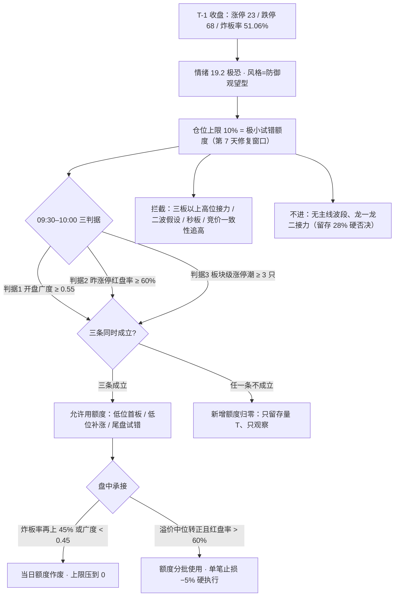

# 2026-11-20 · **风格研判**

> **数据源新鲜度**: partial（A 股主源零缺口，跨资产 / 两融有缺口）
> **降级状态**: true · 置信度 0.472
> **窗口**: 30 个收益日（末日 2026-11-19）· Ward 6 簇 · n=42（22 风格板块 + 20 ETF，外盘指数另表）

## 一句话结论

今日 **防御观望型** + 情绪浓度 **19.2（极恐）** + **无主线（轮动结构）**，仓位上限 **10%**——但这不是「继续空仓」：位置是 **第 7 天（连跌 6 天 · repair_window）**，10% 是**等三判据验证的极小试错额度**，只许低位首板 / 低位补涨 / 尾盘试错，**不许接力高位老龙、不许做二波假设**。

---

## 决策树（今日的唯一开关）



**这张图的含义**：今天不是「找一个方向买」，而是**先证明修复存在、再把 10% 拆成小份试错**；证明不成立，当天就是观察日 + 存量 T。

---

## 一、情绪周期：**第 7 天（连跌 6 天 · repair_window）**

### 1.1 位置读数（`cycle_position.json`，as of 2026-11-19 收盘）

| 字段 | 读数 | 含义 |
|---|---|---|
| `consecutive_down_days` | **6** | 2026-11-11 之后连续 6 个交易日收在杀跌态（2026-11-12 → 2026-11-19） |
| `cycle_day` | **7** | 今日是杀跌段第 7 个交易日 = 修复窗口观察日 |
| `tier` | **repair_window** | 语义是「连跌次日的修复窗口」，**不是继续空仓** |
| `signals` | 涨停 23 / 跌停 68 / 炸板 24（51.06%）/ 广度 11.65% / 中位 −2.55% | 冰点读数仍在恶化 |
| `rule_source` | 卷首情绪周期表·主跌期 + 连跌两日博反弹、第三天必有修复的心法 | 心法给的是**窗口**，不是**许可** |

### 1.2 三个词怎么共存：补跌 × 防御观望 × 修复窗口

- **`emotion_cycle.phase = 补跌（capitulation，conf 0.9）**：跌停 68 家 ≥ 50 且炸板率 51.06% ≥ 50%，判据成立 → **市场温度按最低档计**，仓位按阶段扣减。
- **`style = 防御观望型`（五分法最小代价 0.157）**：看的是**结构**——涨停 23 家、最高 3 板、首板占比 78.3%、无连板龙头、广度 12.3% → 结构上不是崩溃，也不是连板情绪。
- **`tier = repair_window`**：看的是**位置与节奏**——连跌 6 天后第 7 天进入修复窗口，**窗口的意义是「可以开始验证」，不是「已经可以重仓」**。

三者关系一句话：**温度定在冰点（补跌）、结构定在观望（防御观望）、位置定在窗口第 7 天（repair_window）——所以额度存在但极小，且必须靠盘中三判据放行。**

### 1.3 对应打法（四条，逐条可执行）

1. **09:30–10:00 只看不做**：先读三个数——开盘广度是否 ≥ 0.55、昨日 41 家涨停股红盘率是否 ≥ 60%、板块级涨停潮是否 ≥ 3 只。**三条同时成立才允许动用 10% 额度**，任何一条不成立 → 当日新增为 0。
2. **优先低位首板 / 低位补涨，不接高位老龙**：T-1 天梯 1 板 18 家占 78.3%、3 板仅 3 家、最高 3 板——**低位筹码尚未被连带清洗**，修复时要弹性也在这里；三板以上昨日单腿 **−7.00%**，是明确的反面教材。
3. **盘初续杀则等尾盘试错，不追日内首波**：昨日炸板率 51.06%、开盘溢价 +1.99% 而收盘中位 −0.71%，**高开就是兑现盘**；尾盘试错的胜率来自「卖压出清」而不是「早盘情绪」。
4. **存量只做 T，不做隔夜加仓**：主力单日 −313.1 亿、5 日 −1913.9 亿、两融 5 日 −2.85%，钱还在撤；任何「修复」在没有增量资金前只按 1 日级别脉冲处理。

### 1.4 历史同口径样本（诚实标注：样本不是概率）

| 连跌天数 | 前一日 | 次日 | 次日涨停 | 次日广度 | 是否修复 |
|---|---|---|---|---|---|
| 2 | 2026-11-13 | 2026-11-16 | 32 | 20.39% | ✗ |
| 3 | 2026-11-16 | 2026-11-17 | 37 | 23.79% | ✗ |
| 4 | 2026-11-17 | 2026-11-18 | 41 | 23.65% | ✗ |
| 5 | 2026-11-18 | 2026-11-19 | 23 | 11.65% | ✗ |

**四个同口径样本，次日全部 `repaired=false`**（判定阈值为次日广度 > 0.55 或涨停 ≥ 60）。这条数据的作用是**压低预期**，不是给方向：它说明「连跌第 N 天必反弹」没有统计支撑，**所以三判据必须三条同时成立**，否则 10% 一分不用。

---

## 二、市场结构（T-1 = 2026-11-19 收盘）

### 2.1 涨停 / 跌停 / 炸板：跌停 68 家，炸板率 51.06%

| 指标 | 读数 | 前一日（2026-11-18） | 方向 |
|---|---|---|---|
| 涨停 | **23** | 41 | ↓ 砍半 |
| 跌停 | **68** | 39 | ↑ 翻倍 |
| 炸板 | 24 | 24 | 持平 |
| 炸板率 | **51.06%** | 36.92% | ↑ 破 50% |
| 最高连板 | **3 板** | 4 板 | ↓ 高度缩短 |
| 天梯 | 1 板 18 / 2 板 2 / 3 板 3 | 1 板 33 / 2 板 4 / 3 板 1 / 4 板 1 | 中间层塌陷 |
| 首板占比 | **78.3%** | 80.5% | 维持低位化 |

**读法**：涨停 23 家、跌停 68 家，**跌停是涨停的 2.96 倍**；炸板率 51.06% 已越过「分歧」进入「退潮」区间（≥40%），按纪律**候选数必须砍半**。天梯只有 3 层、最高 3 板、2 板仅 2 家——**接力链条事实上已断**。

### 2.2 溢价与承接：开盘 +1.99%，收盘中位 −0.71%

| 指标 | 读数 |
|---|---|
| 样本 | 昨日 41 家涨停股 |
| 开盘溢价 | 均值 **+1.99%** / 中位 +1.97% |
| 收盘溢价 | 均值 **+0.12%** / 中位 **−0.71%** |
| 红盘率 | **46.3%**（不足半数） |
| 再涨停 | 5 只 |
| 封板质量 | 封单比中位 11.0%、换手中位 7.07%、炸板次数中位 0 |
| 封板时点 | 09:30 前 17.4% / 10:00 前 56.5% / 10:30 前 73.9% / 14:00 前 100% |

**读法**：开盘给 +1.99% 的溢价，收盘只剩均价 +0.12%、中位 −0.71%，红盘率 46.3%——**这是「高开兑现」的标准形态**；封板质量（封单比 11.0%、炸板次数中位 0）尚可，说明**封得住的票还在，但接力资金已经不接第二次**。

### 2.3 指数与广度：指数分化，个股全面失血

| 指数 | 收盘 | 单日 |
|---|---|---|
| 上证指数 | 3577.62 | **−0.28%** |
| 深证成指 | 10583.20 | −0.71% |
| 创业板指 | 2293.34 | −0.79% |
| 科创50 | 1270.78 | **+1.83%** |
| 沪深300 | 3984.84 | +0.03% |
| 中证500 | 6251.96 | −0.48% |
| 北证50 | 798.64 | **−3.99%** |

| 广度 | 读数 |
|---|---|
| 上涨 / 下跌 / 平 | **638 / 4532 / 47**（5217 只） |
| 涨家占比 | **12.3%** |
| 涨跌幅中位 | **−2.45%** |
| 涨超 5% / 跌超 5% | 67 / **634** |
| 成交额 | **13049 亿**（前日 13696 亿，**−4.72%**） |

**读法**：科创50 +1.83%、沪深300 +0.03% 与「涨家 12.3%、中位 −2.45%」是对立的——**权重与护盘资金托住了指数，中小市值在失血**；北证50 −3.99% 是流动性最薄处先崩的直接读数。

### 2.4 六连跌序列（同口径逐日）

| 日期 | 涨停 | 跌停 | 炸板 | 炸板率 | 广度 | 中位 |
|---|---|---|---|---|---|---|
| 2026-11-12 | 37 | 5 | 35 | 48.61% | 15.70% | −1.61% |
| 2026-11-13 | 37 | 33 | 21 | 36.21% | 13.73% | −2.00% |
| 2026-11-16 | 32 | 60 | 16 | 33.33% | 20.39% | −2.12% |
| 2026-11-17 | 37 | 67 | 20 | 35.09% | 23.79% | −1.31% |
| 2026-11-18 | 41 | 39 | 24 | 36.92% | 23.65% | −1.20% |
| **2026-11-19** | **23** | **68** | 24 | **51.06%** | **11.65%** | **−2.55%** |

**读法**：中间三天（11-16 → 11-18）是「跌停 60+、广度 20%+、涨停回升到 41」的**弱抵抗形态**——昨天这根抵抗线被打断：涨停 41 → 23、广度 23.65% → 11.65%、炸板率 36.92% → 51.06%。**这是本轮最差的一天，不是修复的第一天。**

### 2.5 资金（R7 同源，已折算进 R1）

| 口径 | 单日 | 5 日 | 10 日 | 20 日 |
|---|---|---|---|---|
| 主力净额 | **−313.1 亿** | **−1913.9 亿** | −2462.5 亿 | −3929.8 亿 |
| 结构 | 超大单 −115.1 / 大单 −198.0 / 中单 −39.1 / **小单 +340.5** | — | — | — |
| 两融余额 | 22083 亿（2026-11-18） | **−649 亿（−2.85%）** | — | — |

**读法**：20 个交易日里只有 8 天主力净流入，**机构在撤、小单在接**——这是典型的「散户接机构」结构，不支持趋势修复；两融 5 日 −2.85% 说明**杠杆也在退**，高位股反包胜率因此显著下降。

### 2.6 主线代理：行业 0 条、概念 2 条，但已被轮动诊断否决

- 行业维度：单行业涨停 ≥8 家 **0 条**；≥3 家仅 1 个（最大 3 家）→ **不构成涨停潮**。
- 概念维度：20 条候选里 ≥8 家仅 **2 条**、≥20 家 **0 条**；最强一条涨停 10 家但前值 13 家（**−3 家**）、另一条 6 家前值 20 家（**−14 家**）——**热度在缩，不在扩**。
- 结论：**代理指标本身不支持「有主线」**；再叠加 §四留存 28.0% 的硬否决，`main_lines_count` 如实写 **1（无主线）**。

---

## 三、30 日 6 簇（Ward k=6 · n=42 · 末日 2026-11-19）

| 簇 | n | 30 日 | 5 日 | 末日 | 最大回撤 | 簇内相关 | 跨簇相关 | 与宽基相关 | 构成（统计成员） |
|---|---|---|---|---|---|---|---|---|---|
| **C6** | 4 | **+31.51%** | +3.92% | **−2.55%** | −8.90% | 0.336 | 0.022 | −0.048 | 高位接力腿：打二板以上 / 非ST三板以上 + 券商·消费 ETF |
| **C5** | 2 | −1.16% | **+1.48%** | −0.54% | **−6.85%** | 0.267 | **−0.232** | **−0.343** | **防御腿：银行 + 煤炭 ETF** |
| **C2** | 3 | −8.27% | −1.94% | +0.86% | −17.12% | 0.335 | 0.290 | 0.387 | 新高与资金观察腿：创历史新高 / 资金前十 / 非ST二板 |
| **C4** | 8 | −9.13% | −4.21% | −0.87% | −10.46% | 0.656 | 0.438 | 0.692 | 宽基与龙头腿：行业龙头 / 300·50 / 医药·恒科·光伏·新能源·地产 ETF |
| **C1** | 6 | −10.93% | **−10.30%** | **−2.72%** | −17.15% | 0.778 | 0.454 | 0.595 | 情绪观察腿：百日新高 / 热股 / 高振幅 / 高贝塔 / 打板 / 首板 |
| **C3** | **19** | **−20.14%** | **−8.91%** | −0.69% | **−22.56%** | **0.834** | 0.363 | **0.896** | 高 beta 巨簇：次新 / 百元股 / 成交·振幅·两通前十 / 增减持·回购·扭亏 / 500·1000 / 科创50 / 通信·芯片·半导体·军工·有色 ETF |

**42 样本整体**：30 日中位 **−14.36%**、正收益 **7/42**；5 日中位 −6.48%；末日 11 涨 / 29 跌、末日中位 −0.98%。

**退化诊断（必须写进结论）**：同一批样本在 average linkage 下塌成 **35/42 单一巨簇**（30 日 −15.86%、簇内相关 0.635，另加 2×2 + 1×3 的小岔路）——说明**这 42 只标的本子上只有一个共同风险因子**；Ward 只是把同一块石头切成 19/8/6/4/3/2，**没有多出任何「新主线」**。这与 §四留存 28.0% 互为印证，也是「不许用主线波段框架」的第二重证据。

**接力温度计（打板类风格指数的 30 日 vs 末日）**：三板以上 30 日 **+83.83%** 而末日 **−7.00%**（回撤与末日同步=收益已在尾部兑现）；二板以上 30 日 +36.00%、末日 −3.90%；二板 30 日 +8.92%、末日 **+4.18%**；首板 30 日 +11.03%、末日 −2.64%；打板综合 30 日 +4.57%、末日 −2.46%。**越高的腿末日越差，二板反而是当日唯一红盘**——这是「高度被杀、中位接力勉强活着」的典型退潮纹理。

### 3.1 三问（对三个关键簇，逐条回答）

**Q1 高 beta 巨簇（C3，n=19，30 日 −20.14%，末日 −0.69%）**

- **大资金意图**: **减仓，不是换仓。** 19 只成员与宽基相关 **0.896**、簇内相关 **0.834**，是同一批筹码的 19 种表达；5 日 −8.91% 而末日仅 −0.69%，说明**这个池子仍在被卖、当天只是止跌**。主力 5 日 −1913.9 亿、两融 5 日 −2.85%，钱是从这个池子撤出，而不是搬进另一个板块。
- **为什么走强**: 位置上 30 日 −20.14%、最大回撤 −22.56%，属**深跌段而非启动位**；催化上缺硬事件，只有隔夜纳指的跌深反抽（3 日仍 −2.57%）；筹码上是杠杆去化叠加配置盘收缩。**三维没有一项支持趋势反转**。
- **逻辑够不够硬**: **位置逻辑硬，反转逻辑不硬。** 30 日 −20.14%、正收益 7/42 是硬数据；但「跌多了该反弹」不是逻辑，**修复三判据全部不成立**才是硬数据。**动作：可研究，不可开仓；额度不投给巨簇内部的反弹。**

**Q2 防御腿（C5：银行 + 煤炭 ETF，30 日 −1.16%，5 日 +1.48%）**

- **大资金意图**: **避险容器，不是进攻主线。** 它是 6 簇里唯一跨簇相关为负（**−0.232**）且与宽基负相关（**−0.343**）的腿——资金在这里买的是「不跌」，不是「涨得多」；5 日 +1.48% 是风险偏好下行的被动流入。
- **为什么走强**: 位置上是 6 簇里最大回撤最小（**−6.85%**）的腿，抗跌来自低 beta；催化上无题材，只有风险偏好下行；筹码上没有增量资金，5 日涨幅不足 1.5%，吸不到趋势盘。
- **逻辑够不够硬**: **抗跌是真的，赚钱效应是假的。** 它可以作跷跷板锚，但**不产生跟风盘**——在留存 28%、涨家 12.3% 的市场里，防御腿只能观察、不能作为今日主攻方向。

**Q3 高位接力腿（C6，n=4，30 日 +31.51%，末日 −2.55%）**

- **大资金意图**: **兑现，不是建仓。** C6 的 30 日 +31.51% 由两条打板腿主导（三板以上单腿 30 日 **+83.83%**、二板以上 +36.00%），券商 / 消费 ETF 只是被同一段情绪临时拼进来——簇内相关仅 **0.336** 就是「拼装」的证据；末日 −2.55%、5 日 +3.92% 说明收益已在尾部兑现。
- **为什么走强**: 今天该弱 —— 30 日涨幅靠打板类指数自身的复利效应放大，**回撤全部发生在尾部**（三板以上最大回撤 −7.00% = 末日 −7.00%）；最高高度从 4 板缩到 3 板、2 板只剩 2 家，**接力链条已断**。
- **逻辑够不够硬**: **最硬的一条是「它今天最该被拦截」。** 30 日 +83.83% 的腿在末日 −7.00%，是「收益兑现在尾部」的教科书形态。**动作：拦截，不接二波、不做反包第二波假设。**

---

## 四、轮动诊断：**rotation（无主线）**

| 指标 | 读数 | 判读 |
|---|---|---|
| 行业截面解释力 | **9.83%**（5556 只 / 105 个行业） | <20% → **结构分化弱**（常态 10% 上下） |
| 昨日 TOP5 行业留存率 | **28.0%**（7/25 命中，5 个相邻交易日对：2026-11-11 → 2026-11-19） | **<35% → 强轮动** |
| 涨停次日溢价 | 收盘中位 **−0.71%**，红盘率 46.3%，**当日广度 12.3%** | 溢价为负且广度极低 → 脉冲而非梯队 |
| 大小盘分层 | <50 亿 **−3.26%** / 50–200 亿 −1.84% / 200–500 亿 −0.51% / 500–1000 亿 −0.36% / >1000 亿 **+0.04%** | **size_tilt = large**（小盘连续 3 日跑输：−3.13 / −1.56 / −2.59 pct） |

**四个指标里三条落在轮动（解释力 <20%、留存 <35%、溢价为负+广度极低），第四条市值分层指向「大盘抗跌、小盘失血」** → 原始 flags 命中 3/4，且**「行业次日留存 <35%」是硬否决条款**，`rotation_regime` 判定 **rotation（无主线）**：`main_lines_count` 如实写 1，**禁用「沿主线做龙一龙二」框架**，持仓周期压缩到 **1–2 日**，按开关状态 + 个股脉冲处理。

**实战含义**：今日任何「看起来成板块」的走势，明日只有 **约 1/4** 概率留在前列（5 个交易日对里最好的一对也仅 3/5 留存）。**所以今天不许用主线波段的仓位与持有周期，只能用脉冲的仓位与 1–2 日周期**——这也是 R1 不推方向、只给额度性质的根因。

---

## 五、外盘：全线杀跌，半导体是最弱环节（2026-11-19 收盘，实时源补齐）

| 指数 | 收盘 | 单日 | 5 日 | 20 日 |
|---|---|---|---|---|
| 纳斯达克综合 | 23879.20 | **−2.25%** | −4.07% | **−8.51%** |
| 标普500 | 7175.83 | −2.02% | −3.88% | −5.59% |
| 道琼斯 | 49097.06 | −2.19% | — | — |
| 费城半导体 | 9419.72 | **−2.41%** | — | — |
| 纳斯达克100 | 26517.05 | −2.21% | — | — |
| 恒生指数 | 22841.62 | **−1.95%** | −4.86% | −0.41% |
| 韩国综合 | 5137.89 | +1.39% | −3.83% | **−7.15%** |
| 日经225 | — | +0.71% | −2.26% | −8.01% |

**纳指 3 日累计 −2.57%**（−0.74% / +0.42% / −2.25%），昨日的反抽当天就被抹掉。15 只美股样本分化到极端：**AMD −7.72%**、AMZN −3.87%、GOOGL −3.46%、NVDA −3.30%、META −3.27%、TSM −2.90%、ASML −2.80% 对 **INTC +1.92%**、QCOM +1.38%。

**读数**：外盘从「跌深反抽」切回「趋势下行」，且**最弱的恰是半导体**（SOX −2.41%、AMD −7.72%），与 A 股 T-1 的科创50 +1.83% 形成**方向相反的背离**。外盘只作情绪前置，**不作今日加仓理由，也不作今日做空科技的理由**——背离本身就是不确定性，不是信号。

**缺口**：商品（原油/铜/金）skipped、美元指数缺，`USDCNH 6.66817`（2026-11-18）为单点 → **跨资产三档坐标（软着陆/降息/衰退）不可建**，已计入 `data_gaps`，不外推。

---

## 六、文本侧：六条方向性判断，全部指向「等信号」

群聊源本轮 0 条（7 个焦点群抓取窗口内无消息），文本侧由公众号池 **95 篇 / 19 源**承接，其中 11 篇为交易/复盘类作者；提取方向性判断 **6 条**，账号匿名化为 K1–K6，板块与个股名不进入产出：

- **K1 位置判断**：缩量下跌是下跌行情进入后期的特征——主动买盘萎缩但卖盘已不如前几日汹涌；护盘集中在大中盘宽基一级，越往下沉覆盖越弱，小微盘流动性枯竭；引 2024 年同类经验认为反弹时超跌小盘弹性更大（**只作背景，不作今日交易依据**）。
- **K2 形态判断**：连续第六个冰点仍属「弱震荡」而非「企稳」，下降趋势未改；企稳要么急跌深V、要么反复横盘两步走（先分离再确认），当前两者都不成立 → **只等不做**。
- **K3 结构判断**：老题材趋势已坏，即便止跌也只是反抽、有波动没空间；新方向可上可下、差一天差很多 → **只按博弈对待，不给趋势仓位**。
- **K4 周期判断**：连跌冰点与量化微盘崩塌形态相似；风格 2–3 个月切换一次，模式空窗期反复博弈=白干；「跌停板明日释放」被当作**修复的前置条件**而非买入理由。
- **K5 扩散判断**：唯一亮点集中在单一环节、方向内部极端分化，海外超跌反弹也带不动整体 → **扩散失败，赚钱效应仍窄**。
- **K6 外部判断**：隔夜外围全面下跌 + 流动性收紧叙事（贵金属、海外科技、汇率同时走弱），A 股尾盘靠宽基 ETF 集中买入托底 → **护盘是当前唯一边际改善项**。

**文本与量化关系 = 部分一致（agreement 取 0.8）**：6 条里 5 条与量化同向（冰点 + 未确认企稳 + 无主线 + 扩散失败 + 护盘托底），仅 K1 的「下跌后期」比量化更乐观。**R1 采纳「位置极端 + 未确认」这一半，不采纳任何「拐点已到」的推断**——文本侧也没有给出可验证阈值，按纪律不进仓位计算。

---

## 七、风格判定与仓位上限

**五分法区间代价最小化**（数值全部 T-1 现算：涨停 23、跌停 68、最高 3 板、炸板率 51.06%、涨家占比 12.3%、行业 ≥8 家涨停 0 条、成交额 −4.72%）：

| 风格 | 代价 | 命中 / 不命中 |
|---|---|---|
| **防御观望型** | **0.157（最小）** | 涨停 23 仍在 20–40 下沿、高度 3 板、广度 12.3%、成交额缩量 ✓ |
| 崩溃退潮型 | 0.2092 | 炸板率 51.06%（>50% ✓）、跌停 68 家（✓），但**上证 −0.28% / 创业板 −0.79% 未达 −1%** → 三条件未同时成立 |
| 震荡分化型 | 0.646 | 涨停 23 低于 30 下沿、无梯队分化 |
| 主线扩散型 | 2.2463 | 行业 ≥8 家 0 条、无梯队 |
| 连板情绪型 | 2.593 | 涨停 23 < 50、高度 3 < 6、炸板率 51.06% > 20% |

**为什么从昨天的「震荡分化型」切到「防御观望型」**：昨天涨停 41、跌停 39、炸板率 36.92%、广度 23.65%；今天涨停 23、跌停 68、炸板率 51.06%、广度 11.65%——**四项同步恶化**，代价表自然切换。**这是数据驱动，不是态度转暖或转冷**；`crash_check` 三条件只成立 2/3，所以**不把今天读成崩溃退潮，也不读成继续空仓**。

**仓位上限推导**：

```
风格基准 0.40（防御观望型）
−0.10（情绪 19.2 落「极恐」档）
−0.20（阶段 capitulation 补跌）
−0.05（当日广度 12.3%）
+0.00（赚钱效应确认：涨停 23 / 广度 12.3% / 炸板率 51.06% 三项均未达标）
= 0.05 → 主跌下限 0.10 生效，取 0.10
```

**上限 = 10%**。性质必须写清：

- **它不是「看空到空仓」，也不是「修复窗口的目标仓位」**——第 7 天的语义是「可以开始验证」，10% 是**极小试错额度**；
- 判据未成立时**新增额度为 0**，10% 只覆盖存量持仓与存量 T；
- 判据成立时也只做「低位首板 / 低位补涨 / 尾盘试错」，**分批使用、不追求用满**；
- **不覆盖**：三板及以上高位接力、二波假设、巨簇内部反弹、竞价一致性追高、秒板。

**炸板率 ≥35% 减半规则已执行**：今日炸板率 **51.06%**，情绪定性写「**极恐（退潮未收敛）**」，候选数在 R1 侧本为 0；对下游的含义是 **R2 / R4 候选池必须砍半，且只留低位身位**。

**与「极恐逆向窗口」的口径张力（必须先讲清）**：技能文档的 5 维表把 0–20 分读作「极恐·逆向买入窗口」。本轮**不按该口径抬高仓位**，理由是三条硬数据同时指向「表外因素」：①连跌 6 天且 4 个同口径历史样本 100% 未修复；②两融 5 日 −2.85%、主力 5 日 −1913.9 亿，**杠杆与配置盘双退**；③轮动留存 28%，任何「逆向买入」都没有次日承接保证。**极恐只说明「跌得够深」，不说明「跌完了」**——这一点是今天最重要的自我约束。

---

## 八、今日做什么 / 不做什么

| 态度 | 对象类型 | 条件 |
|---|---|---|
| **进（额度内）** | 低位首板、低位补涨、尾盘试错 | 09:30–10:00 三判据**三条同时成立**，且个股非高位接力、非 3 板以上，单笔止损 −5% 硬执行 |
| **观察** | 防御腿（低 beta 高股息类 ETF） | 只作跷跷板锚；最大回撤 −6.85% 抗跌但无赚钱效应，**不占额度** |
| **降级** | 宽基与龙头腿（C4，n=8） | 30 日 −9.13%、5 日 −4.21%；等溢价中位转正再评估 |
| **拦截** | 高位接力腿（C6：打板类高位 + 拼装 ETF） | 30 日 +31.51% 已在尾部兑现、末日 −2.55%，三板以上单腿末日 −7.00% → **不做二波** |
| **不进** | 高 beta 巨簇（C3）内部任何反弹 | 30 日 −20.14%、簇内 0.834、与宽基 0.896，**反弹即卖点** |
| **不做** | 主线波段、龙一龙二接力、隔夜加仓 | `rotation` 硬规则：留存 28.0%，主线框架禁用，周期 1–2 日 |

### 唯一额度对象的思维链（R1 不出票，此处只描述额度性质）

- **买入理由**：①**周期锚**——位置是第 7 天 repair_window，语义是修复窗口不是继续空仓，所以「有额度」；②**位置锚**——42 样本 30 日中位 −14.36%、正收益仅 7/42，跌的是中位不是高位，天梯 1 板占比 78.3%、3 板仅 3 家，**低位筹码尚未被清洗**，一旦承接恢复弹性最大；③**结构锚**——封单比中位 11.0%、炸板次数中位 0，**封得住的票还在**，缺的只是第二次接力。
- **风险点**：①四个同口径历史样本（连跌 2/3/4/5 天）**次日全部未修复**，这是最硬的反向证据；②主力 5 日 −1913.9 亿、两融 5 日 −2.85%，杠杆与配置盘双退；③隔夜纳指 −2.25%、费半 −2.41%，外盘不给趋势确认；④炸板率 51.06% 远在减半线上方，**高开即兑现**的概率大。
- **止损条件**：单笔试错亏损达 **−5%** 无条件退出（不进 −5%~−10% 区间）；若开盘 30 分钟广度 < 0.45 或炸板率再破 **45%**，**当日新增额度作废、不再新开**，上限直接压到 0；存量仓位只做 T、不留隔夜加仓。
- **可验证假设**: 24–72h 内可证真/证伪 ——**H1** 收盘广度 ≥ 0.55 且涨停 ≥ 60 → 修复窗口成立，明日额度可维持 0.10 并可申请上移；**H2** 昨日 41 家涨停股收盘红盘率 ≥ 60% 且溢价中位 > +1% → 承接恢复；**H3** 主力净额收敛到 −150 亿以内 → 派发为一次性释放；**H4** 三板以上高度不再缩、2 板家数回升到 ≥5 → 接力链条重建。**四条里 ≤1 条成立 → 明日额度仍按 0.10 且新增归零；≥2 条成立才允许把额度抬到 0.20，且仍需 R2 给出可交易结构。**

---

## 九、风险与反证

- **反证 1（最硬的一条）**：`retention 28.0%` 本身否定了「修复成主线」的叙事——今日任何走强的方向，明日只有约 1/4 概率留在前列；**若今日出现「普涨式修复」，按轮动框架更可能是一日游**，不是趋势起点。
- **反证 2（口径）**：跌停家数 R1 用 `limit_list_d` 直出 **68** 家；R7 的东财口径同日读到 **83** 家跌停。**以 68 为基线、83 作压力测试**：两种口径下「跌停 ≫ 涨停」的方向不变，但若真实跌停更多，10% 的额度应当更保守地使用。
- **反证 3（指数与个股背离）**：科创50 +1.83%、沪深300 +0.03% 但全市场中位 −2.45%、涨家占比 12.3%——**指数红是个股绿的对立面**，只能解释为「权重 + 护盘托底」，不能用「普涨修复」解释。
- **反证 4（历史样本全负）**：连跌 2/3/4/5 天后的次日全部 `repaired=false`，**「第 7 天必修复」不是统计结论**；它只是心法给出的观察窗口，所以三判据必须三条同时成立。
- **反证 5（情绪已到极恐但不等于见底）**：情绪分 19.2 落「极恐」（0–20），已进入恐慌区；但**恐慌是可延续状态**——跌停 68、炸板率 51.06%、两融去化都还在进行中，位置极端 ≠ 可以重仓。
- **反证 6（外盘背离）**：A 股 T-1 科创50 +1.83%，隔夜美股半导体 −2.41%、AMD −7.72%——**背离意味着今日开盘方向不可预判**，任何「跟随外盘杀科技」或「跟随 A 股抢科技反弹」都是单向押注，二者本轮都不做。

**盘中降档触发条件（任一即降）**：

1. 竞价 / 开盘 30 分钟广度 < 0.45 → 新增额度归零；
2. 炸板率再上 45% → 仓位上限压到 0（只留存量 T）；
3. 昨日 41 家涨停股收盘红盘率 < 50% → 承接证伪，停手；
4. 主力单日净额再破 −300 亿 → 派发重新加速，禁止任何新增；
5. 三板以上高度继续缩（最高 ≤2 板）且 2 板家数 ≤2 → 接力链条断裂确认，只观察。

---

## 十、数据源审计

| 源 | 状态 | 日期 | 记录数 | 备注 |
|---|---|:--:|---|---|
| tushare.ths_daily + ths_member | 🟢 ok | 2026-11-19 | 22 | 22/22 风格板块，30 个收益日完整、零方差 0 |
| tushare.fund_daily | 🟢 ok | 2026-11-19 | 20 | 20/20 ETF，窗口末日 2026-11-19 |
| r1_style_cluster.py（Ward k=6） | 🟢 ok | 2026-11-19 | 42 | average 退化诊断同步产出 35 巨簇 |
| tushare.limit_list_d / limit_step | 🟢 ok | 2026-11-19 | 5217 | 涨停 / 跌停 / 炸板逐票 + 3 层天梯 |
| tushare.index_daily | 🟢 ok | 2026-11-19 | 7 | 含北证50（−3.99%） |
| tushare.daily + daily_basic | 🟢 ok | 2026-11-19 | 5556 | 行业解释力 / 留存 / 市值分层末日同步 T-1 |
| R7_capital_flow（主力 / 两融） | 🟡 partial | 2026-11-18 | 2 | 主力当日口径（−313.1 亿）；两融 T+1（最新 2026-11-18，22083 亿） |
| sina gb_ + eastmoney push2his | 🟢 ok | 2026-11-19 | 20 | 5 指数 + 15 美股；SOX / NDX prev_close unverified |
| tushare.index_global / us_daily | 🟡 stale | 2026-11-18 | 5 | 美股停在 2026-11-18，已由实时源补齐 2026-11-19 |
| 商品（原油 / 铜 / 金） | 🔴 error | 2026-11-19 | 0 | skipped，跨资产三档坐标不可建 |
| 汇率 USDCNH / DXY | 🟡 partial | 2026-11-18 | 1 | 仅 USDCNH 6.66817 单点，DXY 缺 |
| 公众号池（19 源） | 🟢 ok | 2026-11-19 | 95 | 覆盖 19 个号，11 篇交易类；方向性判断 6 条，账号匿名化 |
| 焦点群（匿名） | 🔴 error | 2026-11-19 | 0 | 7 群 0 字节，抓取窗口内无消息 |
| cycle_position.py | 🟢 ok | 2026-11-19 | 12 | 连跌 6 天 / cycle_day 7 / repair_window |
| emotion_cycle.py | 🟡 partial | 2026-11-19 | 5 | 盘前按 T-1 口径，竞价后需 P1 校准 |

---

## 十一、不确定性 / 反证自评

1. **风格标签的边界**：防御观望型（0.157）与崩溃退潮型（0.2092）代价差只有 0.05，**崩溃三条件只成立 2/3**（上证 −0.28% / 创业板 −0.79% 未达 −1%）。若把「跌停 68 + 炸板率 51.06%」直接读成崩溃，仓位上限会从 10% 压到 0——**这是本轮最大的主观判断点**，本轮锁定为「观望」而非「崩溃」，理由是指数层面未确认。
2. **周期位置的样本太少**：同口径只有 4 条（连跌 2/3/4/5 天），且**全部未修复**；「第 7 天」是心法窗口，不是统计结论。这是把上限压在「极小额度 + 三判据放行」的直接原因。
3. **跌停口径分歧**：`limit_list_d` 直出 68 家，R7 东财口径 83 家；本文以 68 为基线，83 作压力测试，**不用较大值来制造恐慌**，也不用较小值来掩盖分歧。
4. **资金维度滞后**：两融停 2026-11-18，方向可信、增量不可信；主力资金是当日口径（−313.1 亿），可信度较高；小单 +340.5 亿的对手盘读数只作结构描述。
5. **外盘缺口**：商品与美元指数缺失，无法判断宏观三档环境；SOX / NDX 的 prev_close 未获交叉校验（unverified），故外盘只作情绪前置，**不进入仓位推导**。
6. **文本侧只有公众号**：群聊 0 条，缺一线游资的即时表述；K1 的「下跌后期」缺乏可验证阈值，本轮只采纳其中的「卖压衰减」这一半。

**置信度 0.472** = 0.70（基线）× 0.75（新鲜度，gap：cross_asset / margin）× 0.90（源一致性，A 股量化与文本 5/6 同向）× clamp = 0.472。**压低的不是 A 股主源（22/22 + 20/20 + 5217 只 + 7 指数全部现算），而是跨资产与两融时效。**

---

## 十二、与其他 R/D/E 的关系

- **依赖**：`cycle_position.json`（第 7 天定位）、`emotion_cycle.json`（补跌阶段）、`R7_capital_flow`（主力 / 两融）、`_r1_market.json`（微观结构）、`_r1_cluster.json`（30 日 6 簇）、`_r1_rotation.json`（轮动诊断）、`_r1_overseas_fill.json`（外盘补齐）、`_r1_kol.json`（文本侧摘要）
- **被消费**：
  - **R2**：`style=防御观望型`、`main_lines_count=1（无主线）`、`rotation_regime=rotation` → **R2 不得输出「沿主线做龙一龙二」，只能给低位观察清单，候选数按炸板率 51.06% 砍半**
  - **R3**：`sentiment_score=19.2`（极恐档）作基准；注意本轮极恐**不等于逆向买入许可**（见 §七口径张力）
  - **R4**：今日催化一律按「退潮中的脉冲」折算，不按「新主线起点」折算；优先低位首板类事件
  - **R6**：与 R2 的一致性反证入口——若 R2 判出主线，即与本轮「留存 28% → 无主线」硬规则冲突
  - **D1**：`position_cap_suggestion=0.10` 是**天花板**；新增额度在 09:30–10:00 三判据成立前为 0，成立后只覆盖低位首板 / 低位补涨 / 尾盘试错，持仓周期 1–2 日，单笔止损 −5%

---

## Sub-Agent 元数据

- skill: `analyze_style_v1`
- artifact: `data/research/20261120/R1_style.json`（pydantic 校验通过，status=degraded，33 KB）
- 生成耗时: 约 600 秒（含 style_snapshot 22 板块 + 20 ETF 现拉、4 个底稿脚本、1 次装配重跑）
- model: deepseek-v4.1-flash
- 方法: `cluster_v1 + market_structure_v2 + llm_prose`
- 红线自检: ✅ 无 A 股板块推荐 ✅ 无 A 股个股代码/名称 ✅ 无 K 线形态/估值/买卖点 ✅ style 落在 5 枚举
- 口径自检: ✅ md 簇数值逐簇对齐 JSON 的 Ward 簇（非 average 退化版 35 巨簇）✅ 情绪周期写「第 7 天 + 四条打法」而非只写 main_down ✅ 第 7 天语义写成「修复窗口」而非「继续空仓」✅ 炸板率 ≥35% 减半规则已执行
