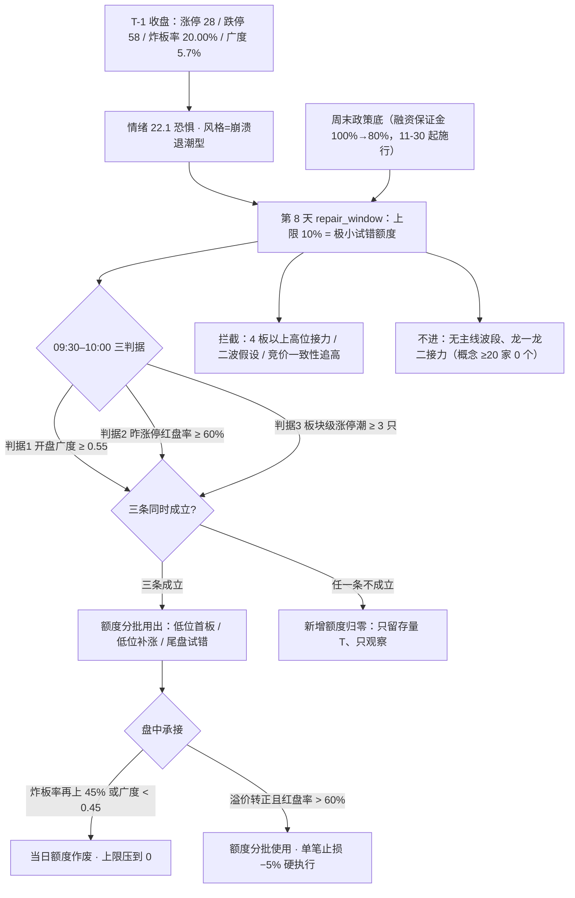

# 2026-11-23 · **风格研判**

> **数据源新鲜度**: partial（A 股主源零缺口，跨资产 / 两融口径有缺口）
> **降级状态**: false · 置信度 **0.535**
> **窗口**: 30 个收益日（2026-10-12 → 2026-11-20，末日 2026-11-20）· Ward 6 簇 · n=42（22 风格板块 + 20 ETF，外盘指数另表）

## 一句话结论

今日 **崩溃退潮型** + 情绪浓度 **22.1（恐惧）** + **无主线**，仓位上限 **10%**——但这不是「继续空仓」：位置是 **第 8 天（连跌 7 天 · repair_window）**，10% 是**等三判据验证的极小试错额度**，只许低位首板 / 低位补涨 / 尾盘试错，**不许接力 4 板以上高位、不许做二波假设**；周末组合式政策底（融资保证金下限 100%→80%，11-30 生效）只作情绪前置，**不据此上调仓位**。

---

## 决策树（今日的唯一开关）



**这张图的含义**：今天不是「找一个方向买」，而是**先证明修复存在、再把 10% 拆成小份试错**。政策利好是背景板，不是放行条——放行条只有 09:30–10:00 的三判据。

---

## 一、情绪周期：**第 8 天（连跌 7 天 · repair_window）**

### 1.1 位置读数（`cycle_position.json`，as of 2026-11-20 收盘）

| 字段 | 读数 | 含义 |
|---|---|---|
| `consecutive_down_days` | **7** | 2026-11-12 → 2026-11-20 连续 7 个交易日收在杀跌态 |
| `cycle_day` | **8** | 今日是杀跌段第 8 个交易日 = **修复窗口当日** |
| `tier` | **repair_window** | 语义是「连跌后的修复窗口」，**不是继续空仓** |
| `signals` | 涨停 28 / 跌停 58 / 炸板 7（20.00%）/ 涨家占比 5.62% / 中位 −5.08% | 冰点读数在**加速恶化**（广度从 11.65% 掉到 5.62%，中位从 −2.55% 掉到 −5.08%） |
| `rule_source` | 卷首情绪周期表·主跌期 + 「连跌两日博反弹、第三天必有修复」 | 心法给的是**窗口**，不是**许可** |

### 1.2 四个词怎么共存：补跌 × 崩溃退潮 × 修复窗口 × 政策底

- **`emotion_cycle.phase = 补跌（capitulation，confidence 0.88）**：跌停 58 家 ≥ 20 家、亏钱效应扩散 → **市场温度按最低档计**，风险预算压到下限。
- **`style = 崩溃退潮型`（五分法最小代价 **0.6000**）**：看的是**结构与代价**——涨停 28 家、最高 4 板、跌停 58、广度 5.7%、中位 −5.08%，退潮结构成立；但崩溃三条件里炸板率这一条**不成立**（20.00% 远低于 50%），所以是可退潮、非崩盘式抛售。
- **`tier = repair_window`（第 8 天）**：看的是**位置与节奏**——连跌 7 天后第 8 天进入修复窗口，**窗口的意义是「可以开始验证」，不是「已经可以重仓」**。
- **周末政策底（文本侧）**：融资买入最低保证金比例 100%→80%（**11-30 起施行**）、创业板做市制度征求意见、沪深降费（深市本年度让利超 22 亿）、中国结算暂免部分登记费 → 这是本轮下跌以来第一个**组合式**政策变量，但主条款要一周后才生效。

一句话：**温度定在冰点（补跌）、结构定在退潮（崩溃退潮型）、位置定在窗口第 8 天（repair_window）、政策定在「预期先行、资金滞后」——所以额度存在但极小，且必须靠盘中三判据放行。**

### 1.3 对应打法（四条，逐条可执行）

1. **09:30–10:00 只看不做**：先读三个数——开盘广度是否 ≥ 0.55、昨日 23 家涨停股红盘率是否 ≥ 60%、板块级涨停潮是否 ≥ 3 只。**三条同时成立才允许动用 10% 额度**；任何一条不成立 → 当日新增为 0。
2. **优先低位首板 / 低位补涨，不接高位老龙**：T-1 天梯 1 板 25 家占 **89.3%**、2 板仅 1 家、4 板 2 家、**3 板空缺**——高度链条是断的，接力没有自然递推；三板以上腿 30 日 +67.09% 而末日 **−7.00%**，是「收益已在尾部兑现」的反面教材。
3. **盘初续杀则等尾盘试错，不追日内首波**：昨日 23 家涨停股**开盘溢价均值 −0.62% / 中位 +0.00%**，而**收盘溢价均值 −3.40% / 中位 −5.08%**——开盘不差、尾盘全吐，说明高开就是兑现盘；尾盘试错的胜率来自「卖压出清」，不来自「早盘情绪」。
4. **存量只做 T，不做隔夜加仓**：主力单日 **−521.9 亿**（净流入率 −3.65%）、5 日 **−1830.0 亿**、两融 5 日 **−4.15%**，钱还在撤；任何「修复」在没有增量资金前只按 1 日级别脉冲处理。

### 1.4 历史同口径样本（诚实标注：样本不是概率）

| 连跌天数 | 前一日 | 次日 | 次日涨停 | 次日广度 | 是否修复 |
|---|---|---|---|---|---|
| 2 | 2026-11-13 | 2026-11-16 | 32 | 20.39% | ✗ |
| 3 | 2026-11-16 | 2026-11-17 | 37 | 23.79% | ✗ |
| 4 | 2026-11-17 | 2026-11-18 | 41 | 23.65% | ✗ |
| 5 | 2026-11-18 | 2026-11-19 | 23 | 11.65% | ✗ |
| 6 | 2026-11-19 | 2026-11-20 | 28 | 5.62% | ✗ |

**五个同口径样本，次日全部 `repaired=false`**（判定阈值为次日广度 > 0.55 或涨停 ≥ 60），而且**越往后越差**（广度 20.39% → 5.62%）。这条数据的作用是**压低预期**，不是给方向：它说明「连跌第 N 天必反弹」没有统计支撑，**所以三判据必须三条同时成立**，否则 10% 一分不用。样本本身只有 5 条，只作结构参考，不作概率。

---

## 二、市场结构（T-1 = 2026-11-20 收盘）

### 2.1 涨停 / 跌停 / 炸板：跌停 58 家，但炸板率只有 20.00%

| 指标 | 读数 | 判读 |
|---|---|---|
| 涨停 | **28** | 较前日 23 家回升 5 家，但其中 25 家是首板 |
| 跌停 | **58** | 连续 5 个交易日 ≥ 39 家（60 / 67 / 39 / 68 / 58），亏钱扩散未停 |
| 炸板 | **7**（炸板率 **20.00%**） | 前日 51.06% → 今日 20.00%，**炸板率大幅收敛**：不是承接变好，是拉到板上的票变少 |
| 最高高度 | **4 板（2 家）**，3 板 **0 家** | 高度**断档**，4 板无法自然递推 |
| 首板占比 | **89.3%**（25/28） | 结构退到最底层：没有梯队，只有孤立脉冲 |
| 首板封板时间 | 10:00 前 39.3% / 11:30 前 **96.4%** | 涨停几乎全在上午完成，午后无新增攻击 |
| 封单比中位 / 换手中位 | 0.1445 / 11.5% | 封单薄、换手高 = 承接质量差 |
| 开板次数中位 | **0.0** | 封住的没开过板，但样本只有 28 家，代表性有限 |

### 2.2 溢价与承接：开盘打平，收盘全吐

- 基准样本 23 家（昨日涨停股）：**开盘溢价均值 −0.62% / 中位 +0.00%**；**收盘溢价均值 −3.40% / 中位 −5.08%**；**红盘率 30.4%**；**再涨停仅 3 只**。
- 读法：**开盘没有恐慌性折价，说明竞价端还撑得住；但全天被卖到尾盘，中位 −5.08% 意味着「隔日接力」这笔生意昨天整体亏 5 个点。** 红盘率 30.4% 远低于 60% 的修复判据 → **判据 2 在 T-1 已经废掉**。

### 2.3 指数与广度：权重扛住，中小盘塌陷

| 指数 | 单日 | 判读 |
|---|---|---|
| 上证指数 | **−1.23%**（3533.79） | 权重护盘，跌幅可控 |
| 沪深300 | **−0.76%** | 唯一跌幅 < 1% 的宽基 |
| 深证成指 | −3.09% | 明显弱于沪市 |
| 创业板指 | **−3.54%** | 破位后加速 |
| 科创50 | −3.12% | 与费半 −10.73% 同向 |
| 中证500 / 北证50 | **−3.93% / −4.85%** | 小盘失血最重 |

- 广度：**涨 297 / 跌 4897 / 平 22**（全市场 5216 只），**中位 −5.11%**，跌超 5% 的 **2707 只（51.9%）**，涨超 5% 的仅 52 只。
- 成交额 **14220 亿**（前日 13049 亿，**+8.97%**）——**放量下跌**，是恐慌换手而非缩量阴跌，这一点与前几日（11-19 缩量）不同。
- 口径说明：`cycle_position.json` 的涨家占比为 **5.62%**（313/5572，含停牌/新上市样本池），本文结构表为 **5.69%**（297/5216）；两者差异来自样本池，均 < 6%，结论不变。

### 2.4 七连跌序列（同口径逐日）

| 交易日 | 涨停 | 跌停 | 炸板率 | 涨家占比 | 全市场中位 |
|---|---|---|---|---|---|
| 11-12 | 37 | 5 | 48.61% | 15.70% | −1.61% |
| 11-13 | 37 | 33 | 36.21% | 13.73% | −2.00% |
| 11-16 | 32 | 60 | 33.33% | 20.39% | −2.12% |
| 11-17 | 37 | 67 | 35.09% | 23.79% | −1.31% |
| 11-18 | 41 | 39 | 36.92% | 23.65% | −1.20% |
| 11-19 | 23 | 68 | 51.06% | 11.65% | −2.55% |
| **11-20** | **28** | **58** | **20.00%** | **5.62%** | **−5.08%** |

**读法**：跌停家数在 11-17 见到 67 家的峰值后没有明显收敛（58），而**广度与中位在 11-20 才真正塌陷**——这是典型的「先杀情绪票、后杀全市场」的二段式出清。**炸板率从 51% 掉到 20% 不是好转，是愿意打板的资金退出**。

### 2.5 资金（R7 同源，已折算进 R1）

| 维度 | 读数 | 口径 |
|---|---|---|
| 主力净额 | **−521.9 亿**（净流入率 −3.65%） | moneyflow_dc 全市场加总 |
| 主力 5 日 | **−1830.0 亿** | 同口径 |
| 两融余额 | **11208 亿**（沪市单所入库） | SSE-only，5 日 **−485 亿（−4.15%）** |

**口径修正说明**：本轮 R7 的两融只有沪市入库（`partial_deposit=true`、`exchanges_present=["SSE"]`）。若拿「当日 1 所」去比「前日 3 所」，会得出 −1.1 万亿量级的伪影；本轮已改用沪市同口径序列折算为 **−485 亿 / −4.15%**，与全市场「3 万亿量级向 2 万亿量级回落」的叙事方向一致但量级不同，**本文只用同口径数字，不跨所混算**。

### 2.6 主线代理：行业 0 条、概念 0 条（≥20 家口径）

- **行业维度**：≥8 家涨停的行业 **0 条**；最多的是元件 6 家，其次 IT服务Ⅱ / 数字媒体 / 化学制品 / 汽车零部件各 2 家。
- **概念维度**：≥20 家涨停的概念 **0 个**；≥8 家的有 3 个（8 家 / 8 家 / 8 家），但它们**当日板块涨跌幅分别是 −5.21% / −5.27% / −5.38%**——涨停来自个别逆势票，不是板块效应。
- **结论**：主线数量如实记 **0（无主线）**。所谓「涨停家数」在这个市场里是**跌出来的**（超跌股脉冲），不是**涨出来的**（资金合力）。

---

## 三、30 日 6 簇（Ward k=6 · n=42 · 窗口 2026-10-12 → 2026-11-20）

| 簇 | n | 30 日 | 5 日 | 末日 | 最大回撤 | 簇内相关 | 跨簇相关 | 与宽基相关 | 构成（统计成员） |
|---|---|---|---|---|---|---|---|---|---|
| **C5** | 2 | **+47.23%** | +6.47% | **−5.45%** | −12.53% | 0.400 | 0.048 | **−0.166** | 高位接力腿：打二板以上 / 非ST三板以上 |
| **C6** | 2 | +0.64% | +0.14% | −0.61% | **−5.26%** | 0.363 | 0.050 | +0.069 | 低波动腿：券商 ETF / 消费 ETF |
| **C4** | 2 | −0.81% | **+0.94%** | **+0.39%** | −7.05% | 0.324 | **−0.245** | **−0.357** | **防御腿：银行 + 煤炭 ETF** |
| **C1** | 8 | −10.43% | −6.61% | −2.83% | −16.69% | 0.535 | 0.398 | 0.511 | 情绪观察腿：百日新高 / 热股 / 创历史新高 / 资金前十 / 高贝塔 / 打板 / 首板 / 非ST二板 |
| **C3** | 8 | −11.43% | −4.99% | −2.29% | −12.33% | 0.651 | 0.447 | 0.697 | 宽基与龙头腿：行业龙头 / 300·50 / 医药·恒科·光伏·新能源·地产 |
| **C2** | **20** | **−24.06%** | **−10.49%** | **−4.30%** | **−25.10%** | **0.834** | 0.359 | **0.895** | 高 beta 巨簇：次新 / 百元股 / 成交·振幅·两通前十 / 增发·增减持·回购·扭亏 / 500·1000 / 科创50 / 通信·芯片·半导体·军工·有色 |

**42 样本整体**：30 日中位 **−17.22%**、正收益 **6/42（14.3%）**；5 日中位 **−7.57%**；末日 **3 涨 / 39 跌**、末日中位 **−3.72%**。

**退化诊断（必须写进结论）**：同一批样本在 average linkage 下塌成 **34/42 单一巨簇**（30 日 **−19.17%**、簇内相关 **0.661**、跨簇相关仅 **0.026**），另外 2×2 + 1×1 + 1×1 的小岔路——说明**这 42 只标的本子上只有一个共同风险因子**；Ward 只是把同一块石头切成 20/8/8/2/2/2，**没有切出任何「新主线」**。这与 §四留存 36.0% 互证，也是「不许用主线波段框架」的第二重证据。

**接力温度计（打板类风格指数的 30 日 vs 末日）**：三板以上 30 日 **+67.09%** 而末日 **−7.00%**（最大回撤 −7.00% = 末日，收益与风险全挤在尾部）；二板以上 30 日 +27.37%、末日 −3.90%；非ST二板 30 日 +8.09%、末日 **−4.55%**；首板 30 日 +3.93%、末日 −4.68%；打板综合 30 日 −1.82%、末日 −4.28%。**本轮与 11-20 的关键差异：昨日「二板是唯一红盘」，今天连二板也转负（−4.55%）——接力链条从「只剩中位」退到「全链同负」。**

### 3.1 三问（对三个关键簇，逐条回答）

**Q1 高 beta 巨簇（C2，n=20，30 日 −24.06%，末日 −4.30%）**

- **大资金意图**: **减仓，不是换仓。** 20 只成员与宽基相关 **0.895**、簇内相关 **0.834**，是同一批筹码的 20 种表达；5 日 −10.49%、末日 −4.30%，说明**这个池子仍在被卖，而且末日跌幅在放大**。主力 5 日 −1830 亿、两融 5 日 −4.15%，钱是从这个池子撤出，而不是搬进另一个板块。
- **为什么走强**: 位置上 30 日 −24.06%、最大回撤 −25.10%，是 6 簇里跌得最深的一条腿，属**深跌段而非启动位**；催化上不但没有正向事件，隔夜费半 −10.73%、英伟达 −14.01% 还是直接反向催化；筹码上是杠杆去化叠加配置盘收缩。**三维没有一项支持趋势反转**。
- **逻辑够不够硬**: **位置逻辑硬，反转逻辑不硬。** 30 日 −24.06%、正收益 6/42 是硬数据；但「跌多了该反弹」不是逻辑，**修复三判据全部不成立**才是硬数据。**动作：可研究，不可开仓；额度不投给巨簇内部的反弹。**

**Q2 防御腿（C4：银行 + 煤炭 ETF，30 日 −0.81%，5 日 +0.94%，末日 +0.39%）**

- **大资金意图**: **避险容器，不是进攻主线。** 它是 6 簇里唯一跨簇相关为负（**−0.245**）且与宽基负相关（**−0.357**）的腿——资金在这里买的是「不跌」，不是「涨得多」；5 日 +0.94%、末日 +0.39% 是风险偏好下行的被动流入。
- **为什么走强**: 位置上最大回撤仅 **−7.05%**，抗跌来自低 beta（银行 ETF 与宽基相关 **−0.645**）；催化上无题材，只有风险偏好下行；筹码上没有增量资金，5 日涨幅不足 1%，吸不到趋势盘。
- **逻辑够不够硬**: **抗跌是真的，赚钱效应是假的。** 它可以作跷跷板锚，但**不产生跟风盘**——在留存 36%、涨家 5.7% 的市场里，防御腿只能观察、不能作为今日主攻方向。

**Q3 高位接力腿（C5，n=2，30 日 +47.23%，末日 −5.45%）**

- **大资金意图**: **兑现，不是建仓。** 30 日 +47.23% 由两条打板指数自身的复利放大（三板以上单腿 30 日 **+67.09%**、二板以上 +27.37%），与宽基相关 **−0.166** 说明它根本不跟大盘走，是纯情绪筹码；末日 −5.45%、5 日却仍 +6.47%——**收益在尾部一次性兑现**。
- **为什么走强**: 今天该弱 —— 三板以上最大回撤 **−7.00% = 末日 −7.00%**，二板末日 −3.90%，最高高度停在 4 板且 **3 板空缺**，2 板只剩 1 家；接力链条已从「中位勉强活着」退到「全链同负」。
- **逻辑够不够硬**: **最硬的一条是「它今天最该被拦截」。** 30 日 +67.09% 的腿在末日 −7.00%，是「收益兑现在尾部」的教科书形态。**动作：拦截，不接二波、不做反包第二波假设。**

---

## 四、轮动诊断：**mixed（但结构已站在轮动一侧）**

| 指标 | 读数 | 判读 |
|---|---|---|
| 行业截面解释力 | **16.62%**（5555 只 / 105 个行业） | <20% → **结构分化弱**（常态 10% 上下） |
| 昨日 TOP5 行业留存率 | **36.0%**（9/25 命中，5 个相邻交易日对：2026-11-12 → 2026-11-20） | **仅高于 35% 硬否决线 1 个百分点**，实质接近强轮动 |
| 涨停次日溢价 | 收盘中位 **−5.08%**，红盘率 30.4%，**当日广度 5.72%** | 溢价深度为负 + 广度极低 → 脉冲而非梯队 |
| 大小盘分层 | <50 亿 **−5.61%** / 50–200 亿 −4.53% / 200–500 亿 −3.13% / 500–1000 亿 −1.84% / >1000 亿 **0.00%** | **size_tilt = large**（小盘连续 3 日跑输：−1.56 / −2.59 / −5.07 pct） |

**判定过程（不掩盖临界状态）**：原始 flags 只命中 2/4（`industry_explained_lt20`、`premium_not_stable`），留存 36.0% **刚好没有触发「<35% 硬否决」**，因此 `rotation_regime` 保持 **mixed**，不做升级。但方向很明确：**解释力接近轮动区、留存贴着否决线、溢价深度为负、小盘连续跑输**——四条里三条偏轮动，只是没跨过阈值。

**主线数量为什么是 0 而不是 1**：`main_lines_count` 用的是代理口径（行业 ≥8 家涨停 0 条、概念 ≥20 家 0 个），两个口径都为空，所以如实写 **0（无主线）**，不为了凑框架硬数出「双主线」。**实战含义**：今日任何「看起来成板块」的走势，明日只有约 1/3 概率留在前列；不许用主线波段的仓位与持有周期，只能用脉冲仓位与 **1–2 日** 周期。

---

## 五、外盘：半导体是全场最弱环节（2026-11-20 收盘，实时源补齐）

| 指数 | 收盘 | 单日 | 5 日 | 20 日 |
|---|---|---|---|---|
| 纳斯达克综合 | 22617.73 | **−5.28%** | −10.02% | **−12.86%** |
| 标普500 | 6910.39 | −3.70% | −8.61% | −9.36% |
| 道琼斯 | 48147.33 | −1.93% | — | — |
| 费城半导体 | 8408.59 | **−10.73%** | — | — |
| 纳斯达克100 | 25028.98 | −5.61% | — | — |
| 恒生指数 | 22410.80 | −1.86% | −5.19% | −2.96% |
| 韩国综合 | 4869.96 | **−5.21%** | −7.95% | **−12.26%** |
| 日经225 | — | −5.06% | −7.70% | −10.29% |

**纳指 3 日累计 −7.02%**，且上周纳指周跌幅约 **−10%**（2020 年以来最大周跌幅，文本侧口径）、道指与标普周跌超 8%。15 只美股样本里半导体系全线崩塌：**英伟达 −14.01%**、美光 −13.89%、AMD −13.25%、博通 −12.19%、台积电 −9.48%（最弱 −14.01% / 最强 −1.90%）。

**读数**：外盘已从「高位震荡」切到「趋势下行 + 半导体去泡沫」，且**最弱的恰是与 A 股 T-1 科创50 −3.12%、创业板 −3.54% 同一条产业链**。外盘只作情绪前置：**今日若科技/半导体高开，按「给隔夜逃命盘抬轿」处理——高开不追、只做低开承接；若科技低开而低位题材接力，才是修复延续的正解。**

**缺口**：商品（原油/铜/金）skipped、美元指数 DXY 缺、`USDCNH 6.67413` 仅 2026-11-21 单点 → **跨资产三档坐标（软着陆/降息/衰退）不可建**，已计入 `data_gaps`，不外推。另外 SOX / NDX 的 prev_close 未能双源校验，已标 unverified。

---

## 六、文本侧：六条方向性判断，主线共识为「政策底已知、市场底未验」

群聊源本轮 **0 条**（7 个焦点群抓取窗口内无消息，文件 0 字节），文本侧由公众号池 **54 篇 / 19 源**（去重后）承接，其中 8 篇为交易复盘、买方路演、宏观解读类；提取方向性判断 **6 条**，账号匿名化为 K1–K6，板块与个股名不进入产出：

- **K1 政策面**：融资买入最低保证金比例由 100% 下调至 80%（**11-30 起施行**，机构测算理论上对应约 4000 亿增量）、创业板做市制度公开征求意见、沪深交易所新一轮降费（深市本年度让利超 22 亿）、中国结算暂免部分登记费；同期韩国准备启动稳定基金、台湾自周一起全面禁止平盘以下放空 → **本轮下跌以来第一个组合式政策底**，但主条款一周后才生效，**本周买的是预期不是资金**。
- **K2 外围**：纳指上周累跌约 10%（2020 年以来最大周跌幅）、道指与标普周跌均超 8%、费半单日 −10.73%；美联储官员仍偏鹰（称迫切需要加息压低通胀），本周还有 PCE、褐皮书与纽约联储主席讲话 → **外盘仍是压制项**，A 股修复只能靠内生变量。
- **K3 筹码面**：上海买方路演反馈 AI 硬件多头仓位已压到接近零、部分机构现金占比到 70%，防御与空头交易拥挤，多数反馈是「暂时不做交易、先观望」→ **空头拥挤 + 仓位轻是修复的燃料**；但产业侧担忧的是 2028 年资本开支拐点（测算存在数千亿美元收入缺口），验证窗口要到 2027 年一季度，因此「即便盘面涨也只定义成反弹」。
- **K4 杠杆**：融资余额从 3 万亿量级向 2 万亿量级回落，近几日午后急跌多与强平盘相关 → **去杠杆已进入尾部**，周末下调保证金比例是对症的；但强平是否出清，要看跌停家数能否连续两日收敛，而不是看单一利好。
- **K5 位置**：上证盘中 3500.88 与金价 3502 附近同步止跌回升；指数已连跌 7 个交易日、T-1 单日中位 −5.08%、涨家占比 5.7% → **冰点特征明确，但「跌深」不是「转折」**。
- **K6 结构**：两大指数周线继续新低，创业板周初跌破上一波箱体后向下跳空，微盘加速补跌并出现 7 连阴，缩量震荡无法认定为企稳 → **结构仍是下行趋势，任何反抽按 1 日级别处理**。

**与量化的一致性**：`agreement_with_quant = partial`。同向部分：文本与量化一致认为「未确认企稳、只按反弹处理」，量化端修复三判据在 T-1 全部不成立。分歧部分：文本新增了周末组合式政策底这一正向变量，而 T-1 读数（跌停 58、广度 5.7%、中位 −5.08%）**不含该变量**；由于生效日 11-30，政策只计入情绪前置，**不据此上调仓位上限**。

---

## 七、风格判定与仓位上限

### 7.1 五分法代价表（区间代价最小化）

| 风格 | 代价 | 关键判据是否成立 |
|---|---|---|
| **崩溃退潮型** | **0.6000（最小）** | 跌停 58 家 ✓ / 涨家占比 5.7% ✓ / 指数明显下跌 ✓ / **炸板率 >50% ✗**（实际 20.00%） |
| 震荡分化型 | 0.6255 | 涨停 28 落在 20–40 区间 ✓，但无明显连板龙头 ✓ |
| 连板情绪型 | 0.7733 | 连板高度 ≥6 ✗（实际 4）/ 涨停 ≥50 ✗ |
| 主线扩散型 | 1.8766 | 涨停 30–50 ✗ / 有明确梯队 ✗（3 板空缺） |
| 防御观望型 | 2.9268 | 涨停 <20 ✗（实际 28）/ 大盘走平 ✗ |

**必须写明的临界性**：崩溃退潮型与震荡分化型只差 **0.0255**，是**刀锋之差**。保留「崩溃退潮型」标签的依据是**退潮结构成立**（跌停家数多 + 广度 5.7% + 指数明显下跌），而不是「崩盘式抛售」（炸板率 20% 不支持）。**所以本文不派生任何方向性结论，只派生额度性质**——标签错 0.025 的代价，远小于据此做方向的代价。

### 7.2 情绪浓度 22.1（恐惧）· 五维加权

| 维度 | 权重 | 读数 | 归一分 |
|---|---|---|---|
| 涨停强度 | 0.25 | 28 家 | 28.0 |
| 跌停压制 | 0.20 | 58 家（100−2×58 → 截断） | 0.0 |
| 连板结构 | 0.20 | 高度 4/6=66.7；连续分 80.0 / 接力分 10.7 | 56.0 |
| 炸板率 | 0.15 | 20.00%（100−4×20） | 20.0 |
| 资金 | 0.20 | 两融 5 日 −4.15% → 8.5；主力净流入率 −3.65% → 0.0 | 4.2 |

加权：0.25×28 + 0.20×0 + 0.20×56 + 0.15×20 + 0.20×4.2 = **22.1**（权重全在，无缺失维度，`weight_renormalized=1.0`）。落「恐惧」档（20–40），对应仓位 0.55–0.65 的常规映射——**但本轮被风格与周期双重压制，实际取 0.10**。

### 7.3 仓位上限 10%：逐项推导，不拍脑袋

```
风格基准 0.15（崩溃退潮型）
  −0.10（情绪 22.1 落恐惧档）
  −0.20（阶段 = 补跌 capitulation）
  −0.05（当日广度 5.7%）
  +0.00（赚钱效应确认：涨停 28 / 广度 5.7% / 炸板率 20.00% → 无确认）
  = −0.20 → 主跌下限 0.10 生效，取 0.10
周期折扣 −0.05（隔夜纳指 3 日 −7.02% ≤ −3%）→ 已被下限托底，仍 0.10
```

**这 10% 的性质**：**极小试错额度，只用于低位新题材首板/隔日，不含接力**。它不是「看空到底仓」的替代品——按纪律 §2，**第 8 天的 tier 是 repair_window**，窗口闭不闭由盘中三判据决定，不由标签决定。

---

## 八、今日做什么 / 不做什么

**做（且必须按顺序）**：

1. **09:30–10:00 只观察**：读开盘广度（≥0.55）、昨日 23 家涨停股红盘率（≥60%）、板块级涨停潮（≥3 只）。
2. **三判据成立才动用额度**：只做**低位首板 / 低位补涨**（T-1 首板占 89.3%，低位筹码未被连带清洗，修复弹性在这里）；单笔止损 **−5%** 硬执行。
3. **不追日内首波，等尾盘**：昨日开盘均值 −0.62% 而收盘中位 −5.08%，高开即兑现；尾盘试错买的是「卖压出清」。
4. **存量只做 T**：不隔夜加仓，不做「政策底 → 满仓反转」的假设。

**不做（拦截清单）**：

- **4 板以上高位接力**（4 板 2 家、3 板空缺，链条断裂；三板以上末日 −7.00%）；
- **二波 / 反包第二波假设**（昨日 23 家涨停股仅 3 只再涨停，再涨停率 13.0%）；
- **竞价一致性追高**（红盘率 30.4%，追高等于给隔日盘接货）；
- **无主线波段**（行业 ≥8 家 0 条、概念 ≥20 家 0 个，留存仅 36.0%）；
- **追隔夜外盘反弹**（费半 −10.73%、英伟达 −14.01%，外盘是压制项不是催化项）。

### 唯一额度对象的思维链（R1 不出票，此处只描述额度性质）

- **买入理由**：①**周期锚**——位置是第 8 天 repair_window，语义是修复窗口不是继续空仓，所以「有额度」；②**结构锚**——42 样本 30 日中位 −17.22%、正收益仅 6/42，跌的是估值与杠杆，不是逻辑；③**政策锚**——融资保证金下调 + 做市 + 降费是本轮第一个组合式政策变量，给了修复一个「理由」，但生效日 11-30，所以只算预期。
- **风险点**：①五个同口径历史样本（连跌 2/3/4/5/6 天）**次日全部未修复**，且越往后越差，这是最硬的反向证据；②主力 5 日 −1830 亿、两融 5 日 −4.15%，杠杆与配置盘双退；③隔夜费半 −10.73%、纳指 3 日 −7.02%，外盘还在杀；④T-1 炸板率 20% 不是承接好，是打板资金退出，修复可能「无板可打」。
- **止损条件**：单笔试错亏损达 **−5%** 无条件退出（不进 −5%~−10% 区间）；若开盘 30 分钟广度 < 0.45 或炸板率再破 **45%**，**当日新增额度作废、不再新开**，上限直接压到 0；存量仓位同步只减不加。
- **可验证假设**：24–72h 内可证真/证伪 —— **H1** 收盘广度 ≥ 0.55 且涨停 ≥ 60 → 修复窗口成立，明日额度可维持 0.10 并可申请上移；**H2** 昨日 23 家涨停股收盘红盘率 ≥ 60% 且中位溢价 ≥ 0 → 隔日接力恢复，低位首板才可做；**H3** 跌停家数连续两日收敛到 ≤ 20 家 → 去杠杆尾部确认，政策底的「预期」开始变成「资金」；三条中 H2 若失败，当日只留存量 T。

---

## 九、风险与反证

- **竞价反向**：若昨日 23 家涨停股开盘溢价（T-1 收盘均值 −3.40% / 中位 −5.08%）进一步转负，或盘初炸板率再上 45%，仓位上限 10% 不再上移、当日不做任何新开仓，只保留存量 T。
- **高度断档**：天梯 4 板以下有 **1 层空缺**（3 板为 0），高度无法自然递推，反包只按一次性脉冲处理。
- **资金未止**：主力单日 −521.9 亿（净流入率 −3.65%）、5 日 −1830.0 亿；两融 5 日 −4.15%，杠杆退潮期高度股反包胜率显著下降。
- **指数分化**：上证 −1.23% vs 创业板 −3.54% / 科创50 −3.12%，若收敛为同步下跌即为退潮确认；若权重补跌而小票反抽，则是二次杀跌。
- **政策滞后**：融资保证金下调 11-30 生效，本周若出现「利好当天高开低走」，说明市场把政策当兑现而非起点，届时应直接压到 0 并等待新证据。
- **外盘二次冲击**：纳指 3 日 −7.02%、费半 −10.73%，若本周 PCE 超预期，A 股修复会被第二次打断。
- **结构风险**：30 日样本中位 −17.22%、正收益 6/42；若本周正收益样本数不回升到 1/3 以上，结构性下跌未结束，任何「修复」只按日内反弹对待。
- **周期风险**：第 8 天（连跌 7 天 · repair_window）按周期打法执行，**不因单日反弹提前放大仓位**。

---

## 十、数据源审计

| 源 | 状态 | 抓取日期 | 记录数 | 备注 |
|---|---|---|---|---|
| tushare.ths_daily（22 风格板块） | 🟢 ok | 2026-11-23 | 22 | 22/22，30 个收益日完整、缺日 0 |
| tushare.fund_daily（20 ETF） | 🟢 ok | 2026-11-23 | 20 | 20/20，零方差不存 |
| r1_style_cluster.py（Ward k=6） | 🟢 ok | 2026-11-23 | 42 | average linkage 退化诊断同时落盘 |
| tushare.limit_list_d / limit_step | 🟢 ok | 2026-11-23 | 5216 | 涨停/跌停/炸板/天梯逐票 |
| tushare.index_daily | 🟢 ok | 2026-11-23 | 7 | 沪/深/创/科/300/500/北证 |
| tushare.daily + daily_basic | 🟢 ok | 2026-11-23 | 5555 | 105 个行业，解释力与大小盘分层 |
| tushare.limit_cpt_list（概念代理） | 🟢 ok | 2026-11-23 | 20 | ≥20 家概念 0 个 |
| R7_capital_flow（主力/两融） | 🟡 partial | 2026-11-23 | 2 | 两融仅沪市入库，已改 SSE 同口径 −485 亿；小单未取 |
| sina gb_ + eastmoney push2his | 🟡 partial | 2026-11-23 | 20 | SOX/NDX prev_close unverified |
| tushare.index_global / us_daily | 🔴 stale | 2026-11-23 | 5 | 美股停 T-2，已实时补齐；商品 skipped、DXY 缺 |
| emotion_cycle.json | 🟢 ok | 2026-11-23 | 1 | phase=capitulation，confidence 0.88 |
| cycle_position.json | 🟢 ok | 2026-11-23 | 12 | cycle_day 8 / 连跌 7 / repair_window |
| wechat_official_rss | 🟢 ok | 2026-11-23 | 55 | 19 源，去重后 54 篇 |
| wechat_cli_5groups | 🔴 error | 2026-11-23 | 0 | 文件 0 字节，7 群窗口内无消息 |
| manifest.json | 🟢 ok | 2026-11-23 | — | global_severity 0，tushare ok |

---

## 十一、不确定性 / 反证自评

1. **风格标签是刀锋判定**：崩溃退潮型 0.6000 vs 震荡分化型 0.6255，差 0.0255。若把炸板率权重调高，结论会翻成震荡分化型——**所以本文只给额度、不给方向，避免用 0.025 的标签差做交易。**
2. **政策底 ≠ 市场底**：周末利好是文本侧（公众号）口径，未用 MCP 交叉验证；且 11-30 才生效。历史经验里「政策底先于市场底」是常态，**本周大概率仍是磨底，而不是反转**。
3. **五个同口径样本全部未修复**：这是最强的反向证据。样本只有 5 条，不能当概率，但足以说明「第 N 天必反弹」不成立，**三判据必须三条同时成立**。
4. **六簇结构退化**：average linkage 下 34/42 塌成一簇（簇内 0.661、跨簇 0.026），说明当前市场只有一个风险因子在定价，**Ward 的 6 簇是同一块石头的切法，不是 6 条主线**。
5. **两融口径仍需警惕**：本轮只有沪市入库，−485 亿是 SSE 同口径数字，**不能与全市场 2.2 万亿量级直接比大小**；若明日三所齐全，方向可能一致但量级会变。
6. **文本与量化的分歧被保留**：`agreement_with_quant = partial`，政策变量是文本独有、量化不含，因此不上调仓位——这是「宁可少做，不抢跑」的选择，代价是可能错过政策驱动的第一根阳线。

---

## 十二、与其他 R/D/E 的关系

- **依赖**：`data/raw/20261123/manifest.json`（severity 0）、`data/raw/20261123/style_snapshot.json`（22+20，30 日窗）、`data/research/20261123/emotion_cycle.json`、`data/research/20261123/cycle_position.json`（第 8 天 / repair_window）、`data/research/20261123/R7_capital_flow.json`（主力/两融）。
- **被消费**：**R2** 取 `style` / `main_lines_count=0` / `position_cap_suggestion=0.10`，据此只能做「研究观察对象」而不授予开仓资格；**R3** 取 `sentiment_score=22.1` 作情绪基准；**R6** 用它反证 R2 是否在无主线市场硬凑主线；**D1** 取 `position_cap_suggestion=0.10` 作为 exec_pool 总仓上限，并把「第 8 天 repair_window + 三判据」写进当日预案的开关条件。
- **边界**：R1 不出板块、不出个股、不给买卖点；本文件中的簇成员与 ETF 名称仅为**统计构成说明**，不构成方向推荐。

---

## Sub-Agent 元数据

- skill: analyze_style_v1
- artifact: data/research/20261123/R1_style.json（37100 B，pydantic `research_unit_v1` 校验通过）
- 中间底稿: `_r1_cluster.json` / `_r1_market.json` / `_r1_rotation.json` / `_r1_overseas_fill.json` / `_r1_kol.json`
- 生成耗时: 约 7 分钟（含 style_snapshot 补拉 22/22 + 20/20、Ward k=6 聚类、两融口径修正后重跑装配）
- model: deepseek-v4.1-flash
