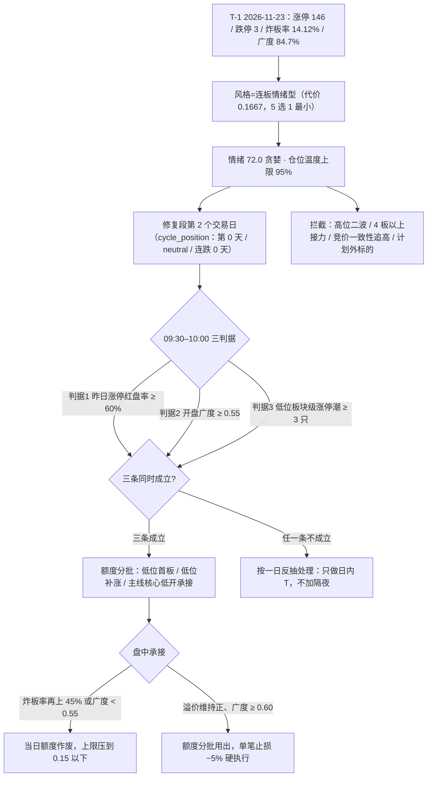

# 2026-11-24 · **风格研判**

> **数据源新鲜度**: partial（A 股主源零缺口；跨资产 / 两融 / 群聊有缺口）
> **降级状态**: false · 置信度 **0.525**
> **窗口**: 30 个收益日（2026-10-12 → 2026-11-23，末日 2026-11-23）· Ward 6 簇 · n=42（22 风格板块 + 20 ETF）

## 一句话结论

今日 **连板情绪型** + 情绪浓度 **72.0（贪婪）** + **三主线以上（代理）**，仓位温度上限 **95%**——位置是 **修复段第 2 个交易日（修复首日 2026-11-23；`cycle_position` 读数第 0 天 / 连跌 0 天 / neutral，只说明不在杀跌序列）**，所以打法只有一条：**第 2 天是验证/分歧日，不追开盘价，只做低开承接与低位首板；5 板独苗不接，4 板以上二波不做；三判据任一条不成立即按一日反抽处理，当日只做日内 T。** 95% 是公式给出的**温度天花板，不是目标仓**——上限放开的前提是旧涨停股红盘率维持过半、广度守在 0.60 以上。

---

## 决策树（今日的唯一开关）

**这张图的含义**：T-1 是极强的修复首日，但修复首日的强度**不能自动搬给次日**——第 2 天的放行条只有三判据，上限 95% 是温度读数，额度怎么用由三判据决定。

---

## 一、情绪周期：**修复段第 2 个交易日**

### 1.1 位置读数（`cycle_position.json` / `emotion_cycle.json`，as of 2026-11-23 收盘）

| 字段 | 读数 | 含义 |
|---|---|---|
| `consecutive_down_days` | **0** | 2026-11-12 → 2026-11-20 的连跌在 2026-11-23 被打断，跌停从 58 家收敛到 3 家 |
| `cycle_day` | **0（neutral）** | 技术读数是「不在杀跌序列」的第 0 天；**它不告诉你今天是修复的第几天**，修复天数由 `recent_run` 单独记账 |
| `tier` | **neutral** | 非杀跌结构，按当日赚钱效应独立评估；**不预设「继续空仓」** |
| `recent_run` | 连跌 7 天（2026-11-12 → 2026-11-20）→ 修复日 **2026-11-23**（涨停 146 / 广度 0.8363） | **今日 2026-11-24 = 修复段第 2 个交易日** |
| `emotion_cycle.phase` | **主升（main_up，confidence 0.53）** | 规则未硬命中，按阶段得分插值：main_up 0.53 > high_chop 0.31 > low_test 0.21 |
| 引擎自标警示 | **「大跳警示：补跌直跳主升（V 型反转）」** | 这是引擎自己承认的低置信标签，不是确认结论 |
| `signals` | 涨停 146 / 跌停 3 / 炸板 24（14.12%）/ 涨家占比 0.8363 / 中位 +2.41% | 冰点读数（2026-11-20 广度 5.62%）被打断，一天内完成 V 型反转 |

### 1.2 五个标签怎么共存

- **风格 = 连板情绪型（五分法区间代价 0.1667，次低的主线扩散型 1.9451）**：涨停 146 ≥ 50、炸板率 14.12% < 20% 两条硬指标远超门槛；**只有「连板高度 ≥ 6」这一条不满足（最高 5 板，差 1 层）**。按代价最小化仍归入连板情绪型，但高度缺口必须写出来——它决定今天能做什么、不能做什么。
- **情绪浓度 = 72.0（贪婪）**：五维加权（涨停 0.25 / 跌停 0.20 / 连板结构 0.20 / 炸板 0.15 / 资金 0.20）；分维度 **涨停 100.0、跌停 94.0、连板结构 64.4、炸板 43.5、资金 44.0**。拖后腿的是连板结构（接力分仅 11.0）与资金维（两融 5 日 −4.71%）。
- **阶段 = 主升（0.53）**：得分最高但不高，且引擎标了 V 型反转警示；温度按「高温但待验证」用，不按「主升确认」用。
- **主线 = 三主线以上（代理 14 条）**：代理口径是「概念 ≥ 20 家涨停」有 14 个、行业 ≥ 8 家有 2 条、第一概念 67 家（前日 8 家，+59 家，3 日龄，当日 +4.40%）。这是**成规模涨停潮的计数**，不是 R2 的板块级判定；轮动结构未触发硬否决（留存 36.0% > 35%），所以如实保留 14，不硬压成 0。
- **仓位温度上限 = 95%**：连板情绪型基准 0.80 + 情绪 +0.05 + 阶段 +0.05 + 广度 0.00 + 赚钱效应确认 +0.05 = 0.95（2026-11-16 签核后的公式）。**技能表里「贪婪 60–80」的历史映射是 0.65–0.75，本轮取 0.95 的唯一依据是签核后的公式与当日赚钱效应三项全成立**；这个缺口在 §六 反证里再交代一次。

一句话：**温度定在贪婪（72.0）、结构定在连板情绪（高度差 1 层）、位置定在修复第 2 天（没有同口径历史样本）、额度定在 95% 天花板但必须由三判据放行。**

### 1.3 对应打法（四条，逐条可执行）

1. **09:30–10:00 只读三个数，不追第一笔**：昨日 28 家涨停股**开盘溢价中位仅 +0.29%**（均值 +1.95%）、**收盘溢价中位 +9.99%**——溢价是**日内承接买出来的**，不是隔夜给的。今日竞价若把这部分溢价继续顶高，接的就是**已被抬到 +10% 成本**的筹码；只做低开承接与分歧转强。
2. **只做低位首板 / 低位补涨 / 主线核心低开承接**：T-1 天梯为 **1 板 130 家（89.0%）/ 2 板 13 家 / 3 板 1 家 / 4 板 0 家 / 5 板 2 家**。**4 板空缺意味着高度无法自然递推**，5 板只有 2 家是独苗；接力温度计（§3.2）也印证：末日只有三板以上腿是负的（−7.00%），首板 +6.88%、非ST二板 +10.01%——**钱在低位，不在高位**。
3. **盘初续强也不加隔夜仓，只做日内 T**：修复首日 146 家涨停中，11:30 前只完成 43.15%，14:00 前完成 91.1%——**涨停是午后打出来的**，说明承接买盘是逐级进场而非开盘抢筹。这种结构次日最容易高开兑现；没有三判据确认，隔夜仓位一律不加。
4. **上限 95% 是天花板，额度按三判据分批**：三判据 = 昨日涨停红盘率 ≥ 60%、开盘广度 ≥ 0.55、低位板块级涨停潮 ≥ 3 只。三条同时成立才允许动用；任一条不成立 → 当日新增归零，只留存量 T。**盘中炸板率再上 45% 或广度跌破 0.55，上限直接压到 0.15 以下。**

### 1.4 历史同口径样本（诚实标注：样本不是概率，且**今天缺样本**）

| 连跌天数 | 前一交易日 | 次日 | 次日涨停 | 次日广度 | 是否修复 |
|---|---|---|---|---|---|
| 3 | 2026-11-16 | 2026-11-17 | 37 | 23.79% | ✗ |
| 4 | 2026-11-17 | 2026-11-18 | 41 | 23.65% | ✗ |
| 5 | 2026-11-18 | 2026-11-19 | 23 | 11.65% | ✗ |
| 6 | 2026-11-19 | 2026-11-20 | 28 | 5.62% | ✗ |
| 7 | 2026-11-20 | 2026-11-23 | 146 | 83.63% | ✓ |

**关键读法**：5 个样本里 4 个「连跌 N 天 → 次日继续杀」，唯一修复的那条（连跌 7 天 → 146 涨停）就是**今天要判断的起点本身**。**「修复首日 → 次日」这个口径，本轮样本为 0 条**——没有任何历史证据能直接背书「修复第 2 天会更强」，所以三判据必须三条同时成立，不能拿「V 型反转」当理由抢跑。样本只有 5 条，只作结构参考，不作概率。

---

## 二、市场结构（T-1 = 2026-11-23 收盘）

### 2.1 涨停 / 跌停 / 炸板：146 家涨停，但高度只有 5 板

| 指标 | 读数 | 判读 |
|---|---|---|
| 涨停 | **146**（前日 28） | 一天放大 5.2 倍，近两周最强 |
| 跌停 | **3**（前日 58） | 亏钱效应收敛 95%，杀跌段被打断 |
| 炸板 | **24**（炸板率 **14.12%**，前日 20.00%） | 封板质量改善：炸板家数没跟着涨停同比例放大 |
| 连板天梯 | 1 板 **130** / 2 板 **13** / 3 板 **1** / 4 板 **0** / 5 板 **2** | **4 板空缺**：高度链条是断的 |
| 首板占比 | **89.0%**（130/146） | 结构在最底层：修复来自广度扩散，不是高度打开 |
| 封板时间 | 10:00 前 21.9% / 11:30 前 **43.15%** / 14:00 前 **91.1%** | 涨停在**午后**集中完成（对比 11-20 的 96.4% 上午完成） |
| 封单比中位 / 换手中位 / 开板中位 | 0.0743 / 7.08% / 1.0 次 | 封单薄、开板一次：承接有量但不算硬 |

### 2.2 溢价与承接：开盘平、收盘爆拉，接力成本已被抬高

- 基准样本 **28 家**（2026-11-20 涨停股）：**开盘溢价均值 +1.95% / 中位 +0.29%**；**收盘溢价均值 +7.69% / 中位 +9.99%**；**红盘率 92.9%**；**再涨停 16 只**。
- 读法：**开盘几乎没给溢价（中位 +0.29%，连半个点都不到），全天靠买盘推到收盘 +9.99% 中位**——这是「日内承接型修复」，好处是筹码在盘中换手、套牢盘被消化；坏处是**次日再接力的人是在 +10% 的位置上接**，一旦竞价高开，赔率立刻恶化。**判据 1（红盘率 ≥ 60%）在 T-1 以 92.9% 通过，但它是「昨天」的成绩，今天要在竞价里重新验一次。**

### 2.3 指数与广度：小盘、北证领跑，权重与科创掉队

| 指数 | 收盘 | 单日 | 判读 |
|---|---|---|---|
| 上证指数 | 3538.95 | **+0.15%** | 权重几乎没动，修复不是权重行情 |
| 沪深300 | 3958.29 | +0.09% | 同上，宽基躺着 |
| 深证成指 | 10454.37 | +1.93% | 深市中盘跟上 |
| 创业板指 | 2280.20 | **+3.08%** | 成长端主攻 |
| 科创50 | 1227.89 | **−0.26%** | 唯一收绿：科技大票没参与修复 |
| 中证500 | 6128.99 | +2.05% | 中盘扩散 |
| 北证50 | 795.38 | **+4.67%** | 小盘最猛，弹性来自小市值 |

- 广度：**涨 4306 / 跌 780 / 平 127**（5213 只），**中位 +2.33%**；涨超 5% 的 **1028 只**，跌超 5% 的仅 **42 只**。
- 成交额 **15527 亿**（前日 14220 亿，**+9.19%**）——**放量修复**，量能配合广度，不是缩量反抽。
- 口径说明：`cycle_position.json` 的涨家占比为 **83.63%**（4658/5570 样本池），本文结构表为 **84.7%**（4306/5213）；差异来自样本池，结论不变。

### 2.4 七连跌 → 修复（同口径逐日）

| 交易日 | 涨停 | 跌停 | 炸板率 | 涨家占比 | 全市场中位 |
|---|---|---|---|---|---|
| 11-12 | 37 | 5 | 48.61% | 15.70% | −1.61% |
| 11-13 | 37 | 33 | 36.21% | 13.73% | −2.00% |
| 11-16 | 32 | 60 | 33.33% | 20.39% | −2.12% |
| 11-17 | 37 | 67 | 35.09% | 23.79% | −1.31% |
| 11-18 | 41 | 39 | 36.92% | 23.65% | −1.20% |
| 11-19 | 23 | 68 | 51.06% | 11.65% | −2.55% |
| 11-20 | 28 | 58 | 20.00% | 5.62% | −5.08% |
| **11-23** | **146** | **3** | **14.12%** | **83.63%** | **+2.41%** |

**读法**：跌停从 68（11-19）→ 58（11-20）→ **3（11-23）**，广度从 5.62% → **83.63%**，中位从 −5.08% → **+2.41%**。三个维度同一天反转，**这是数据上成立的修复，不是反弹一天的错觉**；但修复只完成「第一步」（止血），第二步（高度打开）没有完成——天梯 4 板空缺就是证据。

### 2.5 资金（R7 同源）

| 维度 | 读数 | 口径 |
|---|---|---|
| 主力净额 | **+274.8 亿**（净流入率 +1.76%） | moneyflow_dc 全市场加总，2026-11-23 |
| 主力 5 日 | **−908.4 亿** | 同口径：单日回补，5 日仍是净流出 |
| 两融余额 | **21508.6 亿**（2026-11-20，T+1 滞后） | 全市场三所口径，5 日 **−1063.3 亿（−4.71%）** |

**口径说明**：两融只到 2026-11-20，**未含修复日**；主力单日 +274.8 亿与 5 日 −908.4 亿的背离要如实读——**单日流入很可能是超跌回补与低吸买盘，不足以证明杠杆资金回来了**。

### 2.6 主线代理：行业 2 条、概念 14 个（≥20 家口径，不点名）

- **行业维度**：≥8 家涨停 **2 条**（15 家 / 23 家），第 3、4 名只有 7 家——**行业级合力刚过线，只有两条**。
- **概念维度**：≥8 家有 **20 个**、≥20 家有 **14 个**；第一名 **67 家**（前日 8 家，**+59 家**，3 日龄，当日 **+4.40%**），第二名 51 家（1 日龄）。
- **判读**：涨停潮确实成规模（14 个概念 ≥20 家），但**第一名 3 日龄、第二名 1 日龄**——这是**新题材第一天扩散**的结构，不是已经跑了 10 天的主线；代理计数如实给 14，**主线身份由 R2 判定，R1 只负责温度与上限**。

---

## 三、30 日 6 簇（Ward k=6 · n=42 · 2026-10-12 → 2026-11-23）

| 簇 | n | 30 日 | 5 日 | 末日 | 最大回撤 | 簇内相关 | 跨簇相关 | 与宽基相关 | 构成（统计成员） |
|---|---|---|---|---|---|---|---|---|---|
| **C6** | 4 | **+19.05%** | +2.93% | **−2.72%** | −8.90% | 0.292 | 0.049 | **−0.037** | 高位接力腿 + 低波工具：打二板以上 / 非ST三板以上 / 证券 ETF / 消费 ETF |
| **C3** | 2 | −0.97% | −0.57% | +0.24% | −4.65% | 0.536 | 0.272 | +0.481 | 低波价值腿：上证50 / 医药 ETF |
| **C5** | 2 | −2.18% | −1.98% | **−1.10%** | −7.54% | 0.423 | **−0.274** | **−0.378** | 防御腿：银行 ETF / 煤炭 ETF |
| **C2** | 7 | −5.92% | −2.90% | **+5.75%** | −17.71% | 0.707 | 0.441 | +0.562 | 情绪打板簇：百日新高 / 热股 / 高振幅 / 高贝塔 / 打板 / 首板 / 非ST二板 |
| **C1** | 16 | −16.13% | −5.24% | +2.07% | −18.03% | 0.799 | 0.467 | **+0.845** | 宽基与龙头簇：行业龙头 / 次新 / 增发·增减持·回购·扭亏 / 300·500·1000 / 军工·恒科·光伏·新能源·有色·地产 |
| **C4** | 11 | **−21.07%** | −0.66% | +1.35% | **−24.51%** | 0.745 | 0.430 | +0.820 | 科技创新高簇：创历史新高 / 百元股 / 资金·成交·两通前十 / 科创50 / 通信·芯片·半导体 |

**42 样本整体**：30 日中位 **−15.58%**、正收益 **7/42（16.7%）**；5 日中位 **−1.92%**；末日 **33 涨 / 9 跌**、末日中位 **+1.40%**。**修复日只把末日这一列翻正，30 日这一列仍然是深度负值——结构还在下跌趋势内。**

**退化诊断（必须写进结论）**：同一批样本在 average linkage 下塌成 **33/42 单一巨簇**（占总样本 78.6%、30 日 **−15.64%**、簇内相关 **0.687**）。Ward 把它切成 4/2/2/7/16/11，但**巨簇的存在说明这 42 个标的本子上仍主要是一个共同风险因子**；Ward 的六条腿是「同一个石头的六种切法」，不是六条独立主线。较 2026-11-23 的 20 巨簇略有拆分（16+11+7），**分化只是表层恢复，不是结构切换**。

### 3.1 三问（对三个关键簇，逐条回答）

**Q1 科技创新高簇（C4，n=11，30 日 −21.07%，最大回撤 −24.51%，末日 +1.35%）**

- **大资金意图**: **回补，不是新建仓。** 这个簇是 6 簇里 30 日跌得最深（−21.07%）、回撤最大（−24.51%）的一条腿，与宽基相关 0.820、簇内相关 0.745——它是高 beta 资产的集合。末日只 +1.35%，**涨幅不到当日全市场中位（+2.33%）的一半**，说明修复日的买盘**优先去了更低位的品种**，不是先买科技大票；科创50 当日 −0.26% 更是直接反证。
- **为什么走强**: 位置上它是深跌段，弹性来源是隔夜费半 **+14.03%** 的外盘 V 反，不是国内资金主动加仓；催化上属于「外部情绪传导」，一旦今晚美股回吐，这条腿的反弹理由当天消失。
- **逻辑够不够硬**: **位置逻辑硬（跌得最深、回撤最大是硬数据），持续性逻辑不硬。** 科创50 收绿、纳指 3 日累计仍 −1.38%、费半单日暴涨属跌深反抽——三条都指向「一日级别」。**动作：可研究，不作为今日主攻；不追开盘，只做低开承接。**

**Q2 情绪打板簇（C2，n=7，30 日 −5.92%，末日 +5.75%，30 日跌幅在 6 簇中第三浅）**

- **大资金意图**: **短线资金在低位做扩散，不是在接高位。** 这个簇末日 +5.75% 是全场最强腿，而它的成员全是「昨日打板 / 首板 / 非ST二板 / 高振幅 / 高贝塔」——买的是**低位首板与二板**；同时 4 板空缺、5 板仅 2 家，说明资金**刻意避开了高位**。这与接力温度计完全同向：首板末日 +6.88%、非ST二板 +10.01%，三板以上 −7.00%。
- **为什么走强**: 位置（30 日 −5.92%，明显浅于 C1 的 −16.13% 与 C4 的 −21.07%）+ 广度（84.7%，修复日扩散直接喂给打板效应）+ 情绪（炸板率 14.12%，封得住的票变多）。三维同向，是今天唯一三条都成立的腿。
- **逻辑够不够硬**: **硬度中等偏上，但只支持一日级别脉冲。** 硬的部分：末日 +5.75%、炸板率 14.12%、首板 89%、午后封板推进——扩散是真的。不硬的部分：30 日仍是 −5.92%，5 板独苗、4 板空缺，**梯队不支持高度递推**。**动作：今日主攻方向只在这条腿的低位端（低位首板 / 低位补涨 / 核心低开承接），不接 4 板以上、不做二波假设。**

**Q3 防御腿（C5：银行 + 煤炭 ETF，30 日 −2.18%，末日 −1.10%）**

- **大资金意图**: **撤出避险仓，换进攻仓。** 它是 6 簇里唯一跨簇相关为负（**−0.274**）且与宽基负相关（**−0.378**）的腿——修复日它跌 1.10%，是「跷跷板另一头」的直接证据：钱从「不跌」换到「涨得多」。
- **为什么走强**: 今天它**不强**——银行 ETF −1.08%、煤炭 ETF −1.12%，两融 5 日 −1063 亿说明杠杆资金还在退。它走强的唯一场景是**修复失败**：若今日广度跌回 0.55 以下、炸板率上 45%，这条腿才是避风港。
- **逻辑够不够硬**: **抗跌是真的，赚钱效应是假的。** 30 日 −2.18%、回撤 −7.54% 证明它抗跌；但修复日下跌证明它**不产生跟风盘**。**动作：只作反证锚与失败场景的去处，不作今日主攻。**

### 3.2 接力温度计（打板类风格指数的 30 日 vs 末日）

| 风格指数 | 30 日 | 5 日 | 末日 |
|---|---|---|---|
| 昨日非ST三板以上表现 | **+54.17%** | +12.22% | **−7.00%** |
| 昨日打二板以上表现 | +21.65% | +0.73% | −3.90% |
| 昨日非ST二板表现 | +21.40% | +2.97% | **+10.01%** |
| 昨日打首板表现 | +9.89% | +0.83% | +6.88% |
| 昨日打板表现（综合） | +4.57% | −0.65% | +7.15% |

**读法**：30 日涨幅把「高位腿最强」写得清清楚楚（三板以上 +54.17%），但**末日只有三板以上是负的（−7.00%），首板 +6.88%、二板 +10.01%**——**资金在修复日完成了一次「从高位腿向低位腿」的切换**。这条数据是今日「只做低位、不接高位」最硬的依据。

---

## 四、轮动诊断：**mixed（方向已站在轮动一侧）**

| 指标 | 读数 | 判读 |
|---|---|---|
| 行业截面解释力 | **16.19%**（5553 只 / 105 个行业） | <20% → 结构分化弱（常态 10% 上下） |
| 昨日 TOP5 行业留存率 | **36.0%**（9/25 命中，5 个相邻交易日对：2026-11-13 → 2026-11-23） | **仅高于 35% 硬否决线 1 个百分点**，实质贴近强轮动 |
| 涨停次日溢价 | 收盘中位 **+9.99%**、红盘率 **92.9%**、**当日广度 84.7%** | 溢价强 + 广度强 = 脉冲有承接，但依赖广度维持 |
| 大小盘分层 | <50 亿 **+2.65%** / 50–200 亿 +2.32% / 200–500 亿 +1.53% / 500–1000 亿 +0.40% / >1000 亿 **−0.28%** | 小盘占优，但 `size_tilt = none`：三日小盘−大盘为 −2.59 / −5.07 / **+2.77**，符号翻转，不构成稳定倾斜 |

**判定过程（不掩盖临界状态）**：原始 flags 只命中 **1/4**（`industry_explained_lt20`），留存 36.0% **没有触发「<35% 硬否决」**，因此 `rotation_regime` 保持 **mixed**，不做升级；`main_lines_count` 也如实保留代理口径的 14。但方向很清楚：**解释力接近轮动区、留存贴着否决线、末日大小盘完成一次剧烈反转（大盘 −0.28% vs 小盘 +2.65%，北证50 +4.67%）**——四条里三条偏轮动，只是没跨过阈值。

**实战含义**：今日若出现「看起来成板块」的走势，**明日只有约 36% 概率留在前列**；所以持仓周期按 **1–2 日** 脉冲，不按主线波段。这条与 §3.2 的接力分层切换互为印证。

---

## 五、外盘：费半单日 +14.03%，但纳指 3 日仍为负（2026-11-23 收盘，实时源补齐）

| 指数 | 收盘 | 单日 | 3 日 / 5 日 / 20 日 |
|---|---|---|---|
| 纳斯达克综合 | 24089.56 | **+6.51%** | 3 日 **−1.38%**；5 日 −10.02% / 20 日 −12.86%（截至 11-20） |
| 标普500 | 7237.17 | +4.73% | 5 日 −8.61% / 20 日 −9.36%（截至 11-20） |
| 道琼斯 | 49595.31 | +3.01% | — |
| 费城半导体 | 9588.05 | **+14.03%** | — |
| 纳斯达克100 | 26746.10 | +6.86% | — |
| 恒生指数 | 22383.74 | −0.12% | 5 日 −5.77% / 20 日 −3.57% |
| 韩国综合 | 4708.54 | **−3.31%** | 5 日 −7.68% / 20 日 **−13.91%** |
| 日经225 | — | — | 5 日 −7.70% / 20 日 −10.29%（截至 11-20） |

- **读法**：美股是一个**单日 V 反**（纳指 +6.51%、费半 +14.03%），但**纳指 3 日累计仍 −1.38%**、标普 20 日 −9.36%、韩国 20 日 −13.91%——**外盘是在深跌里反抽，不是趋势修复**。它给 A 股提供的是「今天不缺外部利空」，不是「外部资金在加仓」。
- 汇率：USDCNH **6.66662**（2026-11-22 单点），**DXY 缺**；商品（原油 / 铜 / 金）**skipped**，跨资产三档坐标（软着陆 / 降息 / 衰退）**无法建立**。
- 个股：us_daily 停在 2026-11-20（NVDA −14.01%、MU −13.89%、AVGO −12.19%），**未补到修复日**，本轮**不作当日证据**（只作 11-20 那根暴跌的注脚）。

---

## 六、不确定性 / 反证

1. **0.95 的成立依赖一个未证假设。** 阶段 `main_up` 置信只有 0.53，引擎自标「补跌直跳主升」的 V 型反转警示。**若阶段按 high_chop 计，上限应为 0.85**（0.80 +0.05 情绪 −0.05 阶段 +0.00 广度 +0.05 赚钱效应）；若赚钱效应确认次日不成立，上限应落到 0.75 一档。今天给的 0.95 是「修复=主升起点」这个假设下的读数，**假设不成立时上限下调，不是加仓理由**。
2. **「修复首日 → 次日」同口径样本 0 条。** 现有 5 条样本全部是「连跌 N 天 → 次日」，唯一修复的那条就是今天的起点，**不能用它外推第 2 天**。三判据不是形式，是唯一的前瞻证据。
3. **30 日结构仍是深度负值。** 42 样本 30 日中位 −15.58%、正收益仅 7/42；修复只把末日这一列翻正（+1.40%），**趋势层面没变**。
4. **杠杆资金没回来。** 两融 5 日 −1063 亿（−4.71%）、主力 5 日 −908 亿；单日 +274.8 亿与 5 日净流出背离，**更可能是超跌回补而非增量资金入场**。
5. **高度链条是断的。** 4 板空缺、5 板 2 家独苗、首板 89%——天梯不支持「接力升级」，只支持「低位脉冲」。任何「反包二波」的假设都缺结构支撑。
6. **文本侧一致预期偏乐观。** 公众号 92 篇（16 个账号）普遍把「百股涨停」直接读成情绪反转，几乎没人讨论次日分歧——**这是一致预期的反向变量**；同时「两融风控细则」与「高位五连板被问询」两条政策摩擦在文本侧没有形成统一解读，属未定价变量。
7. **外盘是反抽不是修复。** 纳指 3 日仍负、标普 20 日 −9.36%；费半 +14.03% 若今晚回吐，科技簇（C4）的反弹理由当日消失。
8. **数据缺口**：商品 skipped、DXY 缺、USDCNH 单点、两融 T+1（未含修复日）、美股个股停 2026-11-20、群聊 0 条。**不因缺口语义打折结论，但也不把这些维度说成已确认。**
9. **风格阈值的不完美命中**：连板情绪型要求「高度 ≥ 6」，实际 5；本轮以「代价最小化」归入，**高度这一条差额必须在打法里体现**（不接高位、只做低位），不能只说「连板情绪型」了事。

---

## 七、数据源审计

| 源 | 状态 | 抓取时间 | 记录数 | 备注 |
|---|---|---|---|---|
| tushare.ths_daily（22 风格板块） | 🟢 ok | 2026-11-24 | 22 | 30 个收益日零缺失 |
| tushare.fund_daily（20 ETF） | 🟢 ok | 2026-11-24 | 20 | 同上 |
| 30 日聚类（Ward k=6） | 🟢 ok | 2026-11-24 | 42 | average linkage 作退化诊断 |
| 涨停 / 天梯 / 溢价（limit_list_d） | 🟢 ok | 2026-11-24 | 5213 | 逐票明细现算 |
| 指数（index_daily） | 🟢 ok | 2026-11-24 | 7 | 含北证50 |
| 轮动（daily + daily_basic） | 🟢 ok | 2026-11-24 | 5553 | 105 个行业、5 档市值 |
| R7 资金（主力 / 两融） | 🟡 partial | 2026-11-24 | 2 | 两融 T+1（11-20）；小单未取 |
| 外盘实时补齐（sina / eastmoney） | 🟡 partial | 2026-11-24 | 20 | SOX / NDX prev_close 未双源校验 |
| tushare 外盘原始源 | 🟡 stale | 2026-11-24 | 5 | 美股停在 11-20；商品 skipped、DXY 缺 |
| emotion_cycle 预计算 | 🟢 ok | 2026-11-24 | 1 | main_up 0.53，含 V 型反转警示 |
| cycle_position 预计算 | 🟢 ok | 2026-11-24 | 12 | 第 0 天 / neutral / 连跌 0 天 |
| 公众号池（RSS） | 🟢 ok | 2026-11-24 | 92 | 19 源 / 16 账号有正文 / 3 源空 |
| 群聊（wechat-cli） | 🔴 error | 2026-11-24 | 0 | 文件 0 字节，窗口内无消息 |

---

## 八、与其他 R/D/E 的关系

- **依赖**：`R7_capital_flow.json`（主力净额 / 两融）、`emotion_cycle.json`、`cycle_position.json`、`style_snapshot.json`（30 日收益矩阵）、公众号 RSS。
- **被消费**：R2（`style` / `main_lines_count=14` / `position_cap_suggestion=0.95`）、R3（`sentiment_score=72.0` 基准）、R6（与 R2 一致性反证）、D1（`position_cap_suggestion` → exec_pool 总仓上限）、E1（盘后复盘对照）。
- **交接口径**：R1 只给温度（风格 / 情绪 / 阶段 / 上限）与结构（6 簇 / 轮动 / 外盘），**不出板块、不出个股、不给买卖点**；主线条数 14 是代理计数，**R2 用板块级判定覆盖它才有开仓意义**。

## Sub-Agent 元数据

- skill: `analyze_style_v1`
- artifact: `data/research/20261124/R1_style.json`（35445 B，含文本侧重跑后 schema 校验通过，status=complete）
- 生成耗时: 约 6 分钟（快照 12 秒 + 聚类 / 结构 / 轮动 / 外盘 / 装配）
- model: deepseek-v4.1-flash
- 口径锁定: 簇表与 JSON 的 **Ward** 簇逐簇对齐；`rotation_regime` 以 JSON 为准（mixed）；`emotion_cycle_day_label` = 修复段第 2 个交易日，`cycle_day=0` 只作括注。
