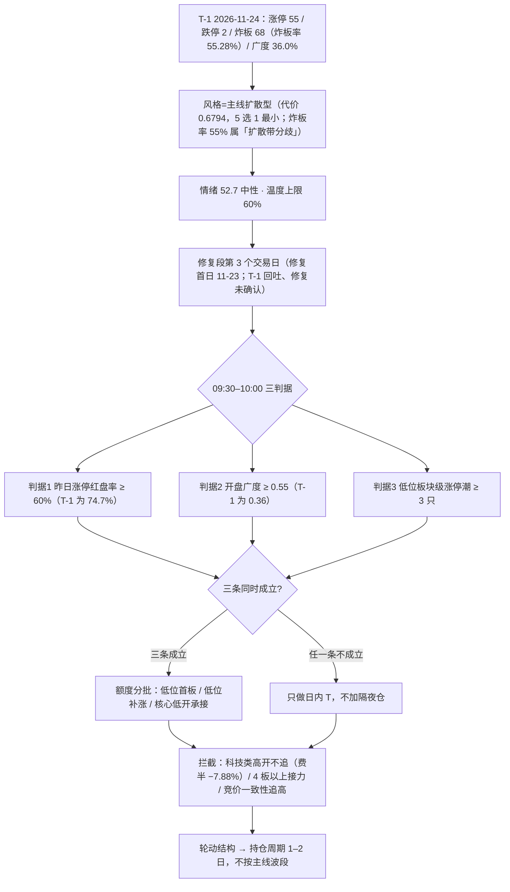

# 2026-11-25 · **风格研判**

> **数据源新鲜度**: partial（A 股主源零缺口；跨资产 / 两融 / SOX 校验 / 群聊有缺口）
> **降级状态**: true · 置信度 **0.472**（`0.70 × 0.75 × 0.90`，低于 0.5 线）
> **窗口**: 30 个收益日（2026-10-13 → 2026-11-24，末日 2026-11-24）· Ward 6 簇 · n=42（22 风格板块 + 20 ETF）

## 一句话结论

今日 **主线扩散型** + 情绪浓度 **52.7（中性）** + **无主线（轮动结构）**，仓位温度上限 **60%**——位置是 **修复段第 3 个交易日**（修复首日 2026-11-23，T-1 回吐、修复未确认），所以打法只有一条：**第 3 天是修复未确认的二次验证日，不是继续空仓**——09:30–10:00 三判据（开盘广度 ≥0.55、昨日涨停红盘率 ≥60%、低位板块级涨停潮 ≥3 只）同时成立才做低位首板 / 低位补涨 / 核心低开承接，任一条不成立只做日内 T。**隔夜费半 −7.88%、美光 −11.01%**，昨日领涨的科技类今日高开一律不追；60% 是温度上限、不是目标仓。

---

## 决策树（今日的唯一开关）

**这张图的含义**：T-1 不是杀跌日，也不是修复确认日——它是一个「涨停还在、封板塌了」的分歧日。第 3 天的放行条只有三判据；60% 是温度读数，额度怎么用由三判据决定。**阶段标签（高位震荡）只描述温度，不等价于「继续空仓」**；即便连日走弱后转成 `main_down`，其语义也是**修复窗口**而不是全天禁手。

---

## 一、情绪周期：**修复段第 3 个交易日**

### 1.1 位置读数（`cycle_position.json` / `emotion_cycle.json`，as of 2026-11-24 收盘）

| 字段 | 读数 | 含义 |
|---|---|---|
| `consecutive_down_days` | **0** | 11-12 → 11-20 的七连跌在 11-23 被打断后，11-24 虽回吐但未触发杀跌日 |
| `cycle_day` | **0（neutral）** | 技术读数只表示「不在杀跌序列」；**它不回答今天是修复的第几天** |
| `tier` | **neutral** | 非杀跌结构，按当日赚钱效应独立评估 |
| `recent_run` | 连跌 **7 天**（11-12 → 11-20，跌停 5→68 家、广度 0.056–0.238）→ 修复日 **11-23**（涨停 146 / 广度 0.8363 / 中位 +2.41%）→ 11-24 回吐 | **今日 11-25 = 修复段第 3 个交易日**（`sessions_since_repair=2`，`repair_session_no_today=3`） |
| `T-1 回吐结构` | 涨停 55 / 跌停 2 / 炸板 68（**55.28%**）/ 广度 **0.3501** / 中位 **−0.67%** | 回吐但未成杀跌日：跌停只有 2 家，杀跌不成立 |
| `emotion_cycle.phase` | **high_chop（高位震荡，confidence 0.75，硬命中）** | 炸板率 55.3% ≥ 25% 且涨停 55 ≥ 40 → 「涨停多但分歧大」 |

### 1.2 五个标签怎么共存（都是温度，不是方向）

- **风格 = 主线扩散型（五分法区间代价 0.6794，次低的震荡分化型 1.7068）**：涨停 55 ∈ 30–50 上沿（代价 0.10）、最高 4 板 ∈ [3,5]、行业 ≥8 家涨停 1 条、涨家占比 36.0%——扩散结构成立；炸板率 55.28% ≥ 25% 属「扩散带分歧」，按 §2.5 **只降温不换标签**（换成震荡分化型＝20–40 家分散，与本日 55 家不符）。
- **情绪浓度 = 52.7（中性）**：五维加权，分维度 **涨停 55.0 / 跌停 96.0 / 连板结构 72.0 / 炸板率 0.0 / 资金 26.8**。拖垮分数的是炸板率（100 − 4×55.28% → 触底 0）与资金（两融 5 日 −4.20% → 8.0、主力净流入率 −0.22% → 45.5）。
- **主线 = 1（无主线·轮动结构）**：硬否决条款生效——行业次日 TOP5 留存 **28.0%（7/25）< 35%**，追昨日最强行业是负 alpha；代理计数（概念 ≥20 家 1 条）不构成主线，按 §3.6 如实写 1，**不为凑仓位硬数出双主线**。
- **仓位温度上限 = 60%**：扩散型基准 0.75 + 情绪 0.00 + 阶段 −0.05 + 广度 −0.05 + 赚钱效应 0.00 = 0.65；再叠**修复段第 3 天 −0.05** → **0.60**。上限没被压到下限，也不代表该用满。
- **置信度 = 0.472（degraded）**：`0.70 × 0.75（freshness：跨资产 + 两融两处缺口）× 0.90（文本与量化部分同向）`。A 股主源零缺口，degraded 只反映跨资产维度，不改写风格与结构结论。

**一句话**：温度中性（52.7）、结构扩散但封板塌了（炸板率 55%）、位置修复第 3 天（验证未确认）、额度 60% 天花板但必须由三判据放行。

### 1.3 对应打法（四条，逐条可执行）

1. **09:30–10:00 只读三个数，不追第一笔**：昨日 146 家涨停股**开盘溢价中位 +3.72%、收盘溢价中位 +3.26%**——溢价有，但**中位从开盘到收盘掉了 0.46 个百分点**，说明高开在被卖。今日任何高开都是**减仓窗口**而非加仓信号。
2. **只做低位首板 / 低位补涨 / 核心低开承接**：T-1 天梯 1 板 25 / 2 板 25 / 3 板 4 / 4 板 1，**首板占比只有 45.5%**（11-23 是 89.0%），二板家数与首板持平——这是「接力层被抬上来、新增首板供给不足」的结构，高位接力赔率最差。
3. **盘初续强也不加隔夜仓**：昨日涨停股红盘率 74.7%、再涨停 30 只（20.5%）——打板层还在赚钱，但**全市场只有 36.0% 的票上涨**，打板赚钱与全市场亏钱并存。这种「窄赚钱」结构次日最容易变成「接力的人接在分歧里」，无三判据确认不做隔夜。
4. **上限 60% 按三判据分批，科技类高开不追**：三判据 = 昨日涨停红盘率 ≥60%、开盘广度 ≥0.55、低位板块级涨停潮 ≥3 只。**盘中炸板率再上 45% 或广度跌破 0.30，当日额度作废、只留存量 T。**

### 1.4 历史同口径样本（诚实标注：样本不是概率，且**本轮缺「修复第 3 天 → 第 4 天」样本**）

| 连跌天数 | 前一交易日 | 次日 | 次日涨停 | 次日广度 | 是否修复 |
|---|---|---|---|---|---|
| 3 | 2026-11-16 | 2026-11-17 | 37 | 23.79% | ✗ |
| 4 | 2026-11-17 | 2026-11-18 | 41 | 23.65% | ✗ |
| 5 | 2026-11-18 | 2026-11-19 | 23 | 11.65% | ✗ |
| 6 | 2026-11-19 | 2026-11-20 | 28 | 5.62% | ✗ |
| 7 | 2026-11-20 | 2026-11-23 | 146 | 83.63% | ✓ |

**读法**：五条样本全是「连跌 N 天 → 次日」，唯一修复的那条就是本轮修复首日本身。**「修复段第 3 天 → 第 4 天」的同口径样本为 0 条**——没有任何历史证据能背书「修复会自然延续」，所以三判据必须三条同时成立，不能拿「修复惯性」当理由抢跑。样本只作结构参考，不作概率。

---

## 二、市场结构（T-1 = 2026-11-24 收盘）

### 2.1 涨停还在，封板塌了：炸板率 55.28%

| 指标 | 读数 | 判读 |
|---|---|---|
| 涨停 | **55**（前日 146） | 数量腰斩 62.3%，但仍在 50 家以上 |
| 跌停 | **2**（前日 3） | 亏钱效应没有扩散：杀跌不成立 |
| 炸板 | **68**（炸板率 **55.28%**，前日 14.12%） | 封板率只剩 **44.7%**：**这是本轮最硬的一条负面数据** |
| 连板天梯 | 1 板 **25** / 2 板 **25** / 3 板 **4** / 4 板 **1**（无 5 板） | 二板层被填满，但 5 板两家的接力**全部归零** |
| 首板占比 | **45.5%**（25/55，前日 89.0%） | 新增供给骤降，结构从「广度修复」转成「梯队内耗」 |
| 晋级率 | 二板 **19.2%**（25/130）、三板 **30.8%**（4/13）、四板 1/1、五板 **0/2** | 中层晋级率尚可，**高位断链** |

### 2.2 溢价与承接：有溢价，但在往下掉

- 基准样本 **146 家**（11-23 涨停股）：**开盘溢价均值 +4.14% / 中位 +3.72%**；**收盘溢价均值 +4.12% / 中位 +3.26%**；**红盘率 74.7%**；**再涨停 30 只（20.5%）**。
- 读法：**开盘给得很足（中位 +3.72%），收盘中位掉到 +3.26%，均值几乎不动但中位数下滑**——大票扛住、中小票被卖，这是典型的「高开派发」形态，不是「低开承接」。判据 1（红盘率 ≥60%）在 T-1 以 74.7% 通过，但**它衡量的是昨天，今天要在竞价重新验一次**。
- 讽刺的一点：**打板层仍在赚钱**（昨日涨停股七成半红盘），而**全市场中位 −0.67%**。赚钱效应没有传导到广度，这正是「扩散型标签 + 轮动结构」并存的来源。

### 2.3 指数与广度：权重与科技翻红，多数股票在跌

| 指数 | 收盘 | 单日 | 判读 |
|---|---|---|---|
| 上证指数 | 3548.37 | **+0.27%** | 权重护盘，收红 |
| 沪深300 | 3963.82 | +0.14% | 宽基微红 |
| 深证成指 | 10423.60 | −0.29% | 中盘转弱 |
| 创业板指 | 2278.99 | **−0.05%** | 从盘中 +4% 一路砸回平盘，**当日最典型的「高开低走」** |
| 科创50 | 1250.09 | **+1.81%** | 昨日领涨，今日直面费半 −7.88% 的缺口风险 |
| 中证500 | 6112.43 | −0.27% | 中盘失血 |
| 北证50 | 793.60 | −0.22% | 小盘无超额 |

- 广度：**涨 1838 / 跌 3267 / 平 114**（5219 只），**中位 −0.67%**，涨家占比 **36.0%**；跌超 5% 的 40 只、涨超 5% 的 248 只。
- 成交额 **16549 亿**（前日 15527 亿，**+6.58%**）——**放量下跌**，量是换手量不是增量买盘。
- 口径说明：`cycle_position.json` 的涨家占比为 **0.3501**（1952/5576 样本池），本文结构表为 **0.36**（1838/5219）；差异来自样本池，结论不变。

### 2.4 杀跌 → 修复 → 回吐（同口径逐日）

| 交易日 | 涨停 | 跌停 | 炸板率 | 涨家占比 | 全市场中位 |
|---|---|---|---|---|---|
| 11-12 | 37 | 5 | 48.61% | 15.70% | −1.61% |
| 11-13 | 37 | 33 | 36.21% | 13.73% | −2.00% |
| 11-16 | 32 | 60 | 33.33% | 20.39% | −2.12% |
| 11-17 | 37 | 67 | 35.09% | 23.79% | −1.31% |
| 11-18 | 41 | 39 | 36.92% | 23.65% | −1.20% |
| 11-19 | 23 | 68 | 51.06% | 11.65% | −2.55% |
| 11-20 | 28 | 58 | 20.00% | 5.62% | −5.08% |
| **11-23（修复 1）** | **146** | **3** | **14.12%** | **83.63%** | **+2.41%** |
| **11-24（回吐 2）** | **55** | **2** | **55.28%** | **35.01%** | **−0.67%** |

**读法**：修复首日（11-23）用一天把广度从 5.62% 拉到 83.63%，第二天就给回 35.01%——**修复只走了第一步（止血），第二步（延续）没走成**。但注意跌停只有 2 家：**这不是二次杀跌，是修复的第一次压力测试**。若今日广度再落到 0.30 以下，才重新进入杀跌序列，修复按失败处理。

### 2.5 资金（R7 同源）

| 维度 | 读数 | 口径 |
|---|---|---|
| 主力净额 | **−37.3 亿**（净流入率 −0.22%） | moneyflow_dc 全市场加总，11-24 |
| 主力 5 日 | **−682.7 亿** | 同口径；修复日回补后仍在失血 |
| 两融余额 | **21419.4 亿**（2026-11-23，T+1 滞后） | 全市场三所口径，5 日 **−938 亿（−4.20%）** |

**口径说明**：两融**未含 11-24**；主力单日 −37.3 亿是把 11-23 的 +274.8 亿回补给吐了出去——**修复日的资金是「超跌回补」，不是「增量入场」，这一点在回吐日已被验证**。

### 2.6 主线代理：行业 1 条、概念 ≥8 家 20 个（≥20 家仅 1 条，不点名）

- **行业维度**：≥8 家涨停只有 **1 条**（8 家），第 2 名仅 5 家——**行业级合力接近消失**。
- **概念维度**：≥8 家有 **20 个**、≥20 家只有 **1 个**；第一名 **31 家（前日 67 家，−36）**、4 日龄、当日 +0.68%；第二名 15 家（前日 51，−36）、第三名 14 家（前日 51，−37，当日 +1.23%）。
- **判读**：涨停潮在「层数」上还广（20 个概念 ≥8 家），在「规模」上已经**腰斩**（前三名全部减半），且第一名 4 日龄已进入分歧段。**代理只说明成规模涨停潮在退坡，主线身份由 R2 判定，R1 只负责温度与上限。**

---

## 三、30 日 6 簇（Ward k=6 · n=42 · 2026-10-13 → 2026-11-24）

| 簇 | n | 30 日 | 5 日 | 末日 | 最大回撤 | 簇内相关 | 跨簇相关 | 与宽基相关 | 构成（统计成员） |
|---|---|---|---|---|---|---|---|---|---|
| **C6** | 4 | **+19.00%** | +2.56% | **−3.07%** | −8.7% | 0.296 | 0.045 | **−0.043** | 高位接力腿 + 低波工具：打二板以上 / 非ST三板以上 / 证券 ETF / 消费 ETF |
| **C5** | 2 | −2.74% | −1.45% | −0.27% | −8.1% | 0.446 | **−0.275** | **−0.380** | 防御腿：银行 ETF / 煤炭 ETF |
| **C1** | 7 | −3.40% | **+1.92%** | **+2.76%** | −17.6% | 0.719 | 0.437 | +0.564 | 情绪打板簇：百日新高 / 热股 / 高振幅 / 高贝塔 / 打板 / 首板 / 非ST二板 |
| **C2** | 3 | −6.22% | −0.93% | −0.44% | −8.7% | 0.308 | 0.271 | +0.432 | 低波价值腿：创历史新高 / 上证50 / 医药 ETF |
| **C3** | 16 | −16.33% | −4.73% | −0.41% | −17.9% | 0.798 | 0.463 | **+0.844** | 宽基与龙头簇：行业龙头 / 次新 / 增发·增减持·回购·扭亏 / 300·500·1000 / 军工·恒科·光伏·新能源·有色·地产 |
| **C4** | 10 | **−21.00%** | +0.89% | **+1.21%** | **−25.2%** | 0.835 | 0.447 | **+0.871** | 科技创新高簇：百元股 / 资金·成交·两通前十 / 科创50 / 通信·芯片·半导体 |

**42 样本整体**：30 日中位 **−14.69%**、正收益 **8/42（19.0%）**；5 日中位 **−1.47%**；末日 **26 涨 / 15 跌**、末日中位 **+0.26%**。

**退化诊断（必须写进结论）**：average linkage 下塌成 **33/42 单一巨簇**（占 78.6%）。Ward 切成 4/2/7/3/16/10，但巨簇的存在说明这 42 个标的本质上仍是一个共同风险因子；**Ward 的六条腿是「同一块石头的六种切法」，不是六条独立主线**。与 11-24 相比，铁块仍是 16+10，分化没有进一步展开。

### 3.1 三问（对三个关键簇，逐条回答）

**Q1 科技创新高簇（C4，n=10，30 日 −21.00%，回撤 −25.2%，末日 +1.21%，与宽基相关 0.871）**

- **大资金意图**: **在深跌簇里做「最后一段反弹」的接力，而不是建仓。** 这条腿 30 日跌 21.00%、回撤 25.2%，是全样本最深的；末日 +1.21% 在 26 涨 / 15 跌的样本里排前列，但 **5 日只有 +0.89%**——**是前一日杀跌后的技术性回抽，不是趋势修复**。昨日科创50 +1.81%、芯片类 ETF +1.61%/+1.47%/+1.23% 全线翻红，而同期全市场涨家只有 36%——买盘集中在这一条腿上，**对手盘是 11-20 割肉、11-23 追回的短线资金**。
- **为什么走强**: 位置（30 日 −21%、距 30 日高点 −12.5%~−35.0%）+ 催化（隔夜费半在 11-23 暴涨后的惯性）+ 筹码（占全样本 10/42，拥挤度高）。三项里**只有「位置」是硬的，催化在昨夜已经反转**：费半 −7.88%、美光 −11.01%、AMD −8.86%、英特尔 −8.15%、英伟达 −5.86%。
- **逻辑够不够硬**: **位置逻辑硬，持续性逻辑已经在隔夜被证伪一次。** 这条腿的反弹理由完全依赖外盘，而外盘昨夜给了反向读数；纳指 3 日累计 −0.61%（不是深度超跌，是高位震荡）。**动作：可研究、不作为今日主攻；今日该簇高开一律不追，只在低开且有承接时看。**

**Q2 情绪打板簇（C1，n=7，30 日 −3.40%，末日 **+2.76%**，全场最强腿）**

- **大资金意图**: **短线资金在「低位打板层」抱团，不在高位接力。** 这簇末日 +2.76% 是六簇最强，而它 30 日只跌 3.40%（比 C3 −16.33%、C4 −21.00% 浅一个数量级）——**位置浅、弹性高、拥挤度低**，是典型的「弱市里的窄口子」。同日高位腿（C6）末日 **−3.07%**，说明资金**刻意避开了高位**。
- **为什么走强**: 位置（30 日 −3.4%，跌幅最浅）+ 筹码（首板 25 家、二板 25 家，二板层被填满）+ 情绪（昨日涨停股红盘率 74.7%、再涨停 30 只）。三项同向，但**炸板率 55.28% 是同一件事的反面**：钱在，封不住。
- **逻辑够不够硬**: **只支持一日级别脉冲，不支持隔夜接力。** 硬的部分：末日 +2.76%、再涨停率 20.5%、红盘率 74.7%。不硬的部分：炸板率 55.28%、封板率 44.7%、5 板归零、新增首板供给从 130 掉到 25。**动作：今日唯一允许的方向是这条腿的低位端（低位首板 / 低位补涨 / 核心低开承接），不接 4 板以上、不做二波假设。**

**Q3 防御腿（C5：银行 + 煤炭 ETF，30 日 −2.74%，末日 −0.27%，跨簇相关 −0.275）**

- **大资金意图**: **防御仓在「不动」，不是「加仓」。** 它是唯一跨簇相关为负（−0.275）、与宽基负相关（−0.380）的腿；30 日 −2.74% 说明它抗跌但不涨，银行 ETF 30 日 +6.83% 是全样本第二强、煤炭 ETF −12.31%，两条腿内部已经分裂（这也是它只有 2 个成员的原因）。
- **为什么走强**: 今天它**不强**——末日 −0.27%，两融 5 日 −938 亿说明杠杆仍在退。它走强的场景只有一个：**修复失败、广度跌破 0.30**，那时它才是避风港。
- **逻辑够不够硬**: **抗跌是真的，赚钱效应是假的。** 30 日 −2.74% / 回撤 −8.1% 证明抗跌；末日下跌证明它不产生跟风盘。**动作：只作反证锚与失败场景的去处，不作今日主攻。**

### 3.2 接力温度计（打板类风格指数的 30 日 vs 末日）

| 风格指数 | 30 日 | 5 日 | 末日 |
|---|---|---|---|
| 昨日非ST三板以上表现 | **+50.00%** | +12.22% | **−7.00%** |
| 昨日打二板以上表现 | +25.55% | +0.73% | **−3.90%** |
| 昨日非ST二板表现 | +25.34% | **+12.31%** | **+4.95%** |
| 昨日打首板表现 | +13.05% | +3.27% | +3.46% |
| 昨日打板表现（综合） | +8.14% | +3.16% | +3.57% |

**读法**：30 日涨幅把「高位腿最强」写死（三板以上 +50.00%），但**末日只有三板以上和二板以上是负的（−7.00% / −3.90%），三只首板/二板腿仍为正（+4.95% / +3.46% / +3.57%）**——资金在 11-24 完成了一次「高位腿 → 低位腿」的切换。这条数据是今日「只做低位、不接高位」最硬的依据，也与 §3.1 Q2 同向。

---

## 四、轮动诊断：**rotation（硬否决生效，无主线）**

| 指标 | 读数 | 判读 |
|---|---|---|
| 行业截面解释力 | **9.52%**（5559 只 / 105 个行业） | <20% → 结构分化弱，**接近「无结构」常态下限** |
| 昨日 TOP5 行业留存率 | **28.0%（7/25 命中，5 个相邻交易日对）** | **<35% 硬否决线 → 追昨日最强行业是负 alpha** |
| 涨停次日溢价 | 收盘中位 **+3.26%**（开盘中位 +3.72%）、红盘率 **74.7%**、同日广度 **36.0%** | 溢价为正但**必须和低广度一起读**：打板层赚钱、全市场亏钱 |
| 大小盘分层 | <50 亿 **−0.688%** / 50–200 亿 −0.687% / 200–500 亿 **−0.746%** / 500–1000 亿 −0.199% / >1000 亿 **−0.098%** | 大盘抗跌、小盘更弱；`size_tilt = none`：三日小−大 **−5.07 / +2.77 / −0.59**，符号反复，不构成稳定倾斜 |

**判定过程（不掩盖硬否决）**：原始 flags 只命中 **2/4**（`industry_explained_lt20` + `retention_lt35`），但留存 **28.0% < 35%** 触发装配层的**硬否决升级** → `rotation_regime = rotation`、`main_lines_count = 1（无主线）`。这不是口径摇摆，是规则规定的单向动作：**行业级持续性已被数据否掉，不能再写「沿主线做龙一龙二」。**

**实战含义**：今日任何「看起来成板块」的走势，明日只有 **28%** 的概率留在前列；持仓周期按 **1–2 日**脉冲，用「开关状态 + 个股脉冲」而不是「主线波段」。这与 §3.2 的接力分层切换互为印证。

---

## 五、外盘：费半单日 **−7.88%**，隔夜把 11-23 的狂欢全部还回去（2026-11-24 收盘，实时源补齐）

| 指数 | 收盘 | 单日 | 备注 |
|---|---|---|---|
| 纳斯达克综合 | 23733.54 | **−1.48%** | 3 日累计 **−0.61%** |
| 标普500 | 7201.09 | −0.50% | — |
| 道琼斯 | 50018.70 | **+0.85%** | 唯一收红：钱从科技流向价值 |
| 费城半导体 | 8832.50 | **−7.88%** | 单点读数、prev_close 未双源校验（unverified） |
| 纳斯达克100 | 26214.17 | −1.99% | 单点读数（unverified） |
| 恒生指数 | 22219.65 | −0.73% | 11-24 收盘 |
| 韩国综合 | 5006.03 | +6.32% | 11-24 收盘（未校验） |
| 日经225 | — | — | 20 日 −6.46%（截至 11-24） |

- **个股层面（同一实时源）**：美光 **−11.01%**、AMD **−8.86%**、英特尔 **−8.15%**、英伟达 −5.86%、博通 −3.98%、台积电 −3.96%、阿斯麦 −3.45%、高通 −0.25%；苹果 **+1.43%**、微软 +0.74%。**硬件链集体杀、软件/消费电子不跌**——这不是普跌，是**针对算力硬件的定向回吐**。
- **读法**：11-23 的费半 +14% 狂欢在 11-24 被 −7.88% 收回一半以上；纳指 3 日累计 −0.61%，**外盘不是趋势修复，是高位宽幅震荡**。它给 A 股的传导是明确的：**昨日领涨的科技类今日高开＝给隔夜逃命盘抬轿**。
- 汇率 / 商品：USDCNH **6.66215**（11-23 单点）、**DXY 缺**；商品（原油 / 铜 / 金）**skipped**，跨资产三档坐标（软着陆 / 降息 / 衰退）**无法建立**。

---

## 六、今日唯一可执行的打法（非个股 · 思维链四段）

- **买入理由**: ①位置——30 日样本中位 −14.69%、正收益仅 8/42（19.0%），指数级下跌已走完大半，修复段第 3 天的试错成本相对低；②结构——跌停只有 2 家、涨停 55 家仍在 50 以上，杀跌没有成立，修复窗口仍然开着；③赚钱效应——昨日涨停股红盘率 74.7%、再涨停 30 只（20.5%），低位打板层（C1 末日 +2.76%）仍在赚钱。**三条合起来支持「小额度做低位」，不支持「满仓做方向」。**
- **风险点**: ①炸板率 **55.28%**、封板率只剩 44.7%，昨日 146 家涨停股的开盘溢价中位 +3.72% 在收盘掉到 +3.26%，**高开派发已成事实**；②隔夜费半 −7.88%、美光 −11.01%，**昨日领涨的科技类今日若高开就是抬轿**；③两融 5 日 −938 亿（−4.20%）、主力 5 日 −682.7 亿，**杠杆与主力都没回来**；④5 板两家接力归零、4 板仅 1 家，**高度链条断了，任何「二波」假设都缺结构**。
- **止损条件**: 单笔试错以买入价为基准 **−5% 硬止损**，不设「看情况」；日内若 **10:30 前低位板块级涨停潮不足 3 只**，当日新增额度全部收回、只留存量 T；若 **广度跌破 0.30**，修复按失败处理，额度清零并重新进入杀跌序列观察。
- **可验证假设**: 24 小时内可证真/证伪三条——①**09:30–10:00 开盘广度**是否 ≥0.55（T-1 为 0.36）；②**昨日 146 家涨停股的集合竞价红盘率**是否 ≥60%（T-1 收盘口径 74.7%）；③**低位方向是否出现 ≥3 只板块级涨停**（同一方向 3 只以上同向封板）。三条同时成立 → 修复延续、60% 额度可分批用出；任一条不成立 → 按一日反抽处理，当日只做日内 T。

---

## 七、不确定性 / 反证

1. **风格标签与轮动结构并存，是本报告最大的内在张力。** 五分法给出「主线扩散型」，轮动诊断给出「无主线」。两者都对：**当日结构是扩散的（55 家涨停、1 条行业 ≥8 家、20 个概念 ≥8 家），但结构没有次日持续性（留存 28%）**。任何按「扩散 → 沿主线做龙一龙二」的读法都会错，正确读法是「今日脉冲、明日重估」。
2. **60% 是温度上限，不是目标仓。** 公式给 0.60 的路径是：0.75（扩散型基准）−0.05（阶段高位震荡）−0.05（广度 36%）−0.05（修复段第 3 天）。**三条折扣全部来自「当日已发生的事实」，没有一条来自「预期」**；若三判据一条都不成立，实际可用额度应为 0%（只留存量 T）。
3. **炸板率 55.28% 是「封不住」而非「不敢封」。** 区分这两者要看今日：若今日炸板率回落到 35% 以下且广度回升到 0.45 以上，则昨日只是换手；若炸板率继续在 45% 以上，则「打板层赚钱」这个前提当天消失，C1 簇的 +2.76% 会变成负值参考。
4. **隔夜外盘的定向性被低估。** 费半 −7.88% 但道指 +0.85%、苹果 +1.43%、微软 +0.74%——**这不是风险偏好崩塌，是算力硬件的定向回吐**。A 股对应的是「科技类不追高、非科技不必然跟跌」，不能把「外盘跌」简单读成「全面风险规避」。
5. **SOX / NDX 是单点读数、未双源校验。** −7.88% 这个数只有 sina 一个来源，prev_close 未能与东财序列对上；个股层面的美光 −11.01%、AMD −8.86%、英特尔 −8.15% 与之同向，**交叉一致性支持该读数，但严格意义上仍是 unverified**。
6. **30 日结构仍在深度负值。** 42 样本 30 日中位 −14.69%、正收益 8/42；6 簇里 4 簇 30 日为负、最深 −21.00%。修复只把「末日」这一列做成 26 涨 / 15 跌，**趋势层面没变**。
7. **两融缺口。** 两融最新 2026-11-23（T+1），**未含 11-24 的回吐日**；5 日 −938 亿只能说明「到 11-23 为止杠杆在退」，不能说明 11-24 的杠杆行为。
8. **文本侧与量化只部分同向。** 公众号 94 篇 / 16 个账号里，主流判断是「高开即出货、反弹节奏已被打乱、需要次日承接验证」——这与量化「修复未确认」同向；但文本侧同时期待「连板梯队竞争出新核心龙头」，而量化侧 6 簇无结构分化、留存 28%，**这个期待没有行业级证据支撑**。文本多为盘后复盘，前瞻价值有限。
9. **样本不足。** 历史同口径只有 5 条「连跌 N 天 → 次日」，修复段第 3 天 → 第 4 天的样本为 **0 条**；轮动诊断的样本只有 6 个交易日（<20 日），`rotation` 只作当前结构、不固化阈值。
10. **数据缺口**：商品 skipped、DXY 缺、USDCNH 单点、两融 T+1、SOX/NDX 未校验、群聊 0 条。**不因缺口语义打折结论，但也不把这些维度说成已确认**——这也是 confidence 只有 0.472、status=degraded 的直接原因。

---

## 数据源审计

| 源 | 日期 | 状态 | 备注 |
|---|---|:--:|---|
| tushare.ths_daily（22 风格板块） | 2026-11-25 | 🟢 | 22/22 · 30 个收益日零缺失 |
| tushare.fund_daily（20 ETF） | 2026-11-25 | 🟢 | 20/20 · 同上 |
| 30 日聚类（Ward k=6） | 2026-11-25 | 🟢 | 42 样本 · average linkage 作退化诊断（33 巨簇） |
| 涨停 / 天梯 / 溢价（limit_list_d） | 2026-11-24 | 🟢 | 5219 只 · 逐票明细现算 |
| 指数（index_daily） | 2026-11-24 | 🟢 | 7 个 · 含北证50 |
| 轮动（daily + daily_basic） | 2026-11-24 | 🟢 | 5559 只 / 105 行业 / 5 档市值 |
| R7 资金（主力 / 两融） | 2026-11-24 | 🟡 | 两融 T+1（2026-11-23）· 小单未取，不以 0 代替 |
| 外盘实时补齐（sina / eastmoney） | 2026-11-24 | 🟡 | 19 条 · SOX / NDX prev_close 未双源校验 |
| tushare 外盘原始源 | 2026-11-24 | 🟡 | 美股指数停 2026-11-23 · 商品 skipped、DXY 缺 |
| emotion_cycle 预计算 | 2026-11-25 | 🟢 | high_chop 0.75 · 硬命中 |
| cycle_position 预计算 | 2026-11-25 | 🟢 | 12 个 session · 修复段第 3 天 |
| 公众号池（RSS） | 2026-11-25 | 🟢 | 94 篇 / 16 账号有正文 / 19 源 |
| 群聊（wechat-cli，匿名） | 2026-11-25 | 🔴 | 0 字节 · 抓取窗口内无消息 |

---

## 八、与其他 R/D/E 的关系

- **依赖**：`R7_capital_flow.json`（主力净额 / 两融）、`emotion_cycle.json`、`cycle_position.json`、`style_snapshot.json`（30 日收益矩阵）、公众号 RSS。
- **被消费**：R2（`style=主线扩散型` / `main_lines_count=1` / `position_cap_suggestion=0.60`）、R3（`sentiment_score=52.7` 基准）、R6（与 R2 一致性反证）、D1（`position_cap_suggestion` → exec_pool 总仓上限 + `cycle_position_note` → 第 3 天打法）、E1（盘后复盘对照）。
- **交接口径**：R1 只给温度（风格 / 情绪 / 阶段 / 上限）与结构（6 簇 / 轮动 / 外盘），**不出板块、不出个股、不给买卖点**；`main_lines_count=1` 是「无主线」的规则读数，**R2 的板块级判定才决定今天做不做、做什么**。

## Sub-Agent 元数据

- skill: `analyze_style_v1`
- artifact: `data/research/20261125/R1_style.json`（pydantic 校验通过，status=degraded，confidence=0.472）
- 生成耗时: 约 8 分钟（快照 60 秒 + 聚类 / 结构 / 轮动 / 外盘 / 装配）
- model: deepseek-v4.1-flash
- 口径锁定: 簇表与 JSON 的 **Ward** 簇逐簇对齐（C6/C5/C1/C2/C3/C4）；`rotation_regime=rotation` 以 JSON 为准（原始 2/4 flags → 留存 28% <35% 硬否决升级）；`emotion_cycle_day_label` = **修复段第 3 个交易日**，`cycle_day=0` 只作括注；仓位以装配脚本输出为准（0.60），未手改 artifact。
