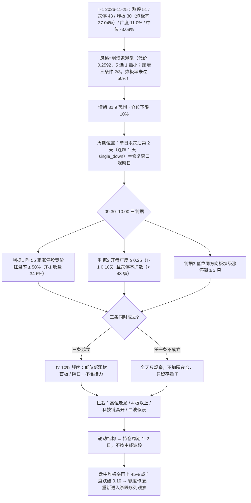

# 2026-11-26 · **风格研判**

> **数据源新鲜度**: partial（A 股主源零缺口；跨资产 / 两融 / SOX 校验 / 群聊有缺口）
> **降级状态**: false · 置信度 **0.525**（`0.70 × 0.75 × 1.00`，刚过 0.5 线）
> **窗口**: 30 个收益日（2026-10-15 → 2026-11-25，末日 2026-11-25）· Ward 6 簇 · n=42（22 风格板块 + 20 ETF）

## 一句话结论

今日 **崩溃退潮型** + 情绪 **31.9（恐惧）** + **无主线（轮动结构）**，仓位上限 **10%**——位置是 **单日杀跌后的第 2 天（连跌 1 天 · single_down）**，语义是**修复窗口观察日，不是继续空仓**；但 10% 只是极小试错额度：只做低位新题材首板/隔日，**不接高位老龙、不追日内首波反弹**。09:30–10:00 若继续杀跌，按「第二天续杀→尾盘找买点」的周期打法等尾盘再试；前一日领涨的科技链高开一律按兑现处理。**10% 是温度下限、不是目标仓**，三判据不成立时实际可用额度为 0%（只留存量 T）。

---

## 决策树（今日的唯一开关）

**这张图的含义**：T-1 是「涨停还在、跌停也来了、广度塌到 11%」的极端分化日。涨停 51 家 ≥50 家、最高 5 板、3/4/5 板无缺口——结构没散；但跌停 43 家、跌超 5% 的 1716 只（占 32.9%）、全市场中位 −3.68%——赚钱效应急冻。**风格是「退潮结构」而不是「崩盘式抛售」**（崩溃三条件只成立 2/3，炸板率 37.04% 未过 50%），所以仓位落在 0.10 下限＝极小试错额度，不是清仓。**阶段标签（high_chop / main_down）只描述温度；`single_down` 第 2 天是修复窗口观察日，不等于「继续空仓」**——额度能否用出去，由三判据当日现验。

---

## 一、情绪周期：**单日杀跌后的第 2 天**（不是继续空仓，也不是接力日）

### 1.1 位置读数（`cycle_position.json` / `emotion_cycle.json`，as of 2026-11-25 收盘）

| 字段 | 读数 | 含义 |
|---|---|---|
| `consecutive_down_days` | **1** | 11-24 的修复回吐后，11-25 触发单日杀跌（跌停 43 家、广度 11.0%） |
| `cycle_day` | **2** | 单日杀跌后的**次日**；**语义=修复窗口观察日**，方向不明，先看承接 |
| `tier` | **single_down** | 未构成「连跌两日」序列，按单日杀跌口径处理 |
| `signals` | 涨停 51 / 跌停 43 / 炸板 30（37.04%）/ 广度 **0.1051**（586/5573）/ 中位 **−3.77%** | 杀跌日画像：广度极低、中位深负 |
| `emotion_cycle.phase` | **high_chop（高位震荡，confidence 0.72）** | 跌停 43 家但昨日涨停溢价 **+2.05%** 为正、炸板率 37.0% < 40% → 「分歧退潮」，不判崩溃 |
| 周期打法（卷首表 + 92 科比） | 「单日杀跌：多为情绪释放，次日方向不明，按原节奏观察」；**第二天持续杀跌 → 尾盘找买点，第三天必有修复** | 今日是**观察日**：不预设方向，杀跌续演才等尾盘 |

### 1.2 五个标签怎么共存（都是温度，不是方向）

- **风格 = 崩溃退潮型（区间代价 0.2592，次低的主线扩散型 0.7640）**：命中「跌停多 + 指数明显下跌」两条硬判据（跌停 43 家、涨家占比 11.0%、上证 −2.03%、创业板 −4.19%）；**炸板率 37.04% 未过 50%，第三条件缺**——所以是退潮结构、不是崩盘。阶段 `high_chop` 与风格标签**并存且有张力**：阶段说「赚钱效应未崩（溢价为正）」，风格说「广度与跌停已塌」。**不覆盖标签，但温度按阶段收紧、仓位不上调。**
- **情绪浓度 = 31.9（恐惧）**：五维加权，分维度 **涨停 51.0 / 跌停 14.0（100 − 2×43）/ 连板结构 73.5 / 炸板率 0.0（100 − 4×37.04%）/ 资金 8.1**（两融 5 日 −3.38% → 16.2、主力净流入率 −3.52% → 0）。拖垮分数的是**跌停家数、炸板率触底、资金双退**三项，涨停数量这一项反而是唯一亮点。
- **主线 = 1（无主线·轮动结构）**：行业次日 TOP5 留存 **16.0%（4/25）< 35%** 触发硬否决；概念代理 ≥20 家 **0 条**、≥8 家 11 条，但第一名 13 家、第二名 13 家（且 4 日龄、当日 −3.79%）——**成规模涨停潮已退坡到「十来家」量级，不构成主线**。如实写 1，不为凑仓位硬数双主线。
- **仓位上限 = 10%**：崩溃退潮型基准 0.15 −0.05（情绪 31.9 恐惧档）−0.05（阶段 high_chop）−0.05（当日广度 11.0%）= **0.00 → 下限 0.10 生效**；路径全部来自「已发生的事实」，没有任何一条来自预期。这是「极小试错额度」，不是建议仓位。
- **置信度 = 0.525（complete）**：`0.70 × 0.75（freshness：跨资产 + 两融两处缺口）× 1.00（文本与量化同向）`。A 股主源零缺口，缺口只在外盘与杠杆维度，不改写风格与结构结论。

### 1.3 对应打法（第 2 天，四条逐条可执行）

1. **09:30–10:00 只读三个数，不追第一笔。** T-1 的 55 家涨停股：**开盘溢价均值 +2.05% / 中位仅 +0.03%**，**收盘溢价均值 −1.37% / 中位 −4.47%**，红盘率 **34.6%**，再涨停 14 只——**均值被少数高开票抬起来、中位才是真相，高开派发是既定事实**。今日任何高开都按兑现（减仓）处理，不是加仓信号。
2. **盘初继续杀跌 → 等尾盘，不追日内首波反弹。** 这是 `single_down` 第 2 天的核心动作：按科比口径，第二天续杀时**尾盘**才是买点窗口；开盘低开缩量止跌、尾盘再确认承接，才允许动用 10% 额度。
3. **修复三判据当日现验，T-1 全部不成立。** 开盘广度 ≥0.25（T-1 为 **0.105**）、昨 55 家涨停股竞价红盘率 ≥50%（T-1 为 **34.6%**）、低位同方向板块级涨停 ≥3 只（T-1 行业 ≥8 家涨停只有 **1 条**）。**三条同时成立才试错一次；任一条不成立，当日额度为 0。**
4. **存量按 T、不加隔夜仓。** 10% 额度只给**低位新题材首板 / 隔日**，**不含接力**：不接高位老龙、不接 4 板以上、不做二波假设；10:30 前板块级涨停潮不足 3 只或盘初炸板率再上 45%，额度立即收回。

### 1.4 历史样本（诚实标注：**「单日杀跌 → 次日」同口径样本 = 0 条**）

| 连跌天数 | 前一交易日 | 次日 | 次日涨停 | 次日广度 | 是否修复 |
|---|---|---|---|---|---|
| 3 | 2026-11-16 | 2026-11-17 | 37 | 23.79% | ✗ |
| 4 | 2026-11-17 | 2026-11-18 | 41 | 23.65% | ✗ |
| 5 | 2026-11-18 | 2026-11-19 | 23 | 11.65% | ✗ |
| 6 | 2026-11-19 | 2026-11-20 | 28 | 5.62% | ✗ |
| 7 | 2026-11-20 | 2026-11-23 | 146 | 83.63% | ✓ |

**读法**：这五条全是「**连跌 N 天** → 次日」，与今日 `consecutive_down_days=1 / cycle_day=2` **口径不同，不能当概率用**；同口径样本为 **0 条**，即没有任何历史证据能背书「单日杀跌次日会修复」。唯一可引用的是结构规律：**连跌序列越深，修复那一日的爆发力越集中**（11-20 连跌 7 天 → 11-23 涨停 146 / 广度 83.6%），这也是「第 2 天只观察、不抢跑」的原因——真正的修复往往发生在杀跌续演之后，不是次日的第一波。

---

## 二、市场结构（T-1 = 2026-11-25 收盘）

### 2.1 涨停还在，跌停也来了：极端分化

| 指标 | 读数 | 判读 |
|---|---|---|
| 涨停 | **51**（前日 55，−7.3%） | 仍在 50 家以上，数量没塌 |
| 跌停 | **43**（前日 2） | **单日暴增 21 倍**：亏钱效应扩散 |
| 炸板 | **30**（炸板率 **37.04%**，前日 55.28%） | 封板率回升到 **63.0%**，但仍越 35% 减半线 |
| 连板天梯 | 1 板 **37** / 2 板 **5** / 3 板 **6** / 4 板 **2** / 5 板 **1** | 最高 5 板，**3/4/5 板无缺口**，高度链完整 |
| 首板占比 | **72.5%**（37/51，前日 45.5%） | 新增供给回来了，接力层反而被抽薄 |
| 晋级率（按天梯家数近似） | 首板→2 板 **20%**（5/25）、2 板→3 板 **24%**（6/25）、3 板→4 板 **50%**（2/4）、4 板→5 板 **100%**（1/1） | 高位晋级率高于低位，是「少数票被硬顶」而非梯队合力 |
| 封板时点 | 09:30 前累计 **9.8%**、10:00 **64.7%**、10:30 **82.4%** | 早盘封板偏少，10:00–10:30 是主封窗口 |

### 2.2 溢价与承接：开盘给得高，收盘还回去

- 基准样本 **55 家**（11-24 涨停股）：**开盘溢价均值 +2.05% / 中位 +0.03%**；**收盘溢价均值 −1.37% / 中位 −4.47%**；**红盘率 34.6%**；**再涨停 14 只（25.5%）**。
- 读法：**开盘均值 +2.05% 是被个别大幅高开票拉高的，中位只有 +0.03%**——一半以上的昨日涨停股开盘就平开/低开；收盘中位 **−4.47%** 说明**高开派发贯穿全天**。这是「溢价还在、承接没了」的形态，不是「低开承接」。
- 同时，再涨停率 25.5% 仍高于 11-24 的 20.5%：**封板率在改善，但赚钱效应的中位数在恶化**——两条读数方向相反，正是「涨停 51 家 + 跌停 43 家」同日出现的微观来源。

### 2.3 指数与广度：权重相对抗跌，科技与中小盘失血

| 指数 | 收盘 | 单日 | 判读 |
|---|---|---|---|
| 上证指数 | 3476.47 | **−2.03%** | 失守 3500，权重相对抗跌 |
| 沪深300 | 3898.24 | −1.65% | 全指数里跌幅最小 |
| 深证成指 | 10086.36 | −3.24% | 中盘失血 |
| 创业板指 | 2183.58 | **−4.19%** | 成长端重灾区 |
| 科创50 | 1186.14 | **−5.12%** | 全指数最弱，与隔夜半导体链同向 |
| 中证500 | 5890.41 | −3.63% | 中盘无超额 |
| 北证50 | 755.87 | −4.75% | 小盘同样深跌 |

- 广度：**涨 567 / 跌 4588 / 平 61**（5216 只），**中位 −3.68%**，涨家占比 **11.0%**；**跌超 5% 的 1716 只（32.9%）**、涨超 5% 的仅 105 只（2.0%）。
- 成交额 **13829 亿**（前日 16549 亿，**−16.43%**）——**缩量下跌**：不是恐慌抛售（放量杀），而是**买盘直接消失**。这一条与文本侧「大资金净买 500 亿也没有水花」的观察互相印证。
- 口径说明：`cycle_position.json` 的广度为 **0.1051**（586/5573 样本池），本文结构表为 **0.1100**（567/4588）；差异来自样本池，结论不变。

### 2.4 修复 → 回吐 → 杀跌（同口径逐日）

| 交易日 | 涨停 | 跌停 | 炸板率 | 涨家占比 | 全市场中位 |
|---|---|---|---|---|---|
| 11-19 | 23 | 68 | 51.06% | 11.65% | −2.55% |
| 11-20 | 28 | 58 | 20.00% | 5.62% | −5.08% |
| **11-23（修复 1）** | **146** | **3** | **14.12%** | **83.63%** | **+2.41%** |
| **11-24（回吐 2）** | **55** | **2** | **55.28%** | **35.01%** | **−0.67%** |
| **11-25（杀跌 3）** | **51** | **43** | **37.04%** | **10.51%** | **−3.77%** |

**读法**：修复只活了两天——11-23 一天把广度拉到 83.6%，11-24 回吐到 35%，11-25 直接跌到 10.5%、跌停 43 家。**这是「修复失败」而不是「修复延续中的回踩」**：跌停从 2 家跳到 43 家，量能缩 16.4%，是买盘撤离的典型形态。因此今日只能按「单日杀跌后的观察日」处理，不能按「修复第 3 天」接力。

### 2.5 资金（R7 同源）

| 维度 | 读数 | 口径 |
|---|---|---|
| 主力净额 | **−490.2 亿**（净流入率 −3.52%） | moneyflow_dc 全市场加总，11-25 |
| 主力 5 日 | **−1087.7 亿** | 同口径；11-23 的回补已全部吐回并倒欠 |
| 两融余额 | **21422 亿**（2026-11-24，T+1 滞后） | 全市场三所口径，5 日 **−749 亿（−3.38%）** |

**口径说明**：两融**未含 11-25**；主力单日 −490.2 亿 + 5 日 −1087.7 亿，说明 11-23 修复日的 +274 亿级回补不但吐回、还继续失血——**杠杆与主力同向撤退**，这是把仓位压到 0.10 下限的量化依据。

### 2.6 主线代理：行业 1 条、概念 ≥8 家 11 个（≥20 家为 0，不点名）

- **行业维度**：≥8 家涨停只有 **1 条（8 家）**，第 2 名仅 4 家——行业级合力接近消失。
- **概念维度**：≥8 家 **11 个**、≥20 家 **0 个**；第一名 13 家、日龄 1 天（首日启动、2 天 2 板）、当日 +0.58%；第二名 13 家但**日龄 4 天、7 天 5 板、当日 −3.79%**——老题材在退坡、新概念只有 13 家量级。
- **判读**：涨停潮在「层数」上不算窄（11 个概念 ≥8 家），在「规模」上已从 20–30 家量级掉到 13 家量级，且没有 ≥20 家的成规模主线。**代理只说明成规模涨停潮在退坡，主线身份由 R2 判定，R1 只负责温度与上限。**

---

## 三、30 日 6 簇（Ward k=6 · n=42 · 2026-10-15 → 2026-11-25）

| 簇 | n | 30 日 | 5 日 | 末日 | 最大回撤 | 簇内相关 | 跨簇相关 | 与宽基相关 | 构成（统计成员） |
|---|---|---|---|---|---|---|---|---|---|
| **C6** | 4 | **+15.45%** | +2.41% | **−3.09%** | −8.9% | 0.310 | 0.068 | **−0.027** | 高位接力腿 + 低波工具：打二板以上 / 非ST三板以上 / 证券 ETF / 消费 ETF |
| **C5** | 2 | −3.44% | −1.78% | −0.29% | **−8.3%** | 0.452 | **−0.256** | **−0.348** | 防御腿：银行 ETF / 煤炭 ETF |
| **C1** | 3 | −5.22% | −0.57% | +0.22% | −8.3% | 0.267 | 0.260 | +0.408 | 低波价值腿：创历史新高 / 上证50 / 医药 ETF |
| **C2** | 8 | −6.48% | −0.35% | −2.79% | −17.1% | 0.674 | 0.443 | +0.585 | 情绪打板簇：百日新高 / 热股 / 资金·高振幅·高贝塔 / 打板·打首板·非ST二板 |
| **C4** | 16 | −17.89% | −7.22% | −3.41% | −18.1% | 0.810 | 0.474 | **+0.853** | 宽基与龙头簇：行业龙头 / 次新 / 增发·增减持·回购·扭亏 / 300·500·1000 / 军工·恒科·光伏·新能源·有色·地产 |
| **C3** | 9 | **−22.22%** | **−5.18%** | **−4.51%** | **−23.1%** | **0.895** | 0.467 | **+0.895** | 科技创新高簇：百元股 / 成交·两通前十 / 科创50 / 通信·芯片·半导体 |

**42 样本整体**：30 日中位 **−16.06%**、正收益 **8/42（19.0%）**；5 日中位 **−4.47%**；末日 **2 涨 / 39 跌**、末日中位 **−3.11%**。

**退化诊断（必须写进结论）**：average linkage 下塌成 **33/42 单一巨簇**（−16.31%、簇内 0.695），其余为四个 2 元素簇 + 1 个单点。这说明 42 个标的在相关结构上仍是一个共同风险因子；**Ward 的六条腿是「同一块石头的六种切法」，不是六条独立主线**。与上一轮（4/2/7/3/16/10）相比，本轮 Ward 结构为 4/2/3/8/16/9——**最大铁块仍是 C4（16 个）与 C3（9 个）相邻两簇，合并即占 25/42（59.5%）**；分化没有进一步展开，只是整体再下一台阶。

### 3.1 三问（对三个关键簇，逐条回答）

**Q1 高位接力腿（C6，n=4，30 日 +15.45%，末日 −3.09%，与宽基相关 −0.027）**

- **大资金意图**: **30 日累计的钱是「接力层赚的」，但末日已经在还。** 这个簇是全样本唯一大幅正收益的腿，然而成员结构是**分裂**的：两根高位接力指数（打二板以上 30 日 +22.97%、非ST三板以上 **+40.26%**）+ 两根低波工具（消费 ETF +6.19%、证券 ETF **−7.64%**）。聚类把「接力」与「低波」并在一起，说明过去 30 日资金只有两个去处——**打板接力与低波避险，中间层消失**。
- **为什么走强**: 30 日强是接力指数贡献，但**末日方向已反转**：非ST三板以上 **−7.00%**、打二板以上 **−3.90%**，消费 ETF 0.00%、证券 ETF −1.45%。该簇与宽基相关 **−0.027**、跨簇相关 0.068＝**独立小生境**：它不跟大盘走，也不带别人走。
- **逻辑够不够硬**: **「30 日累计强」这条逻辑在最关键的一列（末日）已被证伪。** 30 日会把退潮期的「曾经强」误读成「现在强」，而高位腿末日 −7.00% 是本轮最硬的负读数之一。**动作：只作温度参考与反证锚，不构成今日方向；高位接力一律不碰。**

**Q2 科技创新高簇（C3，n=9，30 日 −22.22%，回撤 −23.1%，末日 −4.51%，与宽基相关 0.895）**

- **大资金意图**: **无承接的持续出逃，不是洗盘。** 30 日 −22.22%、5 日 −5.18%、末日 −4.51%——**三个时段全负**，说明这一个月里没有出现过一次有效反抽；簇内相关 **0.895**、与宽基相关 **0.895**，它就是风险因子本体，买它等于买「大盘 + 科技」双 beta。
- **为什么走强**: **它今天并不强——隔夜硬件链继续补跌。** 英伟达 **−3.91%**、美光 **−4.53%**、台积电 −1.96%、阿斯麦 −2.47%、费半 −0.65%；消息面还有存储目标价被大幅下调、下行周期时点被提前、算力集群退租传闻。**外盘没有转向，只是跌幅收窄。**
- **逻辑够不够硬**: **反弹逻辑不硬。** 需要两个条件同时成立：外盘转向（纳指 3 日 +4.28% 是 11-23 单日 +6.51% 撑起来的，之后连跌两日）+ 内部止跌（末日 −4.51% 说明还没有）。**动作：今日该簇高开一律不追；只在低开且有承接时作观察对象，不做隔夜接力。**

**Q3 防御腿（C5：银行 + 煤炭 ETF，30 日 −3.44%，末日 −0.29%，跨簇相关 −0.256）**

- **大资金意图**: **防御仓在「不动」，不是「加仓」。** 它仍是唯一跨簇相关为负（−0.256）、与宽基负相关（−0.348）的腿；但内部已经分裂——银行 ETF 30 日 **+6.47%**（全样本第二强）、煤炭 ETF **−13.35%**，两条腿方向相反，这也是它只有 2 个成员的原因。
- **为什么走强**: T-1 它不是「涨」，是**跌得少**：末日 −0.29%，而全市场中位 −3.68%。这是普跌日的**相对收益**，不是绝对赚钱效应；它没有跟风盘、也不产生涨停。
- **逻辑够不够硬**: **抗跌是真的（回撤 −8.3% 全样本最浅），赚钱效应是假的。** **动作：只作失败场景的去处与反证锚，不作今日主攻；若今日广度继续塌到 0.05 以下，它是唯一还能看的观察位，但仍不构成开仓理由。**

### 3.2 接力温度计（打板类风格指数的 30 日 vs 末日）

| 风格指数 | 30 日 | 5 日 | 末日 |
|---|---|---|---|
| 昨日非ST三板以上表现 | **+40.26%** | +12.22% | **−7.00%** |
| 昨日非ST二板表现 | +26.05% | **+13.23%** | −1.37% |
| 昨日打二板以上表现 | +22.97% | +0.73% | **−3.90%** |
| 昨日打首板表现 | +8.20% | −1.88% | **−4.38%** |
| 昨日打板表现（综合） | +4.40% | −0.47% | **−3.94%** |

**读法**：**五条腿末日全为负，是「打板层无一赢家」的完整读数。** 分层看：高位腿（三板以上 −7.00%）比低位腿（非ST二板 −1.37%、首板 −4.38%）跌得更狠，说明资金不是在「高低切换」，而是在**整体撤退、高位先撤**。这与 11-24 的「高位腿 → 低位腿」切换完全相反，也是今日不能做接力的直接证据。

---

## 四、轮动诊断：**rotation（硬否决生效，无主线）**

| 指标 | 读数 | 判读 |
|---|---|---|
| 行业截面解释力 | **29.24%**（5559 只 / 105 个行业） | 高：行业间分化明显，单日「有结构」 |
| 昨日 TOP5 行业留存率 | **16.0%（4/25 命中，5 个相邻交易日对）** | **<35% 硬否决线 → 追昨日最强行业是负 alpha** |
| 涨停次日溢价 | 收盘中位 **−4.47%**（开盘中位 +0.03%）、红盘率 **34.6%**、同日广度 **11.0%** | 溢价为负且必须与极低广度一起读：**没有承接** |
| 大小盘分层 | <50 亿 **−4.04%** / 50–200 亿 −3.58% / 200–500 亿 −2.90% / 500–1000 亿 −1.58% / >1000 亿 **−0.80%** | **大盘抗跌、小盘最惨**；三日小−大 **+2.77 / −0.59 / −3.02**，最近一日小盘大幅跑输 → `size_tilt = large` |

**判定过程（不掩盖硬否决）**：原始 flags 只命中 **2/4**（`retention_lt35` + `premium_not_stable`），但留存 **16.0% < 35%** 触发装配层的**硬否决升级** → `rotation_regime = rotation`、`main_lines_count = 1（无主线）`。注意「解释力 29.24% 很高」与「留存 16% 很低」**不矛盾**：单日行业分化确实大（有大涨的防守腿、大跌的科技腿），但**次日不延续**——分化 ≠ 主线。

**实战含义**：今日任何「看起来成板块」的强势，明日只有 **16%** 的概率留在前列；持仓周期按 **1–2 日**脉冲，用「开关状态 + 个股脉冲」而不是「主线波段」。这与 §3.2「打板层五条腿末日全负」互为印证。

---

## 五、外盘：科技链继续补跌，纳指 3 日正收益全靠 11-23 一根暴涨（2026-11-25 收盘，实时源补齐）

| 指数 | 收盘 | 单日 | 备注 |
|---|---|---|---|
| 纳斯达克综合 | 23585.80 | **−0.62%** | 3 日累计 **+4.28%**（11-23 +6.51 / 11-24 −1.48 / 11-25 −0.62），**已连跌两日** |
| 标普500 | 7182.78 | −0.25% | prev_close 双源校验 ok |
| 道琼斯 | 50182.95 | **+0.33%** | 唯一收红：钱继续留在价值端 |
| 费城半导体 | 8774.86 | **−0.65%** | 单点读数、prev_close 未双源校验（unverified） |
| 纳斯达克100 | 26046.90 | −0.64% | 单点读数（unverified） |
| 恒生指数 | 21966.01 | **−1.14%** | 11-25 收盘（fresh） |
| 韩国综合 | 4697.51 | **−6.16%** | 单点读数（unverified），与存储链同向 |
| 日经225 | — | — | 无 11-25 收盘价；20 日 −8.33%（截至 11-25） |

- **个股层面（同一实时源，11-25 收盘）**：美光 **−4.53%**、英伟达 **−3.91%**、亚马逊 −3.12%、阿斯麦 −2.47%、谷歌 −2.13%、台积电 −1.96%、AMD −1.75%、康宁 −1.60%、微软 −1.25%、特斯拉 −1.18%、英特尔 −0.60%、博通 −0.07%；**Meta +3.40%、高通 +2.24%、苹果 +0.43%**。**硬件/存储链继续杀、部分软件与消费电子不跌**——仍是对算力硬件的定向回吐，不是全面风险偏好崩塌。
- **读法**：纳指 3 日 +4.28% 是 11-23 单日 +6.51% 撑出来的，之后连续两日回落；**这不是趋势修复，是高位震荡里的反抽**。给 A 股的传导很明确：**前一日领涨的科技链今日高开＝给隔夜逃命盘抬轿**，低开才有观察价值。
- **汇率 / 商品**：USDCNH **6.67676**（11-24 单点）、**DXY 缺**；商品（原油 / 铜 / 金）**skipped**，跨资产三档坐标（软着陆 / 降息 / 衰退）**无法建立**。

---

## 六、今日唯一可执行的打法（非个股 · 思维链四段）

- **买入理由**: ①位置——30 日样本中位 **−16.06%**、正收益仅 **8/42（19.0%）**、末日 **2 涨 / 39 跌**，是极端普跌后的第 2 天；按周期口径，单日杀跌的次日试错成本相对低；②结构——涨停 **51 家 ≥50**、最高 **5 板**且 3/4/5 板无缺口、首板占比回到 **72.5%**（供给回来），跌停 43 家但炸板率 **37.04% < 50%**，属退潮结构而非崩盘；③周期——`single_down` **第 2 天=修复窗口观察日，不是继续空仓**。**三条只支持「10% 极小额度、只做低位首板/隔日」，不支持任何接力，也不支持先手抢跑。**
- **风险点**: ①**溢价结构已坏**——55 家涨停股开盘中位仅 +0.03%、收盘中位 **−4.47%**、均值 −1.37%、红盘率 34.6%，高开派发是既定事实；②**广度是普跌而非分歧**——涨家占比 11.0%、跌超 5% 的 1716 只（32.9%）、中位 −3.68%；③**资金双退**——主力 −490.2 亿（5 日 −1087.7 亿）、两融 5 日 −749 亿（−3.38%）；④**外盘没转向**——费半 −0.65%、英伟达 −3.91%、美光 −4.53%，存储链利空（目标价下调、下行周期提前、算力退租）未出尽；⑤**轮动结构**——行业次日留存 16%，任何板块强势次日大概率消失。
- **止损条件**: 单笔试错以买入价为基准 **−5% 硬止损**，不设「看情况」；09:30–10:00 **三判据任一不成立 → 当日新增额度全部收回**，只留存量 T；盘中**炸板率再上 45%** 或**广度跌破 0.10**（T-1 0.105）→ 修复按失败处理、额度清零，重新进入杀跌序列观察；存量持仓按 T 处理、**不一次性清仓**（单日杀跌次日方向不明，清仓也是一种预判）。
- **可验证假设**: 24 小时内可证真/证伪三条——①**昨 55 家涨停股竞价红盘率**是否 ≥50%（T-1 收盘 34.6%）；②**09:30–10:00 开盘广度**是否 ≥0.25（T-1 0.105）且跌停家数不扩散（<43 家）；③**低位同方向板块级涨停潮**是否 ≥3 只（T-1 行业 ≥8 家涨停仅 1 条）。三条同时成立 → 尾盘可动用 10% 额度试错一次；①③不成立 → **全天只观察、不试错**；若盘初直接反抽而不给低点 → 按「不追首波」处理，当日额度作废。

---

## 七、不确定性 / 反证

1. **风格标签与阶段并存且有张力，是本报告最大的内在结构。** 五分法给出「崩溃退潮型」（代价 0.2592 最小），阶段给出「高位震荡」（溢价为正、炸板率 37% < 40%）。两者都对：**结构侧已经塌（跌停 43、广度 11.0%），但赚钱效应还没崩到崩溃三条件全成立（炸板率未过 50%）**。任何把「崩溃退潮型」读成「崩盘式抛售、清仓离场」的读法都会错；正确读法是「退潮结构 + 极小额度」。
2. **10% 是下限，不是目标仓。** 公式路径：0.15（崩溃基准）−0.05（情绪 31.9）−0.05（阶段 high_chop）−0.05（广度 11.0%）= 0.00 → 下限 0.10 生效。**三条折扣全部来自已发生的事实**；若三判据一条都不成立，实际可用额度应为 0%（只留存量 T）。
3. **「涨停 51 家」容易被误读成不弱。** 51 家涨停与 43 家跌停同一天出现，且跌超 5% 的有 1716 只——**涨停数量被少数低位小票与新股撑起，不代表赚钱效应存在**。判断赚钱效应要看中位（−3.68%）、红盘率（34.6%）与溢价中位（−4.47%），不是涨停家数。
4. **开盘溢价均值 +2.05% 与中位 +0.03% 的背离，是当日最重要的口径陷阱。** 均值被个别大幅高开票拉起，中位才代表「一半以上的昨日涨停股」。本报告一律以中位为主、均值为辅，反之会得出「溢价还在、可以接力」的错误结论。
5. **30 日累计会把「曾经强」当成「现在强」。** 高位接力腿 30 日 +40.26%，末日 −7.00%；若只看 30 日就会得出「接力最强」的相反结论。**必须用末日列定方向，30 日只用来看位置。**
6. **「行业解释力 29.24%」与「留存 16.0%」并存，是分化不等于主线的证据。** 单日行业间分化确实大（防守腿与科技腿两个方向），但次日不延续；按留存硬否决写「无主线」，**不为凑仓位硬数出双主线**。
7. **周期「第 2 天」的同口径样本为 0 条。** `cycle_position.json` 的五条样本是「连跌 3–7 天 → 次日」，与今日「单日杀跌（连跌 1 天）→ 次日」口径不同；唯一可比的结构规律是「杀跌越深、修复日爆发越集中」，因此今日只能观察、不能抢跑。
8. **文本侧与量化高度同向，本身也是风险。** 公众号 86 篇 / 14 个账号的主线判断是「接力模式全线失效、高开即兑现、买方枯竭、外盘利空未出尽」——与量化「广度 11.0%、溢价中位 −4.47%、留存 16%」完全一致。**一致预期在情绪极值处常被反向利用**：若今日盘初出现低开缩量止跌 + 低位板块级涨停，那正是「一致悲观」被打破的时点，届时按三判据执行、不因文本悲观而放弃观察。
9. **外盘读数的单源风险。** SOX −0.65%、NDX −0.64% 只有 sina 一个来源、prev_close 未双源校验；韩国综合 −6.16% 同样 unverified；日经 225 无 11-25 收盘价。个股层面美光 −4.53%、英伟达 −3.91% 与之同向，**交叉一致性支持读数，但严格意义上仍属 unverified**。
10. **数据缺口**：商品 skipped、DXY 缺、USDCNH 单点、两融 T+1（未含 11-25）、北向口径不可用、群聊 0 条。**不因缺口给结论打折，但也不把这些维度说成已确认**——这是 confidence 只有 0.525 的直接原因（freshness 0.75）。
11. **两融 T+1 的时点错配。** 两融最新 2026-11-24，**未含 11-25 的杀跌日**；−749 亿（−3.38%）只能说明「到 11-24 为止杠杆在退」，不能说明 11-25 的杠杆行为。若今日低开后两融数据补录出现单日大幅去杠杆，届时应把仓位上限进一步收紧而非放宽。

---

## 数据源审计

| 源 | 日期 | 状态 | 备注 |
|---|---|:--:|---|
| tushare.ths_daily（22 风格板块） | 2026-11-26 | 🟢 | 22/22 · 30 个收益日零缺失 |
| tushare.fund_daily（20 ETF） | 2026-11-26 | 🟢 | 20/20 · 同上 |
| 30 日聚类（Ward k=6） | 2026-11-26 | 🟢 | 42 样本 · average linkage 作退化诊断（33 巨簇） |
| 涨停 / 天梯 / 溢价（limit_list_d） | 2026-11-25 | 🟢 | 5216 只 · 逐票明细现算 |
| 指数（index_daily） | 2026-11-25 | 🟢 | 7 个 · 含北证50 |
| 轮动（daily + daily_basic） | 2026-11-25 | 🟢 | 5559 只 / 105 行业 / 5 档市值 |
| R7 资金（主力 / 两融） | 2026-11-25 | 🟡 | 两融 T+1（2026-11-24）· 小单未取，不以 0 代替 |
| 外盘实时补齐（sina / eastmoney） | 2026-11-25 | 🟡 | 20 条 · SOX / NDX prev_close 未双源校验 |
| tushare 外盘原始源 | 2026-11-24 | 🟡 | 美股指数停 2026-11-24 · 商品 skipped、DXY 缺 |
| emotion_cycle 预计算 | 2026-11-26 | 🟢 | high_chop 0.72 · 硬命中 |
| cycle_position 预计算 | 2026-11-26 | 🟢 | 12 个字段 · 单日杀跌第 2 天 |
| 公众号池（RSS） | 2026-11-26 | 🟢 | 86 篇 / 14 账号有正文 / 19 源 |
| 群聊（wechat-cli，匿名） | 2026-11-26 | 🔴 | 0 字节 · 抓取窗口内无消息 |

---

## 八、与其他 R/D/E 的关系

- **依赖**：`R7_capital_flow.json`（主力净额 / 两融）、`emotion_cycle.json`、`cycle_position.json`、`style_snapshot.json`（30 日收益矩阵）、公众号 RSS。
- **被消费**：R2（`style=崩溃退潮型` / `main_lines_count=1` / `position_cap_suggestion=0.10`）、R3（`sentiment_score=31.9` 基准）、R6（与 R2 一致性反证）、D1（`position_cap_suggestion` → exec_pool 总仓上限 + `cycle_position_note` → 第 2 天打法）、E1（盘后复盘对照）。
- **交接口径**：R1 只给温度（风格 / 情绪 / 阶段 / 上限）与结构（6 簇 / 轮动 / 外盘），**不出板块、不出个股、不给买卖点**；`main_lines_count=1` 是「无主线」的规则读数，**R2 的板块级判定才决定今天做不做、做什么**。第 2 天语义写死为：**观察承接 → 盘初续杀等尾盘 → 三判据成立才动用 10% 额度**，不是继续空仓，也不是接力日。

## Sub-Agent 元数据

- skill: `analyze_style_v1`
- artifact: `data/research/20261126/R1_style.json`（pydantic 校验通过，status=complete，confidence=0.525）
- 生成耗时: 约 6 分钟（快照 30 秒 + 聚类 / 结构 / 轮动 / 外盘 / 装配）
- model: deepseek-v4.1-flash
- 口径锁定: 簇表与 JSON 的 **Ward** 簇逐簇对齐（C6/C5/C1/C2/C4/C3）；`rotation_regime=rotation` 以 JSON 为准（原始 2/4 flags → 留存 16.0% <35% 硬否决升级）；`emotion_cycle_day_label` = **第 2 天（连跌 1 天 · single_down）**；仓位以装配脚本输出为准（0.10），未手改 artifact。
