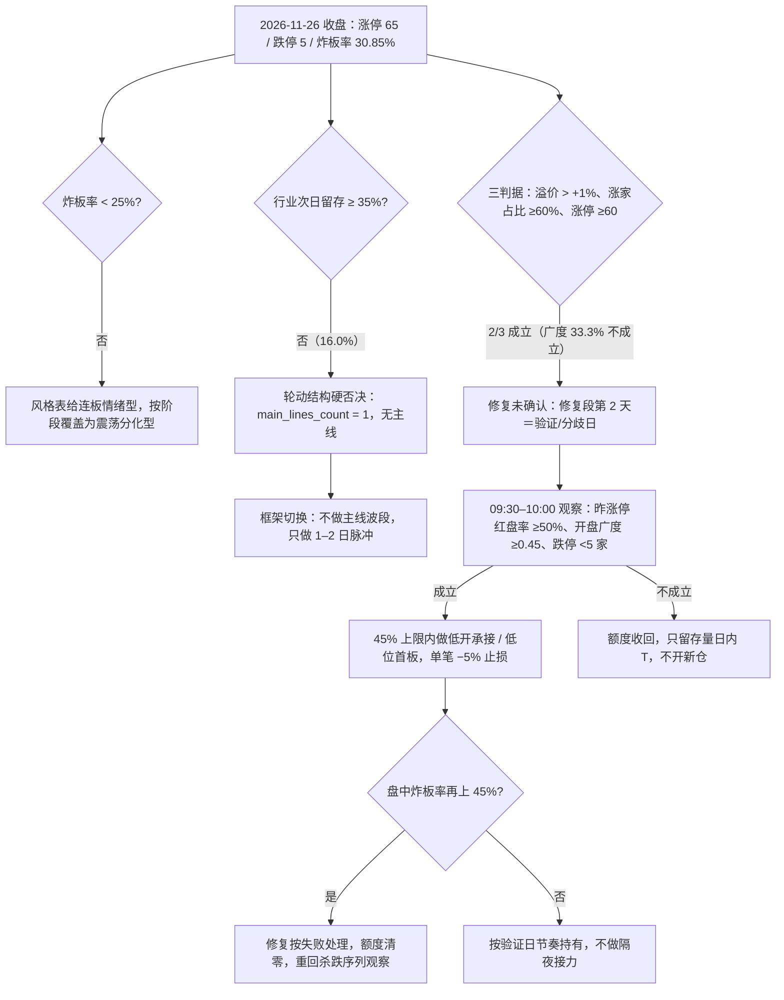

# 2026-11-27（周五） · **风格研判**

> **数据源新鲜度**: partial
> **降级状态**: true（外盘停 2026-11-25、商品 skipped、两融 T+1、群聊 0 条）
> **置信度**: 0.525

## 一句话结论

**震荡分化型 + 情绪 54.9（中性）+ 无主线（轮动结构），仓位上限 45%、持仓周期按 1–2 日；今日是修复段第 2 个交易日＝验证/分歧日，不追开盘价、只做低开承接与分歧转强。**

## 决策树（今日的唯一开关）

## 一、情绪周期：**修复段第 2 个交易日**（验证/分歧日，不是继续空仓）

### 1.1 位置读数（`cycle_position.json` / `emotion_cycle.json`，as of 2026-11-26 收盘）

| 字段 | 读数 | 含义 |
|---|---|---|
| `consecutive_down_days` | 0 | 已不在杀跌序列（最近杀跌日为 2026-11-25） |
| `cycle_day` | 0 | 技术读数：非杀跌段 |
| `tier` | neutral | 中性，但不是「无风险」 |
| 修复段起点 | 2026-11-26 | 涨停 65、跌停 5、广度 31.66% |
| **今日位置** | **修复段第 2 个交易日** | 修复首日之后的第一天验证 |
| `emotion_cycle_phase` | high_chop（置信 0.75） | 温度＝高位分歧，不是方向 |

`cycle_position.json` 的「第 0 天」只说明不在杀跌序列；本轮真正可执行的位置是**修复段第 2 个交易日**。按 skill 口径，这不是「继续空仓」，也不是接力日，而是**验证/分歧日**。

### 1.2 修复三判据：2/3 成立，修复「已发生但未确认」

| 判据 | 阈值 | 2026-11-26 实际 | 是否成立 |
|---|---|---|---|
| 昨日涨停收盘溢价 | > +1% | 均值 +3.22% / 中位 +5.07% | ✅ |
| 涨家占比（广度） | ≥ 60% | 33.3%（涨 1683 / 跌 3375） | ❌ |
| 涨停家数 | ≥ 60 | 65 | ✅ |

两条成立、广度不成立 → **不能按「修复确认后的接力日」处理**。广度是唯一否决项，也是最容易被误读的一项：指数收红（上证 +0.01%）掩盖了「跌多涨少」的真实分布。

### 1.3 对应打法（修复段第 2 天，四条逐条可执行）

1. **不追开盘价。** 修复首日的收红是尾盘拉出来的（上证 +0.01%、深成 **−2.29%**），开盘冲高更可能是先手兑现窗口；只在低开承接与分歧转强时出手。
2. **延续的前提是两项不再走弱**：昨日涨停红盘率 **66.7%** 与广度 **33.3%**。任一转弱即按「一日反抽」处理，当日只做日内 T，不做隔夜。
3. **高位只留观察、不给新仓。** 最高 5 板仅 **1 家**独苗，4 板 1 家、3 板 4 家——梯队不是断层，而是**厚度不足**：一旦最高板断板，2–3 板层没有承接带。
4. **仓位上限 45%，逐笔确认后才用出去。** 既不因前段杀跌全天禁手，也不因修复首日收红就放大；存量按 T 与分批处理，不一次性清仓。

### 1.4 同口径历史样本：**0 条**（不当概率用）

`cycle_position.samples` 全部是「连跌 3–7 天 → 次日」的样本（2026-11-16 至 2026-11-20 五次，仅 2026-11-20 → 11-23 判为修复）。**「单日杀跌 → 修复段第 2 天」的同口径样本为零**，因此本段只作结构参照：最近一段修复的次日（2026-11-24）读数是涨停 55、炸板率 55.28%、广度 35.01%——**修复首日强、次日回吐**，与本轮「涨停更多但广度仍低」的结构并不相同，不能直接套用。

## 二、市场结构（T-1 = 2026-11-26 收盘）

### 2.1 涨停还在、跌停收敛，但供给高度集中

| 指标 | 2026-11-26 | 2026-11-25 | 变化 |
|---|---|---|---|
| 涨停 | 65 | 51 | +14 |
| 跌停 | 5 | 43 | −38 |
| 炸板家数 | 29 | 30 | −1 |
| 炸板率 | 30.85% | 37.04% | −6.2pct |
| 最高连板 | 5 | 5 | 持平 |
| 首板占比 | 78.5% | 72.5% | +6.0pct |

连板天梯：1 板 51 家 / 2 板 8 家 / 3 板 4 家 / 4 板 1 家 / 5 板 1 家。**跌停从 43 家收敛到 5 家是今天最硬的正读数**，但涨停增量几乎全部落在首板（+14 家涨停中有 14 家来自 1 板层），说明增量是「新做新」而非「接力升温」。

### 2.2 溢价与承接：开盘给得低、收盘给得高（结构反转）

| 口径 | 开盘 | 收盘 |
|---|---|---|
| 均值 | +1.56% | +3.22% |
| 中位 | +0.56% | +5.07% |
| 红盘率 | — | 66.7% |
| 再涨停 | — | 14 只 |

与 11-25（开盘中位 +0.03%、收盘中位 **−4.47%**、红盘率 34.6%）相比，今日溢价结构**从「高开派发」翻成「低开承接」**：开盘只给 +0.56%，收盘中位冲到 +5.07%。这是修复日应有的形态，但也意味着**先手成本已经抬高**——今日再追，等于在 +5% 的溢价上接力。

### 2.3 指数与广度：权重收红、中小盘与科技失血

| 指数 | 涨跌 | 备注 |
|---|---|---|
| 上证指数 | +0.01% | 尾盘拉红，3476.88 |
| 深证成指 | −2.29% | 万点关口附近 |
| 创业板指 | +0.29% | 2189.82 |
| 科创50 | −1.36% | 科技腿最弱 |
| 沪深300 | +0.06% | 权重企稳 |
| 中证500 | −0.46% | 中盘偏弱 |
| 北证50 | −0.45% | 小盘偏弱 |

广度：涨 **1683** / 跌 **3375** / 平 163，涨家占比 **33.3%**，中位 **−0.76%**，涨超 5% 178 只 / 跌超 5% 144 只；成交额 **13172 亿**（前日 13829 亿，**−4.75%**）。**指数红、个股绿的背离，是本轮修复最需要警惕的地方**：赚钱效应集中在少数票，而不是扩散。

### 2.4 逐日序列（同口径，杀跌 → 修复 → 验证）

| 日期 | 涨停 | 跌停 | 炸板率 | 最高板 | 广度 |
|---|---|---|---|---|---|
| 2026-11-20 | 28 | 58 | 20.00% | 4 | 5.62% |
| 2026-11-23 | 146 | 3 | 14.12% | 5 | 83.63% |
| 2026-11-24 | 55 | 2 | 55.28% | 4 | 35.01% |
| 2026-11-25 | 51 | 43 | 37.04% | 5 | 10.51% |
| 2026-11-26 | 65 | 5 | 30.85% | 5 | 31.66% |

11-23 是「一次性利好把三天反弹压缩到一个竞价」的极端修复日（涨停 146），此后连续两天回吐（广度 35.01% → 10.51%），11-26 再度修复到 31.66%。**这个序列的形状是「修复—回吐—再修复」，不是「修复—加速」**，对今日的直接含义是：修复段第 2 天大概率仍要经历一次分歧。

### 2.5 资金（R7 同源，口径对齐）

| 项 | 读数 | 说明 |
|---|---|---|
| 主力净额 | **+9.14 亿** | 净流入率 +0.07%，单日转正但极弱 |
| 主力 5 日累计 | **−765.4 亿** | 5 日仍在净流出 |
| 两融余额 | **21213.9 亿**（2026-11-25） | T+1 口径，未含 11-26 |
| 两融 5 日 | **−868.8 亿（−3.93%）** | 杠杆持续退潮 |

单日 +9.14 亿在 13172 亿成交额里只占 0.07%——**这不叫资金回流，只能叫「停止单边砸盘」**。两融 5 日 −3.93% 意味着杠杆资金的仓位在系统性下降，高度股反包的胜率随之下移。

### 2.6 主线代理：行业 ≥8 家涨停 **0 条**，概念 ≥20 家 **0 条**

- 行业口径：无一条行业达到 8 家涨停；最高为通用设备 5 家、元件 5 家、化学制品 5 家。
- 概念口径：≥8 家 20 条，**≥20 家 0 条**；最大一条 19 家（前一日 7 家，delta +12），其次 18 家（前一日 13 家）。
- 结论：**只有「扩散」，没有「集中」**。扩散到 20 条概念、每条都不足 20 家，不构成可交易主线；按 skill §3.6 硬规则，`main_lines_count` 如实写 1（无主线）。

## 三、30 日 6 簇（Ward k=6 · n=42 · 2026-10-15 → 2026-11-26）

方法：1−Pearson 相关距离 + Ward linkage，k=6；average linkage 结果另存为退化诊断。窗口内 42 个样本的 30 日收益中位 **−14.40%**、正收益 **8/42**、末日 **17 涨 / 23 跌**。

| 簇 | n | 30 日 | 5 日 | 末日 | 簇内相关 | 与宽基相关 | 代表成员 |
|---|---|---|---|---|---|---|---|
| C6 | 4 | **+14.67%** | +1.58% | **−3.39%** | 0.32 | −0.014 | 打二板以上表现、非ST三板以上表现、证券ETF、消费ETF |
| C1 | 8 | +0.37% | +4.27% | +2.45% | 0.572 | +0.498 | 百日新高、同花顺热股、创历史新高、昨日资金前十、高贝塔值、昨日打板/打首板/非ST二板表现 |
| C5 | 2 | −0.01% | +0.27% | +1.57% | 0.46 | **−0.408** | 银行ETF、煤炭ETF |
| C2 | 2 | −0.46% | −0.86% | +0.12% | 0.475 | +0.483 | 上证50、医药ETF |
| C4 | 17 | −16.29% | −5.99% | −0.41% | 0.795 | +0.844 | 行业龙头、近端次新股、增发/增持/减持/回购计划、业绩扭亏、沪深300/中证500/中证1000、军工ETF、恒生科技、光伏ETF、新能源、有色ETF、房地产 |
| C3 | 9 | **−20.21%** | **−5.62%** | −0.04% | **0.888** | **+0.892** | 百元股、昨日成交前十、沪股通/深股通成交前十、科创50、通信ETF、芯片ETF、半导体、芯片ETF华夏 |

结构读法：**6 簇里 2 条是「30 日强但末日转弱」（C6/C1），2 条是「30 日平防御强」（C5/C2），2 条是「30 日最弱、簇内高度同质」（C4/C3）**。C4+C3 合计 26/42 只、簇内相关 0.79–0.89、与宽基相关 0.84–0.89，说明大部分风险资产仍是同一个 beta。

### 3.1 三问（对三个关键簇，逐条回答）

**C6 · 接力层（30 日最强，末日已反转）**

- **大资金意图**: **过去 30 日的钱是「接力层赚的」，但先手在 11-26 已经开始兑现。** 该簇 30 日 +14.67%，其中非ST三板以上 **+40.26%**、打二板以上 **+22.67%**，是全样本唯一的绝对收益来源；但簇内相关只有 **0.32**、与宽基相关 **−0.014**，说明它把「高位接力」和「低波工具」（消费 ETF +5.00%、证券 ETF −9.24%）硬拼在一起——**过去一个月资金只有两个去处：打板接力与低波避险，中间层消失**。
- **为什么走强**: 30 日强由两根接力指数贡献，5 日仍 +1.58%（三板以上 5 日 **+12.22%**）；**但末日 −3.39%，两根接力腿同时转负（−3.90% / −7.00%）**。强的是 30 日累计，弱的是最新一根 K 线。
- **逻辑够不够硬**: **「30 日累计强」在最关键的一列（末日）已被证伪。** 三板以上末日 **−7.00%** 是全样本最硬的负读数之一；30 日会把退潮期的「曾经强」误读成「现在强」。**动作：只作温度计与反证锚，不构成今日方向；高位接力一律不碰。**

**C3 · 科技成长（30 日最弱，簇内高度同质）**

- **大资金意图**: **无承接的持续出逃，不是洗盘。** 30 日 **−20.21%**、5 日 **−5.62%**，两个时段全负；簇内相关 **0.888**、与宽基相关 **0.892**，它就是风险因子本体——买它等于买「大盘 + 科技」双 beta。
- **为什么走强**: **它并不强，只是跌势收敛。** 末日 −0.04% 的分母里，通信 ETF **+2.68%**、深股通成交前十 +1.78% 在反抽，而科创50 **−1.68%**、芯片 ETF **−1.57%**、半导体 **−1.70%**、芯片 ETF 华夏 −1.68% 仍在跌；芯片三条腿 5 日 **−10.46% ~ −10.65%**，是外盘存储利空的直接传导。
- **逻辑够不够硬**: **反抽逻辑不硬。** 需要两个条件同时成立：外盘转向（纳指 3 日 +4.28% 由 11-23 一根撑起，20 日仍 **−11.16%**）+ 内部止跌（末日仍分化）。通信与芯片同簇内方向相反，说明这是超跌轮动，不是趋势修复。**动作：该簇高开一律不追；只在低开有承接时作观察对象，不做隔夜接力。**

**C5 · 防御（唯一显著负相关）**

- **大资金意图**: **防御仓在「不动」，不是「加仓」。** 与宽基相关 **−0.408**，是全样本唯一显著负相关的腿；但它只有 2 个成员，且内部方向相反——银行 ETF 30 日 **+7.42%**（全样本第二强）、煤炭 ETF **−7.44%**，所以它聚不成更大的簇。
- **为什么走强**: 末日 **+1.57%** 是普跌日（全市场中位 −0.76%）里的**相对收益**，不是绝对赚钱效应；银行末日仅 +0.65%、煤炭 +2.48%，两者都没有跟风盘、也不产生涨停。
- **逻辑够不够硬**: **抗跌是真的，赚钱效应是假的。** **动作：只作失败场景的去处与反证锚，不作今日主攻。**

### 3.2 接力温度计：高度越高、末日越差

| 风格指数 | 30 日 | 5 日 | 末日 |
|---|---|---|---|
| 昨日非ST二板表现 | +44.10% | +18.80% | **+9.31%** |
| 昨日打首板表现 | +12.43% | +1.26% | +0.48% |
| 昨日打板表现 | +8.68% | +3.08% | +1.02% |
| 昨日打二板以上表现 | +22.67% | +0.73% | **−3.90%** |
| 昨日非ST三板以上表现 | +40.26% | +12.22% | **−7.00%** |

**二板层末日 +9.31%、三板以上末日 −7.00%**——同一天里，接力层的「低位接力」和「高位独苗」方向完全相反。这给出的可执行判断是：**接力只在 2 板以内有效，3 板以上已在兑现**；也解释了为什么今日 5 板独苗只留观察、不给新仓。

### 3.3 退化证据（诚实标注）

average linkage 在同一矩阵上塌成 **33/42 的单一巨簇**（30 日 −13.46%、簇内 0.684），只剩 4 个 2 成员小簇和 1 个单例。**这既是「无结构分化」的证据，也提醒 Ward 的 6 簇是 k 的选择结果，不是自然分界**——若换成 k=4，接力层与防御层仍会独立，但 C4/C3 会合并，结构解释力下降。簇表只用于描述资金去处，不作方向推荐。

## 四、轮动诊断：**rotation（硬否决生效，无主线）**

| 指标 | 读数 | 阈值 | 判定 |
|---|---|---|---|
| 行业截面解释力 | 10.48% | ≥ 20% 才有主线结构 | ❌ 轮动 |
| 昨日 TOP5 行业留存 | **16.0%（4/25）** | ≥ 50% 才有延续 | ❌ 轮动（硬否决） |
| 涨停次日溢价 | 收盘中位 **+5.07%**（红盘 66.7%、广度 33.3%） | 必须与广度同报 | 溢价高但广度低 |
| 大小盘分层 | <50 亿 **−1.07%** vs >1000 亿 **−0.15%** | 小盘连续 3 日弱于大盘 | 小盘全负（−0.59 / −3.02 / −0.61） |

原始诊断命中 **2/4 flags**（`industry_explained_lt20`、`retention_lt35`），按 skill §3.6「留存 <35% 硬否决」升级为 **rotation**；`size_tilt = large`（资金向权重集中，小盘桶 2568/3229 只下跌）。**这意味着今日禁用主线波段框架**：不存在「沿主线做龙一龙二」的路径，只能做 1–2 日脉冲与开关式仓位。留存 16% 的直接后果是——**任何板块的强势，次日大概率消失**。

## 五、外盘：感恩节休市掩盖了一天，压制项没有消失（2026-11-25 收盘，实时源补齐）

| 标的 | 涨跌 | 备注 |
|---|---|---|
| 纳斯达克 | −0.62% | 盘中一度 −4.53%，探入技术性回调区间后收窄 |
| 标普500 | −0.25% | 盘中一度 −3.11% |
| 道指 | +0.33% | 唯一收红 |
| 费城半导体 | −0.65% | 科技腿仍弱 |
| 纳指 3 日累计 | **+4.28%** | 全靠 11-23 单日大涨撑起 |
| 恒生指数 | +1.19%（2026-11-26） | 港股先于 A 股修复 |
| 韩国综合 | +0.29%（2026-11-26） | — |
| NVDA | −3.91% | — |
| MU | **−4.53%** | 存储链最弱 |
| TSM | −1.96% | — |
| AMD | −1.75% | — |
| AVGO | −0.07% | 相对抗跌 |

20 日动量：纳指 **−11.16%**、标普 −7.25%、恒指 −3.19%、韩国 **−20.66%**、日经 −9.12%——**外盘是「急跌后的高波震荡」，不是「转势」**。2026-11-26 美股因感恩节休市，因此「隔夜无外盘扰动」是假日效应，不是风险出清；真正的定价发生在 2026-11-30 开盘。跨资产缺口：商品（原油/铜/金）skipped、汇率仅 USDCNH 6.662 单点，**无法建立「软着陆/降息/衰退」三档宏观坐标**，故本节只作情绪前置，不作为风格判定的主变量。

## 六、今日唯一可执行的打法（非个股 · 思维链四段）

- **买入理由**: ①**位置**——30 日样本中位 **−14.40%**、正收益仅 **8/42**、末日 17 涨 / 23 跌，是普跌结构里的修复段第 2 个交易日，试错成本相对低；②**结构**——涨停 **65 ≥ 60**、最高 5 板、首板占比 **78.5%**（供给持续），跌停从 43 收敛到 **5 家**、炸板率从 55.28% → 37.04% → **30.85%**、收盘溢价中位 **+5.07%**、红盘率 **66.7%**、再涨停 **14 只**；③**周期**——修复段第 2 天＝验证/分歧日，**不是继续空仓**。三条只支持「45% 上限内的低开承接与低位首板」，**不支持任何接力、不支持先手抢跑**。
- **风险点**: ①**广度未过门槛**——涨家占比 33.3%（需 ≥60%）、涨 1683 / 跌 3375、中位 −0.76%，赚钱效应没有扩散；②**指数内部分裂**——上证 +0.01% 与深成 **−2.29%** 背离，科创50 −1.36%、创业板 +0.29%；③**资金双弱**——主力单日仅 +9.14 亿（净流入率 0.07%）、5 日 **−765.4 亿**；两融 5 日 **−3.93%**；④**外盘未出尽**——纳指 20 日 −11.16%、MU −4.53%、NVDA −3.91%，且存储涨价预期被下调；⑤**轮动结构**——留存 16%，板块强势次日大概率消失；⑥**梯队厚度不足**——5 板独苗 1 家，4 板仅 1 家。
- **止损条件**: 单笔以买入价为基准 **−5% 硬止损**，不设「看情况」；09:30–10:00 若**开盘广度 < 0.30**（T-1 0.317）或**昨涨停红盘率 < 50%**（T-1 66.7%）→ 当日额度全部收回、只留存量日内 T；盘中**炸板率再上 45%** 或**跌停重新扩散到 ≥20 家** → 修复按失败处理、额度清零，重回杀跌序列观察；存量按 T 分批处理、**不一次性清仓**。
- **可验证假设**: 24 小时内可证真/证伪三条——①**昨日 51 家涨停股竞价红盘率是否 ≥50%**（T-1 收盘 66.7%）；②**09:30–10:00 开盘广度是否 ≥0.45**（T-1 0.317）且跌停家数 < 5 家；③**低位同方向的板块级涨停潮是否 ≥3 只**（T-1 行业 ≥8 家涨停 **0 条**）。三条同时成立 → 在 45% 上限内做低开承接；①②不成立 → **全天只做日内 T、不开新仓**；若盘初直接高开反抽而不给低点 → 按「不追开盘」处理，当日额度作废。

## 七、不确定性 / 反证

- **风格标签的边界很窄。** 五分法代价：连板情绪型 **0.7092**、震荡分化型 **0.7754**，差 **0.066**。今日定成震荡分化型靠的是「阶段=高位震荡 + 炸板率 30.85% ≥ 25%」的阶段覆盖；**若炸板率回落到 25% 以下且涨停保持 60+，标签会翻回连板情绪型**，仓位口径也随之上移。这是本报告最脆的一环。
- **情绪分被炸板维压到底。** 五维里 `break_rate` 维取 0 分（100 − 4×30.85% = 0）、`capital` 维 31 分，两项把总分压到 54.9（中性）；但溢价中位 +5.07%、红盘 66.7% 的主观感受明显好于 54.9。**分数中性 ≠ 情绪中性**，实际是「接力层热、扩散层冷」的分裂状态。
- **广度是唯一否决项，也是可能快速翻转的项。** 若今日广度从 33.3% 回到 55% 以上，三判据即 3/3 成立，修复升格为确认——但这需要 3375 只下跌股里的多数转涨，概率不高；反过来，广度跌破 0.30 即修复失败。
- **30 日结构仍是下跌。** 42 样本中位 −14.40%、正收益 8/42、C4+C3 合计 26 只与宽基相关 0.84–0.89——**「修复」目前只发生在 1–2 日的尺度上，不是趋势反转**。任何把今日当「底部确认」的读法都缺一根验证。
- **簇的 k 是人为选择。** average linkage 在同一矩阵上塌成 33/42 单一巨簇，说明「结构分化」并非自然存在的强分界；Ward k=6 提供的是可读的分组，不是统计显著性。
- **文本侧与量化侧有张力。** 7 条方向性判断中，多数把当前定性为「震荡耗着/进二退一」，只认可市场内生的「该弱不弱」；少数多头视角强调稳定力量（互换便利、增持再贷款、ETF 建仓、两融逆周期）与杠杆规模从 3 万亿降到 2.1 万亿。量化侧给出的修复段第 2 天/未确认，比多头视角保守，比空头视角积极。文本以盘后复盘为主，前瞻价值有限。
- **数据缺口直接影响置信度。** 商品 skipped、汇率单点、两融 T+1、外盘停 2026-11-25、群聊 0 条 → `freshness_factor = 0.75`，confidence = 0.7 × 0.75 × 1.0 = **0.525**。跨资产坐标缺失意味着「宏观驱动 vs 情绪驱动」无法区分，风格判定只能依赖 A 股内部结构。

## 数据源审计

| 源 | 状态 | 抓取日期 | 记录数 | 备注 |
|---|---|---|---|---|
| tushare.limit_list_d / limit_step | ✅ ok | 2026-11-27 | 65+29 | 涨停/炸板逐票明细现算 |
| tushare.daily（全市场广度） | ✅ ok | 2026-11-27 | 5221 行 | 涨 1683 / 跌 3375 |
| tushare.index_daily | ✅ ok | 2026-11-27 | 7 指数 | 上证/深成/创业板/科创50/沪深300/中证500/北证50 |
| tushare.ths_daily（22 风格板块） | ✅ ok | 2026-11-27 | 22/22 | 30 个收益日完整 |
| tushare.fund_daily（20 ETF） | ✅ ok | 2026-11-27 | 20/20 | 30 个收益日完整 |
| tushare.daily_basic + stock_basic | ✅ ok | 2026-11-27 | 5 个交易日 | 大小盘分层与行业截面 |
| tushare.moneyflow_dc（R7 同源） | ⚠️ 弱 | 2026-11-27 | 1 日 | 主力 +9.14 亿，5 日 −765.4 亿 |
| tushare.margin（两融） | ⚠️ stale | 2026-11-26 | 3 交易所 | 最新 2026-11-25（T+1） |
| 隔夜外盘（sina + eastmoney） | ⚠️ stale | 2026-11-27 | 5 指数 + 14 股 | 美股感恩节休市，停 2026-11-25 |
| 商品（原油/铜/金） | ❌ skipped | — | 0 | 跨资产三档坐标无法建立 |
| 汇率 | ⚠️ 单点 | 2026-11-26 | 1 | 仅 USDCNH 6.662，无 DXY |
| 公众号池 | ✅ ok | 2026-11-27 | 19 源 / 15 有稿 / 90 篇 | 账号匿名化，前瞻价值有限 |
| 群聊（wechat-cli） | ❌ 0 条 | 2026-11-27 | 0 | 抓取窗口内无消息 |

## 八、与其他 R/D/E 的关系

- **依赖**: `style_snapshot.json`（22 板块 + 20 ETF 30 日）、`_r1_cluster.json`、`_r1_market.json`、`_r1_rotation.json`、`_r1_overseas_fill.json`、`cycle_position.json`、`emotion_cycle.json`、`R7_capital_flow_20261127.json`、`wechat_official_rss.jsonl`
- **被消费**:
  - R2 主线：`style=震荡分化型`、`main_lines_count=1`（无主线）、`position_cap_suggestion=0.45` → 今日不得按主线框架挑龙头，只能做 1–2 日脉冲观察
  - R3 情绪：`sentiment_score=54.9` 作基准，若 R3 自算与之差 >15 分需说明
  - R6 反证：`phase_style_consistency`（风格表连板情绪型 → 覆盖为震荡分化型）、轮动硬否决、C6 末日反转，均为一致性反证的输入端
  - D1 决策：`position_cap_suggestion=0.45`、`emotion_cycle_day_label=修复段第 2 个交易日`、`cycle_position_note` 的验证/分歧日打法与三判据

## Sub-Agent 元数据

- skill: analyze_style_v1
- artifact: `data/research/20261127/R1_style.json`
- 生成耗时: 约 6 分钟（快照 13s + 聚类 1s + 结构 4s + 轮动 1s + 装配 1s）
- model: deepseek-v4.1-flash
